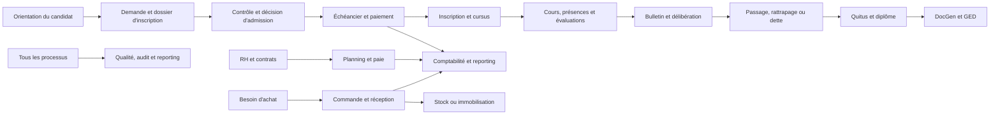

# EasyEcole — Guide détaillé des processus de l’application

> **Objet :** décrire les principaux processus métier d’EasyEcole, leurs acteurs, leur déroulement, leurs contrôles et les résultats attendus.
>
> **Périmètre :** parcours étudiant, pédagogie, finances, ressources humaines, achats et patrimoine, communication, e-learning, GED, génération de documents, qualité, administration et reporting.
>
> **Important :** ce guide consolide la documentation du dépôt. Il ne constitue pas une preuve que chaque étape est activée dans chaque environnement. Les rubriques « Limites et points à confirmer » signalent les fonctionnalités décrites comme partielles ou manquantes dans les documents de référence.

## Sommaire

1. [Lire ce guide](#1-lire-ce-guide)
2. [Vue d’ensemble des flux](#2-vue-densemble-des-flux)
3. [Accès, identité et configuration](#3-accès-identité-et-configuration)
4. [Orientation, admission et inscription](#4-orientation-admission-et-inscription)
5. [Réinscription et progression académique](#5-réinscription-et-progression-académique)
6. [Enseignement, présence et évaluations](#6-enseignement-présence-et-évaluations)
7. [Bulletins, jury, rattrapage et clôture](#7-bulletins-jury-rattrapage-et-clôture)
8. [Paiements des étudiants et comptabilité](#8-paiements-des-étudiants-et-comptabilité)
9. [Scolarité, demandes et vie étudiante](#9-scolarité-demandes-et-vie-étudiante)
10. [Stages et insertion](#10-stages-et-insertion)
11. [E-learning et suivi à distance](#11-e-learning-et-suivi-à-distance)
12. [Ressources humaines et paie](#12-ressources-humaines-et-paie)
13. [Achats, stocks et marchés](#13-achats-stocks-et-marchés)
14. [Immobilisations et patrimoine](#14-immobilisations-et-patrimoine)
15. [Communication et collaboration](#15-communication-et-collaboration)
16. [Documents officiels et signatures](#16-documents-officiels-et-signatures)
17. [GED, conservation et élimination](#17-ged-conservation-et-élimination)
18. [Qualité et amélioration continue](#18-qualité-et-amélioration-continue)
19. [Espace parents](#19-espace-parents)
20. [Administration, audit et reporting](#20-administration-audit-et-reporting)
21. [Contrôles transverses et limites](#21-contrôles-transverses-et-limites)
22. [Documentation de référence](#22-documentation-de-référence)

## 1. Lire ce guide

Chaque processus est décrit selon le même fil : **déclencheur**, **acteurs**, **étapes**, **contrôles**, puis **résultat**. Les noms exacts des rôles peuvent varier entre les documents fonctionnels, les rôles applicatifs et les comptes configurés dans l’établissement ; les droits effectifs sont ceux appliqués par l’environnement.

- **Flux documenté :** décrit par une documentation métier ou produit du dépôt.
- **À confirmer :** la documentation signale un écart, un statut partiel ou une règle qui dépend du paramétrage.
- Les validations, décisions et publications doivent être distinguées des simples saisies : elles peuvent avoir des effets sur l’accès, la comptabilité ou la génération de documents.

## 2. Vue d’ensemble des flux

Le parcours étudiant est le flux central. Les autres pôles produisent ou consomment des données liées : la comptabilité suit les paiements, la RH gère les personnels et enseignants, la GED conserve les pièces et preuves, tandis que le reporting consolide les indicateurs.

## 3. Accès, identité et configuration

### 3.1 Création et gestion des comptes

**Déclencheur :** arrivée d’un nouvel utilisateur, création administrative ou création liée à un parcours étudiant.

**Acteurs :** administrateur, institution, utilisateur concerné ; selon le cas, processus d’inscription.

1. Un compte est créé avec une identité, un email, un statut et un rôle applicatif.
2. Un profil métier peut compléter le compte : apprenant, enseignant, parent, personnel ou autre profil prévu.
3. L’administrateur associe les rôles et permissions nécessaires au domaine de travail.
4. L’utilisateur reçoit ou définit ses identifiants selon la procédure de l’établissement.
5. Les modifications de compte et les actions d’administration sont consultables dans les fonctions d’audit disponibles.

**Contrôles :** unicité des identifiants selon le référentiel, statut autorisé, séparation entre visibilité d’un menu et autorisation d’exécuter une action.

**Résultat :** compte utilisable avec un périmètre d’accès déterminé par les rôles et permissions.

### 3.2 Connexion et récupération d’accès

1. L’utilisateur transmet ses identifiants au formulaire de connexion.
2. Le système vérifie le compte et ses facteurs d’authentification configurés.
3. En cas de succès, une session applicative est établie ; les appels protégés sont associés à l’utilisateur connecté.
4. L’utilisateur peut demander une récupération de mot de passe selon les fonctions disponibles.
5. À la déconnexion ou à l’invalidation des sessions, les accès concernés ne doivent plus être réutilisables.

**À confirmer :** durées de session, rotation des jetons et procédure exacte de réinitialisation selon la version déployée ; consulter la configuration d’authentification de l’environnement.

### 3.3 Paramétrage avant une campagne

Avant l’ouverture des opérations, l’administration configure les référentiels nécessaires : établissement, année/session, parcours, cours/UE, niveaux/classes, frais, barèmes, règles de notation, types documentaires et rôles. Une incohérence à ce stade peut bloquer les inscriptions, la saisie des notes ou la production des documents en aval.

## 4. Orientation, admission et inscription

### 4.1 Orientation du candidat

**Déclencheur :** un candidat souhaite être conseillé sur un parcours.

**Acteurs :** candidat, comité d’orientation, administration.

1. Le candidat fournit son profil, son niveau d’étude et les informations utiles sur ses acquis.
2. Le système présente le catalogue de parcours, leurs niveaux, catégories, prérequis et débouchés lorsqu’ils sont renseignés.
3. Le candidat sélectionne un ou plusieurs parcours envisagés.
4. Le comité examine la demande et les éléments soumis.
5. Une réponse d’orientation est enregistrée ; le parcours retenu peut servir de cible à la demande d’inscription.

**Contrôles :** vérifier les prérequis du parcours et la cohérence entre le conseil d’orientation et le parcours demandé. Les règles d’acceptation doivent être confirmées dans le paramétrage local.

**Résultat :** candidat orienté vers un parcours, ou demande renvoyée pour complément/décision.

### 4.2 Dépôt et instruction d’une demande d’inscription

**Déclencheur :** ouverture d’une session de recrutement ou d’inscription.

**Acteurs :** candidat/apprenant, secrétariat, comité d’orientation, institution, administration.

1. L’établissement ouvre une session avec son calendrier, ses parcours et ses conditions.
2. Le candidat choisit la session et le parcours demandé, puis complète les informations requises.
3. Il téléverse les pièces justificatives demandées dans son dossier.
4. Le service compétent vérifie la complétude et la lisibilité du dossier. Une pièce manquante entraîne une demande de complément ou empêche la poursuite de l’instruction.
5. Le comité ou l’acteur désigné examine le dossier et enregistre une décision : validation, rejet ou demande de correction selon le workflow disponible.
6. Le candidat suit l’état de sa demande depuis son espace ou par les communications prévues.

**Contrôles :** session ouverte, parcours existant, pièces exigées présentes, décision attribuée à un acteur autorisé et traçable.

**Résultat :** dossier admis, refusé ou en attente de régularisation. La validation d’une demande n’est pas nécessairement équivalente à l’inscription définitive.

### 4.3 Paiement et finalisation de l’inscription

**Acteurs :** apprenant, caissier/banque, cabinet comptable ou comptabilité interne, institution/secrétariat.

1. Les frais applicables au parcours sont déterminés et un échéancier est établi.
2. L’apprenant effectue un paiement par un moyen activé par l’établissement et transmet le justificatif ou le bordereau lorsque le parcours l’exige.
3. Le caissier ou l’acteur de contrôle vérifie le paiement et l’authenticité des justificatifs.
4. La comptabilité enregistre ou impute l’opération lorsque cette étape est utilisée.
5. L’acteur habilité valide le bordereau. Un rejet doit conduire à une correction ou à une nouvelle preuve, plutôt qu’à considérer le paiement comme acquis.
6. L’administration termine l’affectation : création ou mise à jour du dossier étudiant, rattachement au cursus et aux cours, génération du matricule et des éléments d’identification prévus.
7. La carte étudiante et les notifications peuvent être générées selon la configuration.

**Contrôles :** concordance entre montant attendu, paiement reçu, étudiant et bordereau ; unicité du rattachement étudiant ; respect des validations requises avant inscription définitive.

**Résultat :** inscription finalisée et étudiant rattaché à son cursus, ou dossier restant en attente de paiement/validation.

**Limites à confirmer :** la séquence exacte de validation varie dans les documents existants (comité avant/après contrôle du paiement). Il faut appliquer l’ordre configuré par l’établissement et distinguer l’admission de la validation financière.

## 5. Réinscription et progression académique

### 5.1 Préparation de l’année ou du semestre

1. L’administration crée ou active la nouvelle session académique et ses périodes.
2. Elle rattache les parcours, classes, cours/UE, salles et créneaux nécessaires.
3. Les règles de contrôle des connaissances, coefficients, crédits et calendriers d’examen sont préparés.
4. Les enseignants et apprenants sont rattachés aux cours selon les responsabilités attribuées.

**Contrôle :** vérifier les dates, rattachements, crédits et règles d’évaluation avant de commencer les saisies.

### 5.2 Réinscription d’un étudiant

1. L’étudiant consulte son résultat et son admissibilité au passage.
2. Il initie ou planifie sa réinscription pour l’année ou le niveau suivant.
3. Il complète les étapes et pièces de réinscription exigées.
4. L’administration examine la planification et confirme ou rejette la demande.
5. Une fois confirmée, le cursus est actualisé et l’étudiant est rattaché à la nouvelle session/classe ; les frais et échéances applicables sont préparés.

**Contrôles :** décision de passage disponible, dettes académiques ou financières prises en compte selon les règles locales, documents requis complets.

**À confirmer :** disponibilité du workflow détaillé, pièces exigées et règles d’éligibilité dans la version active. Le [wizard de réinscription](CONCEPTION-WIZARD-REINSCRIPTION.md) décrit un parcours de conception.

## 6. Enseignement, présence et évaluations

### 6.1 Préparer et dispenser les cours

**Acteurs :** administration pédagogique, enseignants, apprenants.

1. L’établissement définit les cours/UE et leur rattachement aux parcours, niveaux ou classes.
2. Il affecte un enseignant, une période, un créneau et une salle.
3. L’enseignant prépare les chapitres, ressources et séances du cahier de texte.
4. À chaque séance, il enregistre les présences et absences, éventuellement avec les moyens de contrôle mis à disposition (dont QR code si activé).
5. Les absences sont consultables par les acteurs autorisés et alimentent le suivi scolaire.

**Résultat :** séance réalisée, contenu pédagogique tracé et présence enregistrée.

### 6.2 Saisir les évaluations

1. L’administration configure les modalités de contrôle des connaissances (MCC), types d’évaluation, coefficients et périodes.
2. L’enseignant crée ou utilise les évaluations prévues pour son cours.
3. Il saisit les notes des apprenants concernés.
4. Le système contrôle les données selon les règles disponibles et conserve les informations nécessaires à l’historique des notes.
5. Les notes peuvent rester en brouillon puis être publiées selon le workflow ; une note publiée ou une période verrouillée peut devenir non modifiable.
6. L’apprenant consulte les notes dès leur publication et selon ses droits.

**Contrôles :** bonne UE, bonne période, bon apprenant, barème cohérent, auteur autorisé, période de saisie ouverte et modifications traçables.

**À confirmer :** la pondération et les formules sont configurables et des écarts sont signalés dans les documents d’audit. Ne pas déduire une formule unique sans vérifier les MCC et règles réellement actives.

## 7. Bulletins, jury, rattrapage et clôture

### 7.1 Calcul et publication des résultats

1. Les notes et MCC de la période sont vérifiées.
2. Les moyennes sont calculées au niveau des évaluations, UE et périodes selon les règles configurées.
3. Les crédits, mentions, absences et résultats sont agrégés pour produire les bulletins ou relevés.
4. Un acteur habilité vérifie les résultats et lance la publication prévue.
5. Les étudiants consultent leurs résultats ; les documents peuvent ensuite être générés et archivés.

**Contrôles :** données complètes, règles de calcul actives, notes non ambiguës, journal des modifications disponible. Les règles de compensation, de crédits et de calcul de rattrapage sont propres au paramétrage.

### 7.2 Délibération et décision du jury

1. L’établissement prépare la session de délibération et désigne les membres du jury.
2. Le jury examine les résultats, absences, crédits et situations particulières.
3. Une décision est enregistrée pour chaque étudiant ou UE : admission/passage, rattrapage, redoublement ou autre décision prévue.
4. Les décisions sont historisées et un procès-verbal peut être produit.
5. La décision alimente la réinscription, le suivi des dettes académiques et, à terme, l’éligibilité à la diplomation.

**Contrôle :** décision prise par les acteurs autorisés et conservée avec sa date et ses justificatifs lorsqu’ils sont requis.

### 7.3 Rattrapage

1. L’administration définit une session et les cours/UE concernés.
2. Les étudiants éligibles identifient les rattrapages à passer et déposent une demande si le workflow le prévoit.
3. Le secrétariat ou l’administration vérifie l’éligibilité et traite la demande.
4. L’étudiant passe l’évaluation ; l’enseignant saisit le résultat.
5. Le résultat est réintégré dans le calcul prévu, puis le suivi de l’UE et les dettes académiques sont mis à jour.

**À confirmer :** calendrier, règles de remplacement/plafonnement de note et automatisation du traitement, car ces règles ne sont pas uniformes dans la documentation.

### 7.4 Clôture de période

1. L’administration vérifie que les saisies attendues et délibérations sont terminées.
2. Elle clôture le semestre ou la période selon le workflow disponible.
3. La clôture peut geler les notes et empêcher de nouvelles modifications.
4. Les résultats non validés alimentent le suivi des UE et les dettes académiques, selon les règles configurées.
5. Le semestre suivant est préparé et activé.

**Contrôle :** traiter les corrections et validations avant le gel ; vérifier les impacts irréversibles ou les procédures de réouverture avant de clôturer.

## 8. Paiements des étudiants et comptabilité

### 8.1 Suivi des frais et encaissements

1. L’établissement définit les frais par parcours, les échéances, réductions et éventuelles pénalités.
2. Une ligne de frais et un échéancier sont associés à l’étudiant.
3. L’étudiant consulte les montants dus et effectue un paiement.
4. Un bordereau ou une preuve de paiement est créé puis vérifié par le rôle financier habilité.
5. La comptabilité enregistre le paiement, l’impute aux frais concernés et met à jour le solde.
6. Le reçu, l’historique et le quitus peuvent être produits selon les règles de l’établissement.

**Contrôles :** rapprochement du paiement avec l’échéance et l’étudiant ; éviter de considérer un justificatif non vérifié comme un encaissement comptabilisé.

### 8.2 Comptabilité générale

1. L’établissement configure les exercices, comptes et journaux.
2. Les opérations de paiement, d’achat ou de paie sont saisies ou intégrées dans les écritures.
3. Les écritures sont contrôlées puis consultées par journal, compte, grand livre ou balance.
4. Les relevés bancaires peuvent être rapprochés des écritures si cette fonction est activée.
5. Les états financiers sont produits à partir des données validées et de l’exercice sélectionné.

**À confirmer :** la documentation de pôles signale des fonctions comptables avancées manquantes ou partielles (clôtures, budget, états réglementaires, rapprochement selon la version). La disponibilité doit être vérifiée avant de traiter ces étapes comme automatisées.

## 9. Scolarité, demandes et vie étudiante

### 9.1 Demande de document scolaire

1. L’étudiant choisit le document demandé (attestation, certificat, relevé ou autre type disponible) et soumet sa demande.
2. Le service scolaire vérifie l’identité, la scolarité et les conditions financières ou administratives applicables.
3. La demande est validée, rejetée ou renvoyée pour complément.
4. Le document est généré ou préparé, puis remis selon le canal retenu.
5. Le document officiel peut être archivé dans la GED et vérifié par sa référence si le format le permet.

**À confirmer :** les conditions de quitus, d’autorisation provisoire et de retrait physique ne sont pas uniformément décrites comme automatisées. Elles peuvent nécessiter un contrôle humain.

### 9.2 Réclamation, discipline et conseil de classe

- **Réclamation :** l’étudiant soumet un motif et les éléments utiles ; le service compétent instruit le cas, répond et clôture ou maintient le suivi.
- **Discipline :** un incident est examiné par les acteurs responsables ; la décision et les sanctions éventuelles sont enregistrées et communiquées selon les droits.
- **Conseil de classe :** les acteurs examinent la situation scolaire et formalisent les recommandations ou décisions de passage prévues.
- **Réorientation :** l’étudiant dépose une demande ; l’administration étudie le parcours, les prérequis et les places, puis accepte ou refuse.

**Contrôles :** confidentialité du dossier, décision attribuée à un responsable, date et motif traçables.

### 9.3 Bibliothèque et calendrier

Le service gère le catalogue des ouvrages, les prêts et retours selon les fonctions disponibles. Le calendrier rassemble les événements scolaires et administratifs publiés aux publics concernés.

## 10. Stages et insertion

**Acteurs :** entreprise, étudiant, service des stages, encadrants.

1. Une entreprise ou l’établissement publie une offre avec le sujet et la période.
2. L’étudiant consulte l’offre et dépose sa candidature.
3. Le service compétent instruit les candidatures et sélectionne ou affecte les étudiants.
4. Une convention est préparée avec les informations de l’étudiant, de l’établissement et de l’organisme d’accueil.
5. Le stage est suivi pendant sa période : présence, encadrement, pièces et rapport selon le processus local.
6. Le stage est évalué et son résultat est rattaché au dossier académique lorsque requis.

**Résultat :** candidature et convention suivies, puis stage évalué. Les étapes d’insertion post-stage dépendent des fonctions et procédures réellement utilisées.

## 11. E-learning et suivi à distance

**Acteurs :** enseignant, apprenant, administration pédagogique.

1. Un cours en ligne est rattaché à une UE/cours du catalogue pédagogique.
2. L’enseignant organise les contenus en modules et publie des supports (documents, vidéos ou autres formats pris en charge).
3. Il crée des quiz et devoirs, avec leurs consignes et échéances.
4. L’apprenant consulte les modules, répond aux quiz et dépose ses travaux.
5. L’enseignant consulte les réponses et soumissions, puis corrige ou fournit un retour.
6. Les échanges peuvent se poursuivre dans le salon de discussion du cours ; des notifications peuvent informer les participants.
7. La progression est enregistrée et un certificat peut être délivré lorsque les conditions du cours sont remplies.

**Contrôles :** rattachement à un cours autorisé, accès réservé aux participants, dates de remise et intégrité des fichiers selon les fonctions en place.

**À confirmer :** l’intégration d’une note de quiz/devoir dans le bulletin pédagogique n’est pas automatique par défaut ; elle dépend d’une décision et d’un paramétrage spécifiques.

## 12. Ressources humaines et paie

### 12.1 Gestion du personnel et contrats

1. Le service RH crée ou met à jour la fiche de l’employé et la relie au compte utilisateur approprié.
2. Il renseigne la catégorie professionnelle, la grille salariale et les informations contractuelles.
3. Pour un enseignant, le contrat RH doit rester cohérent avec les cours, le planning et les heures d’enseignement.
4. Les contrats suivent leur cycle de vie selon les états disponibles ; les documents associés peuvent être archivés dans la GED.

### 12.2 Temps, éléments variables et paie

1. Les périodes de paie sont préparées.
2. Le pointage, le planning, les heures supplémentaires et autres éléments variables sont collectés.
3. Les bulletins sont préparés avec leurs lignes de rémunération et retenues.
4. Un responsable vérifie et valide les bulletins.
5. Le paiement est enregistré ; les écritures comptables peuvent être produites ou intégrées.
6. Le bulletin et les justificatifs sont archivés et communiqués selon les accès prévus.

**Résultat :** paie validée et versée, avec une trace comptable et documentaire selon l’intégration active.

### 12.3 Recrutement, congés, prêts et prestataires

- **Recrutement :** publication d’une offre, réception des candidatures, examen puis décision et contractualisation. La documentation signale que le workflow de recrutement peut se limiter à des opérations CRUD et ne pas imposer toutes les transitions.
- **Congés :** consulter le solde, déposer une demande, faire valider par le responsable, puis suivre la période d’absence. Le workflow est signalé comme incomplet dans la documentation RH ; vérifier le traitement réel avant de s’y fier.
- **Prêts :** enregistrer le prêt, son montant et son échéancier, puis suivre les remboursements.
- **Prestataires :** référencer le prestataire, enregistrer les prestations et indemnités, puis assurer le contrôle et le paiement suivant la procédure financière.

## 13. Achats, stocks et marchés

### 13.1 Besoin et achat fournisseur

**Acteurs :** service demandeur, responsables valideurs, achats, fournisseur, réceptionnaire, comptabilité.

1. Un service exprime un besoin en précisant l’article, la quantité, l’urgence et le motif.
2. Le besoin est approuvé ou refusé selon le circuit de validation et le budget.
3. Les fournisseurs sont consultés et les propositions de prix comparées.
4. Une demande d’achat et, si nécessaire, un engagement budgétaire sont établis.
5. La commande est validée et transmise au fournisseur.
6. À la livraison, la réception est enregistrée et comparée à la commande.
7. La facture fournisseur est rapprochée de la commande et de la réception.
8. Les validations requises sont réalisées ; la comptabilité enregistre le paiement et l’écriture.
9. Les pièces sont archivées dans la GED.

**Contrôles :** autorisation budgétaire, validations complètes, quantité reçue, conformité facture/commande/réception et preuve du paiement.

### 13.2 Mouvement et inventaire de stock

1. Le service gère les articles, seuils minimums, catégories, fournisseurs et sites.
2. Chaque entrée ou sortie fait l’objet d’un mouvement qui met à jour le stock courant.
3. Une correction documente la quantité avant/après et son motif.
4. Un transfert précise le site source et destination, puis est validé.
5. Un inventaire compare la quantité théorique à la quantité observée ; les écarts sont expliqués avant clôture.
6. Un article obsolète, endommagé ou inutilisable peut être déclaré en rebut suivant le circuit prévu.

**Résultat :** stock suivi par article et site, avec l’historique de ses mouvements.

### 13.3 Marché public

1. L’établissement planifie le marché, son objet, sa période et son estimation.
2. Il enregistre les manifestations d’intérêt et les fournisseurs concernés.
3. L’appel d’offres est préparé, publié et dépouillé selon la procédure applicable.
4. Le marché est attribué et un contrat est enregistré.
5. Les modifications nécessaires sont formalisées en avenants.
6. Les commandes, réceptions et acquisitions associées suivent ensuite les processus achats et patrimoine.

**Important :** le système de gestion ne remplace pas les obligations légales de publication, de mise en concurrence et d’approbation applicables.

## 14. Immobilisations et patrimoine

1. Une immobilisation est enregistrée à la suite d’une acquisition, d’un don ou d’un transfert, avec sa catégorie, sa valeur et sa date.
2. Elle reçoit une référence d’identification et peut être étiquetée par QR code.
3. L’actif est affecté à un site, local ou responsable ; les changements d’affectation sont tracés.
4. Les amortissements sont calculés selon le mode et la durée définis dans la catégorie.
5. Les maintenances préventives ou correctives, coûts, prestataires et assurances sont suivis.
6. L’inventaire compare l’état enregistré à l’état constaté et documente les écarts.
7. Les sorties temporaires sont suivies jusqu’au retour.
8. En fin de vie, l’actif peut être cédé ou réformé/rebuté avec motif et approbation.

**Résultat :** historique patrimonial de l’acquisition à la sortie. Le lien entre amortissement et comptabilité doit être vérifié pour l’environnement concerné.

## 15. Communication et collaboration

### 15.1 Annonces et actualités

1. Un acteur autorisé rédige une annonce avec son contenu, sa catégorie et sa période de diffusion.
2. L’annonce est vérifiée et publiée auprès de la population visée.
3. Les utilisateurs consultent le fil d’actualité et reçoivent les notifications prévues.
4. L’annonce peut être modifiée ou retirée par un acteur autorisé.

### 15.2 Messagerie

Un utilisateur sélectionne des destinataires, rédige un message et l’envoie. Les participants consultent leurs échanges ; le système peut suivre la lecture et émettre des notifications. L’accès aux conversations doit rester limité aux participants et aux rôles habilités.

### 15.3 Suggestions et réclamations

1. L’utilisateur soumet une suggestion ou une réclamation.
2. L’administration la classe et l’assigne au service compétent.
3. Le service examine le sujet et peut demander des précisions.
4. Une réponse est enregistrée et le statut est mis à jour jusqu’au traitement.

## 16. Documents officiels et signatures

### 16.1 Génération d’un document

1. Le type de document est paramétré : catégorie, module source, template, signature requise et conservation.
2. Le demandeur ou le processus métier fournit les données de référence (identité, matricule, résultats, dates).
3. Le moteur applique le template et produit le document dans le format configuré.
4. Une référence unique est attribuée ; un QR code ou un mécanisme de vérification peut être inclus.
5. Si le type l’exige, le document suit un workflow de validation et de signature.
6. Le document final est remis à son destinataire et peut être versé dans la GED.

### 16.2 Vérification d’authenticité

Un tiers saisit les éléments de vérification exposés par le document (par exemple matricule et référence). Le système cherche la référence correspondante et retourne le résultat de vérification autorisé, sans exposer les données non nécessaires.

**Contrôles :** données de source exactes, modèle approuvé, signataires habilités, référence non ambiguë et accès public limité aux informations utiles à l’authenticité.

## 17. GED, conservation et élimination

### 17.1 Versement et classement

1. Un document est téléversé ou reçu automatiquement d’un module métier.
2. Il est classé par domaine, type documentaire, dossier, tags et niveau de confidentialité.
3. Les métadonnées de conservation et la DUA sont appliquées lorsqu’elles sont définies.
4. Une empreinte d’intégrité et les informations de versement peuvent être conservées.
5. Les utilisateurs ne consultent que les documents autorisés par leurs permissions.

### 17.2 Consultation, version et courrier

Les utilisateurs recherchent les documents auxquels ils ont accès, consultent leurs métadonnées et versions, et enregistrent les courriers entrants/sortants selon le processus. Les consultations et opérations sensibles peuvent être tracées.

### 17.3 Conservation et élimination

1. Le système ou l’archiviste suit la date de fin de DUA et le statut du document.
2. À échéance, le document est présenté comme éligible à l’élimination selon le référentiel.
3. Un responsable contrôle les obligations légales, les litiges et les éventuels blocages.
4. L’élimination est validée ou rejetée et le registre de décision est conservé.

**À confirmer :** l’application de la durée de conservation, la gestion d’archives physiques et la destruction automatique sont signalées comme partielles ou à compléter. Une date de DUA n’autorise pas à elle seule la suppression d’une pièce.

## 18. Qualité et amélioration continue

### 18.1 Non-conformité et action corrective

1. Un écart est déclaré avec sa source, sa gravité, le processus concerné et les preuves utiles.
2. Un responsable analyse la cause et définit une action corrective avec un pilote et une échéance.
3. L’avancement et les éléments de preuve sont suivis.
4. L’efficacité de l’action est vérifiée ; l’écart est clôturé ou réouvert si le problème persiste.

### 18.2 Audit, revue de direction et satisfaction

- **Audit :** planifier l’audit, conduire les vérifications, enregistrer les constats/pistes et créer des actions si nécessaire.
- **Revue de direction :** examiner les indicateurs, audits, risques et actions ; enregistrer les décisions, responsables et échéances.
- **Enquête :** définir les publics et questions, collecter les réponses, analyser les résultats puis transmettre les axes d’amélioration à la revue.

**Résultat :** décisions et actions traçables alimentant l’amélioration des processus.

## 19. Espace parents

1. Le compte parent est créé ou associé à l’apprenant selon le processus d’inscription et les données fournies.
2. Le lien parent-enfant est vérifié et maintenu par un acteur autorisé.
3. Le parent consulte les informations disponibles : notes, absences, emploi du temps, paiements et documents.
4. Les données affichées proviennent des processus pédagogiques, financiers et de scolarité.

**Contrôle essentiel :** le parent ne doit consulter que les apprenants liés à son compte ; l’espace est principalement en lecture seule.

## 20. Administration, audit et reporting

### 20.1 Administration du système

L’administration gère les utilisateurs, rôles, permissions, établissements, années scolaires, paramètres, modèles et configurations nécessaires aux modules. Toute modification de droits doit respecter le principe du moindre privilège et être vérifiable.

### 20.2 Reporting

1. Les modules métier enregistrent leurs opérations dans leurs référentiels respectifs.
2. Les tableaux de bord regroupent les indicateurs disponibles : effectifs, notes, paiements, paie, progression et qualité, selon les vues configurées.
3. La direction filtre et consulte les résultats pour le suivi opérationnel.
4. Les données agrégées doivent être rapprochées des modules sources avant toute décision financière ou réglementaire.

**À confirmer :** la fraîcheur des vues, les filtres d’établissement et les droits d’accès. Certaines vues matérialisées peuvent nécessiter une synchronisation après une initialisation ou un rechargement de données.

## 21. Contrôles transverses et limites

- **Identité et rattachements :** contrôler le bon étudiant, parent, enseignant, établissement, cours et période avant toute validation.
- **Séparation des tâches :** lorsque plusieurs acteurs sont prévus, distinguer la saisie, le contrôle et l’approbation.
- **Traçabilité :** conserver l’acteur, la date, le statut, le motif et les pièces justificatives des décisions importantes.
- **Confidentialité :** limiter les notes, données RH, pièces d’identité et documents sensibles aux rôles habilités.
- **Statuts :** ne pas confondre brouillon, soumis, validé, publié, payé, clôturé ou archivé ; les transitions disponibles dépendent du module.
- **Paramétrage :** les frais, formules de notes, crédits, délais, exigences documentaires et règles de conservation peuvent varier selon l’établissement.
- **Écarts documentaires :** certaines fiches décrivent des fonctions comme implémentées tandis que d’autres signalent des lacunes. En cas de contradiction, vérifier le contrôleur/service et les tests de la version déployée avant de s’appuyer sur une automatisation.
- **Conformité externe :** les étapes dans l’application ne remplacent pas les validations réglementaires, comptables, archivistiques ou éducatives propres au pays et à l’établissement.

## 22. Documentation de référence

- [Index de la documentation](00-INDEX.md)
- [Documentation produit](DOCUMENTATION-PRODUIT.md)
- [Logique métier par pôle et relations inter-pôles](LOGIQUE-METIER-POLES.md)
- [Diagrammes des cas d’utilisation](DIAGRAMMES-CAS-UTILISATION.md)
- [Pôle pédagogique](01-PEDAGOGIQUE.md)
- [Pôle financier](02-FINANCIER.md)
- [Pôle ressources humaines](03-RH.md)
- [Communication](04-COMMUNICATION.md)
- [GED](05-GED.md)
- [E-learning](06-ELEARNING.md)
- [Espace parents](07-PARENTS.md)
- [Administration et système](08-ADMIN.md)
- [Génération de documents](09-DOCGEN.md)
- [Gaps et conformité qualité](11-GAPS-ISO.md)
- [Spécification fonctionnelle](FONCTIONNEL-SPECIFICATION.md)
- [Relations entre les tables](LIAISONS-TABLES-BDD.md)
- [Commandes et scénarios E2E](COMMANDES-E2E.md)
