# Guide d'utilisation — Administrateur

> Administration du système : comptes et rôles, configuration, sauvegardes, sécurité, menus, modules transverses et supervision technique.

**Profil :** Administrateur  
**Nombre d'écrans :** 187  
**Généré le :** 02/11/2026

Ce guide présente les écrans du profil dans l'ordre d'utilisation conseillé. Chaque section contient une capture, l'objectif de l'écran et les actions principales.

## Sommaire

1. [Sessions d’inscription](#1-sessions-d-inscription)
2. [Parcours](#2-parcours)
3. [Salles de classe](#3-salles-de-classe)
4. [Frais par parcours](#4-frais-par-parcours)
5. [Demandes](#5-demandes)
6. [Effectifs inscrits](#6-effectifs-inscrits)
7. [Demandes d'orientation](#7-demandes-d-orientation)
8. [Parcours d'orientation](#8-parcours-d-orientation)
9. [Préinscriptions](#9-preinscriptions)
10. [Mes bordereaux](#10-mes-bordereaux)
11. [Désignation du directeur de mémoire](#11-designation-du-directeur-de-memoire)
12. [Configurations](#12-configurations)
13. [Attributions](#13-attributions)
14. [Campagne de bourses](#14-campagne-de-bourses)
15. [Dossiers étudiants](#15-dossiers-etudiants)
16. [Cartes étudiantes](#16-cartes-etudiantes)
17. [Arborescence des dossiers](#17-arborescence-des-dossiers)
18. [Registres](#18-registres)
19. [Équivalences](#19-equivalences)
20. [Dispenses](#20-dispenses)
21. [Réorientation](#21-reorientation)
22. [Réclamations](#22-reclamations)
23. [Traiter les réclamations](#23-traiter-les-reclamations)
24. [Emplois du temps](#24-emplois-du-temps)
25. [Calendrier](#25-calendrier)
26. [Sessions d'examens](#26-sessions-d-examens)
27. [Rattrapages](#27-rattrapages)
28. [Décisions de passage](#28-decisions-de-passage)
29. [Enseignants](#29-enseignants)
30. [Cahiers de texte](#30-cahiers-de-texte)
31. [Cahier de présence](#31-cahier-de-presence)
32. [Notes](#32-notes)
33. [Bibliothèque](#33-bibliotheque)
34. [Gestion de la bibliothèque](#34-gestion-de-la-bibliotheque)
35. [Bulletins](#35-bulletins)
36. [Moyennes](#36-moyennes)
37. [Audit des notes](#37-audit-des-notes)
38. [Paramètres de notation](#38-parametres-de-notation)
39. [Délibérations & jury](#39-deliberations-jury)
40. [Absences](#40-absences)
41. [Sanctions & discipline](#41-sanctions-discipline)
42. [Conseils de classe](#42-conseils-de-classe)
43. [Annonces](#43-annonces)
44. [Vie estudiantine](#44-vie-estudiantine)
45. [Suggestions](#45-suggestions)
46. [Offres de stage](#46-offres-de-stage)
47. [Demandes de stage](#47-demandes-de-stage)
48. [Entreprises](#48-entreprises)
49. [Paiements](#49-paiements)
50. [Échéances](#50-echeances)
51. [Situation irrégulière](#51-situation-irreguliere)
52. [Situation financière](#52-situation-financiere)
53. [Validation des bordereaux](#53-validation-des-bordereaux)
54. [Validation comité](#54-validation-comite)
55. [Bordereaux à imputer](#55-bordereaux-a-imputer)
56. [Bordereaux en attente](#56-bordereaux-en-attente)
57. [Bordereaux traités](#57-bordereaux-traites)
58. [Bordereaux rejetés](#58-bordereaux-rejetes)
59. [Types de bordereau](#59-types-de-bordereau)
60. [Comptabilité](#60-comptabilite)
61. [Catégories](#61-categories)
62. [Transferts](#62-transferts)
63. [Corrections](#63-corrections)
64. [Rebuts](#64-rebuts)
65. [Inventaires](#65-inventaires)
66. [Fournisseurs](#66-fournisseurs)
67. [Reportings](#67-reportings)
68. [Cycle de vie](#68-cycle-de-vie)
69. [Sites](#69-sites)
70. [Catégories — vue 2](#70-categories-vue-2)
71. [Affectations](#71-affectations)
72. [Assurances](#72-assurances)
73. [Sorties provisoires](#73-sorties-provisoires)
74. [Cessions](#74-cessions)
75. [Rebuts — vue 2](#75-rebuts-vue-2)
76. [Maintenance](#76-maintenance)
77. [Inventaires — vue 2](#77-inventaires-vue-2)
78. [Reportings — vue 2](#78-reportings-vue-2)
79. [Catégories professionnelles](#79-categories-professionnelles)
80. [Grilles salariales](#80-grilles-salariales)
81. [Paramètres de paie](#81-parametres-de-paie)
82. [Heures supplémentaires](#82-heures-supplementaires)
83. [Prêts et avances](#83-prets-et-avances)
84. [Prestataires](#84-prestataires)
85. [Indemnités prestataires](#85-indemnites-prestataires)
86. [Contrats](#86-contrats)
87. [Planning du personnel](#87-planning-du-personnel)
88. [Reportings RH](#88-reportings-rh)
89. [Discussions](#89-discussions)
90. [Bordereaux](#90-bordereaux)
91. [Mes cours](#91-mes-cours)
92. [Cours vidéo](#92-cours-video)
93. [Cours PDF](#93-cours-pdf)
94. [Quiz](#94-quiz)
95. [Progression](#95-progression)
96. [Certificats](#96-certificats)
97. [Devoirs](#97-devoirs)
98. [Catalogue e-learning](#98-catalogue-e-learning)
99. [Utilisateurs](#99-utilisateurs)
100. [QR codes](#100-qr-codes)
101. [Journal d'audit](#101-journal-d-audit)
102. [Configuration](#102-configuration)
103. [Membres du comité](#103-membres-du-comite)
104. [Profils d'accès](#104-profils-d-acces)
105. [Mon profil](#105-mon-profil)
106. [Mon compte](#106-mon-compte)
107. [École](#107-ecole)
108. [Année scolaire](#108-annee-scolaire)
109. [Frais](#109-frais)
110. [Notifications](#110-notifications)
111. [Système](#111-systeme)
112. [Sauvegardes](#112-sauvegardes)
113. [Types de documents](#113-types-de-documents)
114. [Modèles de documents](#114-modeles-de-documents)
115. [Cachet électronique](#115-cachet-electronique)
116. [Workflows documentaires](#116-workflows-documentaires)
117. [Tous les documents](#117-tous-les-documents)
118. [Générer un document](#118-generer-un-document)
119. [Diplômes](#119-diplomes)
120. [Demandes de documents](#120-demandes-de-documents)
121. [Mes documents](#121-mes-documents)
122. [Traiter les demandes](#122-traiter-les-demandes)
123. [Demandes VAE](#123-demandes-vae)
124. [Signatures](#124-signatures)
125. [Signature direction](#125-signature-direction)
126. [Demandes de documents](#126-demandes-de-documents)
127. [Tableau de bord](#127-tableau-de-bord)
128. [Encaissement](#128-encaissement)
129. [Caisse](#129-caisse)
130. [Clôture de caisse](#130-cloture-de-caisse)
131. [Demandes — vue 2](#131-demandes-vue-2)
132. [Autorisations provisoires](#132-autorisations-provisoires)
133. [Types de documents — vue 2](#133-types-de-documents-vue-2)
134. [Journal de caisse](#134-journal-de-caisse)
135. [Tableau de bord du superviseur](#135-tableau-de-bord-du-superviseur)
136. [Mon tableau de bord](#136-mon-tableau-de-bord)
137. [Unités d'enseignement](#137-unites-d-enseignement)
138. [Planifications](#138-planifications)
139. [Avis à manifestation d’intérêt](#139-avis-a-manifestation-d-interet)
140. [Appels d'offres](#140-appels-d-offres)
141. [Contrats — vue 2](#141-contrats-vue-2)
142. [Avenants](#142-avenants)
143. [Comptes bancaires](#143-comptes-bancaires)
144. [Relevés bancaires](#144-releves-bancaires)
145. [Rapprochement bancaire](#145-rapprochement-bancaire)
146. [Demandes d'achat](#146-demandes-d-achat)
147. [Validations](#147-validations)
148. [Commandes](#148-commandes)
149. [Réceptions](#149-receptions)
150. [Factures](#150-factures)
151. [Fournisseurs — vue 2](#151-fournisseurs-vue-2)
152. [Budgets](#152-budgets)
153. [Articles](#153-articles)
154. [Mouvements](#154-mouvements)
155. [Besoins](#155-besoins)
156. [Demandes de prix](#156-demandes-de-prix)
157. [Immobilisations](#157-immobilisations)
158. [Employés](#158-employes)
159. [Offres d'emploi](#159-offres-d-emploi)
160. [Candidatures](#160-candidatures)
161. [Paie](#161-paie)
162. [Prestations](#162-prestations)
163. [Formations](#163-formations)
164. [Évaluations](#164-evaluations)
165. [Demandes de congé](#165-demandes-de-conge)
166. [Soldes de congé](#166-soldes-de-conge)
167. [Terminal de pointage](#167-terminal-de-pointage)
168. [Historique](#168-historique)
169. [Shifts](#169-shifts)
170. [Absences — vue 2](#170-absences-vue-2)
171. [Planning](#171-planning)
172. [Rapports](#172-rapports)
173. [Tableau de bord de pilotage](#173-tableau-de-bord-de-pilotage)
174. [Effectifs](#174-effectifs)
175. [Notes — vue 2](#175-notes-vue-2)
176. [Paiements — vue 2](#176-paiements-vue-2)
177. [Ressources humaines](#177-ressources-humaines)
178. [Catalogue](#178-catalogue)
179. [Recherche avancée](#179-recherche-avancee)
180. [Dossiers](#180-dossiers)
181. [Téléverser un document](#181-televerser-un-document)
182. [Conservation](#182-conservation)
183. [Gestion e-learning](#183-gestion-e-learning)
184. [Non-conformités](#184-non-conformites)
185. [Audits](#185-audits)
186. [Revues de direction](#186-revues-de-direction)
187. [Enquêtes de satisfaction](#187-enquetes-de-satisfaction)

## 1. Sessions d’inscription

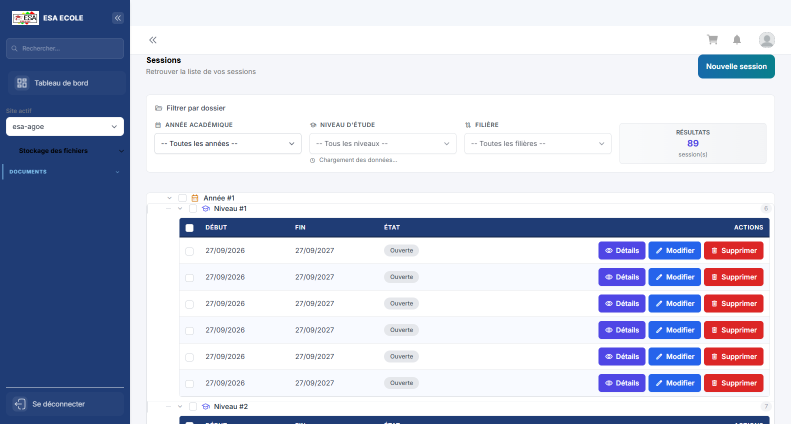

**Objectif :** Sessions d’inscription par année académique et niveau : période d’ouverture, pièces et frais associés.

**Actions principales :**

1. Créer une session
2. Définir la période et les pièces
3. Ouvrir ou clôturer la session

---

## 2. Parcours

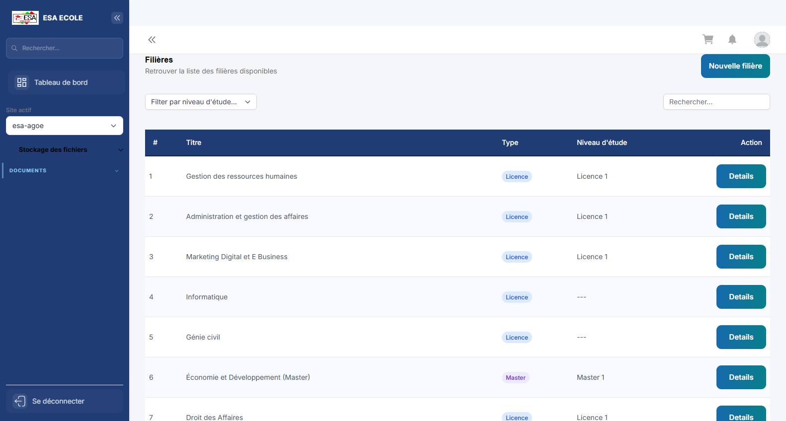

**Objectif :** Catalogue des parcours de formation : niveaux, UE, crédits et conditions d’accès.

**Actions principales :**

1. Créer ou modifier un parcours
2. Rattacher les UE
3. Vérifier les prérequis

---

## 3. Salles de classe

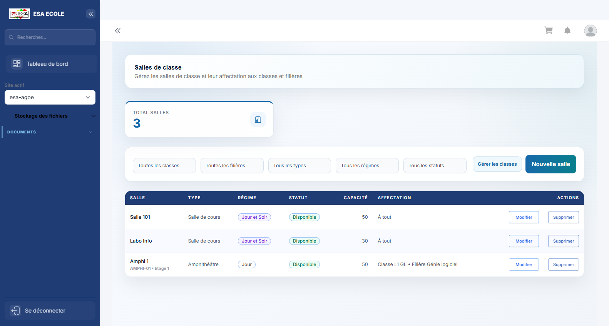

**Objectif :** Référentiel des salles et de leurs capacités, utilisé pour les emplois du temps et les examens.

**Actions principales :**

1. Créer une salle
2. Renseigner la capacité
3. Affecter aux cours ou examens

---

## 4. Frais par parcours

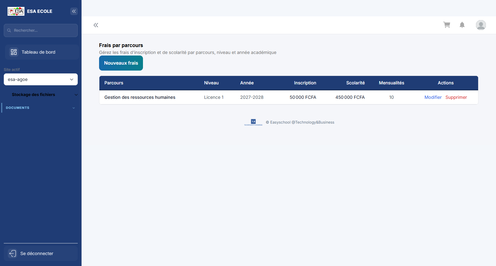

**Objectif :** Grille des frais de scolarité par parcours, niveau et année académique.

**Actions principales :**

1. Choisir le parcours
2. Définir les tranches et échéances
3. Enregistrer la grille

---

## 5. Demandes

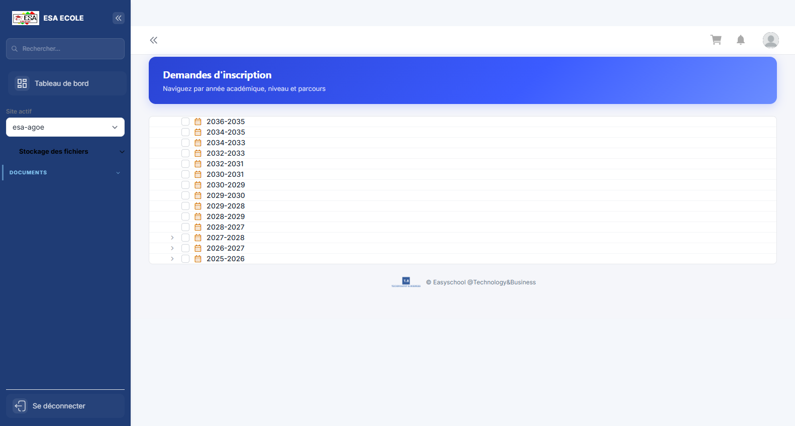

**Objectif :** File des demandes d’inscription ou de réinscription avec leur statut dans le pipeline.

**Actions principales :**

1. Filtrer par statut
2. Ouvrir un dossier
3. Faire avancer l’étape

---

## 6. Effectifs inscrits

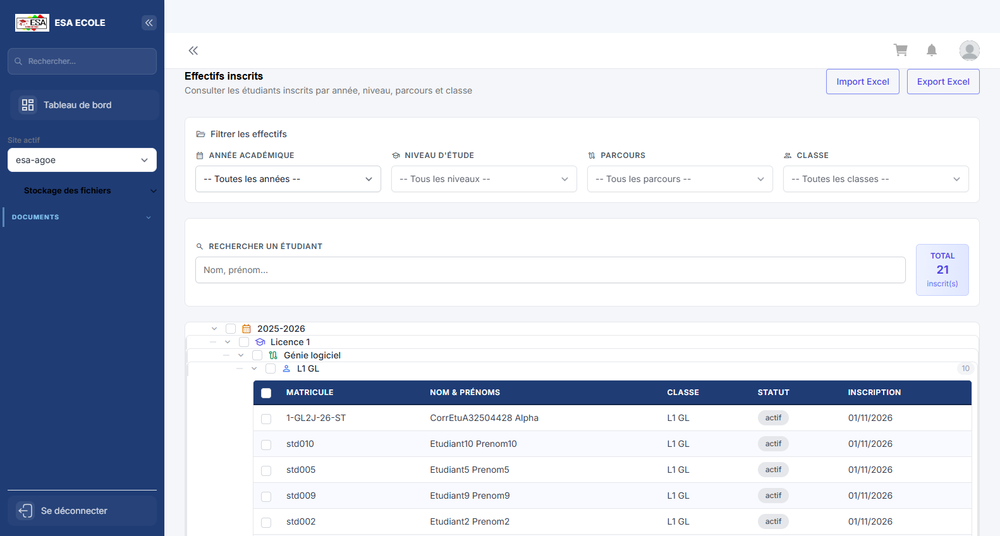

**Objectif :** Liste et statistiques des étudiants effectivement inscrits pour l’année ou la session sélectionnée.

**Actions principales :**

1. Choisir l’année et le parcours
2. Vérifier les inscrits
3. Exporter ou ouvrir un dossier

---

## 7. Demandes d'orientation

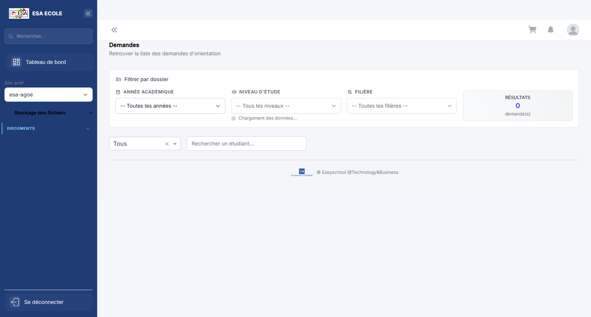

**Objectif :** Demandes d’orientation des candidats : choix de parcours, pièces et décision du comité.

**Actions principales :**

1. Consulter les demandes
2. Vérifier les pièces
3. Instruire ou orienter

---

## 8. Parcours d'orientation

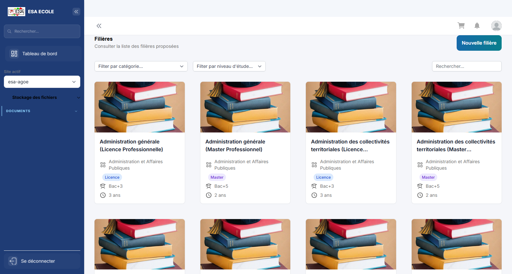

**Objectif :** Parcours proposés à l’orientation, avec leurs débouchés et conditions d’admission.

**Actions principales :**

1. Consulter l’offre
2. Associer les niveaux
3. Publier les parcours

---

## 9. Préinscriptions

**Objectif :** Préinscriptions reçues : contrôle des informations, des pièces et des vœux du candidat.

**Actions principales :**

1. Ouvrir une préinscription
2. Contrôler le dossier
3. Valider ou demander une correction

---

## 10. Mes bordereaux

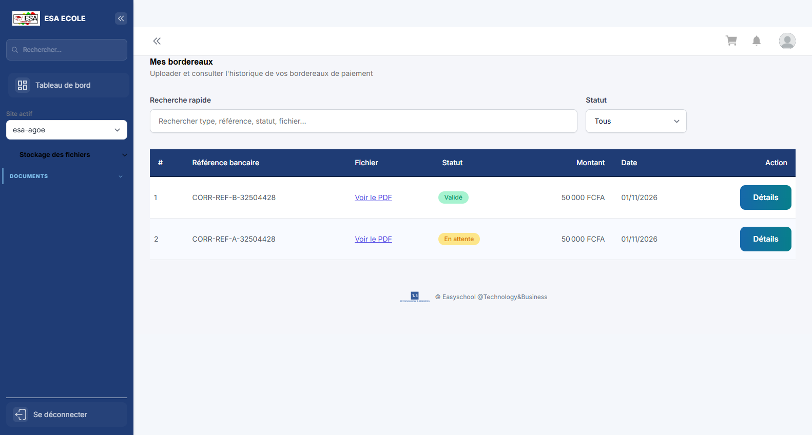

**Objectif :** Bordereaux déposés par l’étudiant (ou suivis par le profil) avec leur état d’authentification et d’imputation.

**Actions principales :**

1. Déposer ou consulter un bordereau
2. Suivre son statut
3. Télécharger le reçu

---

## 11. Désignation du directeur de mémoire

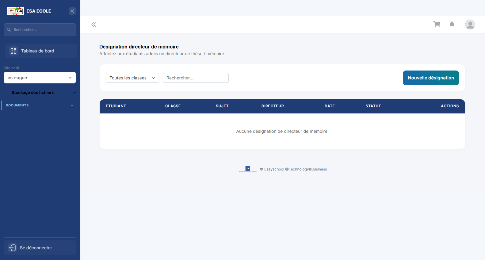

**Objectif :** Affectation des directeurs de mémoire aux étudiants et suivi des encadrements.

**Actions principales :**

1. Choisir les étudiants
2. Proposer un directeur
3. Valider l’affectation

---

## 12. Configurations

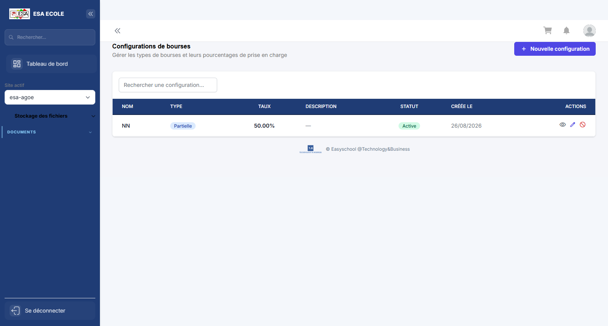

**Objectif :** Paramétrage du module : règles, barèmes et options appliquées aux dossiers.

**Actions principales :**

1. Choisir la configuration
2. Modifier les paramètres
3. Enregistrer et tester

---

## 13. Attributions

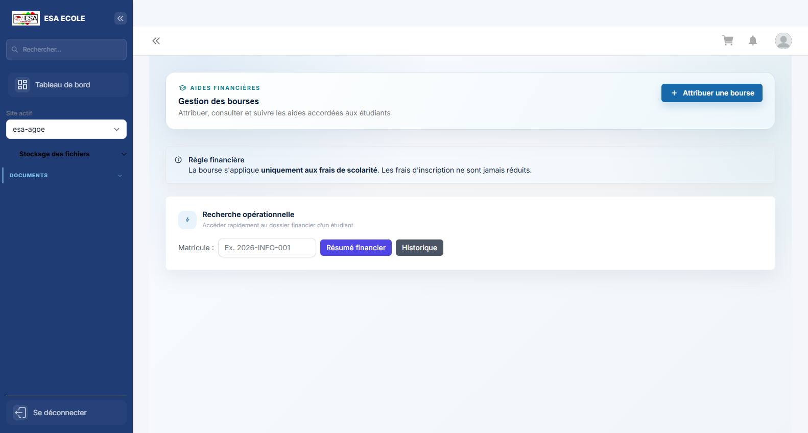

**Objectif :** Attribution des droits, responsabilités ou avantages aux personnes concernées.

**Actions principales :**

1. Rechercher la personne
2. Choisir l’attribution
3. Valider la période

---

## 14. Campagne de bourses

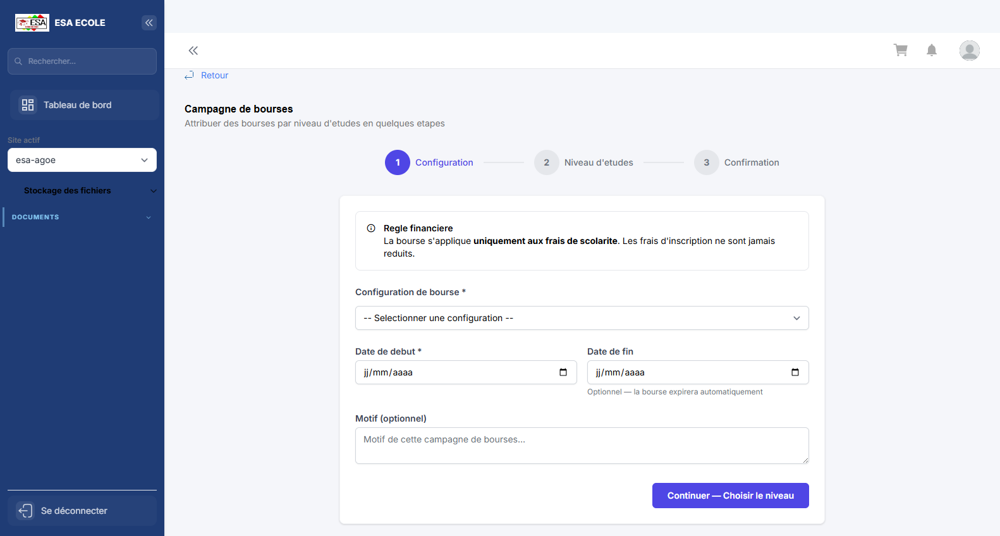

**Objectif :** Campagne d’attribution des bourses : critères, candidats et décisions.

**Actions principales :**

1. Ouvrir la campagne
2. Examiner les candidatures
3. Attribuer ou refuser

---

## 15. Dossiers étudiants

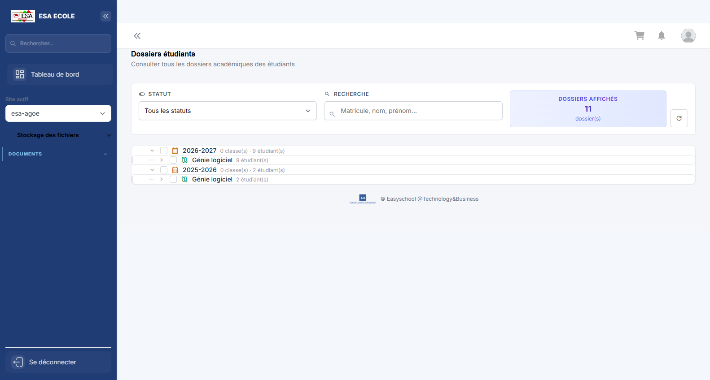

**Objectif :** Base des dossiers étudiants : recherche, complétude et historique administratif.

**Actions principales :**

1. Rechercher un étudiant
2. Contrôler les pièces
3. Ouvrir le dossier complet

---

## 16. Cartes étudiantes

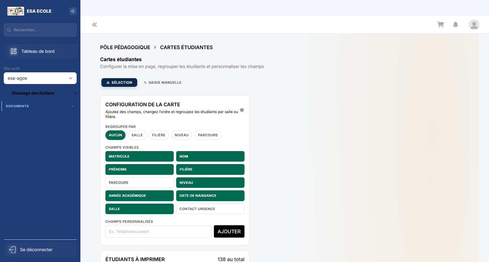

**Objectif :** Génération et suivi des cartes étudiantes avec photo, matricule et QR code.

**Actions principales :**

1. Sélectionner les étudiants
2. Vérifier la photo
3. Générer ou imprimer les cartes

---

## 17. Arborescence des dossiers

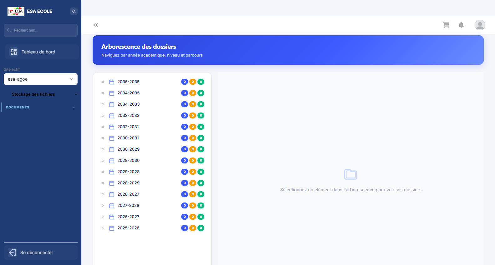

**Objectif :** Classement hiérarchique des dossiers et documents (étudiant, promotion, année).

**Actions principales :**

1. Parcourir l’arborescence
2. Ouvrir un dossier
3. Déplacer ou archiver

---

## 18. Registres

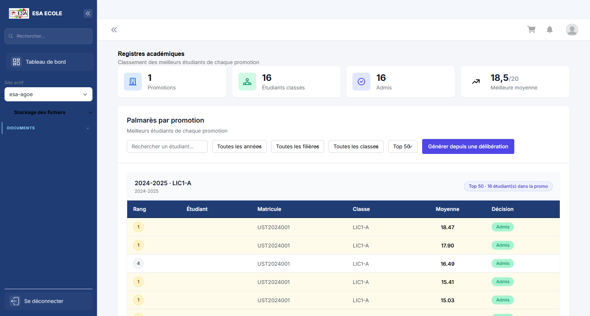

**Objectif :** Registres officiels : inscriptions, présences, délibérations et registres réglementaires.

**Actions principales :**

1. Choisir le registre
2. Filtrer par année
3. Consulter ou exporter

---

## 19. Équivalences

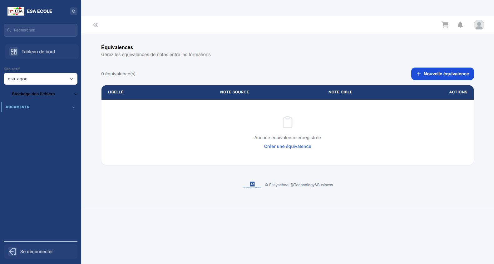

**Objectif :** Reconnaissance d’UE ou de crédits obtenus ailleurs.

**Actions principales :**

1. Créer une demande
2. Joindre les justificatifs
3. Valider l’équivalence

---

## 20. Dispenses

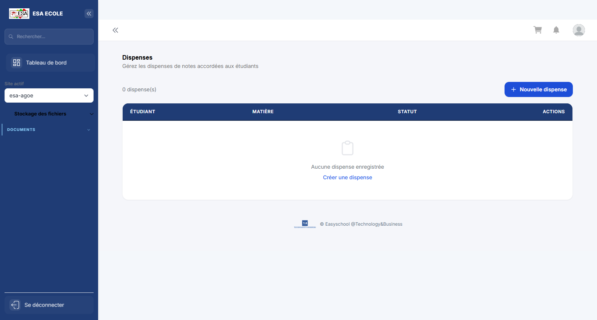

**Objectif :** Dispenses d’assiduité ou d’épreuve accordées à un étudiant.

**Actions principales :**

1. Choisir l’étudiant
2. Renseigner le motif
3. Valider la dispense

---

## 21. Réorientation

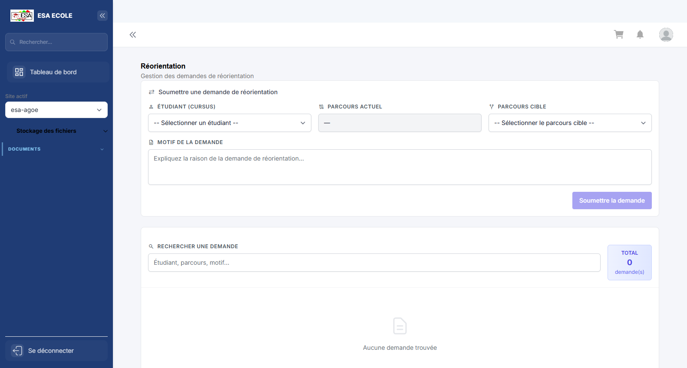

**Objectif :** Demandes de réorientation vers un autre parcours ou niveau.

**Actions principales :**

1. Créer une demande
2. Joindre les motifs
3. Suivre la décision

---

## 22. Réclamations

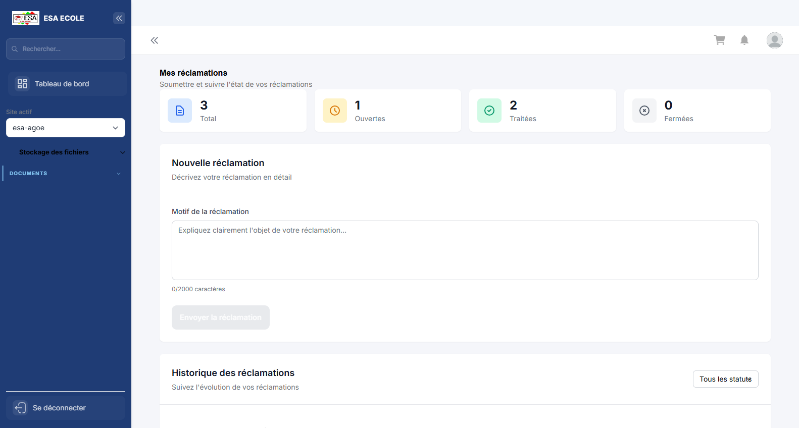

**Objectif :** Dépôt et suivi des réclamations (notes, scolarité, discipline, paiement).

**Actions principales :**

1. Créer une réclamation
2. Joindre les pièces
3. Suivre le statut

---

## 23. Traiter les réclamations

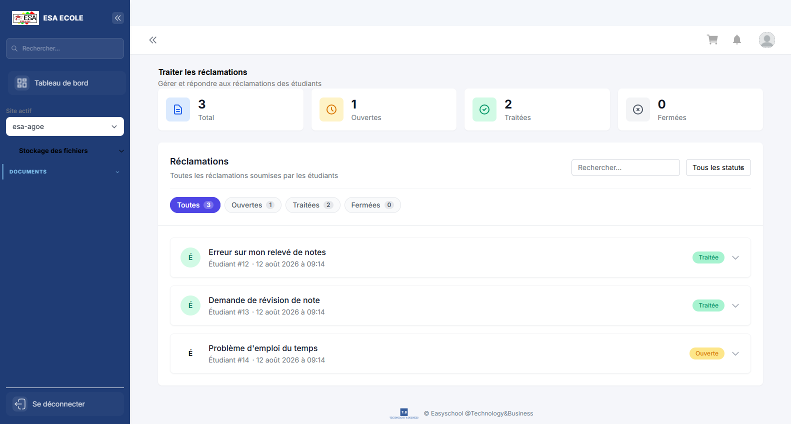

**Objectif :** File de traitement des réclamations : instruction, réponse et clôture.

**Actions principales :**

1. Ouvrir une réclamation
2. Instruire le dossier
3. Répondre et clôturer

---

## 24. Emplois du temps

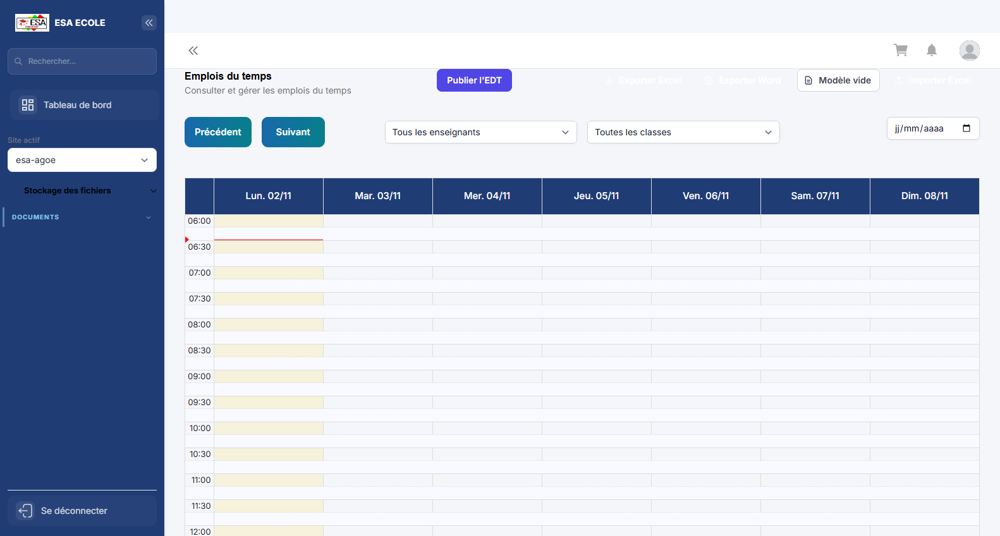

**Objectif :** Planning des cours par classe, enseignant et salle.

**Actions principales :**

1. Choisir la classe ou l’enseignant
2. Consulter le planning
3. Détecter les conflits

---

## 25. Calendrier

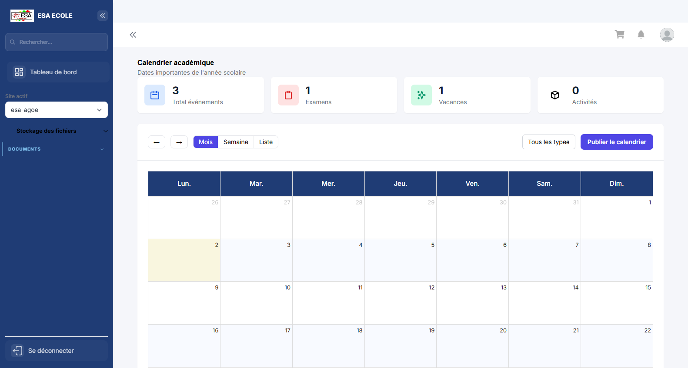

**Objectif :** Calendrier académique : sessions, examens, périodes de saisie et événements de l’établissement.

**Actions principales :**

1. Choisir la période
2. Consulter un événement
3. S’abonner ou exporter le calendrier

---

## 26. Sessions d'examens

**Objectif :** Programmation des examens : dates, salles, surveillants et épreuves.

**Actions principales :**

1. Créer une session
2. Affecter salles et surveillants
3. Publier le planning

---

## 27. Rattrapages

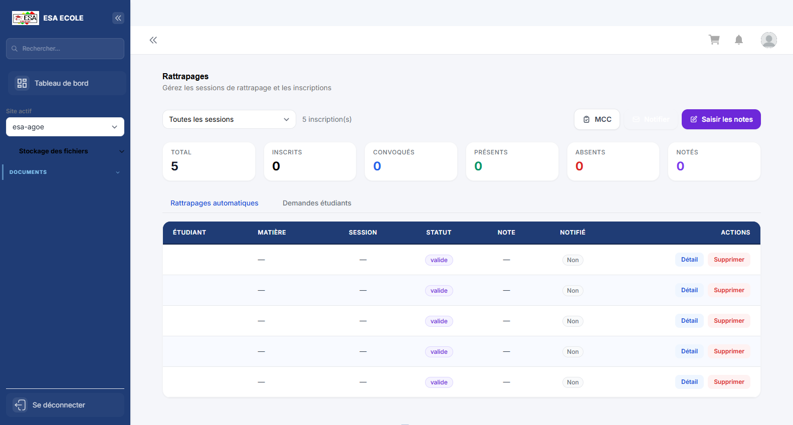

**Objectif :** Sessions de rattrapage : inscription, épreuves et résultats.

**Actions principales :**

1. Créer une session
2. Inscrire les étudiants
3. Saisir les résultats

---

## 28. Décisions de passage

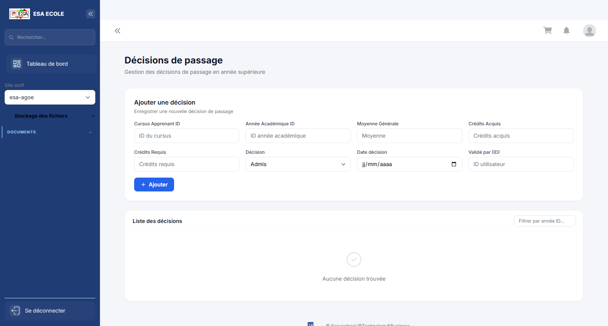

**Objectif :** Décisions de passage en année supérieure ou de redoublement.

**Actions principales :**

1. Préparer les propositions
2. Valider en jury
3. Notifier les étudiants

---

## 29. Enseignants

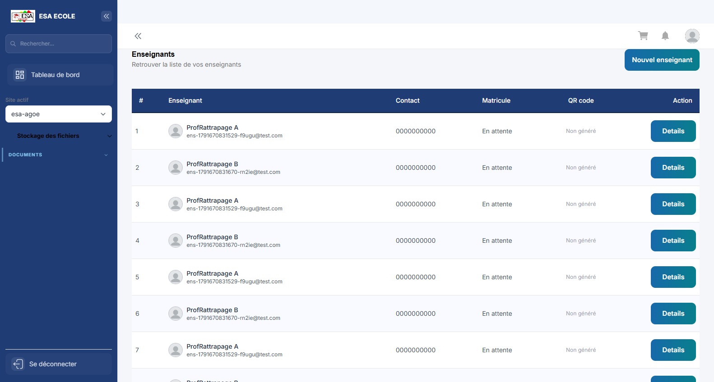

**Objectif :** Référentiel des enseignants : profil, spécialités, affectations et badge de pointage.

**Actions principales :**

1. Créer ou modifier un enseignant
2. Affecter aux cours
3. Générer le badge

---

## 30. Cahiers de texte

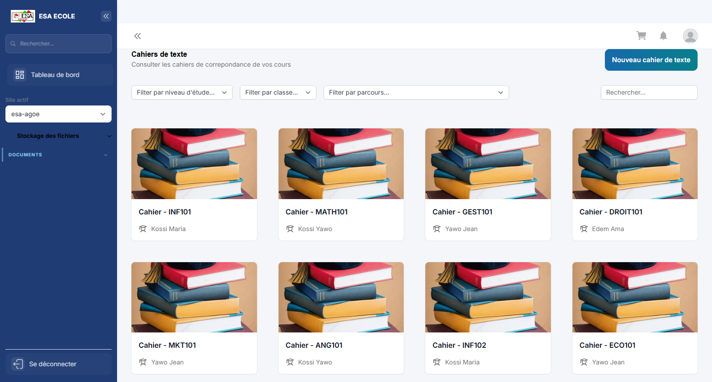

**Objectif :** Contenu des séances : objectifs, activités, devoirs et ressources.

**Actions principales :**

1. Choisir la classe et la séance
2. Renseigner le contenu
3. Publier pour les étudiants

---

## 31. Cahier de présence

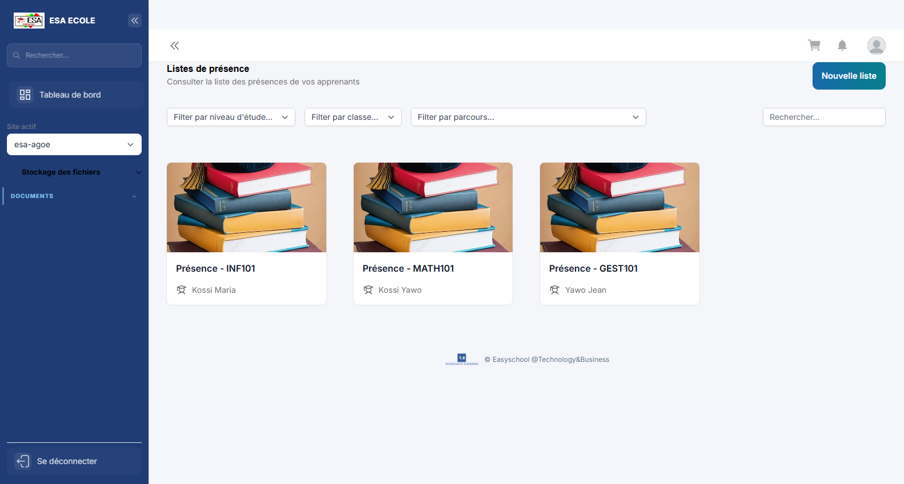

**Objectif :** Appel et suivi des présences par séance, avec motif d’absence.

**Actions principales :**

1. Ouvrir la séance
2. Marquer les présents et absents
3. Enregistrer

---

## 32. Notes

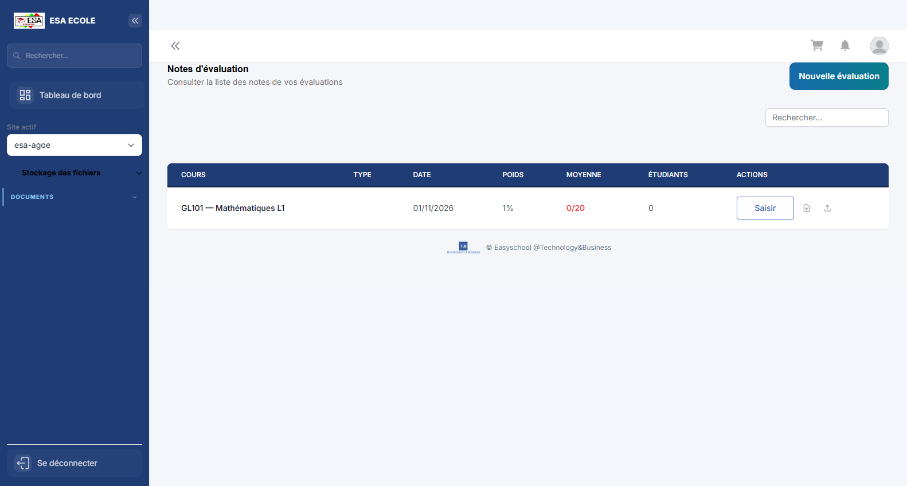

**Objectif :** Saisie et consultation des notes par classe, UE et type d’évaluation.

**Actions principales :**

1. Choisir la classe et l’UE
2. Saisir les notes
3. Vérifier puis publier

---

## 33. Bibliothèque

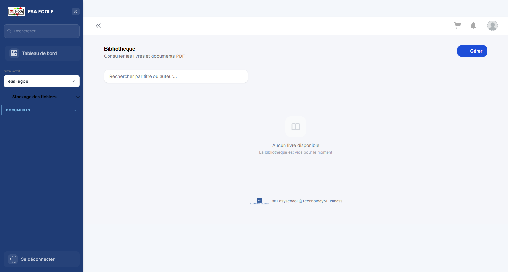

**Objectif :** Catalogue des ouvrages disponibles, avec recherche et consultation des fiches.

**Actions principales :**

1. Rechercher un ouvrage
2. Consulter la fiche et la disponibilité
3. Réserver ou emprunter

---

## 34. Gestion de la bibliothèque

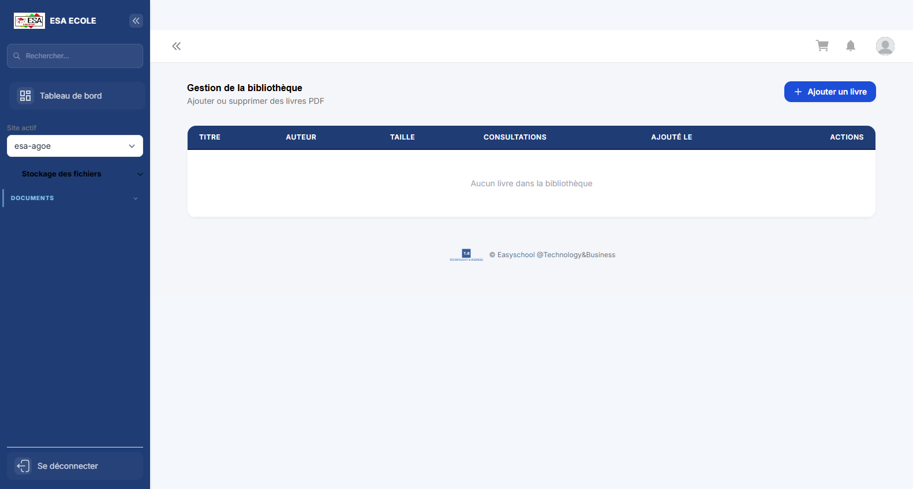

**Objectif :** Administration du fonds documentaire : ouvrages, exemplaires, prêts et retours.

**Actions principales :**

1. Ajouter un ouvrage
2. Gérer les exemplaires
3. Suivre les prêts et retards

---

## 35. Bulletins

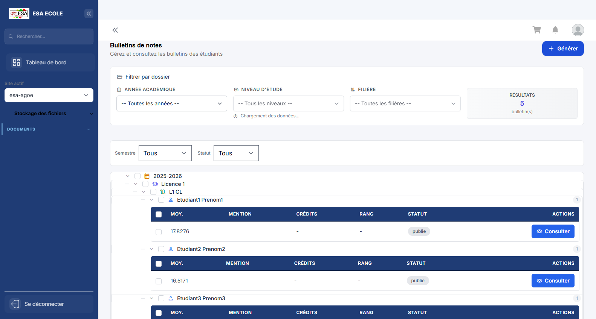

**Objectif :** Bulletins générés à partir des notes : moyennes, crédits, mentions et décisions.

**Actions principales :**

1. Choisir l’année et la classe
2. Générer les bulletins
3. Contrôler et publier

---

## 36. Moyennes

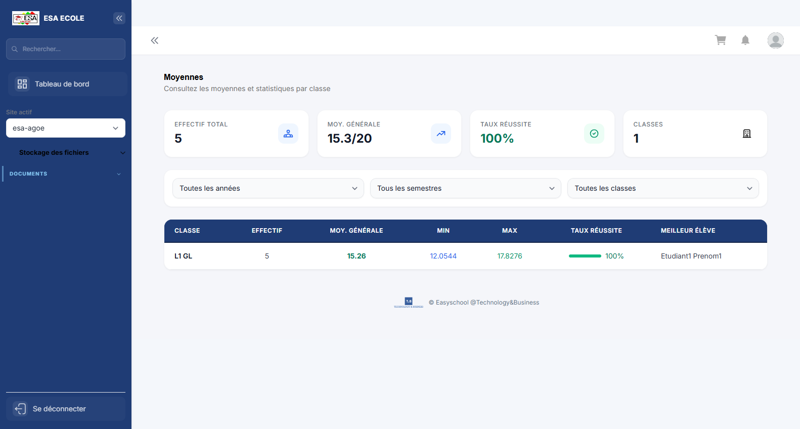

**Objectif :** Calcul et contrôle des moyennes par étudiant, UE et semestre.

**Actions principales :**

1. Sélectionner le périmètre
2. Lancer le calcul
3. Contrôler les anomalies

---

## 37. Audit des notes

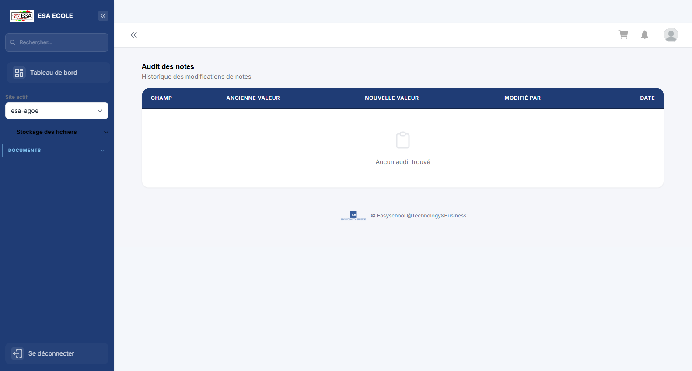

**Objectif :** Historique des modifications de notes : ancienne valeur, nouvelle valeur, auteur et date.

**Actions principales :**

1. Filtrer par classe ou période
2. Comparer les valeurs
3. Signaler une anomalie

---

## 38. Paramètres de notation

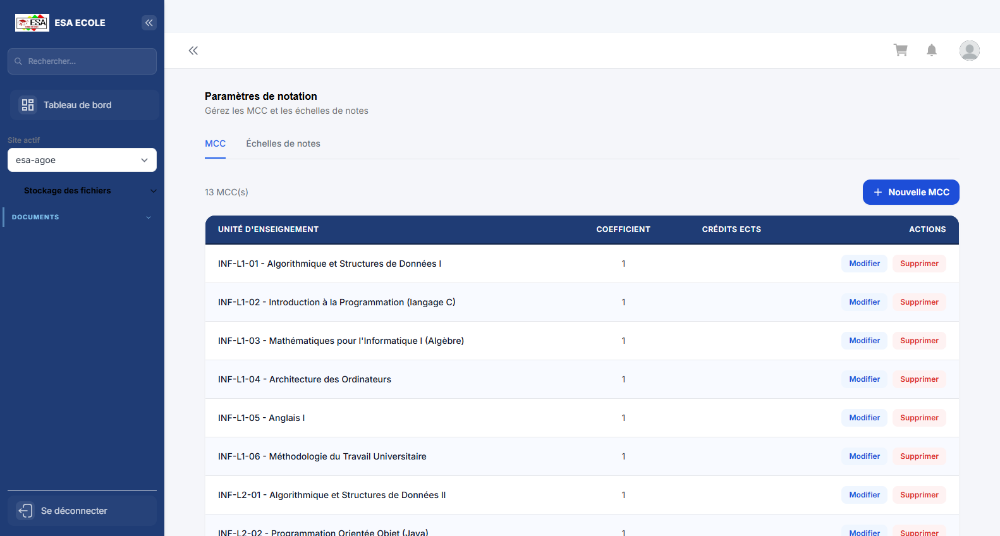

**Objectif :** Règles de calcul : coefficients, compensation, crédits et seuils de validation.

**Actions principales :**

1. Choisir le niveau
2. Définir les règles
3. Enregistrer

---

## 39. Délibérations & jury

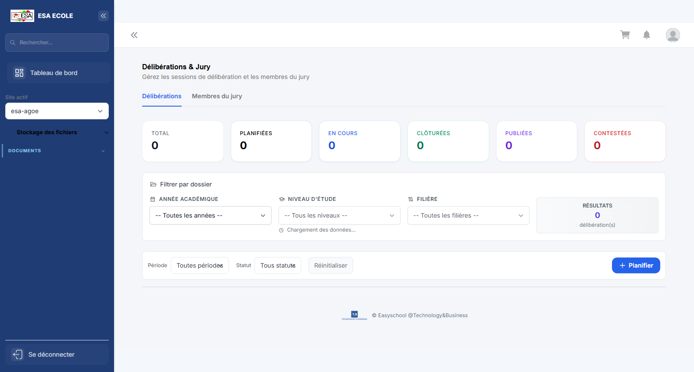

**Objectif :** Séances de jury : décisions d’admission, de passage ou de redoublement.

**Actions principales :**

1. Préparer la séance
2. Examiner les cas
3. Consigner les décisions

---

## 40. Absences

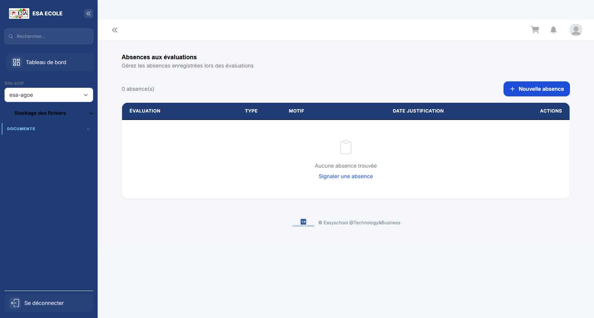

**Objectif :** Suivi des absences et justificatifs, avec alertes et statistiques.

**Actions principales :**

1. Filtrer les absences
2. Vérifier un justificatif
3. Valider ou sanctionner

---

## 41. Sanctions & discipline

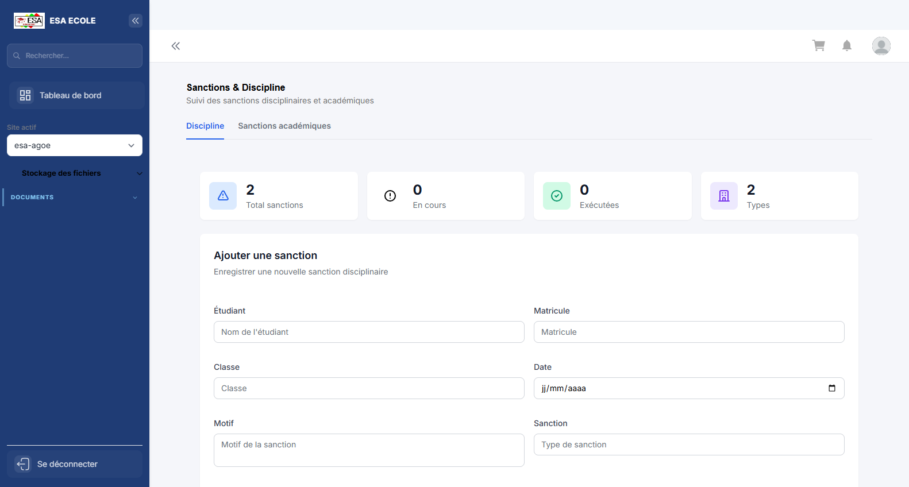

**Objectif :** Procédures disciplinaires : faits, convocation, décision et suivi.

**Actions principales :**

1. Ouvrir un dossier
2. Consigner les faits
3. Notifier la décision

---

## 42. Conseils de classe

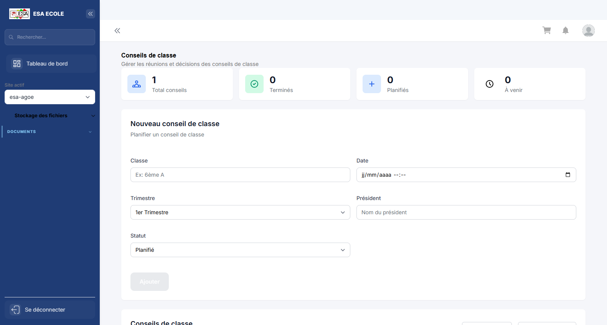

**Objectif :** Préparation et tenue des conseils de classe : synthèse par étudiant et avis.

**Actions principales :**

1. Choisir la classe
2. Consulter les synthèses
3. Saisir les avis

---

## 43. Annonces

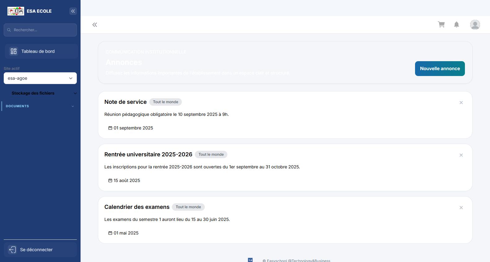

**Objectif :** Publication et consultation des annonces destinées aux étudiants, enseignants ou personnels.

**Actions principales :**

1. Créer ou ouvrir une annonce
2. Choisir le public cible
3. Publier ou archiver

---

## 44. Vie estudiantine

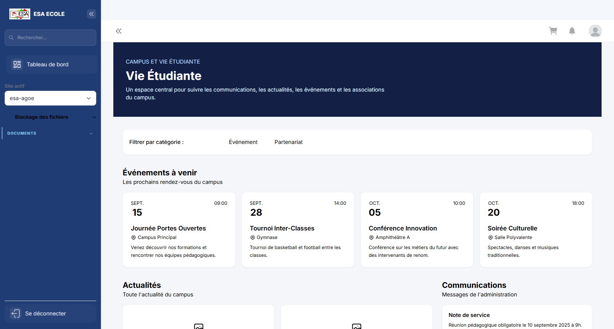

**Objectif :** Actualités, activités et informations de la vie étudiante.

**Actions principales :**

1. Parcourir les publications
2. Ouvrir une actualité
3. Participer ou réagir

---

## 45. Suggestions

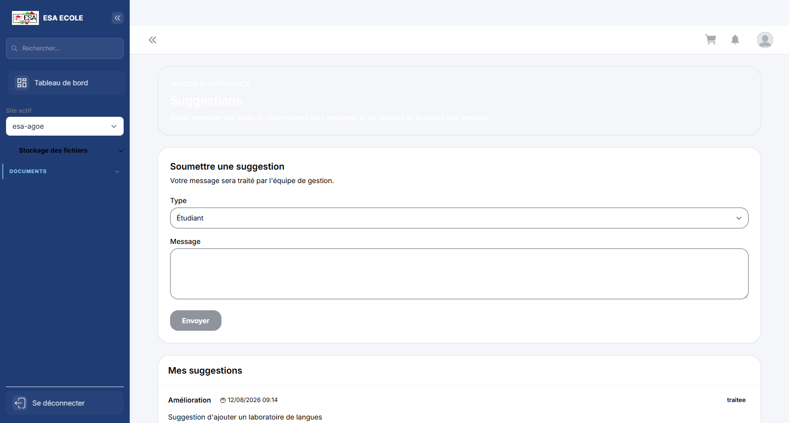

**Objectif :** Boîte à idées et suggestions d’amélioration adressées à l’administration.

**Actions principales :**

1. Rédiger une suggestion
2. La soumettre
3. Suivre son traitement

---

## 46. Offres de stage

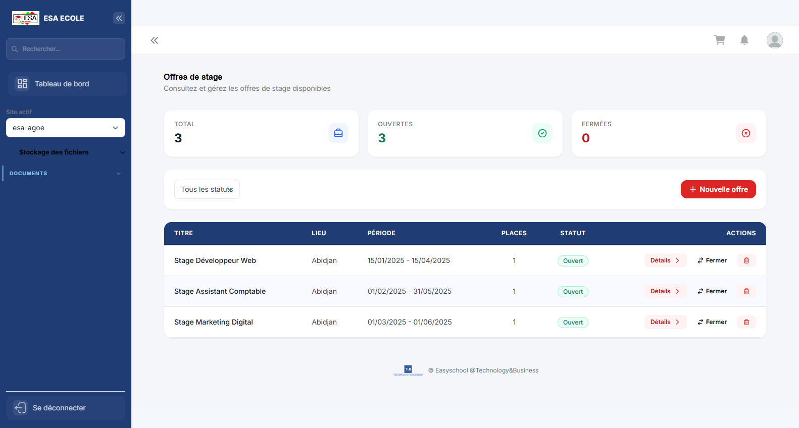

**Objectif :** Offres de stage publiées par les entreprises partenaires.

**Actions principales :**

1. Parcourir les offres
2. Consulter le détail
3. Postuler

---

## 47. Demandes de stage

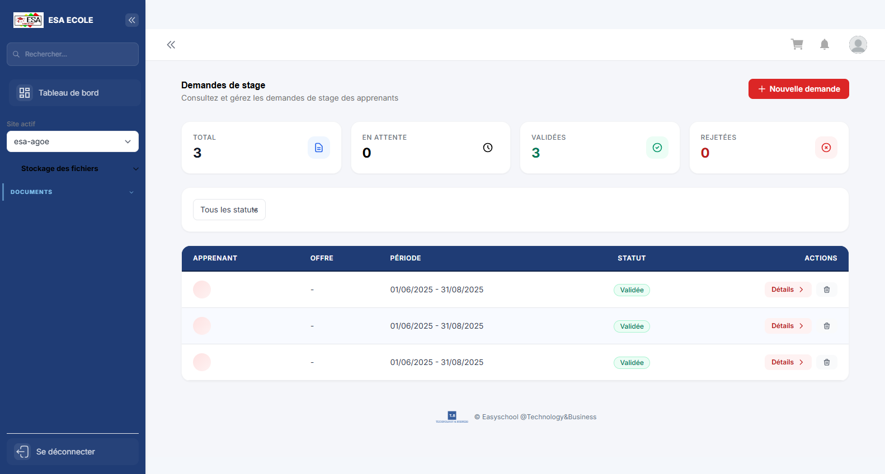

**Objectif :** Demandes et conventions de stage des étudiants.

**Actions principales :**

1. Créer une demande
2. Joindre la convention
3. Suivre la validation

---

## 48. Entreprises

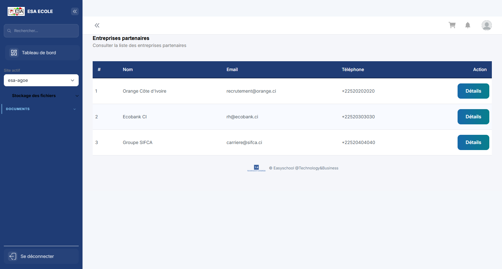

**Objectif :** Référentiel des entreprises partenaires et des contacts.

**Actions principales :**

1. Créer une entreprise
2. Renseigner les contacts
3. Associer les offres

---

## 49. Paiements

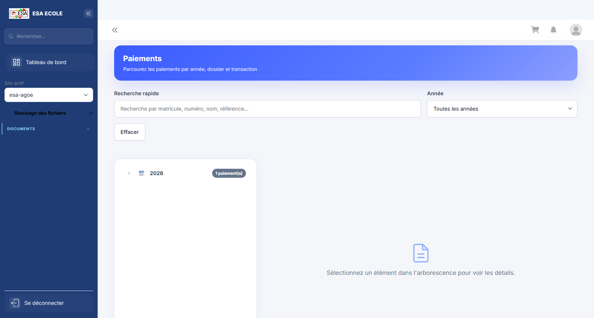

**Objectif :** Paiements des étudiants : saisie, recherche, historique et rattachement aux échéances.

**Actions principales :**

1. Rechercher un étudiant ou un paiement
2. Vérifier le montant et la référence
3. Enregistrer ou consulter le reçu

---

## 50. Échéances

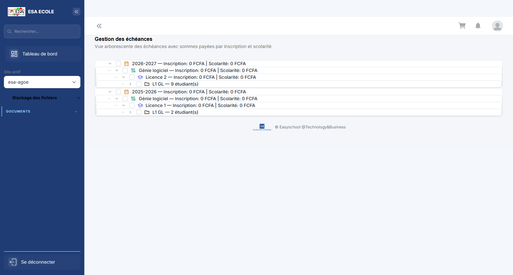

**Objectif :** Échéancier des frais par étudiant : montants dus, dates limites et statuts.

**Actions principales :**

1. Choisir un étudiant ou une période
2. Contrôler les échéances
3. Marquer un paiement ou une relance

---

## 51. Situation irrégulière

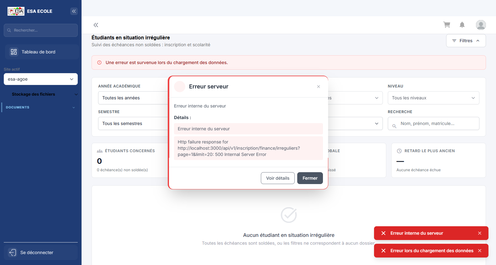

**Objectif :** Étudiants en retard ou en défaut de paiement, avec motif et ancienneté de la dette.

**Actions principales :**

1. Filtrer les impayés
2. Analyser l’historique
3. Lancer une relance ou une régularisation

---

## 52. Situation financière

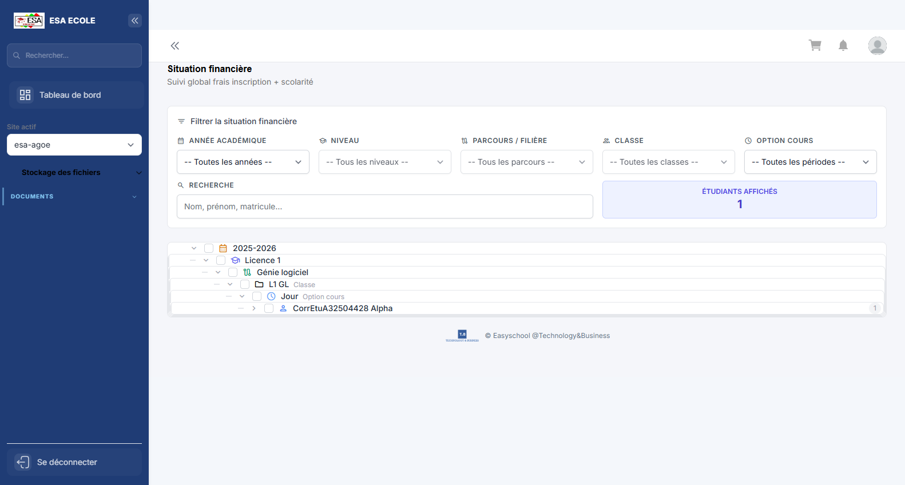

**Objectif :** Situation détaillée d’un étudiant : total dû, total payé, reste à payer et échéances.

**Actions principales :**

1. Rechercher l’étudiant
2. Lire le solde et l’historique
3. Exporter la situation

---

## 53. Validation des bordereaux

**Objectif :** Authentification des bordereaux déposés : contrôle du justificatif et saisie des références bancaires.

**Actions principales :**

1. Ouvrir le bordereau
2. Vérifier le PDF et les références
3. Valider ou rejeter avec motif

---

## 54. Validation comité

**Objectif :** Séance de validation collégiale : chaque membre examine, vote et signe la décision.

**Actions principales :**

1. Examiner les dossiers à l’ordre du jour
2. Voter
3. Signer la décision

---

## 55. Bordereaux à imputer

**Objectif :** Bordereaux authentifiés en attente d’imputation comptable sur les échéances.

**Actions principales :**

1. Ouvrir un bordereau validé
2. Saisir le montant constaté
3. Imputer et transmettre

---

## 56. Bordereaux en attente

**Objectif :** Bordereaux en cours d’instruction, en attente d’une pièce ou d’une validation.

**Actions principales :**

1. Identifier le motif d’attente
2. Compléter ou relancer
3. Réorienter le dossier

---

## 57. Bordereaux traités

**Objectif :** Bordereaux totalement traités et imputés, consultables pour contrôle.

**Actions principales :**

1. Filtrer par période
2. Contrôler l’imputation
3. Exporter le journal

---

## 58. Bordereaux rejetés

**Objectif :** Bordereaux rejetés avec motif, à corriger par l’étudiant ou le service concerné.

**Actions principales :**

1. Consulter le motif
2. Notifier l’étudiant
3. Suivre la nouvelle soumission

---

## 59. Types de bordereau

**Objectif :** Référentiel des types de bordereaux et des imputations associées.

**Actions principales :**

1. Créer un type
2. Associer les frais
3. Activer

---

## 60. Comptabilité

**Objectif :** Comptabilité générale : journaux, écritures, balance et grand livre.

**Actions principales :**

1. Choisir le journal
2. Consulter ou saisir une écriture
3. Contrôler la balance

---

## 61. Catégories

**Objectif :** Catégories d’articles, de documents ou d’immobilisations utilisées dans les référentiels.

**Actions principales :**

1. Créer une catégorie
2. Définir les règles associées
3. Enregistrer

---

## 62. Transferts

**Objectif :** Transferts de dossiers entre services, sites ou archives.

**Actions principales :**

1. Sélectionner les dossiers
2. Choisir la destination
3. Valider le transfert

---

## 63. Corrections

**Objectif :** Corrections et régularisations autorisées sur les données ou les opérations.

**Actions principales :**

1. Rechercher l’élément
2. Saisir le motif
3. Appliquer la correction

---

## 64. Rebuts

**Objectif :** Biens mis au rebut avec motif, procès-verbal et sortie d’inventaire.

**Actions principales :**

1. Sélectionner les biens
2. Renseigner le motif
3. Valider la mise au rebut

---

## 65. Inventaires

**Objectif :** Campagnes d’inventaire physique et rapprochement avec le registre comptable.

**Actions principales :**

1. Lancer une campagne
2. Saisir les constats
3. Générer les écarts

---

## 66. Fournisseurs

**Objectif :** Référentiel des fournisseurs et de leurs coordonnées.

**Actions principales :**

1. Créer un fournisseur
2. Renseigner les coordonnées
3. Activer

---

## 67. Reportings

**Objectif :** Tableaux de bord et rapports financiers consolidés.

**Actions principales :**

1. Choisir le rapport
2. Filtrer la période
3. Exporter

---

## 68. Cycle de vie

**Objectif :** Étapes de vie d’un document ou dossier : actif, intermédiaire, archivage, élimination.

**Actions principales :**

1. Vérifier l’étape
2. Programmer la transition
3. Valider l’opération

---

## 69. Sites

**Objectif :** Sites et établissements rattachés, avec leur adresse et leur responsable.

**Actions principales :**

1. Créer un site
2. Renseigner l’adresse
3. Activer

---

## 70. Catégories — vue 2

**Objectif :** Catégories d’articles, de documents ou d’immobilisations utilisées dans les référentiels.

**Actions principales :**

1. Créer une catégorie
2. Définir les règles associées
3. Enregistrer

---

## 71. Affectations

**Objectif :** Affectation des biens, salles ou moyens aux personnes et services.

**Actions principales :**

1. Choisir le bien
2. Sélectionner le bénéficiaire
3. Valider l’affectation

---

## 72. Assurances

**Objectif :** Contrats d’assurance des biens : police, échéances et sinistres.

**Actions principales :**

1. Créer un contrat
2. Renseigner les échéances
3. Suivre les sinistres

---

## 73. Sorties provisoires

**Objectif :** Biens sortis temporairement avec date de retour et responsable.

**Actions principales :**

1. Enregistrer une sortie
2. Fixer la date de retour
3. Contrôler le retour

---

## 74. Cessions

**Objectif :** Cessions de biens : motif, valorisation et validation.

**Actions principales :**

1. Sélectionner le bien
2. Renseigner la cession
3. Valider

---

## 75. Rebuts — vue 2

**Objectif :** Biens mis au rebut avec motif, procès-verbal et sortie d’inventaire.

**Actions principales :**

1. Sélectionner les biens
2. Renseigner le motif
3. Valider la mise au rebut

---

## 76. Maintenance

**Objectif :** Interventions de maintenance préventive et curative sur les biens.

**Actions principales :**

1. Créer une demande
2. Planifier l’intervention
3. Clôturer avec le rapport

---

## 77. Inventaires — vue 2

**Objectif :** Campagnes d’inventaire physique et rapprochement avec le registre comptable.

**Actions principales :**

1. Lancer une campagne
2. Saisir les constats
3. Générer les écarts

---

## 78. Reportings — vue 2

**Objectif :** Tableaux de bord et rapports financiers consolidés.

**Actions principales :**

1. Choisir le rapport
2. Filtrer la période
3. Exporter

---

## 79. Catégories professionnelles

**Objectif :** Catégories et échelons du personnel utilisés pour la paie.

**Actions principales :**

1. Créer une catégorie
2. Définir les échelons
3. Associer les employés

---

## 80. Grilles salariales

**Objectif :** Grilles de salaires par catégorie, échelon et ancienneté.

**Actions principales :**

1. Choisir la catégorie
2. Renseigner les montants
3. Publier la grille

---

## 81. Paramètres de paie

**Objectif :** Règles de calcul de la paie : cotisations, primes et retenues.

**Actions principales :**

1. Choisir le paramètre
2. Modifier la valeur
3. Enregistrer

---

## 82. Heures supplémentaires

**Objectif :** Saisie et validation des heures supplémentaires effectuées.

**Actions principales :**

1. Saisir les heures
2. Faire valider par le responsable
3. Intégrer à la paie

---

## 83. Prêts et avances

**Objectif :** Prêts et avances accordés au personnel, avec échéancier de remboursement.

**Actions principales :**

1. Créer une demande
2. Valider le montant
3. Suivre les retenues

---

## 84. Prestataires

**Objectif :** Prestataires externes et suivi de leurs interventions.

**Actions principales :**

1. Créer un prestataire
2. Renseigner les coordonnées
3. Suivre les prestations

---

## 85. Indemnités prestataires

**Objectif :** Calcul et paiement des indemnités dues aux prestataires.

**Actions principales :**

1. Sélectionner les prestations
2. Calculer les indemnités
3. Valider le paiement

---

## 86. Contrats

**Objectif :** Contrats de travail : type, durée, rémunération et avenants.

**Actions principales :**

1. Créer un contrat
2. Renseigner les clauses
3. Suivre les échéances

---

## 87. Planning du personnel

**Objectif :** Affectation hebdomadaire des personnels : poste, tâche et horaires.

**Actions principales :**

1. Choisir la semaine
2. Affecter les personnels
3. Publier le planning

---

## 88. Reportings RH

**Objectif :** Indicateurs RH : effectifs, masse salariale, absences et turnover.

**Actions principales :**

1. Choisir la période
2. Analyser les indicateurs
3. Exporter

---

## 89. Discussions

**Objectif :** Messagerie interne permettant d’échanger avec les autres acteurs de l’établissement.

**Actions principales :**

1. Choisir une conversation
2. Rédiger et envoyer un message
3. Joindre un document si nécessaire

---

## 90. Bordereaux

**Objectif :** Vue des bordereaux de paiement et de leur statut dans le circuit de validation.

**Actions principales :**

1. Filtrer par statut
2. Ouvrir un bordereau
3. Suivre son traitement

---

## 91. Mes cours

**Objectif :** Cours en ligne accessibles à l’apprenant après validation du paiement.

**Actions principales :**

1. Ouvrir un cours
2. Suivre les supports
3. Suivre sa progression

---

## 92. Cours vidéo

**Objectif :** Supports vidéo des cours en ligne avec suivi de visionnage.

**Actions principales :**

1. Choisir une vidéo
2. La visionner
3. Marquer comme terminée

---

## 93. Cours PDF

**Objectif :** Supports PDF des cours en ligne, consultables ou téléchargeables selon les droits.

**Actions principales :**

1. Choisir un support
2. Le consulter
3. Marquer comme terminé

---

## 94. Quiz

**Objectif :** Quiz d’évaluation des connaissances avec score et correction.

**Actions principales :**

1. Démarrer le quiz
2. Répondre aux questions
3. Consulter le résultat

---

## 95. Progression

**Objectif :** Avancement de l’apprenant dans les supports et activités d’un cours.

**Actions principales :**

1. Choisir un cours
2. Consulter le taux d’avancement
3. Reprendre les supports restants

---

## 96. Certificats

**Objectif :** Certificats de réussite ou d’assiduité délivrés après validation d’un parcours.

**Actions principales :**

1. Vérifier les conditions
2. Générer le certificat
3. Télécharger ou vérifier

---

## 97. Devoirs

**Objectif :** Devoirs par semestre : énoncé, date limite, dépôt de la copie et correction.

**Actions principales :**

1. Ouvrir un devoir
2. Déposer la copie
3. Consulter la note et la correction

---

## 98. Catalogue e-learning

**Objectif :** Cours en ligne publiés pour l’année et le niveau de l’apprenant, avec crédits et tarif.

**Actions principales :**

1. Parcourir le catalogue
2. Vérifier les prérequis
3. Choisir une UE

---

## 99. Utilisateurs

**Objectif :** Comptes utilisateurs : création, rôle, activation, blocage et réinitialisation.

**Actions principales :**

1. Créer ou rechercher un compte
2. Attribuer le rôle
3. Activer ou bloquer

---

## 100. QR codes

**Objectif :** Génération et vérification des QR codes (cartes, badges, documents).

**Actions principales :**

1. Sélectionner les éléments
2. Générer les QR codes
3. Imprimer ou télécharger

---

## 101. Journal d'audit

**Objectif :** Journal horodaté des actions sensibles : acteur, action, entité, ancienne et nouvelle valeur.

**Actions principales :**

1. Filtrer par acteur ou période
2. Ouvrir une trace
3. Exporter le journal

---

## 102. Configuration

**Objectif :** Paramètres généraux de l’application : établissement, année, notifications et options.

**Actions principales :**

1. Choisir une section
2. Modifier les valeurs
3. Enregistrer

---

## 103. Membres du comité

**Objectif :** Composition du comité : membres, rôles et droits de vote.

**Actions principales :**

1. Ajouter un membre
2. Définir son rôle
3. Activer ou retirer

---

## 104. Profils d'accès

**Objectif :** Profils et matrice des habilitations : menus et actions autorisés par rôle.

**Actions principales :**

1. Choisir un profil
2. Cocher les permissions
3. Appliquer immédiatement

---

## 105. Mon profil

**Objectif :** Informations personnelles et professionnelles du compte connecté : identité, contacts et rattachements.

**Actions principales :**

1. Vérifier ses informations
2. Mettre à jour les champs modifiables
3. Enregistrer

---

## 106. Mon compte

**Objectif :** Paramètres de sécurité du compte : mot de passe, double authentification et sessions.

**Actions principales :**

1. Changer le mot de passe
2. Activer ou vérifier le 2FA
3. Contrôler les sessions ouvertes

---

## 107. École

**Objectif :** Fiche de l’établissement : identité, coordonnées, logo et informations officielles.

**Actions principales :**

1. Renseigner l’identité
2. Mettre à jour les coordonnées
3. Enregistrer les paramètres

---

## 108. Année scolaire

**Objectif :** Année académique de référence : dates de début et de fin, statut actif et rattachement des données.

**Actions principales :**

1. Créer ou sélectionner l’année
2. Définir les dates et le statut
3. Rattacher les sessions et référentiels

---

## 109. Frais

**Objectif :** Référentiel des frais et de leurs règles de calcul (scolarité, services, examens).

**Actions principales :**

1. Créer un type de frais
2. Associer les parcours concernés
3. Activer la facturation

---

## 110. Notifications

**Objectif :** Centre de notifications de l’application : alertes métier, échéances et messages système.

**Actions principales :**

1. Lire les notifications récentes
2. Marquer comme lues
3. Ouvrir l’élément concerné

---

## 111. Système

**Objectif :** État technique du système : services, files d’attente, tâches planifiées et versions.

**Actions principales :**

1. Contrôler les services
2. Consulter les journaux
3. Relancer une tâche si nécessaire

---

## 112. Sauvegardes

**Objectif :** Sauvegardes de la base et des documents : planification, exécution et restauration.

**Actions principales :**

1. Lancer une sauvegarde
2. Vérifier l’intégrité
3. Télécharger ou restaurer

---

## 113. Types de documents

**Objectif :** Référentiel des modèles de documents et de leurs règles de génération.

**Actions principales :**

1. Créer un type
2. Associer le modèle
3. Définir les champs obligatoires

---

## 114. Modèles de documents

**Objectif :** Gestion des modèles (contenu, variables, mise en page) utilisés pour les documents officiels.

**Actions principales :**

1. Créer ou importer un modèle
2. Insérer les variables
3. Publier la version

---

## 115. Cachet électronique

**Objectif :** Configuration et apposition du cachet électronique de l’établissement.

**Actions principales :**

1. Choisir le cachet
2. Vérifier le document
3. Apposer le cachet

---

## 116. Workflows documentaires

**Objectif :** Circuits de validation des documents : étapes, acteurs et conditions de passage.

**Actions principales :**

1. Choisir un workflow
2. Définir les étapes
3. Activer le circuit

---

## 117. Tous les documents

**Objectif :** Vue transversale des documents produits ou déposés, avec filtres et recherche.

**Actions principales :**

1. Filtrer par type ou étudiant
2. Ouvrir un document
3. Contrôler ou télécharger

---

## 118. Générer un document

**Objectif :** Assistant de génération d’un document officiel à partir d’un modèle et des données du dossier.

**Actions principales :**

1. Choisir le modèle
2. Vérifier les champs préremplis
3. Générer et archiver

---

## 119. Diplômes

**Objectif :** Diplômes obtenus, impressions et vérification d’authenticité.

**Actions principales :**

1. Rechercher un diplômé
2. Consulter le diplôme
3. Générer ou vérifier

---

## 120. Demandes de documents

**Objectif :** Demandes de documents administratifs (attestation, relevé, certificat) et leur traitement.

**Actions principales :**

1. Créer ou ouvrir une demande
2. Vérifier les pièces
3. Générer le document

---

## 121. Mes documents

**Objectif :** Documents personnels disponibles : attestations, relevés, certificats et documents déposés.

**Actions principales :**

1. Parcourir la liste
2. Ouvrir un document
3. Télécharger

---

## 122. Traiter les demandes

**Objectif :** File de traitement des demandes de documents : vérification, validation et génération.

**Actions principales :**

1. Ouvrir une demande
2. Contrôler les conditions
3. Valider et générer

---

## 123. Demandes VAE

**Objectif :** Demandes de validation des acquis de l’expérience : pièces, expertise et décision.

**Actions principales :**

1. Déposer une demande
2. Fournir le dossier d’expérience
3. Suivre l’instruction

---

## 124. Signatures

**Objectif :** Signatures électroniques apposées sur les documents et suivi de leur validité.

**Actions principales :**

1. Ouvrir un document à signer
2. Contrôler le contenu
3. Signer électroniquement

---

## 125. Signature direction

**Objectif :** File des documents en attente de signature de la direction.

**Actions principales :**

1. Examiner le document
2. Vérifier les pièces
3. Signer ou renvoyer

---

## 126. Demandes de documents

**Objectif :** Demandes de documents à traiter par le service concerné, avec pièces et statut.

**Actions principales :**

1. Ouvrir une demande
2. Vérifier les pièces et conditions
3. Valider ou générer le document

---

## 127. Tableau de bord

**Objectif :** Vue de pilotage opérationnel : volumes, échéances et activités récentes du périmètre du profil.

**Actions principales :**

1. Choisir la période
2. Analyser les indicateurs
3. Accéder au détail d’un bloc

---

## 128. Encaissement

**Objectif :** Encaissement au guichet : identification de l’étudiant, montant, mode de paiement et reçu.

**Actions principales :**

1. Rechercher l’étudiant
2. Saisir le paiement
3. Imprimer le reçu

---

## 129. Caisse

**Objectif :** État de la caisse du jour : fonds, encaissements, décaissements et solde.

**Actions principales :**

1. Ouvrir la caisse
2. Enregistrer les opérations
3. Contrôler le solde

---

## 130. Clôture de caisse

**Objectif :** Clôture journalière : comptage, écart éventuel et validation de la caisse.

**Actions principales :**

1. Compter les espèces
2. Saisir le montant
3. Valider la clôture

---

## 131. Demandes — vue 2

**Objectif :** File des demandes d’inscription ou de réinscription avec leur statut dans le pipeline.

**Actions principales :**

1. Filtrer par statut
2. Ouvrir un dossier
3. Faire avancer l’étape

---

## 132. Autorisations provisoires

**Objectif :** Autorisations accordées en attente de régularisation (accès aux cours, examens ou documents).

**Actions principales :**

1. Créer une autorisation
2. Fixer l’échéance
3. Suivre la régularisation

---

## 133. Types de documents — vue 2

**Objectif :** Référentiel des modèles de documents et de leurs règles de génération.

**Actions principales :**

1. Créer un type
2. Associer le modèle
3. Définir les champs obligatoires

---

## 134. Journal de caisse

**Objectif :** Détail chronologique des mouvements de caisse avec justificatifs et soldes.

**Actions principales :**

1. Choisir la date
2. Contrôler les mouvements
3. Exporter le journal

---

## 135. Tableau de bord du superviseur

**Objectif :** Vue transversale du superviseur général : avancement des cours, saisie des notes, absences et alertes pédagogiques.

**Actions principales :**

1. Contrôler les indicateurs
2. Repérer les retards de saisie
3. Ouvrir l’écran concerné

---

## 136. Mon tableau de bord

**Objectif :** Page d'accueil du profil : indicateurs personnels, alertes et raccourcis vers les tâches les plus fréquentes.

**Actions principales :**

1. Lire les indicateurs et alertes
2. Ouvrir un raccourci
3. Traiter les éléments en attente

---

## 137. Unités d'enseignement

**Objectif :** UE et ECUE : crédits, volumes horaires, semestres et prérequis.

**Actions principales :**

1. Créer une UE
2. Ajouter les ECUE
3. Définir crédits et prérequis

---

## 138. Planifications

**Objectif :** Planification des marchés et des actions d’achat sur l’année.

**Actions principales :**

1. Créer une planification
2. Associer les besoins
3. Suivre l’avancement

---

## 139. Avis à manifestation d’intérêt

**Objectif :** Publication et traitement des avis à manifestation d’intérêt.

**Actions principales :**

1. Publier l’avis
2. Recevoir les manifestations
3. Présélectionner

---

## 140. Appels d'offres

**Objectif :** Procédures d’appel d’offres : publication, réception des plis et attribution.

**Actions principales :**

1. Publier l’appel
2. Recevoir les offres
3. Évaluer et attribuer

---

## 141. Contrats — vue 2

**Objectif :** Contrats de travail : type, durée, rémunération et avenants.

**Actions principales :**

1. Créer un contrat
2. Renseigner les clauses
3. Suivre les échéances

---

## 142. Avenants

**Objectif :** Avenants aux marchés et contrats : motifs, montants et validation.

**Actions principales :**

1. Créer un avenant
2. Renseigner les modifications
3. Valider

---

## 143. Comptes bancaires

**Objectif :** Comptes bancaires de l’établissement et leurs paramètres.

**Actions principales :**

1. Créer un compte
2. Renseigner les coordonnées
3. Activer

---

## 144. Relevés bancaires

**Objectif :** Import et consultation des relevés bancaires en vue du rapprochement.

**Actions principales :**

1. Importer un relevé
2. Contrôler les lignes
3. Lancer le rapprochement

---

## 145. Rapprochement bancaire

**Objectif :** Rapprochement entre les écritures comptables et les opérations bancaires.

**Actions principales :**

1. Sélectionner le compte et la période
2. Pointer les opérations
3. Valider les écarts

---

## 146. Demandes d'achat

**Objectif :** Demandes d’achat émises par les services et leur circuit de validation.

**Actions principales :**

1. Créer une demande
2. Faire valider
3. Transformer en commande

---

## 147. Validations

**Objectif :** File des éléments en attente de validation (opérations, documents, dossiers).

**Actions principales :**

1. Filtrer les demandes en attente
2. Examiner chaque élément
3. Valider ou renvoyer

---

## 148. Commandes

**Objectif :** Commandes d’achat : création, suivi de livraison et réception.

**Actions principales :**

1. Créer une commande
2. Suivre la livraison
3. Réceptionner

---

## 149. Réceptions

**Objectif :** Réception des biens et services commandés, avec contrôle de conformité.

**Actions principales :**

1. Ouvrir la commande
2. Contrôler les quantités
3. Valider la réception

---

## 150. Factures

**Objectif :** Factures fournisseurs : réception, contrôle et mise en paiement.

**Actions principales :**

1. Enregistrer une facture
2. Contrôler les pièces
3. Valider le paiement

---

## 151. Fournisseurs — vue 2

**Objectif :** Référentiel des fournisseurs et de leurs coordonnées.

**Actions principales :**

1. Créer un fournisseur
2. Renseigner les coordonnées
3. Activer

---

## 152. Budgets

**Objectif :** Préparation, suivi et exécution budgétaire par service ou projet.

**Actions principales :**

1. Créer un budget
2. Saisir les lignes
3. Suivre l’exécution

---

## 153. Articles

**Objectif :** Référentiel des articles et prestations utilisés dans les achats et la comptabilité.

**Actions principales :**

1. Créer un article
2. Renseigner l’unité et le prix
3. Activer

---

## 154. Mouvements

**Objectif :** Mouvements de stocks ou de trésorerie : entrées, sorties et soldes.

**Actions principales :**

1. Filtrer les mouvements
2. Ouvrir un mouvement
3. Contrôler le justificatif

---

## 155. Besoins

**Objectif :** Expression des besoins des services en biens et services.

**Actions principales :**

1. Décrire le besoin
2. Estimer le coût
3. Transmettre pour validation

---

## 156. Demandes de prix

**Objectif :** Consultation des fournisseurs et comparaison des offres.

**Actions principales :**

1. Créer la demande
2. Envoyer aux fournisseurs
3. Comparer et retenir

---

## 157. Immobilisations

**Objectif :** Registre des immobilisations : acquisition, amortissement et valeur nette.

**Actions principales :**

1. Créer une immobilisation
2. Paramétrer l’amortissement
3. Suivre la valeur nette

---

## 158. Employés

**Objectif :** Référentiel du personnel : identité, poste, contrat et affectation.

**Actions principales :**

1. Créer ou modifier un employé
2. Renseigner le poste
3. Activer le compte

---

## 159. Offres d'emploi

**Objectif :** Publication et suivi des offres de recrutement.

**Actions principales :**

1. Créer une offre
2. Publier
3. Suivre les candidatures

---

## 160. Candidatures

**Objectif :** Réception et traitement des candidatures aux offres d’emploi.

**Actions principales :**

1. Examiner les CV
2. Présélectionner
3. Planifier les entretiens

---

## 161. Paie

**Objectif :** Préparation et exécution de la paie : éléments variables, bulletins et virements.

**Actions principales :**

1. Choisir la période
2. Contrôler les éléments variables
3. Calculer et valider la paie

---

## 162. Prestations

**Objectif :** Prestations réalisées par les fournisseurs ou prestataires, avec suivi et facturation.

**Actions principales :**

1. Créer une prestation
2. Suivre l’exécution
3. Facturer

---

## 163. Formations

**Objectif :** Plan de formation du personnel : sessions, participants et évaluation.

**Actions principales :**

1. Créer une formation
2. Inscrire les participants
3. Évaluer

---

## 164. Évaluations

**Objectif :** Types et campagnes d’évaluation : devoirs, contrôles, examens et coefficients.

**Actions principales :**

1. Créer une évaluation
2. Définir la date et le coefficient
3. Saisir les notes

---

## 165. Demandes de congé

**Objectif :** Demandes de congé du personnel et leur circuit de validation.

**Actions principales :**

1. Créer une demande
2. Faire valider
3. Mettre à jour le solde

---

## 166. Soldes de congé

**Objectif :** Soldes de congés par employé et par période.

**Actions principales :**

1. Rechercher un employé
2. Consulter le solde
3. Ajuster si nécessaire

---

## 167. Terminal de pointage

**Objectif :** Pointage des arrivées et départs par QR code ou matricule, avec contrôle de l’identité.

**Actions principales :**

1. Scanner le QR ou saisir le matricule
2. Vérifier l’identité
3. Pointer l’arrivée ou le départ

---

## 168. Historique

**Objectif :** Journal chronologique des opérations réalisées sur le périmètre : date, acteur, action et résultat.

**Actions principales :**

1. Filtrer par période ou acteur
2. Consulter le détail d’une opération
3. Exporter si besoin

---

## 169. Shifts

**Objectif :** Plages horaires de travail utilisées pour le pointage et les plannings.

**Actions principales :**

1. Créer un shift
2. Définir les horaires
3. Activer

---

## 170. Absences — vue 2

**Objectif :** Suivi des absences et justificatifs, avec alertes et statistiques.

**Actions principales :**

1. Filtrer les absences
2. Vérifier un justificatif
3. Valider ou sanctionner

---

## 171. Planning

**Objectif :** Planning hebdomadaire des activités ou du personnel.

**Actions principales :**

1. Choisir la semaine
2. Consulter les affectations
3. Ajuster si nécessaire

---

## 172. Rapports

**Objectif :** Rapports et exports disponibles pour le profil, avec filtres de période et de périmètre.

**Actions principales :**

1. Choisir un rapport
2. Renseigner les filtres
3. Générer puis télécharger

---

## 173. Tableau de bord de pilotage

**Objectif :** Synthèse consolidée destinée au pilotage : effectifs, résultats, finances et alertes majeures.

**Actions principales :**

1. Sélectionner l’année ou la période
2. Comparer les indicateurs
3. Exporter ou ouvrir le détail

---

## 174. Effectifs

**Objectif :** Effectifs par niveau, parcours ou classe, avec répartition et évolution.

**Actions principales :**

1. Filtrer par année et niveau
2. Comparer les effectifs
3. Exporter la liste

---

## 175. Notes — vue 2

**Objectif :** Saisie et consultation des notes par classe, UE et type d’évaluation.

**Actions principales :**

1. Choisir la classe et l’UE
2. Saisir les notes
3. Vérifier puis publier

---

## 176. Paiements — vue 2

**Objectif :** Paiements des étudiants : saisie, recherche, historique et rattachement aux échéances.

**Actions principales :**

1. Rechercher un étudiant ou un paiement
2. Vérifier le montant et la référence
3. Enregistrer ou consulter le reçu

---

## 177. Ressources humaines

**Objectif :** Accès au module RH : effectifs, contrats, paie et indicateurs du personnel.

**Actions principales :**

1. Choisir le sous-module
2. Consulter les indicateurs
3. Traiter les échéances

---

## 178. Catalogue

**Objectif :** Catalogue général des formations, cours et ressources disponibles.

**Actions principales :**

1. Rechercher une formation
2. Consulter la fiche
3. S’inscrire ou contacter

---

## 179. Recherche avancée

**Objectif :** Recherche multi-critères dans les données du périmètre (étudiants, dossiers, documents, opérations).

**Actions principales :**

1. Renseigner les critères
2. Lancer la recherche
3. Ouvrir un résultat

---

## 180. Dossiers

**Objectif :** Vue des dossiers à traiter ou récemment modifiés, avec leur état d’avancement.

**Actions principales :**

1. Filtrer les dossiers
2. Ouvrir un dossier
3. Appliquer l’action attendue

---

## 181. Téléverser un document

**Objectif :** Dépôt d’un document dans un dossier ou une demande, avec contrôle du format et de la taille.

**Actions principales :**

1. Choisir le fichier
2. Contrôler le document
3. Valider le dépôt

---

## 182. Conservation

**Objectif :** Règles de conservation et de durée de vie des documents d’archives.

**Actions principales :**

1. Définir les durées
2. Appliquer aux catégories
3. Programmer l’élimination

---

## 183. Gestion e-learning

**Objectif :** Administration des cours en ligne : création, publication et suivi des inscriptions.

**Actions principales :**

1. Créer un cours
2. Publier
3. Suivre les sélections et la progression

---

## 184. Non-conformités

**Objectif :** Déclaration et traitement des non-conformités qualité avec actions correctives.

**Actions principales :**

1. Déclarer une non-conformité
2. Analyser la cause
3. Suivre l’action corrective

---

## 185. Audits

**Objectif :** Campagnes d’audit interne : périmètre, contrôles réalisés, constats et plans d’action.

**Actions principales :**

1. Créer une campagne
2. Réaliser les contrôles
3. Consigner les constats

---

## 186. Revues de direction

**Objectif :** Préparation et suivi des revues de direction : ordre du jour, décisions et actions.

**Actions principales :**

1. Préparer la revue
2. Consigner les décisions
3. Suivre les actions

---

## 187. Enquêtes de satisfaction

**Objectif :** Enquêtes de satisfaction des étudiants et personnels : diffusion, réponses et résultats.

**Actions principales :**

1. Créer l’enquête
2. Diffuser
3. Analyser les résultats

---

*Guide généré par `scripts/guide/generer-guides.cjs`. Les captures valides les plus récentes sont utilisées, avec repli sur les captures historiques.*
