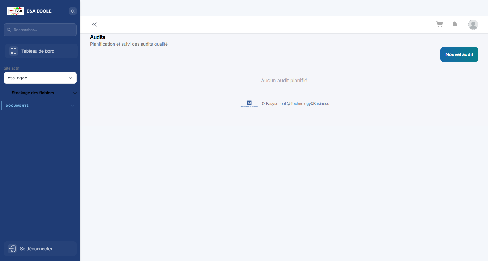
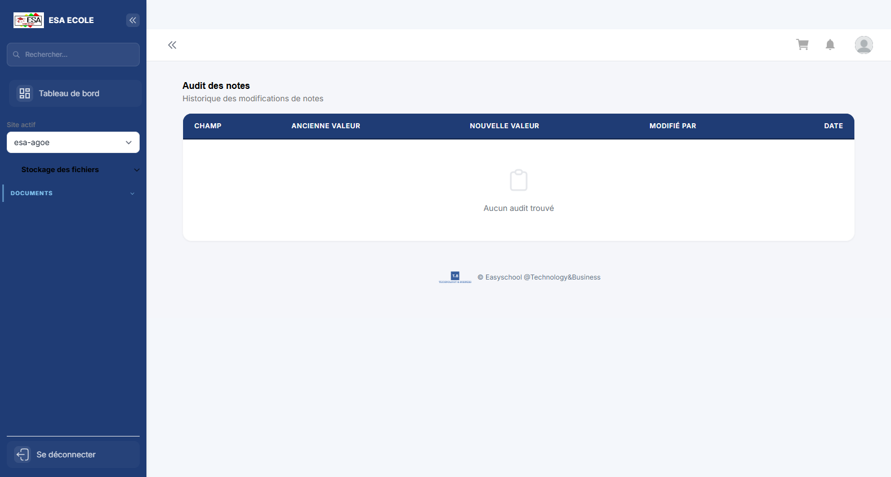
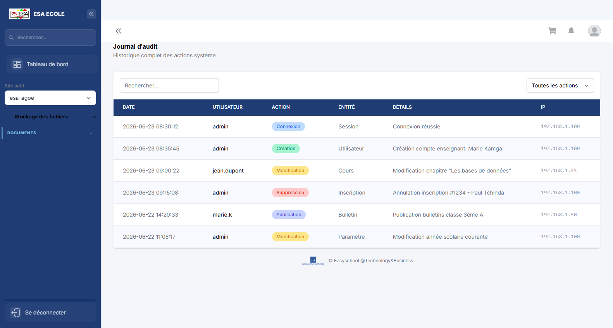
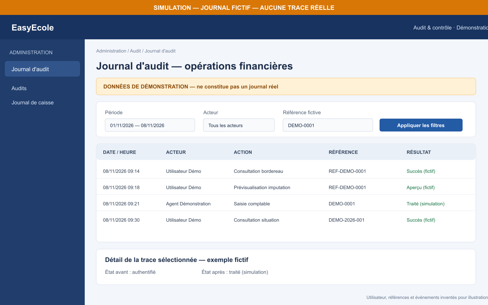
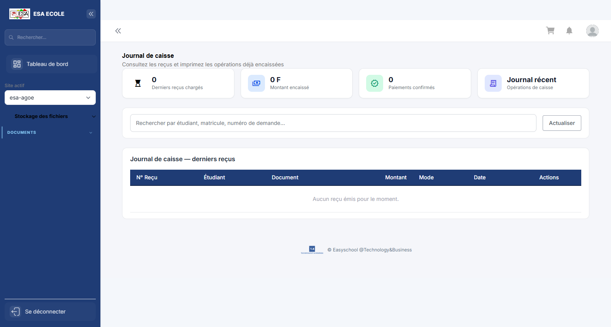
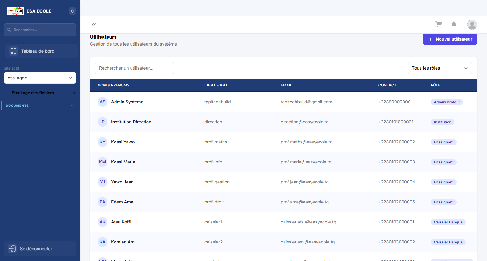
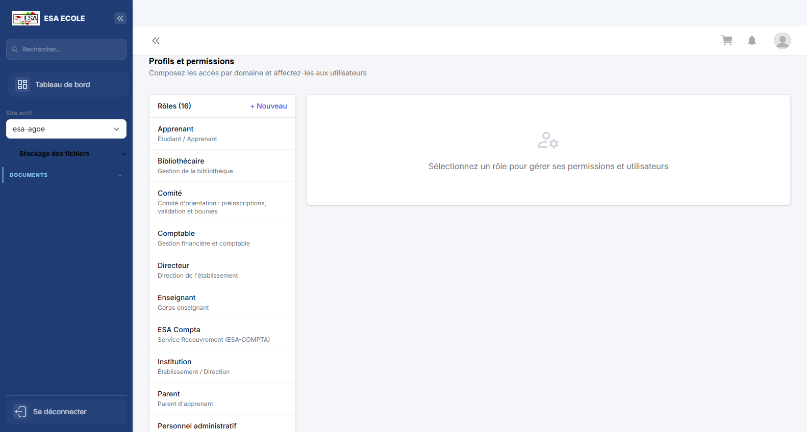
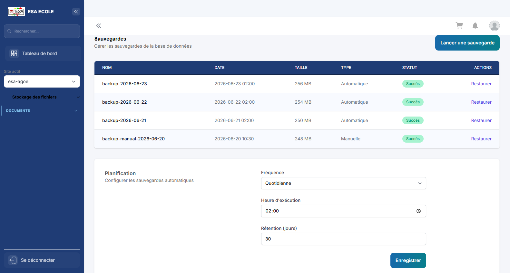
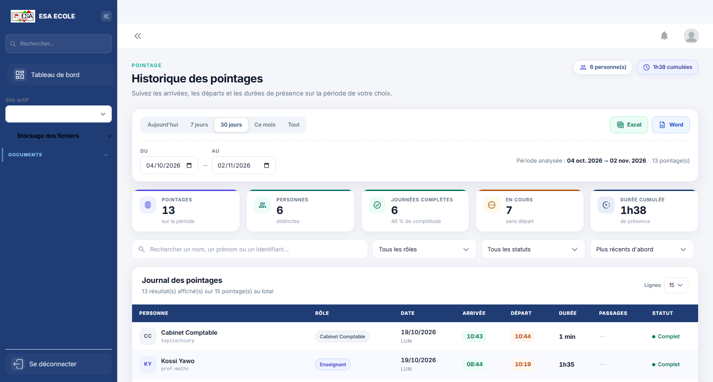
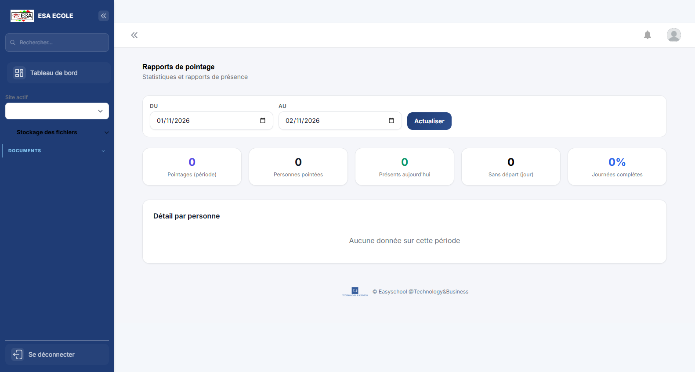

# Guide d'utilisation — Audit & contrôle

> Traçabilité des actions, contrôle des notes et des caisses, vérification des comptes et des habilitations. Ce guide rassemble les écrans d'audit du profil administrateur et les vues de contrôle du superviseur général.

**Profil :** Audit & contrôle  
**Nombre d'écrans :** 9  
**Mise à jour :** 08/11/2026

Ce guide présente les écrans du profil dans l'ordre d'utilisation conseillé. L'image complémentaire du journal financier est une simulation explicitement signalée ; elle ne représente aucune trace réelle.

## Sommaire

1. [Audits](#1-audits)
2. [Audit des notes](#2-audit-des-notes)
3. [Journal d'audit](#3-journal-d-audit)
4. [Journal de caisse](#4-journal-de-caisse)
5. [Utilisateurs](#5-utilisateurs)
6. [Profils d'accès](#6-profils-d-acces)
7. [Sauvegardes](#7-sauvegardes)
8. [Historique](#8-historique)
9. [Rapports](#9-rapports)

## 1. Audits

**Objectif :** Campagnes d’audit interne : périmètre, contrôles réalisés, constats et plans d’action.

**Actions principales :**

1. Créer une campagne
2. Réaliser les contrôles
3. Consigner les constats

---

## 2. Audit des notes

**Objectif :** Historique des modifications de notes : ancienne valeur, nouvelle valeur, auteur et date.

**Actions principales :**

1. Filtrer par classe ou période
2. Comparer les valeurs
3. Signaler une anomalie

---

## 3. Journal d'audit

**Objectif :** Journal horodaté des actions sensibles : acteur, action, entité, ancienne et nouvelle valeur.

**Actions principales :**

1. Filtrer par acteur ou période
2. Ouvrir une trace
3. Exporter le journal

---

## 4. Journal de caisse

**Objectif :** Détail chronologique des mouvements de caisse avec justificatifs et soldes.

**Actions principales :**

1. Choisir la date
2. Contrôler les mouvements
3. Exporter le journal

---

## 5. Utilisateurs

**Objectif :** Comptes utilisateurs : création, rôle, activation, blocage et réinitialisation.

**Actions principales :**

1. Créer ou rechercher un compte
2. Attribuer le rôle
3. Activer ou bloquer

---

## 6. Profils d'accès

**Objectif :** Profils et matrice des habilitations : menus et actions autorisés par rôle.

**Actions principales :**

1. Choisir un profil
2. Cocher les permissions
3. Appliquer immédiatement

---

## 7. Sauvegardes

**Objectif :** Sauvegardes de la base et des documents : planification, exécution et restauration.

**Actions principales :**

1. Lancer une sauvegarde
2. Vérifier l’intégrité
3. Télécharger ou restaurer

---

## 8. Historique

**Objectif :** Journal chronologique des opérations réalisées sur le périmètre : date, acteur, action et résultat.

**Actions principales :**

1. Filtrer par période ou acteur
2. Consulter le détail d’une opération
3. Exporter si besoin

---

## 9. Rapports

**Objectif :** Rapports et exports disponibles pour le profil, avec filtres de période et de périmètre.

**Actions principales :**

1. Choisir un rapport
2. Renseigner les filtres
3. Générer puis télécharger

---

*Guide Audit & contrôle — mis à jour le 08/11/2026. L'illustration supplémentaire est entièrement fictive et ne constitue pas un journal réel.*
