# Guide d'utilisation — Caissier banque

> Opérations de caisse et de banque : encaissements, paiements, situations financières, bordereaux et comptabilité.

**Profil :** Caissier banque  
**Nombre d'écrans :** 23  
**Généré le :** 02/11/2026

Ce guide présente les écrans du profil dans l'ordre d'utilisation conseillé. Chaque section contient une capture, l'objectif de l'écran et les actions principales.

## Sommaire

1. [Paiements](#1-paiements)
2. [Mon profil](#2-mon-profil)
3. [Mon compte](#3-mon-compte)
4. [Mes bordereaux](#4-mes-bordereaux)
5. [Configurations](#5-configurations)
6. [Attributions](#6-attributions)
7. [Mon tableau de bord](#7-mon-tableau-de-bord)
8. [Situation irrégulière](#8-situation-irreguliere)
9. [Situation financière](#9-situation-financiere)
10. [Validation des bordereaux](#10-validation-des-bordereaux)
11. [Comptabilité](#11-comptabilite)
12. [Immobilisations](#12-immobilisations)
13. [Sites](#13-sites)
14. [Catégories](#14-categories)
15. [Affectations](#15-affectations)
16. [Assurances](#16-assurances)
17. [Sorties provisoires](#17-sorties-provisoires)
18. [Cessions](#18-cessions)
19. [Rebuts](#19-rebuts)
20. [Maintenance](#20-maintenance)
21. [Inventaires](#21-inventaires)
22. [Reportings](#22-reportings)
23. [Paiements — vue 2](#23-paiements-vue-2)

## 1. Paiements

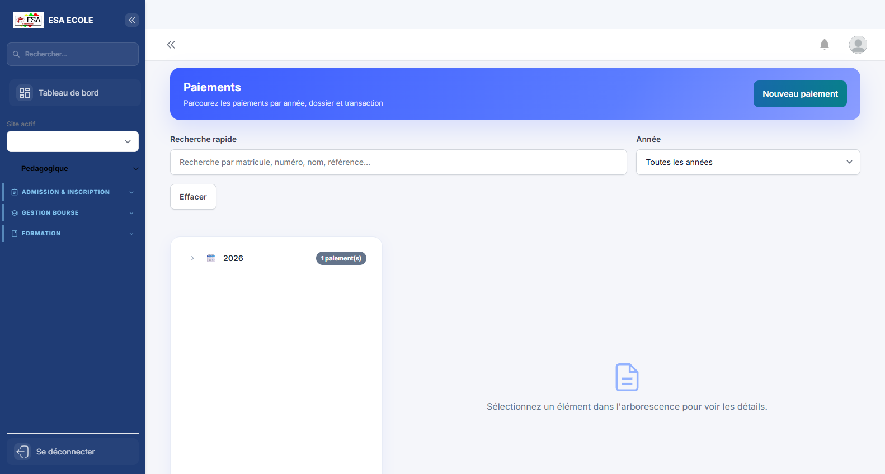

**Objectif :** Paiements des étudiants : saisie, recherche, historique et rattachement aux échéances.

**Actions principales :**

1. Rechercher un étudiant ou un paiement
2. Vérifier le montant et la référence
3. Enregistrer ou consulter le reçu

---

## 2. Mon profil

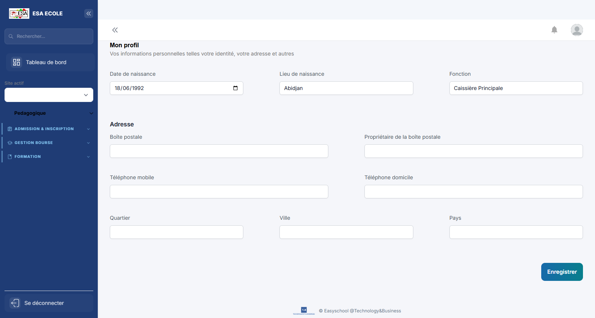

**Objectif :** Informations personnelles et professionnelles du compte connecté : identité, contacts et rattachements.

**Actions principales :**

1. Vérifier ses informations
2. Mettre à jour les champs modifiables
3. Enregistrer

---

## 3. Mon compte

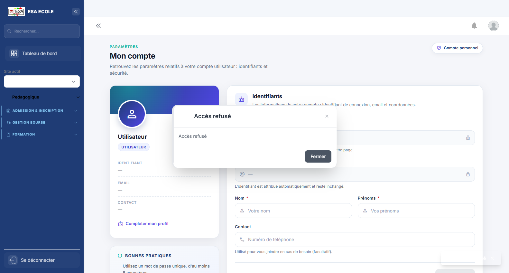

**Objectif :** Paramètres de sécurité du compte : mot de passe, double authentification et sessions.

**Actions principales :**

1. Changer le mot de passe
2. Activer ou vérifier le 2FA
3. Contrôler les sessions ouvertes

---

## 4. Mes bordereaux

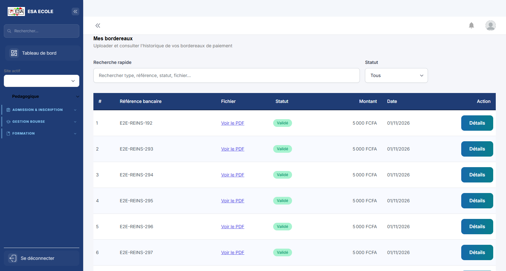

**Objectif :** Bordereaux déposés par l’étudiant (ou suivis par le profil) avec leur état d’authentification et d’imputation.

**Actions principales :**

1. Déposer ou consulter un bordereau
2. Suivre son statut
3. Télécharger le reçu

---

## 5. Configurations

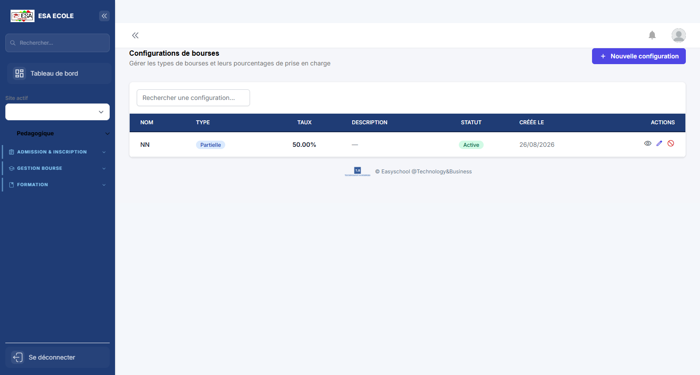

**Objectif :** Paramétrage du module : règles, barèmes et options appliquées aux dossiers.

**Actions principales :**

1. Choisir la configuration
2. Modifier les paramètres
3. Enregistrer et tester

---

## 6. Attributions

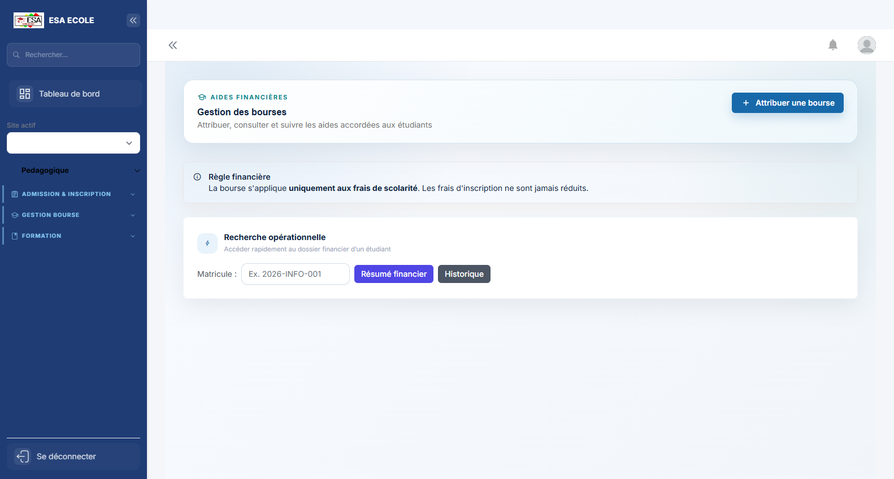

**Objectif :** Attribution des droits, responsabilités ou avantages aux personnes concernées.

**Actions principales :**

1. Rechercher la personne
2. Choisir l’attribution
3. Valider la période

---

## 7. Mon tableau de bord

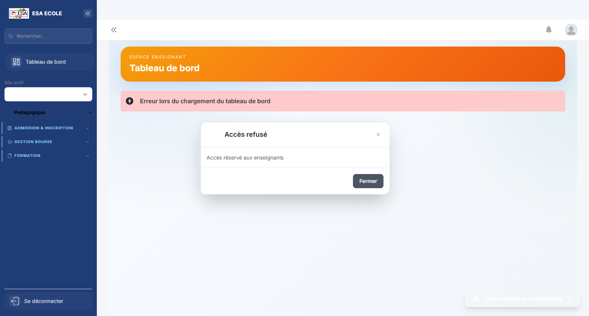

**Objectif :** Page d'accueil du profil : indicateurs personnels, alertes et raccourcis vers les tâches les plus fréquentes.

**Actions principales :**

1. Lire les indicateurs et alertes
2. Ouvrir un raccourci
3. Traiter les éléments en attente

---

## 8. Situation irrégulière

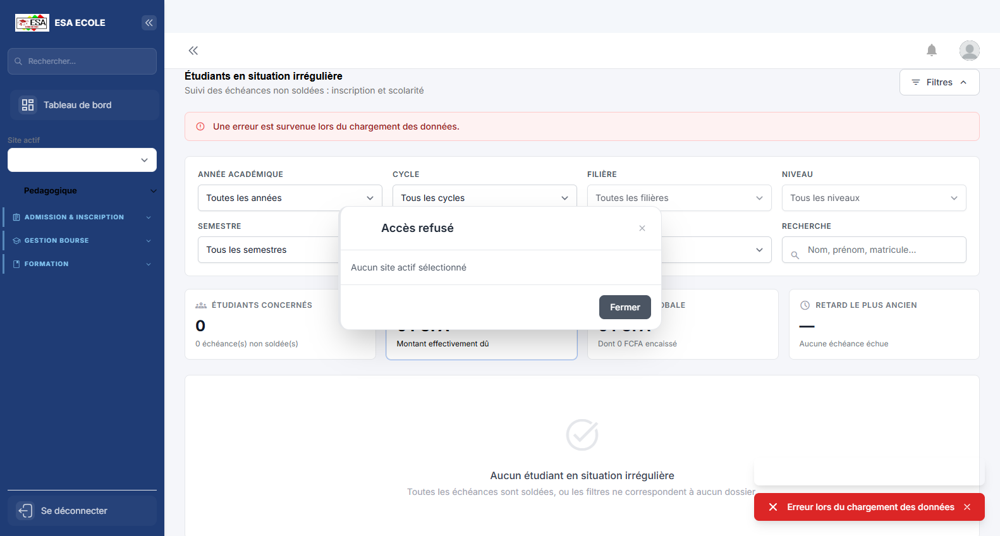

**Objectif :** Étudiants en retard ou en défaut de paiement, avec motif et ancienneté de la dette.

**Actions principales :**

1. Filtrer les impayés
2. Analyser l’historique
3. Lancer une relance ou une régularisation

---

## 9. Situation financière

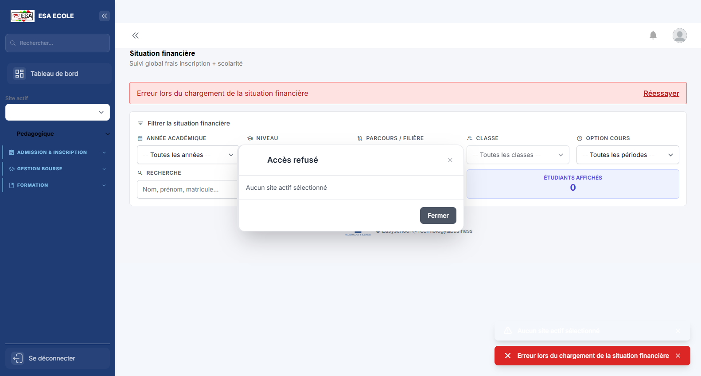

**Objectif :** Situation détaillée d’un étudiant : total dû, total payé, reste à payer et échéances.

**Actions principales :**

1. Rechercher l’étudiant
2. Lire le solde et l’historique
3. Exporter la situation

---

## 10. Validation des bordereaux

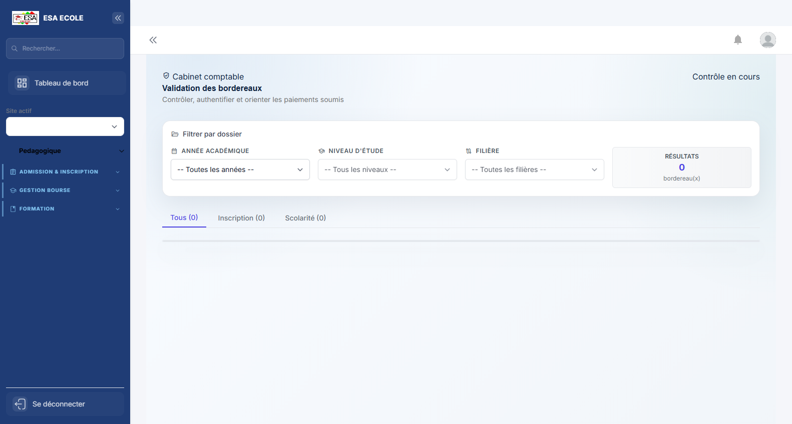

**Objectif :** Authentification des bordereaux déposés : contrôle du justificatif et saisie des références bancaires.

**Actions principales :**

1. Ouvrir le bordereau
2. Vérifier le PDF et les références
3. Valider ou rejeter avec motif

---

## 11. Comptabilité

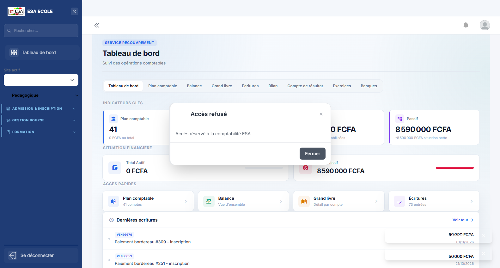

**Objectif :** Comptabilité générale : journaux, écritures, balance et grand livre.

**Actions principales :**

1. Choisir le journal
2. Consulter ou saisir une écriture
3. Contrôler la balance

---

## 12. Immobilisations

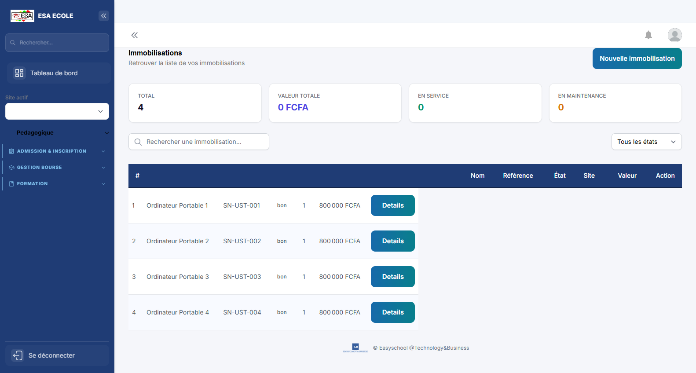

**Objectif :** Registre des immobilisations : acquisition, amortissement et valeur nette.

**Actions principales :**

1. Créer une immobilisation
2. Paramétrer l’amortissement
3. Suivre la valeur nette

---

## 13. Sites

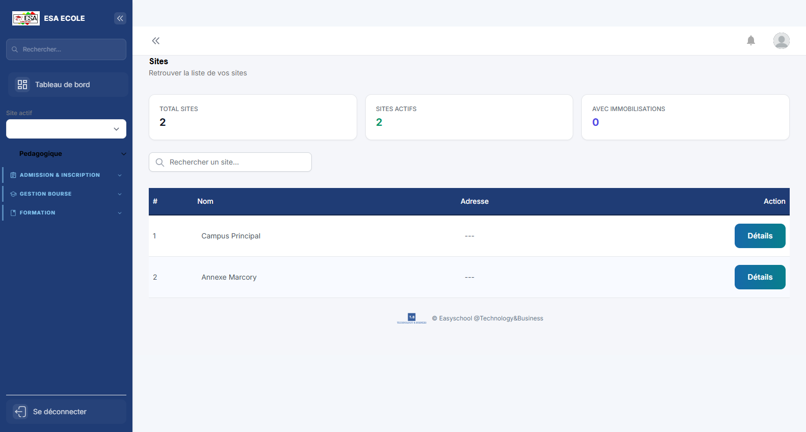

**Objectif :** Sites et établissements rattachés, avec leur adresse et leur responsable.

**Actions principales :**

1. Créer un site
2. Renseigner l’adresse
3. Activer

---

## 14. Catégories

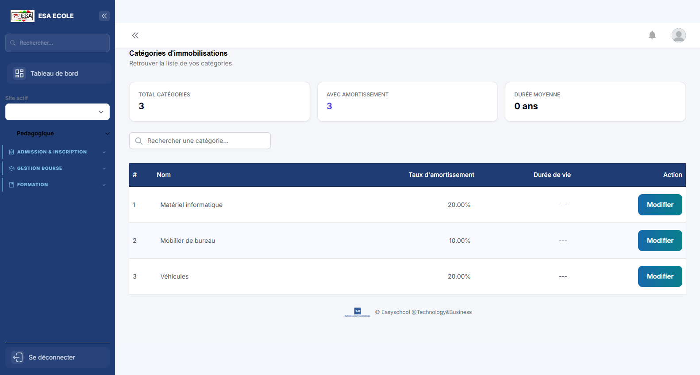

**Objectif :** Catégories d’articles, de documents ou d’immobilisations utilisées dans les référentiels.

**Actions principales :**

1. Créer une catégorie
2. Définir les règles associées
3. Enregistrer

---

## 15. Affectations

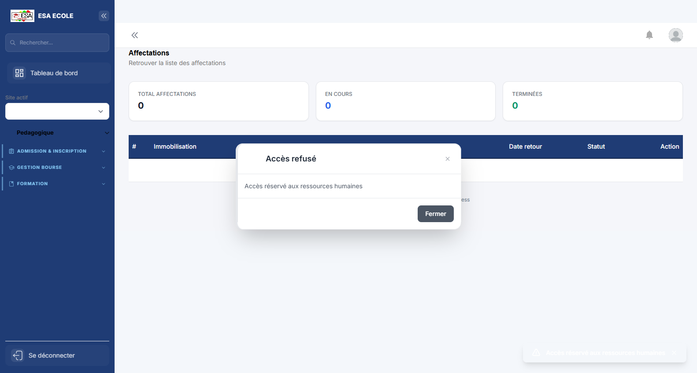

**Objectif :** Affectation des biens, salles ou moyens aux personnes et services.

**Actions principales :**

1. Choisir le bien
2. Sélectionner le bénéficiaire
3. Valider l’affectation

---

## 16. Assurances

**Objectif :** Contrats d’assurance des biens : police, échéances et sinistres.

**Actions principales :**

1. Créer un contrat
2. Renseigner les échéances
3. Suivre les sinistres

---

## 17. Sorties provisoires

**Objectif :** Biens sortis temporairement avec date de retour et responsable.

**Actions principales :**

1. Enregistrer une sortie
2. Fixer la date de retour
3. Contrôler le retour

---

## 18. Cessions

**Objectif :** Cessions de biens : motif, valorisation et validation.

**Actions principales :**

1. Sélectionner le bien
2. Renseigner la cession
3. Valider

---

## 19. Rebuts

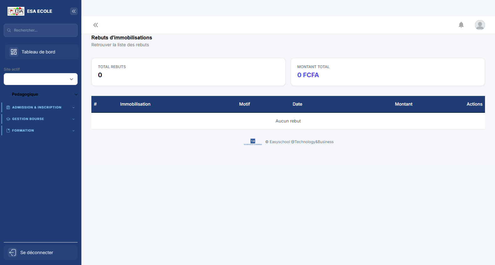

**Objectif :** Biens mis au rebut avec motif, procès-verbal et sortie d’inventaire.

**Actions principales :**

1. Sélectionner les biens
2. Renseigner le motif
3. Valider la mise au rebut

---

## 20. Maintenance

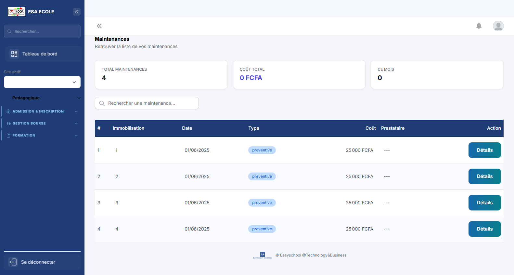

**Objectif :** Interventions de maintenance préventive et curative sur les biens.

**Actions principales :**

1. Créer une demande
2. Planifier l’intervention
3. Clôturer avec le rapport

---

## 21. Inventaires

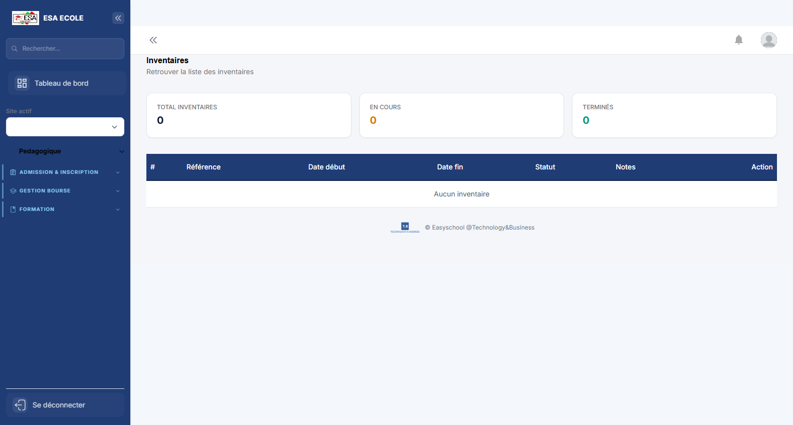

**Objectif :** Campagnes d’inventaire physique et rapprochement avec le registre comptable.

**Actions principales :**

1. Lancer une campagne
2. Saisir les constats
3. Générer les écarts

---

## 22. Reportings

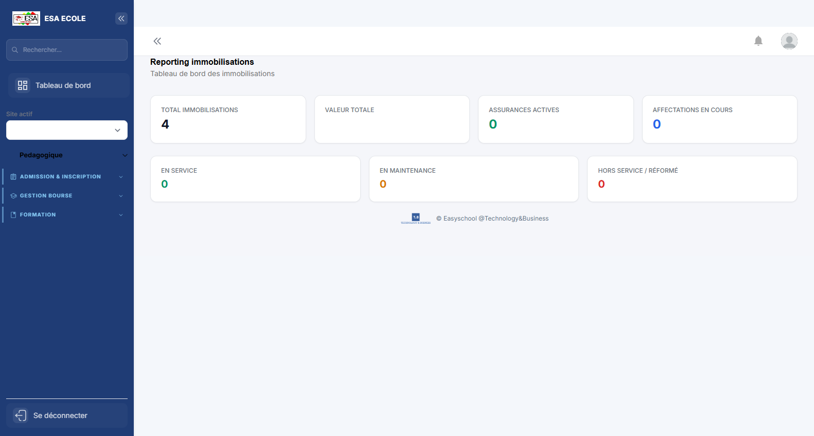

**Objectif :** Tableaux de bord et rapports financiers consolidés.

**Actions principales :**

1. Choisir le rapport
2. Filtrer la période
3. Exporter

---

## 23. Paiements — vue 2

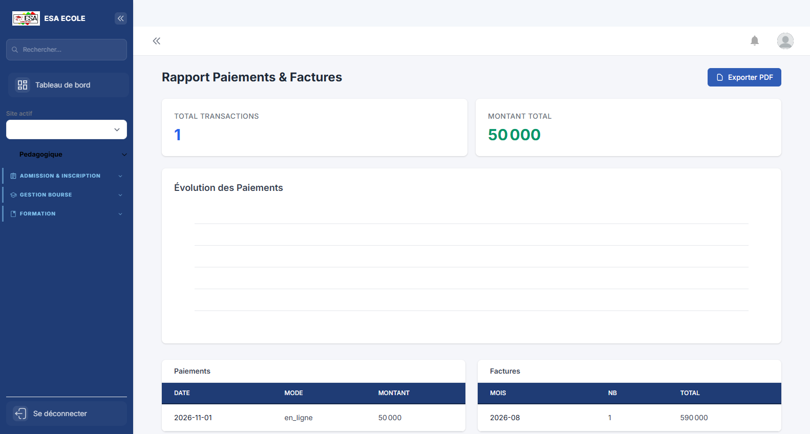

**Objectif :** Paiements des étudiants : saisie, recherche, historique et rattachement aux échéances.

**Actions principales :**

1. Rechercher un étudiant ou un paiement
2. Vérifier le montant et la référence
3. Enregistrer ou consulter le reçu

---

*Guide généré par `scripts/guide/generer-guides.cjs`. Les captures valides les plus récentes sont utilisées, avec repli sur les captures historiques.*
