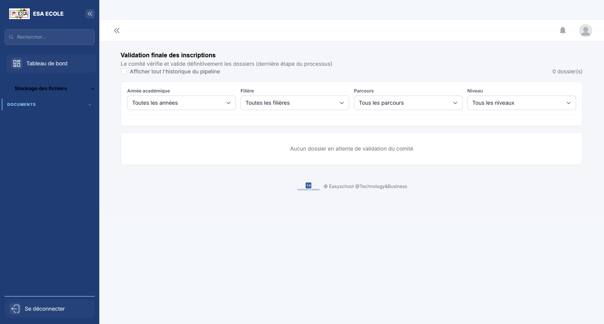
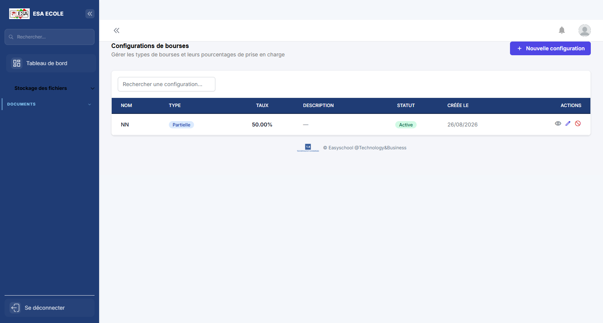
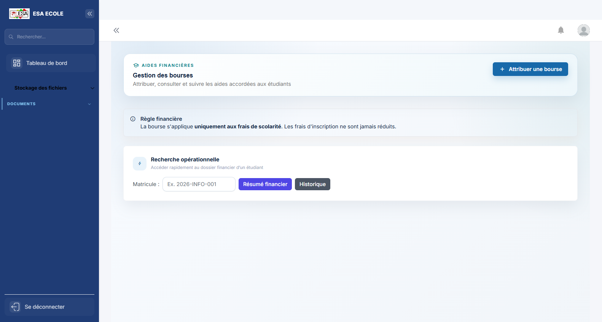
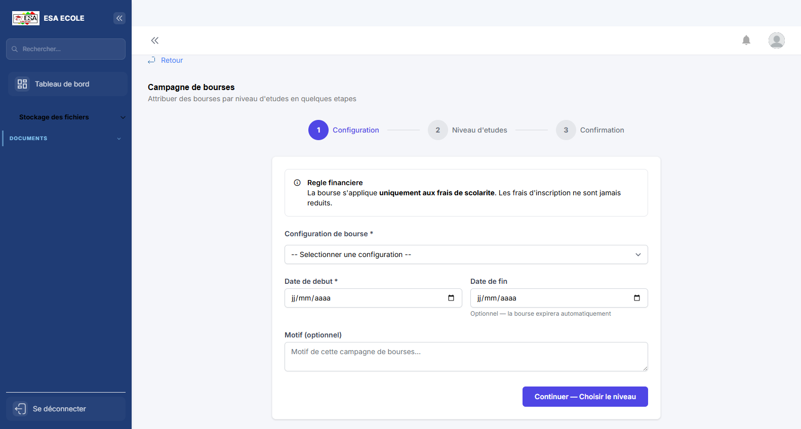
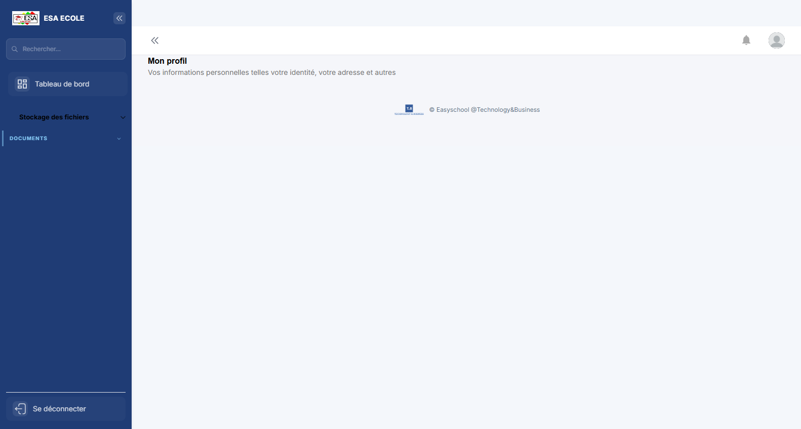
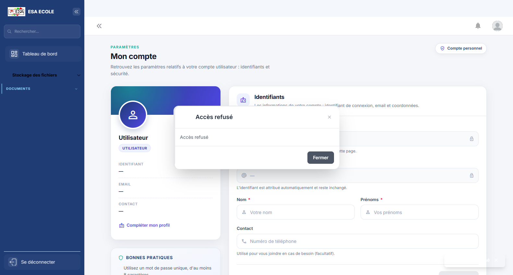
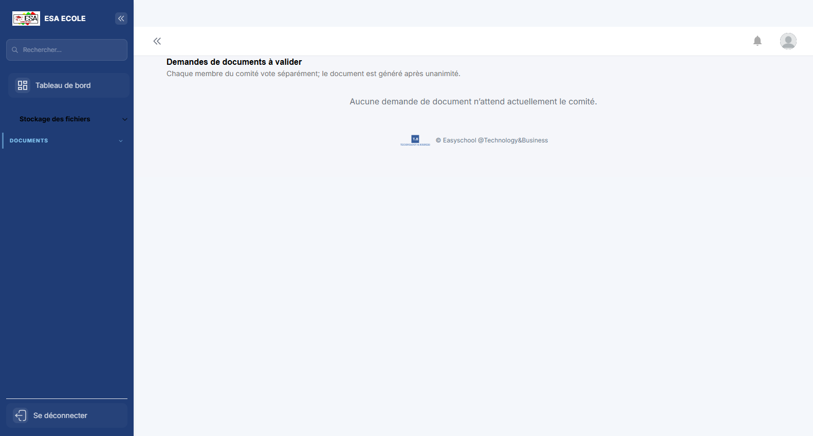
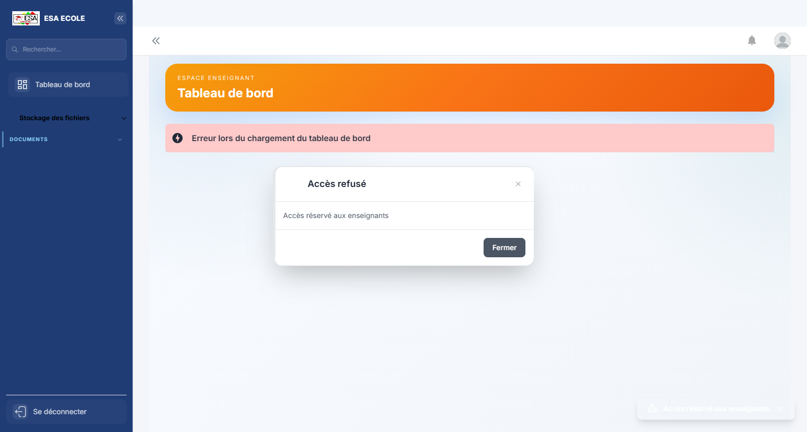

# Guide d'utilisation — Comité d'orientation

> Traitement des préinscriptions, validation des dossiers en comité, campagnes de bourses et demandes de documents.

**Profil :** Comité d'orientation  
**Nombre d'écrans :** 9  
**Généré le :** 02/11/2026

Ce guide présente les écrans du profil dans l'ordre d'utilisation conseillé. Chaque section contient une capture, l'objectif de l'écran et les actions principales.

## Sommaire

1. [Préinscriptions](#1-preinscriptions)
2. [Configurations](#2-configurations)
3. [Attributions](#3-attributions)
4. [Campagne de bourses](#4-campagne-de-bourses)
5. [Validation comité](#5-validation-comite)
6. [Mon profil](#6-mon-profil)
7. [Mon compte](#7-mon-compte)
8. [Demandes de documents](#8-demandes-de-documents)
9. [Mon tableau de bord](#9-mon-tableau-de-bord)

## 1. Préinscriptions

**Objectif :** Préinscriptions reçues : contrôle des informations, des pièces et des vœux du candidat.

**Actions principales :**

1. Ouvrir une préinscription
2. Contrôler le dossier
3. Valider ou demander une correction

---

## 2. Configurations

**Objectif :** Paramétrage du module : règles, barèmes et options appliquées aux dossiers.

**Actions principales :**

1. Choisir la configuration
2. Modifier les paramètres
3. Enregistrer et tester

---

## 3. Attributions

**Objectif :** Attribution des droits, responsabilités ou avantages aux personnes concernées.

**Actions principales :**

1. Rechercher la personne
2. Choisir l’attribution
3. Valider la période

---

## 4. Campagne de bourses

**Objectif :** Campagne d’attribution des bourses : critères, candidats et décisions.

**Actions principales :**

1. Ouvrir la campagne
2. Examiner les candidatures
3. Attribuer ou refuser

---

## 5. Validation comité

**Objectif :** Séance de validation collégiale : chaque membre examine, vote et signe la décision.

**Actions principales :**

1. Examiner les dossiers à l’ordre du jour
2. Voter
3. Signer la décision

---

## 6. Mon profil

**Objectif :** Informations personnelles et professionnelles du compte connecté : identité, contacts et rattachements.

**Actions principales :**

1. Vérifier ses informations
2. Mettre à jour les champs modifiables
3. Enregistrer

---

## 7. Mon compte

**Objectif :** Paramètres de sécurité du compte : mot de passe, double authentification et sessions.

**Actions principales :**

1. Changer le mot de passe
2. Activer ou vérifier le 2FA
3. Contrôler les sessions ouvertes

---

## 8. Demandes de documents

**Objectif :** Demandes de documents à traiter par le service concerné, avec pièces et statut.

**Actions principales :**

1. Ouvrir une demande
2. Vérifier les pièces et conditions
3. Valider ou générer le document

---

## 9. Mon tableau de bord

**Objectif :** Page d'accueil du profil : indicateurs personnels, alertes et raccourcis vers les tâches les plus fréquentes.

**Actions principales :**

1. Lire les indicateurs et alertes
2. Ouvrir un raccourci
3. Traiter les éléments en attente

---

*Guide généré par `scripts/guide/generer-guides.cjs`. Les captures valides les plus récentes sont utilisées, avec repli sur les captures historiques.*
