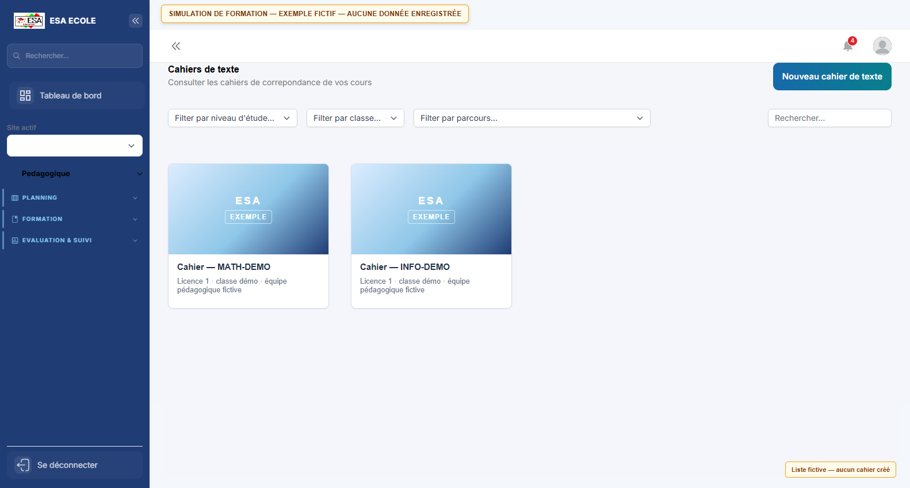
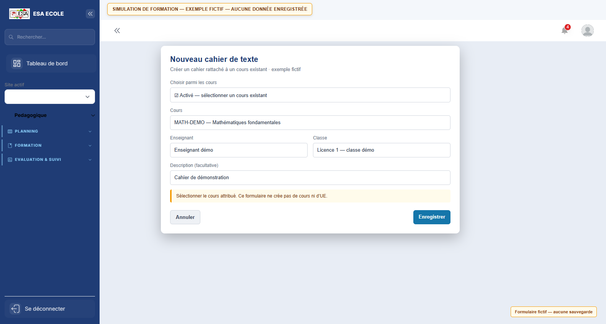
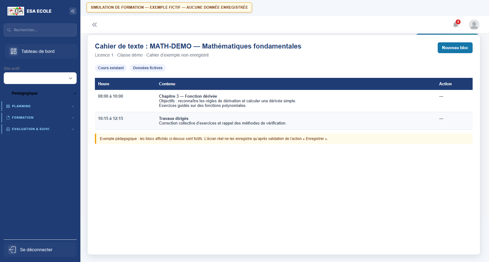
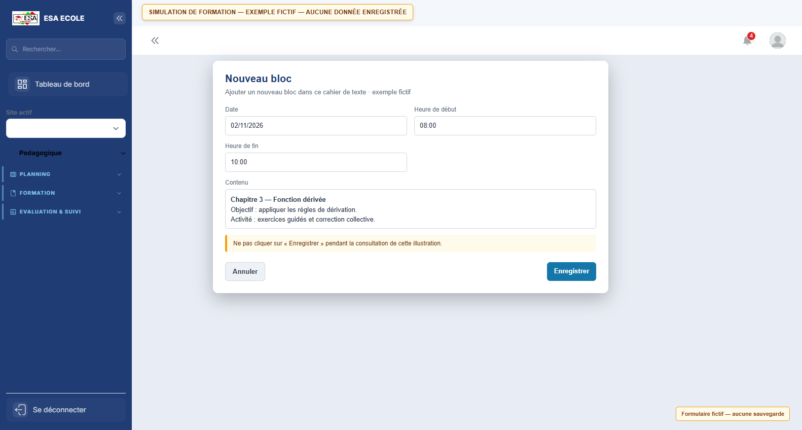
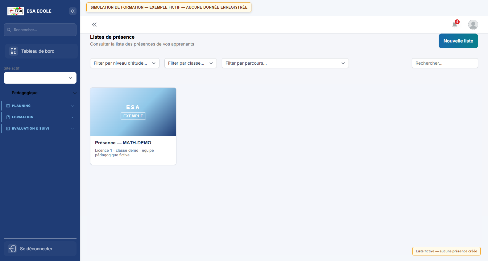
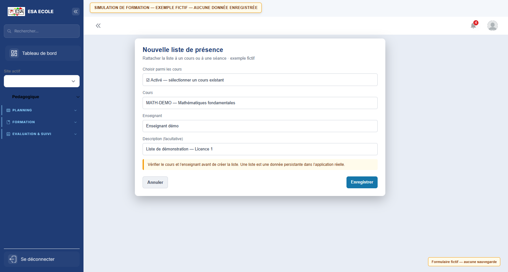
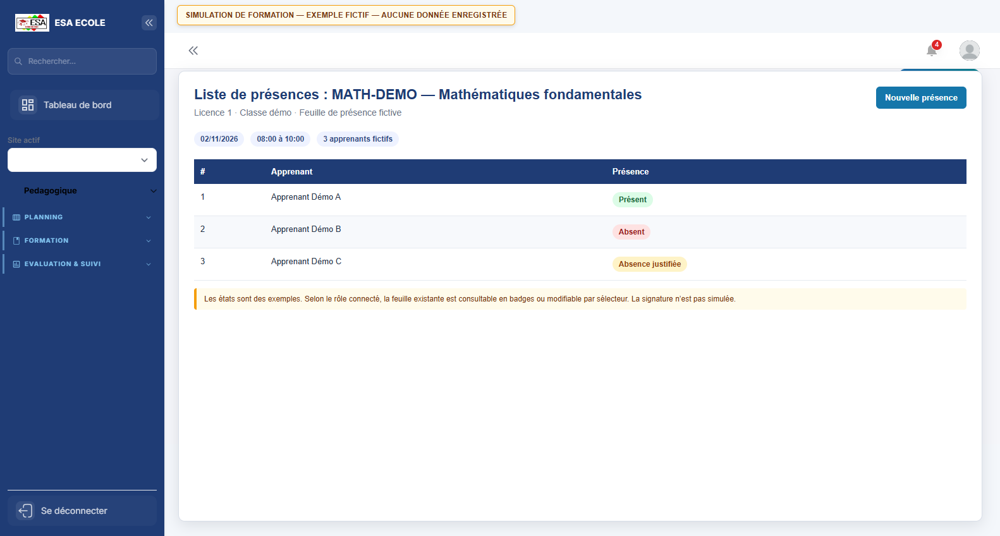
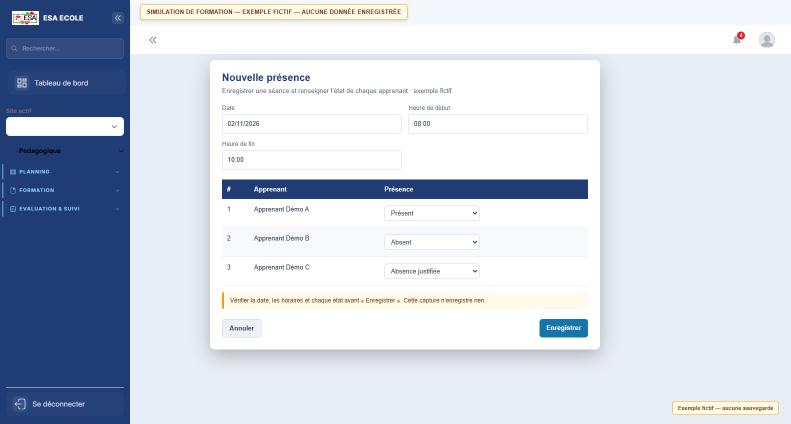

# Guide d'utilisation — Enseignant

> Enseignement et évaluation : consultation du planning attribué, cahiers de texte, présences, notes, bulletins, ressources et e-learning. La création et la publication des emplois du temps ne sont pas proposées au rôle Enseignant dans l'application actuelle.

**Profil :** Enseignant  
**Nombre d'écrans :** 29
**Généré le :** 08/11/2026

Ce guide présente les écrans du profil dans l'ordre d'utilisation conseillé. Chaque section contient une capture, l'objectif de l'écran et les actions principales.

## Sommaire

### Procédures pas à pas
- [Cahier de texte — vérifier le planning, créer le cahier et saisir une séance](#cahier-de-texte-verifier-le-planning-creer-le-cahier-et-saisir-une-seance)
- [Présences — créer une liste et enregistrer les états d’une séance](#presences-creer-une-liste-et-enregistrer-les-etats-d-une-seance)

1. [Salles de classe](#1-salles-de-classe)
2. [Équivalences](#2-equivalences)
3. [Dispenses](#3-dispenses)
4. [Emplois du temps](#4-emplois-du-temps)
5. [Calendrier](#5-calendrier)
6. [Sessions d'examens](#6-sessions-d-examens)
7. [Rattrapages](#7-rattrapages)
8. [Mon tableau de bord](#8-mon-tableau-de-bord)
9. [Notes](#9-notes)
10. [Bibliothèque](#10-bibliotheque)
11. [Bulletins](#11-bulletins)
12. [Moyennes](#12-moyennes)
13. [Absences](#13-absences)
14. [Conseils de classe](#14-conseils-de-classe)
15. [Annonces](#15-annonces)
16. [Vie estudiantine](#16-vie-estudiantine)
17. [Catalogue e-learning](#17-catalogue-e-learning)
18. [Mon profil](#18-mon-profil)
19. [Mon compte](#19-mon-compte)
20. [Tous les documents](#20-tous-les-documents)
21. [Unités d'enseignement](#21-unites-d-enseignement)
22. [Cahiers de texte — exemple fictif](#22-cahiers-de-texte-exemple-fictif)
23. [Cahier de texte — séances fictives](#23-cahier-de-texte-seances-fictives)
24. [Cahier de texte — formulaire de séance](#24-cahier-de-texte-formulaire-de-seance)
25. [Listes de présence — exemple fictif](#25-listes-de-presence-exemple-fictif)
26. [Feuille de présence — exemple fictif](#26-feuille-de-presence-exemple-fictif)
27. [Nouvelle séance de présence — exemple fictif](#27-nouvelle-seance-de-presence-exemple-fictif)
28. [Nouveau cahier de texte — formulaire fictif](#28-nouveau-cahier-de-texte-formulaire-fictif)
29. [Nouvelle liste de présence — formulaire fictif](#29-nouvelle-liste-de-presence-formulaire-fictif)

## Procédures pas à pas

### Cahier de texte — vérifier le planning, créer le cahier et saisir une séance

Les captures ci-dessous sont des illustrations statiques avec des données entièrement fictives. Elles ne créent aucun cours, cahier ou bloc. Un cahier doit être rattaché à un cours déjà attribué à l’enseignant ; si le cours n’existe pas ou n’apparaît pas, demander son affectation au service chargé de la planification.

#### Vérifier que le cours est programmé

1. **Ouvrir Emplois du temps et sélectionner la date, la classe ou l’enseignant pour consulter le planning.**
   - Pourquoi : Le cahier et ses blocs doivent correspondre à un cours et à une séance réellement programmés.
   - Responsable : Enseignant
2. **Si le cours ou le site n’apparaît pas, ne pas créer ni publier un emploi du temps depuis ce compte ; transmettre l’anomalie à l’administration ou au responsable de planification.**
   - Pourquoi : La création et la publication de l’emploi du temps sont réservées aux profils Institution, Administrateur et Superviseur général.
   - Responsable : Enseignant, puis Institution / Administrateur

#### Créer le cahier à partir d’un cours existant

1. **Ouvrir Cours > Cahiers de texte, puis filtrer par niveau, classe ou parcours et rechercher le cours.**
   - Pourquoi : Les filtres évitent d’ouvrir un cahier appartenant à une autre classe.
   - Responsable : Enseignant
2. **Si aucun cahier n’existe, cliquer sur Nouveau cahier de texte, activer Choisir parmi les cours et sélectionner le cours déjà attribué.**
   - Pourquoi : L’enseignant rattache le cahier à l’offre de cours existante ; il ne crée ni UE ni cours depuis ce formulaire.
   - Responsable : Enseignant
3. **Vérifier l’enseignant associé, ajouter une description si utile, puis cliquer sur Enregistrer.**
   - Pourquoi : L’enregistrement crée le cahier dans l’application ; la capture de démonstration, elle, ne sauvegarde rien.
   - Responsable : Enseignant

#### Ajouter le contenu d’une séance

1. **Ouvrir le cahier du cours et cliquer sur Nouveau bloc.**
   - Pourquoi : Chaque bloc décrit une séance dans le cahier sélectionné.
   - Responsable : Enseignant
2. **Renseigner la date, l’heure de début, l’heure de fin et le contenu réellement traité.**
   - Pourquoi : Ces champs sont requis et permettent de rapprocher le cahier de la séance planifiée.
   - Responsable : Enseignant
3. **Relire le contenu puis cliquer sur Enregistrer ; vérifier ensuite que le bloc apparaît dans le tableau.**
   - Pourquoi : L’enregistrement est une opération persistante ; contrôler le résultat évite les doublons ou les erreurs de date.
   - Responsable : Enseignant

### Présences — créer une liste et enregistrer les états d’une séance

Les captures de cette procédure présentent des apprenants et des états entièrement fictifs. Elles ne créent ni liste ni présence. Les droits et contrôles varient selon le rôle connecté et le site autorisé.

#### Ouvrir ou créer la liste du cours

1. **Ouvrir Cours > Présences, puis filtrer ou rechercher la liste liée au cours et à la classe concernés.**
   - Pourquoi : Réutiliser la bonne liste conserve l’historique des séances et évite les doublons.
   - Responsable : Enseignant
2. **Ouvrir la liste existante. Si elle n’existe pas, cliquer sur Nouvelle liste, choisir le cours existant, vérifier l’enseignant et enregistrer.**
   - Pourquoi : Une liste de présence est rattachée au cours ; les sélecteurs ne donnent pas le droit de créer un cours.
   - Responsable : Enseignant

#### Renseigner une séance et les participants

1. **Dans la liste, cliquer sur Nouvelle présence, puis renseigner la date, l’heure de début et l’heure de fin.**
   - Pourquoi : La feuille doit correspondre à la séance réellement tenue.
   - Responsable : Enseignant
2. **Contrôler les participants affichés et attribuer à chacun l’état exact : Présent, Absent, Absence justifiée ou Non renseigné.**
   - Pourquoi : Les états saisis dans le formulaire sont enregistrés avec la séance.
   - Responsable : Enseignant
3. **Relire les horaires et les états, puis cliquer sur Enregistrer. Vérifier la feuille après le retour à la liste.**
   - Pourquoi : L’enregistrement crée la séance et ses états ; toute correction ultérieure doit respecter les droits du rôle.
   - Responsable : Enseignant
4. **Signer la feuille seulement après contrôle si le bouton Signer la feuille est proposé.**
   - Pourquoi : La signature est une action engageante et n’est disponible que dans les conditions prévues par le rôle et la feuille.
   - Responsable : Enseignant

#### Cas du Surveillant

1. **Accéder uniquement aux listes et sites autorisés par le compte ; si l’écran indique qu’aucun site actif n’est autorisé, demander l’affectation au responsable.**
   - Pourquoi : La simulation ne doit pas contourner les restrictions de site.
   - Responsable : Surveillant / Administrateur
2. **Sur une feuille existante, choisir l’état dans le sélecteur affiché puis vérifier le résultat.**
   - Pourquoi : Pour le rôle Surveillant, le changement de sélection enregistre immédiatement l’état ; il n’y a pas de bouton Enregistrer distinct sur cette cellule.
   - Responsable : Surveillant

## 1. Salles de classe

**Objectif :** Référentiel des salles et de leurs capacités, utilisé pour les emplois du temps et les examens.

**Actions principales :**

1. Créer une salle
2. Renseigner la capacité
3. Affecter aux cours ou examens

---

## 2. Équivalences

**Objectif :** Reconnaissance d’UE ou de crédits obtenus ailleurs.

**Actions principales :**

1. Créer une demande
2. Joindre les justificatifs
3. Valider l’équivalence

---

## 3. Dispenses

**Objectif :** Dispenses d’assiduité ou d’épreuve accordées à un étudiant.

**Actions principales :**

1. Choisir l’étudiant
2. Renseigner le motif
3. Valider la dispense

---

## 4. Emplois du temps

**Objectif :** Planning des cours par classe, enseignant et salle. Les profils Institution, Administrateur et Superviseur général peuvent gérer et publier le planning dans leur périmètre autorisé ; les autres profils le consultent.

**Actions principales :**

1. Vérifier le site actif autorisé
2. Consulter ou gérer les séances selon le rôle
3. Vérifier les conflits puis publier le planning si le rôle le permet

---

## 5. Calendrier

**Objectif :** Calendrier académique : sessions, examens, périodes de saisie et événements de l’établissement.

**Actions principales :**

1. Choisir la période
2. Consulter un événement
3. S’abonner ou exporter le calendrier

---

## 6. Sessions d'examens

**Objectif :** Programmation des examens : dates, salles, surveillants et épreuves.

**Actions principales :**

1. Créer une session
2. Affecter salles et surveillants
3. Publier le planning

---

## 7. Rattrapages

**Objectif :** Sessions de rattrapage : inscription, épreuves et résultats.

**Actions principales :**

1. Créer une session
2. Inscrire les étudiants
3. Saisir les résultats

---

## 8. Mon tableau de bord

**Objectif :** Page d'accueil du profil : indicateurs personnels, alertes et raccourcis vers les tâches les plus fréquentes.

**Actions principales :**

1. Lire les indicateurs et alertes
2. Ouvrir un raccourci
3. Traiter les éléments en attente

---

## 9. Notes

**Objectif :** Saisie et consultation des notes par classe, UE et type d’évaluation.

**Actions principales :**

1. Choisir la classe et l’UE
2. Saisir les notes
3. Vérifier puis publier

---

## 10. Bibliothèque

**Objectif :** Catalogue des ouvrages disponibles, avec recherche et consultation des fiches.

**Actions principales :**

1. Rechercher un ouvrage
2. Consulter la fiche et la disponibilité
3. Réserver ou emprunter

---

## 11. Bulletins

**Objectif :** Bulletins générés à partir des notes : moyennes, crédits, mentions et décisions.

**Actions principales :**

1. Choisir l’année et la classe
2. Générer les bulletins
3. Contrôler et publier

---

## 12. Moyennes

**Objectif :** Calcul et contrôle des moyennes par étudiant, UE et semestre.

**Actions principales :**

1. Sélectionner le périmètre
2. Lancer le calcul
3. Contrôler les anomalies

---

## 13. Absences

**Objectif :** Suivi des absences et justificatifs, avec alertes et statistiques.

**Actions principales :**

1. Filtrer les absences
2. Vérifier un justificatif
3. Valider ou sanctionner

---

## 14. Conseils de classe

**Objectif :** Préparation et tenue des conseils de classe : synthèse par étudiant et avis.

**Actions principales :**

1. Choisir la classe
2. Consulter les synthèses
3. Saisir les avis

---

## 15. Annonces

**Objectif :** Publication et consultation des annonces destinées aux étudiants, enseignants ou personnels.

**Actions principales :**

1. Créer ou ouvrir une annonce
2. Choisir le public cible
3. Publier ou archiver

---

## 16. Vie estudiantine

**Objectif :** Actualités, activités et informations de la vie étudiante.

**Actions principales :**

1. Parcourir les publications
2. Ouvrir une actualité
3. Participer ou réagir

---

## 17. Catalogue e-learning

**Objectif :** Cours en ligne publiés pour l’année et le niveau de l’apprenant, avec crédits et tarif.

**Actions principales :**

1. Parcourir le catalogue
2. Vérifier les prérequis
3. Choisir une UE

---

## 18. Mon profil

**Objectif :** Informations personnelles et professionnelles du compte connecté : identité, contacts et rattachements.

**Actions principales :**

1. Vérifier ses informations
2. Mettre à jour les champs modifiables
3. Enregistrer

---

## 19. Mon compte

**Objectif :** Paramètres de sécurité du compte : mot de passe, double authentification et sessions.

**Actions principales :**

1. Changer le mot de passe
2. Activer ou vérifier le 2FA
3. Contrôler les sessions ouvertes

---

## 20. Tous les documents

**Objectif :** Vue transversale des documents produits ou déposés, avec filtres et recherche.

**Actions principales :**

1. Filtrer par type ou étudiant
2. Ouvrir un document
3. Contrôler ou télécharger

---

## 21. Unités d'enseignement

**Objectif :** UE et ECUE : crédits, volumes horaires, semestres et prérequis.

**Actions principales :**

1. Créer une UE
2. Ajouter les ECUE
3. Définir crédits et prérequis

---

## 22. Cahiers de texte — exemple fictif

**Objectif :** Illustration de la liste des cahiers associés à des cours existants. Les noms, classes et codes affichés sont fictifs.

**Actions principales :**

1. Filtrer par niveau, classe ou parcours
2. Rechercher le cours déjà attribué
3. Ouvrir le cahier concerné

---

## 23. Cahier de texte — séances fictives

**Objectif :** Illustration de blocs de cours comportant un horaire et un contenu pédagogique d’exemple, sans enregistrement.

**Actions principales :**

1. Vérifier le cours et la classe
2. Relire la date et les horaires du bloc
3. Vérifier que le contenu décrit la séance réellement dispensée

---

## 24. Cahier de texte — formulaire de séance

**Objectif :** Exemple du formulaire de création d’un bloc : date, heure de début, heure de fin et contenu sont obligatoires.

**Actions principales :**

1. Renseigner la date et les deux horaires
2. Décrire le contenu effectivement traité
3. Enregistrer uniquement après vérification

---

## 25. Listes de présence — exemple fictif

**Objectif :** Illustration de la liste de présence d’un cours existant. Les personnes et le cours affichés sont fictifs.

**Actions principales :**

1. Filtrer ou rechercher une liste
2. Ouvrir la liste correspondant au cours
3. Créer une liste seulement si elle n’existe pas

---

## 26. Feuille de présence — exemple fictif

**Objectif :** Exemple de feuille avec les états Présent, Absent et Absence justifiée. Aucun état n’a été enregistré.

**Actions principales :**

1. Vérifier le cours, la date et les horaires
2. Contrôler chaque état de présence
3. Signer uniquement après vérification si cette action est disponible

---

## 27. Nouvelle séance de présence — exemple fictif

**Objectif :** Illustration du formulaire qui associe une date et des horaires aux participants et à leur état de présence.

**Actions principales :**

1. Renseigner la date et les horaires
2. Vérifier la liste des participants
3. Renseigner les états puis enregistrer

---

## 28. Nouveau cahier de texte — formulaire fictif

**Objectif :** Illustration du formulaire qui rattache un cahier à un cours déjà existant, avec l’enseignant et une description facultative.

**Actions principales :**

1. Choisir parmi les cours
2. Sélectionner le cours attribué
3. Vérifier l’enseignant avant d’enregistrer

---

## 29. Nouvelle liste de présence — formulaire fictif

**Objectif :** Illustration du formulaire de création d’une liste rattachée à un cours existant.

**Actions principales :**

1. Choisir un cours existant
2. Vérifier l’enseignant
3. Enregistrer la liste après contrôle

---

*Guide généré par `scripts/guide/generer-guides.cjs`. Les captures valides les plus récentes sont utilisées, avec repli sur les captures historiques.*
