# Guide d'utilisation — Enseignant

> Enseignement et évaluation : cahiers de texte, présences, notes, bulletins, conseils de classe, ressources et e-learning.

**Profil :** Enseignant  
**Nombre d'écrans :** 23  
**Généré le :** 02/11/2026

Ce guide présente les écrans du profil dans l'ordre d'utilisation conseillé. Chaque section contient une capture, l'objectif de l'écran et les actions principales.

## Sommaire

1. [Salles de classe](#1-salles-de-classe)
2. [Équivalences](#2-equivalences)
3. [Dispenses](#3-dispenses)
4. [Emplois du temps](#4-emplois-du-temps)
5. [Calendrier](#5-calendrier)
6. [Sessions d'examens](#6-sessions-d-examens)
7. [Rattrapages](#7-rattrapages)
8. [Mon tableau de bord](#8-mon-tableau-de-bord)
9. [Cahiers de texte](#9-cahiers-de-texte)
10. [Cahier de présence](#10-cahier-de-presence)
11. [Notes](#11-notes)
12. [Bibliothèque](#12-bibliotheque)
13. [Bulletins](#13-bulletins)
14. [Moyennes](#14-moyennes)
15. [Absences](#15-absences)
16. [Conseils de classe](#16-conseils-de-classe)
17. [Annonces](#17-annonces)
18. [Vie estudiantine](#18-vie-estudiantine)
19. [Catalogue e-learning](#19-catalogue-e-learning)
20. [Mon profil](#20-mon-profil)
21. [Mon compte](#21-mon-compte)
22. [Tous les documents](#22-tous-les-documents)
23. [Unités d'enseignement](#23-unites-d-enseignement)

## 1. Salles de classe

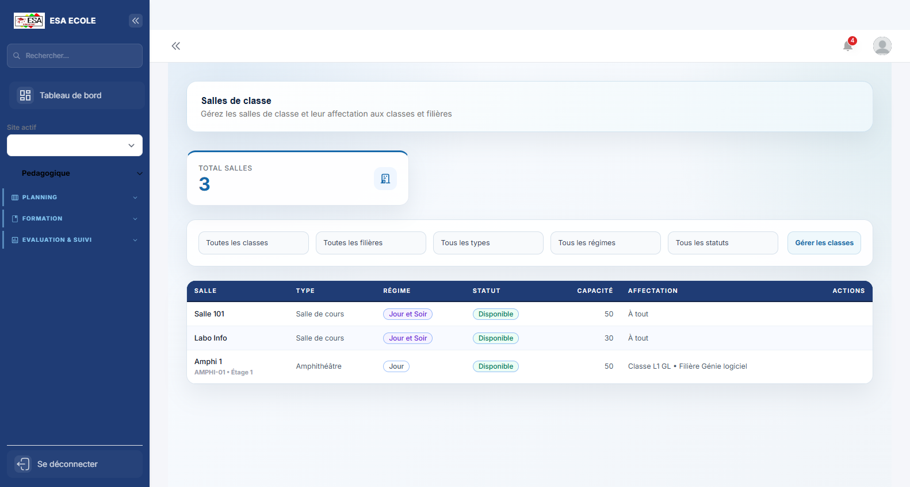

**Objectif :** Référentiel des salles et de leurs capacités, utilisé pour les emplois du temps et les examens.

**Actions principales :**

1. Créer une salle
2. Renseigner la capacité
3. Affecter aux cours ou examens

---

## 2. Équivalences

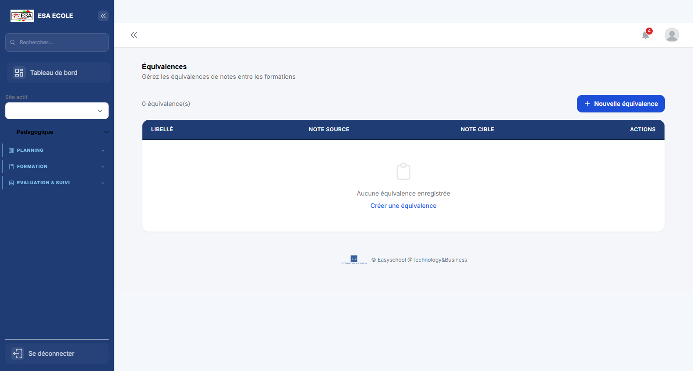

**Objectif :** Reconnaissance d’UE ou de crédits obtenus ailleurs.

**Actions principales :**

1. Créer une demande
2. Joindre les justificatifs
3. Valider l’équivalence

---

## 3. Dispenses

**Objectif :** Dispenses d’assiduité ou d’épreuve accordées à un étudiant.

**Actions principales :**

1. Choisir l’étudiant
2. Renseigner le motif
3. Valider la dispense

---

## 4. Emplois du temps

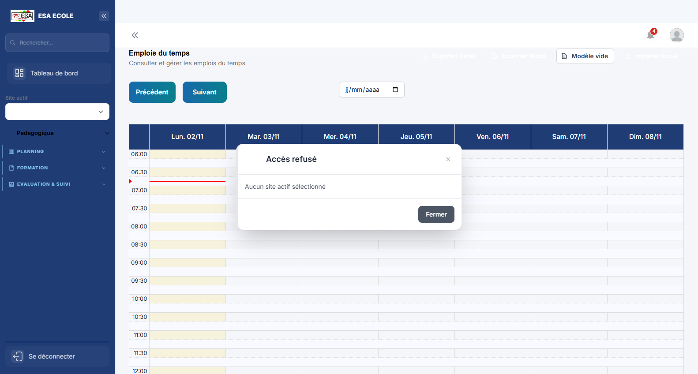

**Objectif :** Planning des cours par classe, enseignant et salle.

**Actions principales :**

1. Choisir la classe ou l’enseignant
2. Consulter le planning
3. Détecter les conflits

---

## 5. Calendrier

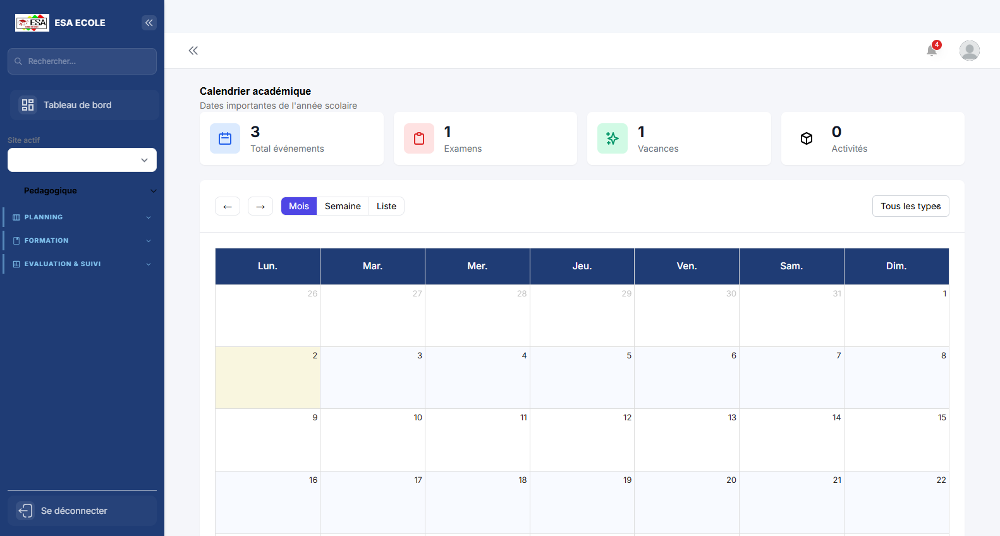

**Objectif :** Calendrier académique : sessions, examens, périodes de saisie et événements de l’établissement.

**Actions principales :**

1. Choisir la période
2. Consulter un événement
3. S’abonner ou exporter le calendrier

---

## 6. Sessions d'examens

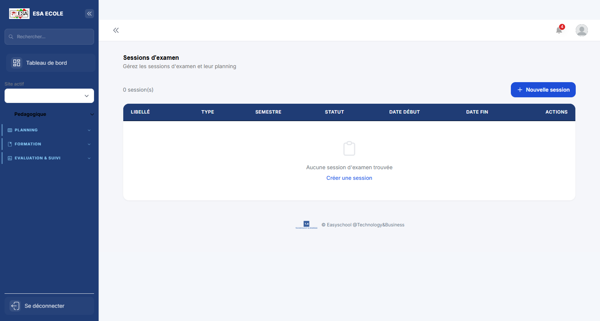

**Objectif :** Programmation des examens : dates, salles, surveillants et épreuves.

**Actions principales :**

1. Créer une session
2. Affecter salles et surveillants
3. Publier le planning

---

## 7. Rattrapages

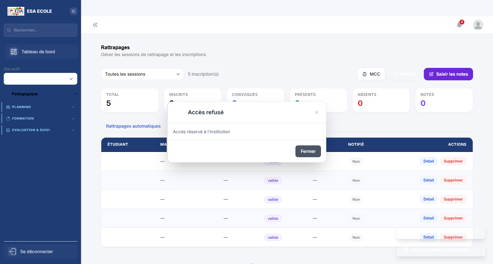

**Objectif :** Sessions de rattrapage : inscription, épreuves et résultats.

**Actions principales :**

1. Créer une session
2. Inscrire les étudiants
3. Saisir les résultats

---

## 8. Mon tableau de bord

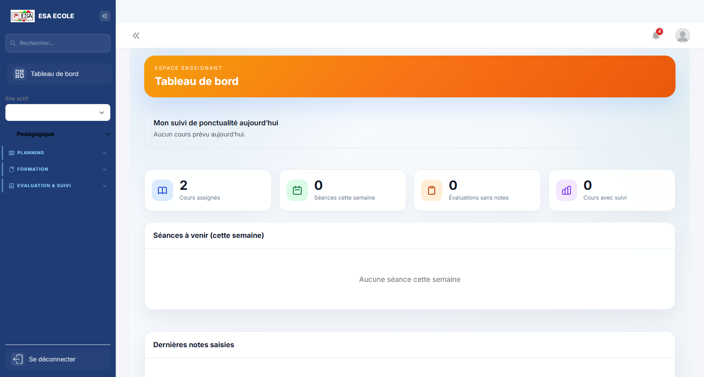

**Objectif :** Page d'accueil du profil : indicateurs personnels, alertes et raccourcis vers les tâches les plus fréquentes.

**Actions principales :**

1. Lire les indicateurs et alertes
2. Ouvrir un raccourci
3. Traiter les éléments en attente

---

## 9. Cahiers de texte

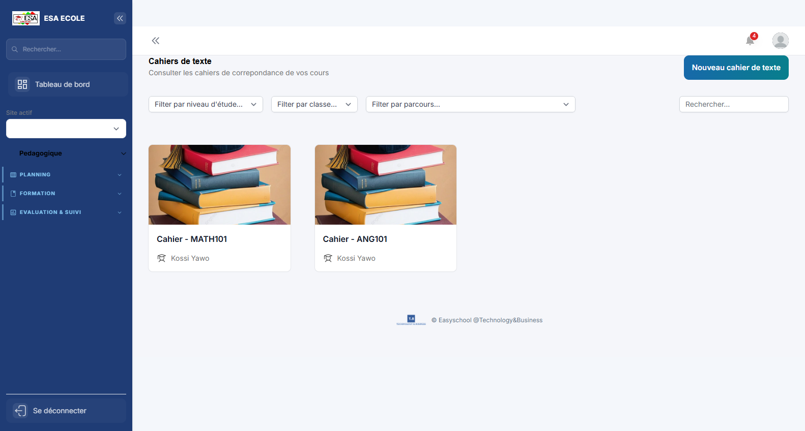

**Objectif :** Contenu des séances : objectifs, activités, devoirs et ressources.

**Actions principales :**

1. Choisir la classe et la séance
2. Renseigner le contenu
3. Publier pour les étudiants

---

## 10. Cahier de présence

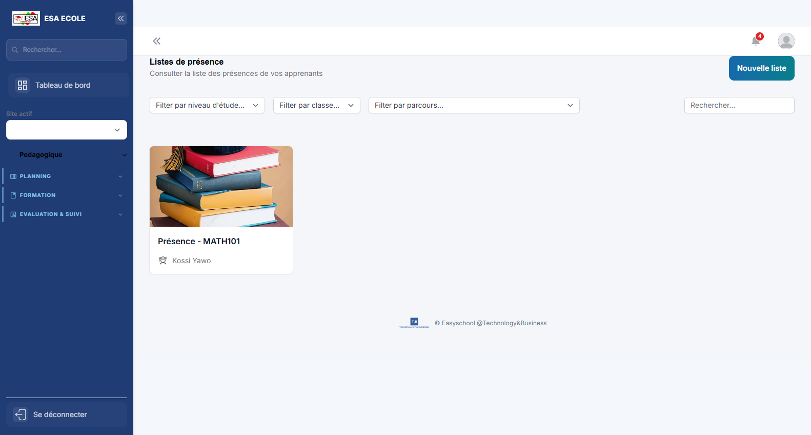

**Objectif :** Appel et suivi des présences par séance, avec motif d’absence.

**Actions principales :**

1. Ouvrir la séance
2. Marquer les présents et absents
3. Enregistrer

---

## 11. Notes

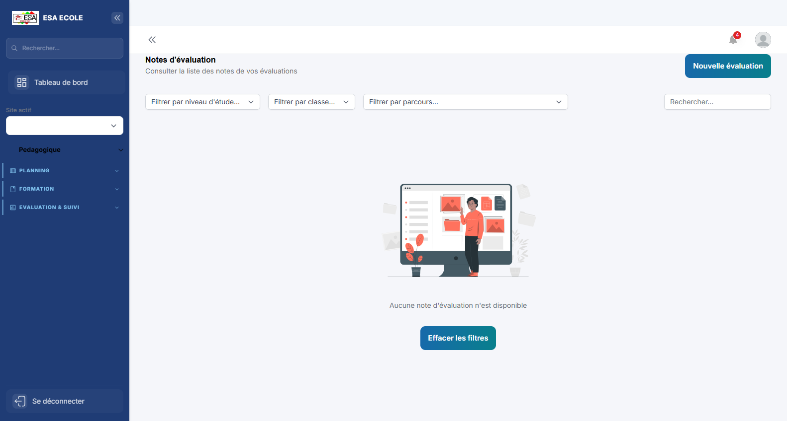

**Objectif :** Saisie et consultation des notes par classe, UE et type d’évaluation.

**Actions principales :**

1. Choisir la classe et l’UE
2. Saisir les notes
3. Vérifier puis publier

---

## 12. Bibliothèque

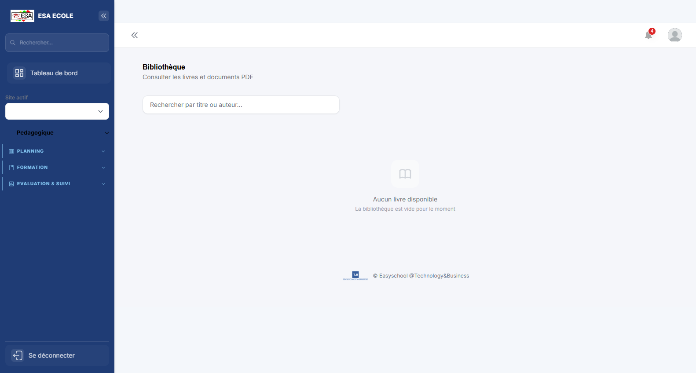

**Objectif :** Catalogue des ouvrages disponibles, avec recherche et consultation des fiches.

**Actions principales :**

1. Rechercher un ouvrage
2. Consulter la fiche et la disponibilité
3. Réserver ou emprunter

---

## 13. Bulletins

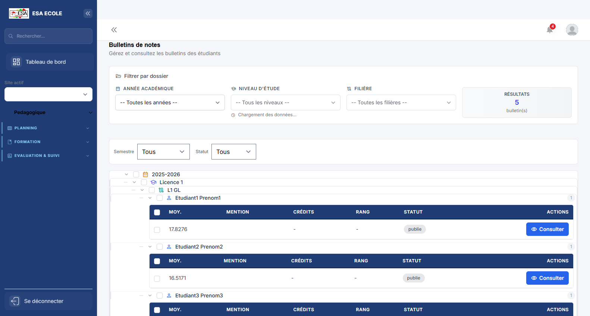

**Objectif :** Bulletins générés à partir des notes : moyennes, crédits, mentions et décisions.

**Actions principales :**

1. Choisir l’année et la classe
2. Générer les bulletins
3. Contrôler et publier

---

## 14. Moyennes

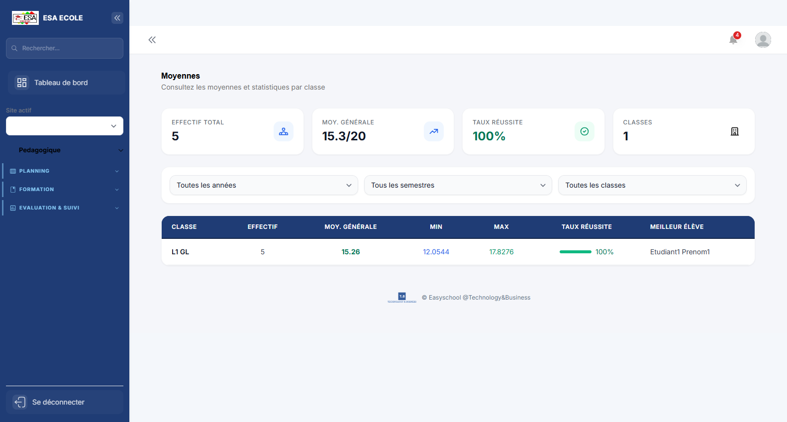

**Objectif :** Calcul et contrôle des moyennes par étudiant, UE et semestre.

**Actions principales :**

1. Sélectionner le périmètre
2. Lancer le calcul
3. Contrôler les anomalies

---

## 15. Absences

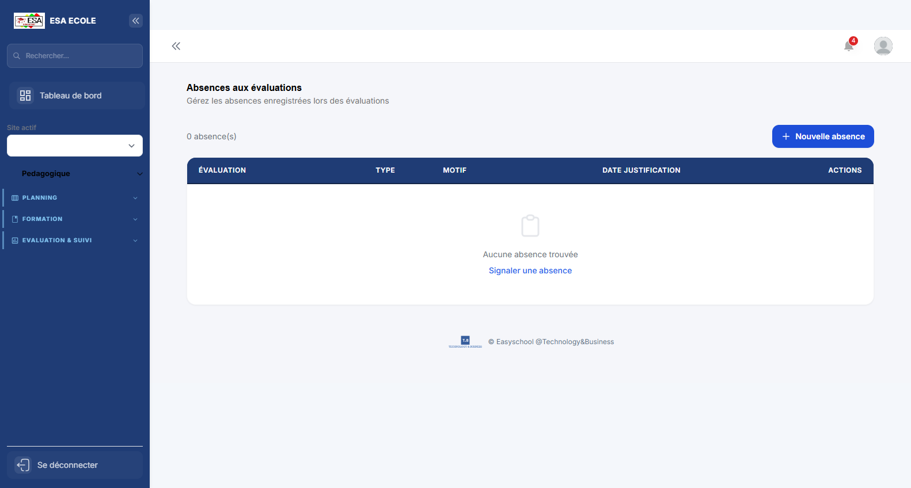

**Objectif :** Suivi des absences et justificatifs, avec alertes et statistiques.

**Actions principales :**

1. Filtrer les absences
2. Vérifier un justificatif
3. Valider ou sanctionner

---

## 16. Conseils de classe

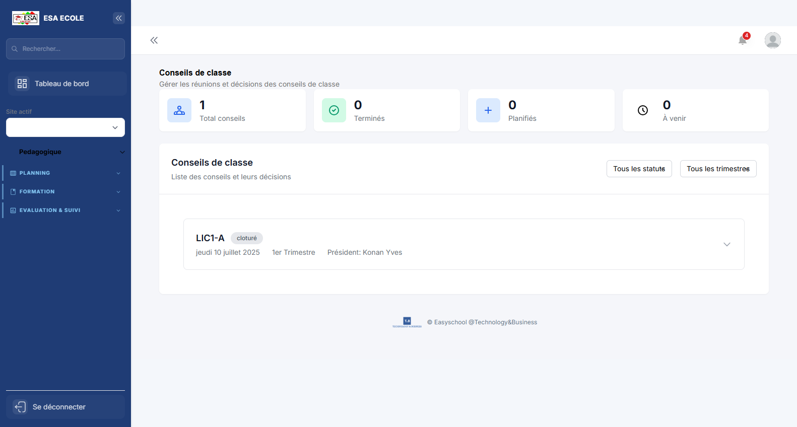

**Objectif :** Préparation et tenue des conseils de classe : synthèse par étudiant et avis.

**Actions principales :**

1. Choisir la classe
2. Consulter les synthèses
3. Saisir les avis

---

## 17. Annonces

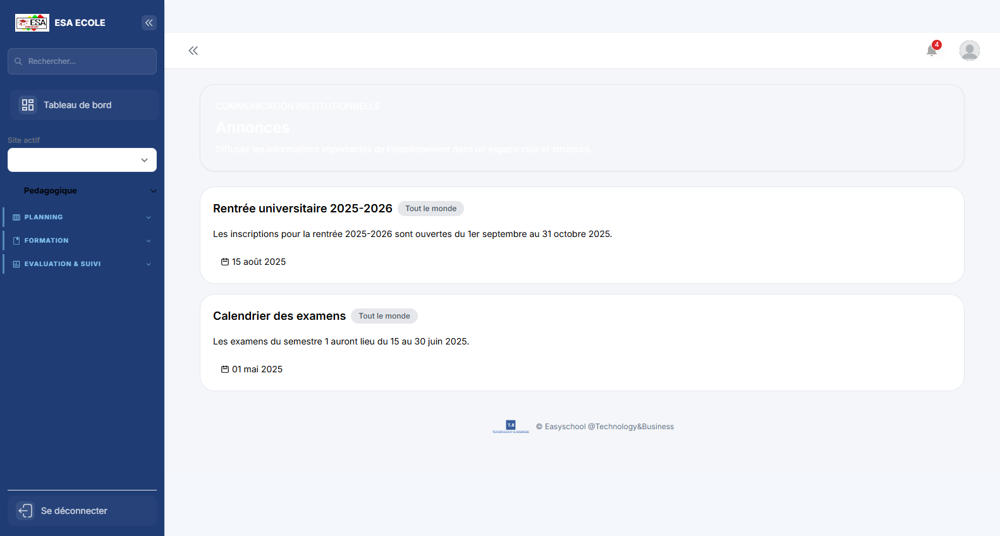

**Objectif :** Publication et consultation des annonces destinées aux étudiants, enseignants ou personnels.

**Actions principales :**

1. Créer ou ouvrir une annonce
2. Choisir le public cible
3. Publier ou archiver

---

## 18. Vie estudiantine

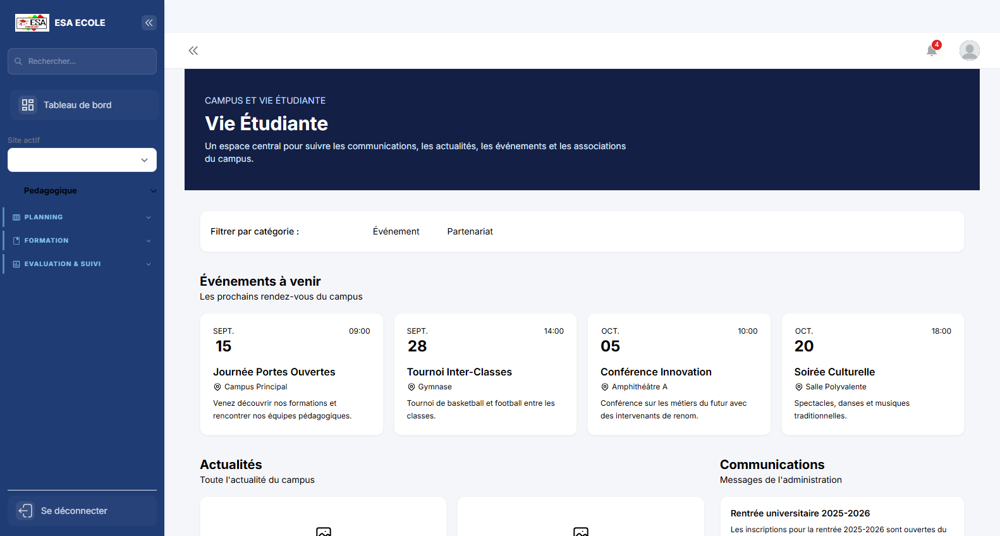

**Objectif :** Actualités, activités et informations de la vie étudiante.

**Actions principales :**

1. Parcourir les publications
2. Ouvrir une actualité
3. Participer ou réagir

---

## 19. Catalogue e-learning

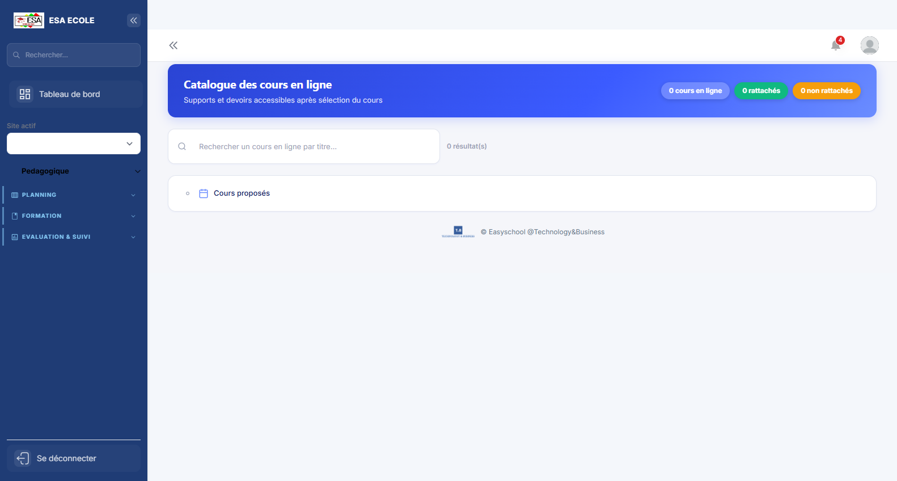

**Objectif :** Cours en ligne publiés pour l’année et le niveau de l’apprenant, avec crédits et tarif.

**Actions principales :**

1. Parcourir le catalogue
2. Vérifier les prérequis
3. Choisir une UE

---

## 20. Mon profil

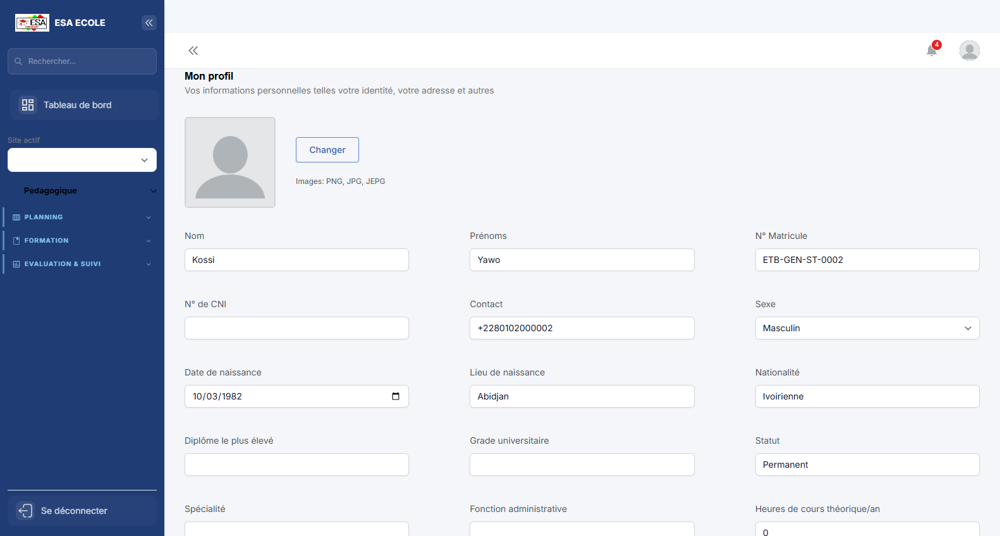

**Objectif :** Informations personnelles et professionnelles du compte connecté : identité, contacts et rattachements.

**Actions principales :**

1. Vérifier ses informations
2. Mettre à jour les champs modifiables
3. Enregistrer

---

## 21. Mon compte

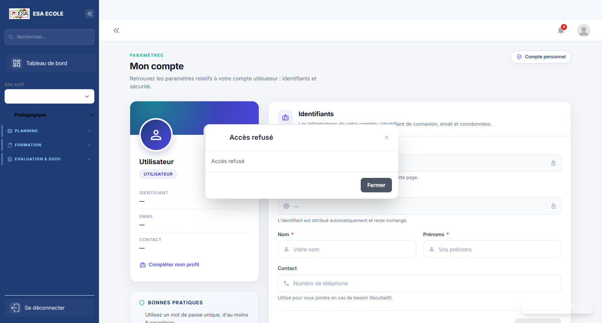

**Objectif :** Paramètres de sécurité du compte : mot de passe, double authentification et sessions.

**Actions principales :**

1. Changer le mot de passe
2. Activer ou vérifier le 2FA
3. Contrôler les sessions ouvertes

---

## 22. Tous les documents

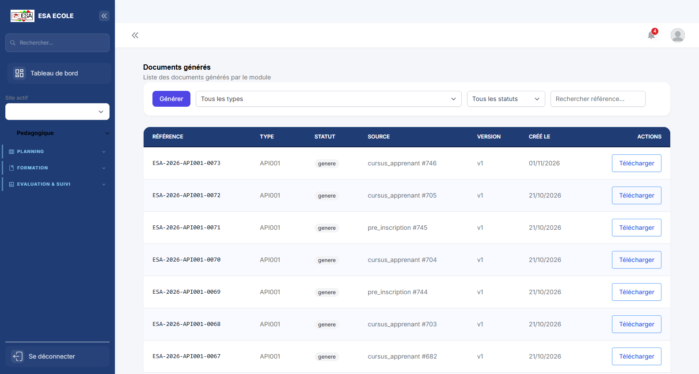

**Objectif :** Vue transversale des documents produits ou déposés, avec filtres et recherche.

**Actions principales :**

1. Filtrer par type ou étudiant
2. Ouvrir un document
3. Contrôler ou télécharger

---

## 23. Unités d'enseignement

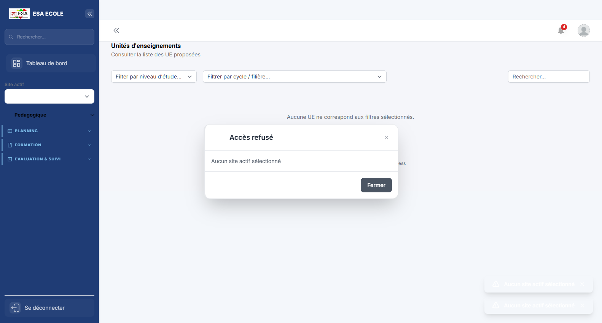

**Objectif :** UE et ECUE : crédits, volumes horaires, semestres et prérequis.

**Actions principales :**

1. Créer une UE
2. Ajouter les ECUE
3. Définir crédits et prérequis

---

*Guide généré par `scripts/guide/generer-guides.cjs`. Les captures valides les plus récentes sont utilisées, avec repli sur les captures historiques.*
