# Guide d'utilisation — Étudiants (Apprenants)

> Parcours de l'étudiant : inscription, dossier, réinscription, paiements et échéances, notes et bulletins, documents, vie estudiantine et e-learning.

**Profil :** Étudiants (Apprenants)  
**Nombre d'écrans :** 22  
**Généré le :** 02/11/2026

Ce guide présente les écrans du profil dans l'ordre d'utilisation conseillé. Chaque section contient une capture, l'objectif de l'écran et les actions principales.

## Sommaire

1. [Parcours](#1-parcours)
2. [Demandes](#2-demandes)
3. [Demandes d'orientation](#3-demandes-d-orientation)
4. [Parcours d'orientation](#4-parcours-d-orientation)
5. [Mes bordereaux](#5-mes-bordereaux)
6. [Mon dossier](#6-mon-dossier)
7. [Réorientation](#7-reorientation)
8. [Réclamations](#8-reclamations)
9. [Calendrier](#9-calendrier)
10. [Bibliothèque](#10-bibliotheque)
11. [Annonces](#11-annonces)
12. [Vie estudiantine](#12-vie-estudiantine)
13. [Suggestions](#13-suggestions)
14. [Paiements](#14-paiements)
15. [Échéances](#15-echeances)
16. [Discussions](#16-discussions)
17. [Mon profil](#17-mon-profil)
18. [Mon compte](#18-mon-compte)
19. [Diplômes](#19-diplomes)
20. [Demandes de documents](#20-demandes-de-documents)
21. [Mes documents](#21-mes-documents)
22. [Demandes VAE](#22-demandes-vae)

## 1. Parcours

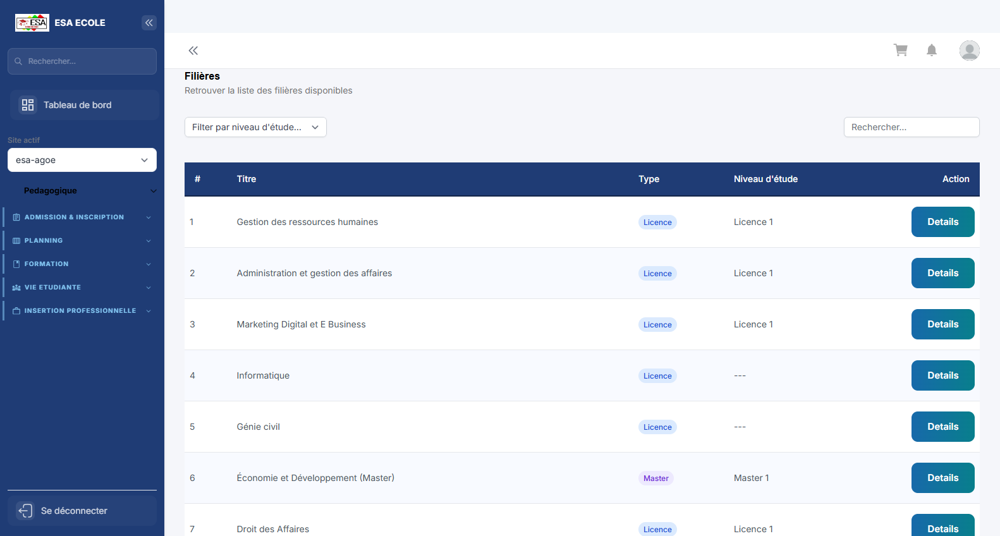

**Objectif :** Catalogue des parcours de formation : niveaux, UE, crédits et conditions d’accès.

**Actions principales :**

1. Créer ou modifier un parcours
2. Rattacher les UE
3. Vérifier les prérequis

---

## 2. Demandes

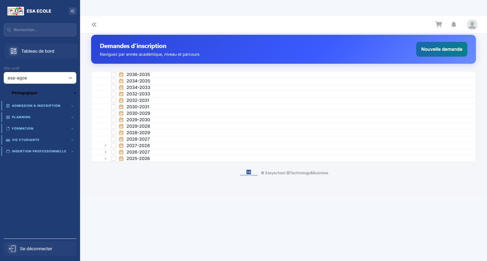

**Objectif :** File des demandes d’inscription ou de réinscription avec leur statut dans le pipeline.

**Actions principales :**

1. Filtrer par statut
2. Ouvrir un dossier
3. Faire avancer l’étape

---

## 3. Demandes d'orientation

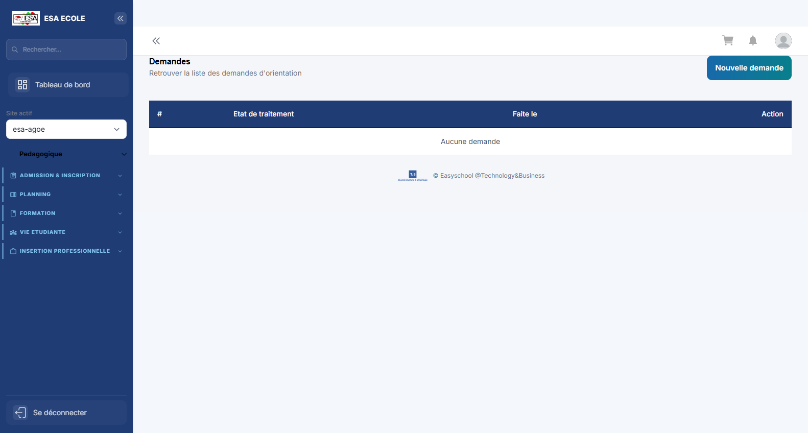

**Objectif :** Demandes d’orientation des candidats : choix de parcours, pièces et décision du comité.

**Actions principales :**

1. Consulter les demandes
2. Vérifier les pièces
3. Instruire ou orienter

---

## 4. Parcours d'orientation

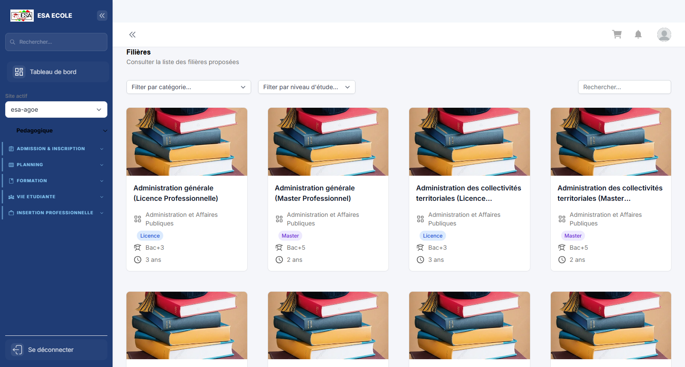

**Objectif :** Parcours proposés à l’orientation, avec leurs débouchés et conditions d’admission.

**Actions principales :**

1. Consulter l’offre
2. Associer les niveaux
3. Publier les parcours

---

## 5. Mes bordereaux

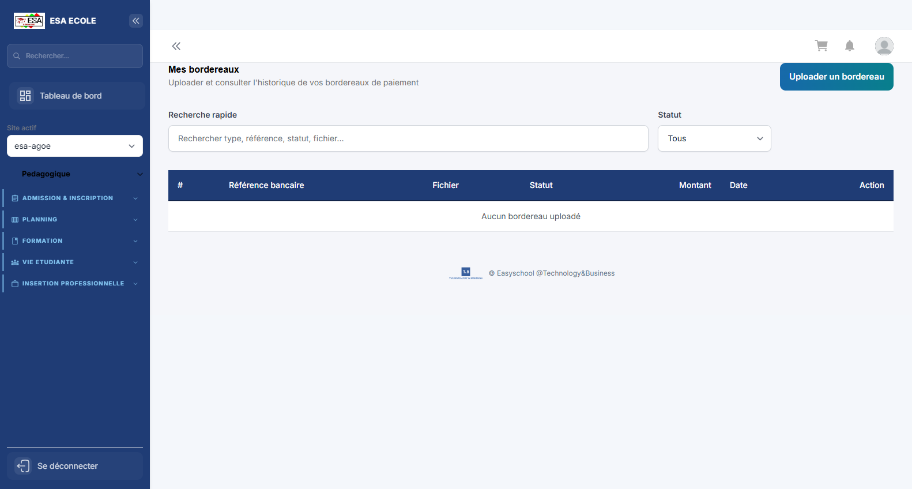

**Objectif :** Bordereaux déposés par l’étudiant (ou suivis par le profil) avec leur état d’authentification et d’imputation.

**Actions principales :**

1. Déposer ou consulter un bordereau
2. Suivre son statut
3. Télécharger le reçu

---

## 6. Mon dossier

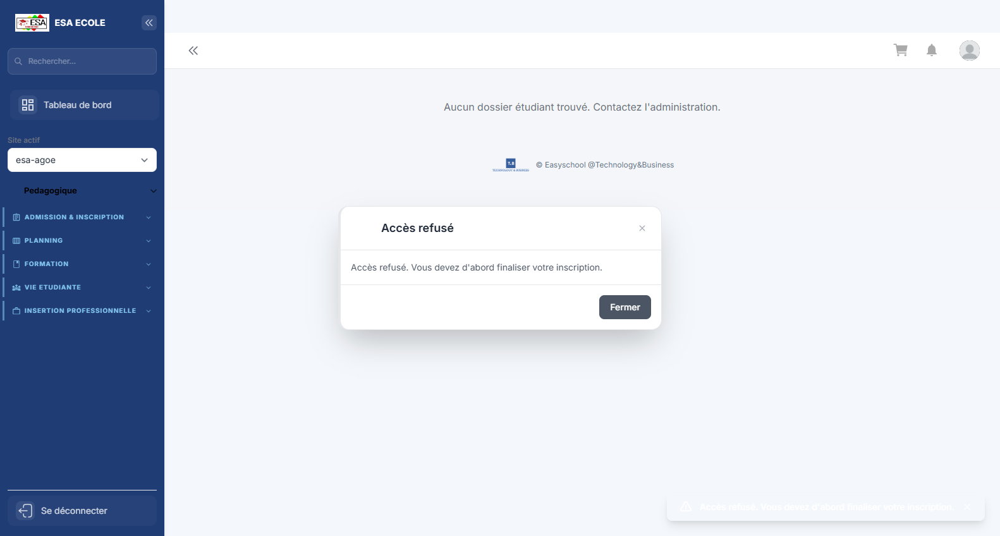

**Objectif :** Dossier administratif de l’étudiant : identité, pièces, inscriptions et suivi.

**Actions principales :**

1. Vérifier les informations
2. Compléter une pièce manquante
3. Suivre la validation

---

## 7. Réorientation

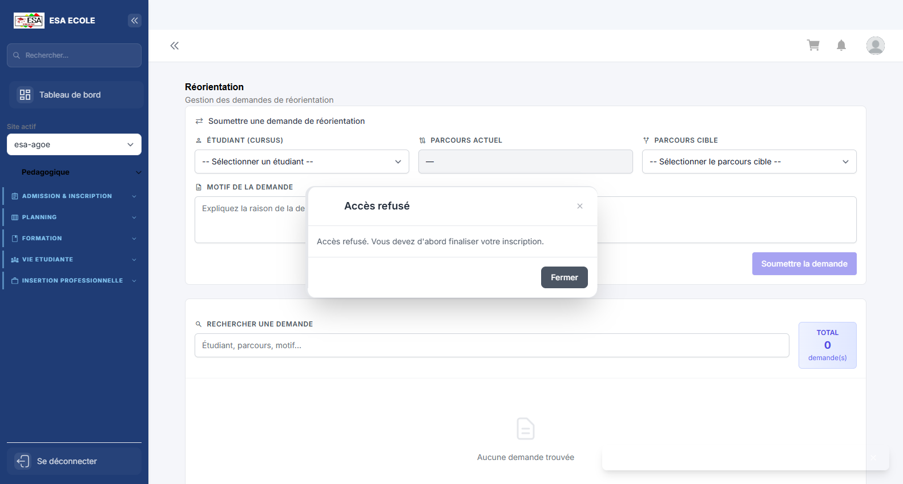

**Objectif :** Demandes de réorientation vers un autre parcours ou niveau.

**Actions principales :**

1. Créer une demande
2. Joindre les motifs
3. Suivre la décision

---

## 8. Réclamations

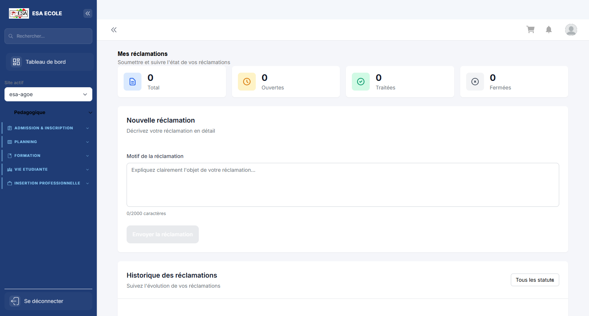

**Objectif :** Dépôt et suivi des réclamations (notes, scolarité, discipline, paiement).

**Actions principales :**

1. Créer une réclamation
2. Joindre les pièces
3. Suivre le statut

---

## 9. Calendrier

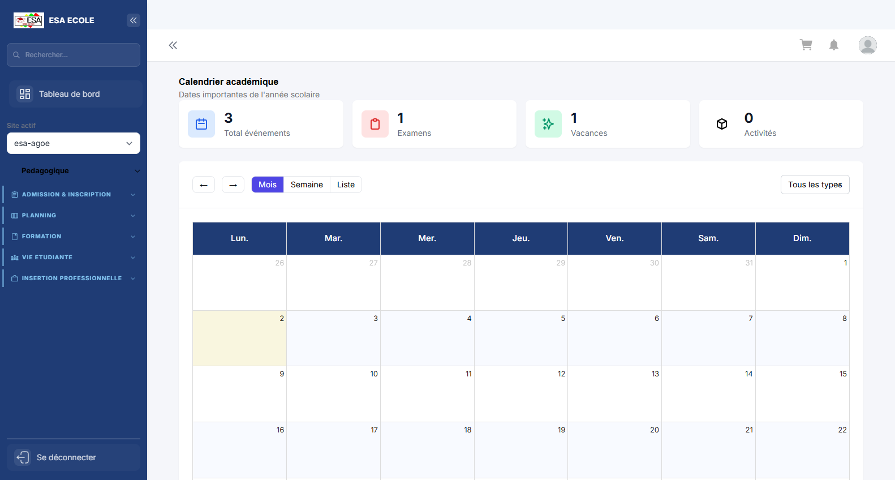

**Objectif :** Calendrier académique : sessions, examens, périodes de saisie et événements de l’établissement.

**Actions principales :**

1. Choisir la période
2. Consulter un événement
3. S’abonner ou exporter le calendrier

---

## 10. Bibliothèque

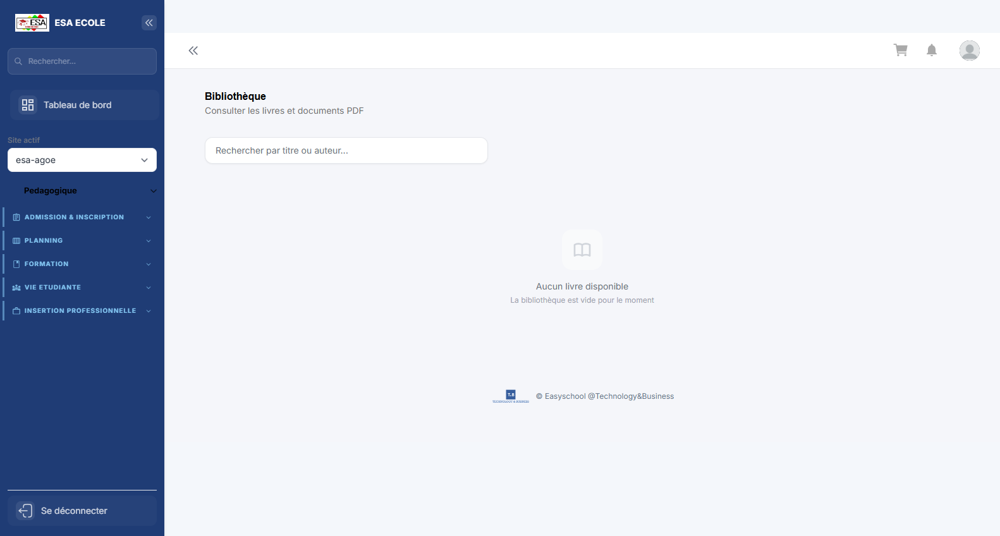

**Objectif :** Catalogue des ouvrages disponibles, avec recherche et consultation des fiches.

**Actions principales :**

1. Rechercher un ouvrage
2. Consulter la fiche et la disponibilité
3. Réserver ou emprunter

---

## 11. Annonces

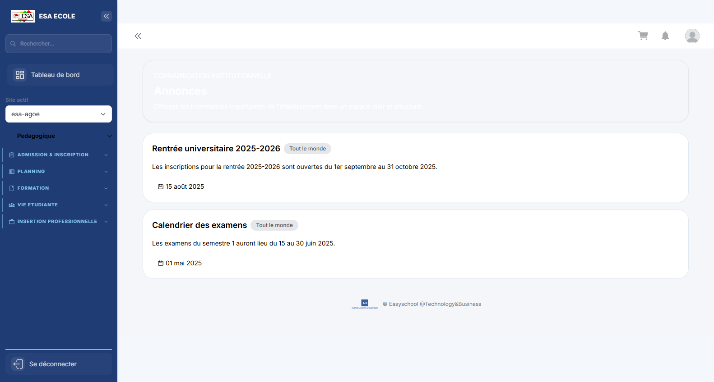

**Objectif :** Publication et consultation des annonces destinées aux étudiants, enseignants ou personnels.

**Actions principales :**

1. Créer ou ouvrir une annonce
2. Choisir le public cible
3. Publier ou archiver

---

## 12. Vie estudiantine

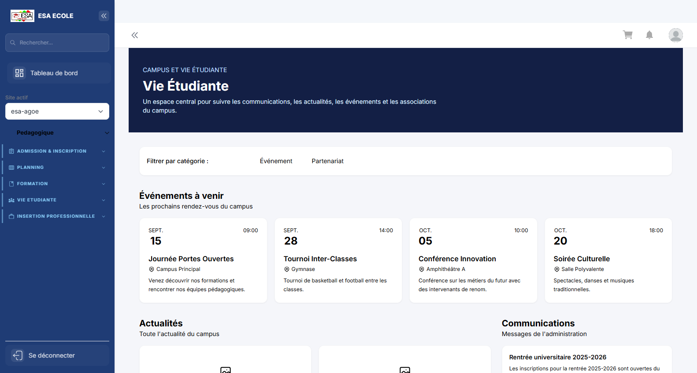

**Objectif :** Actualités, activités et informations de la vie étudiante.

**Actions principales :**

1. Parcourir les publications
2. Ouvrir une actualité
3. Participer ou réagir

---

## 13. Suggestions

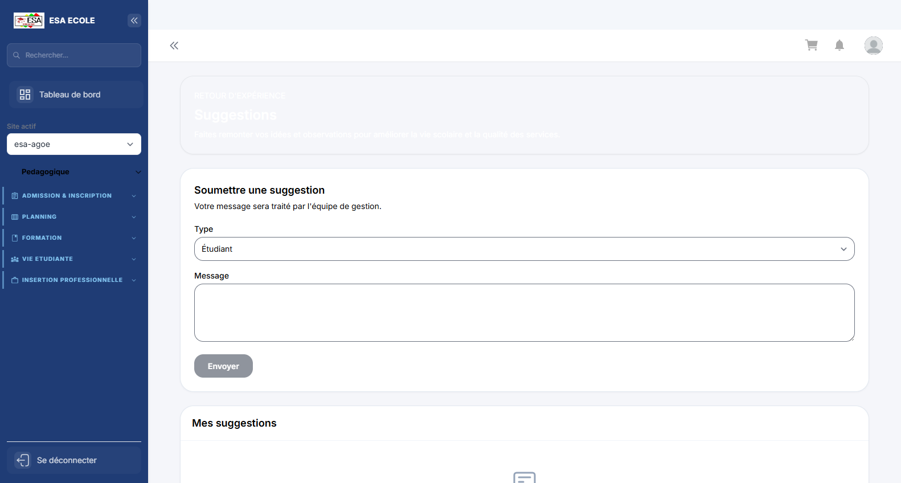

**Objectif :** Boîte à idées et suggestions d’amélioration adressées à l’administration.

**Actions principales :**

1. Rédiger une suggestion
2. La soumettre
3. Suivre son traitement

---

## 14. Paiements

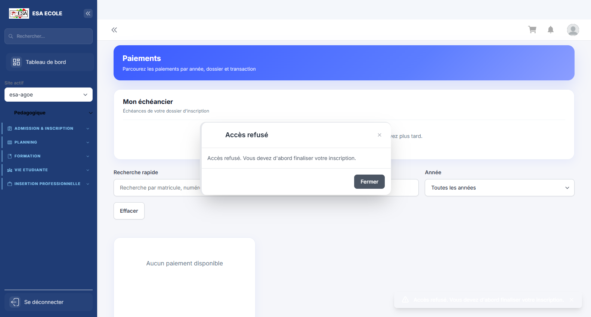

**Objectif :** Paiements des étudiants : saisie, recherche, historique et rattachement aux échéances.

**Actions principales :**

1. Rechercher un étudiant ou un paiement
2. Vérifier le montant et la référence
3. Enregistrer ou consulter le reçu

---

## 15. Échéances

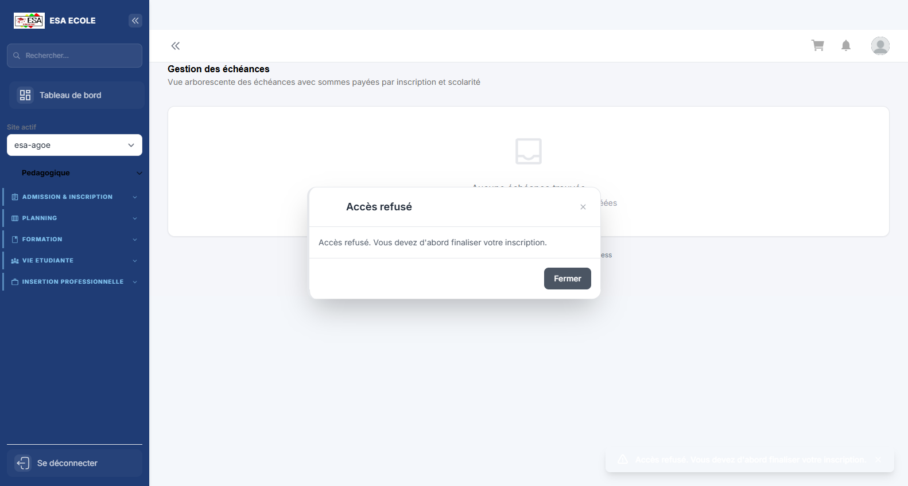

**Objectif :** Échéancier des frais par étudiant : montants dus, dates limites et statuts.

**Actions principales :**

1. Choisir un étudiant ou une période
2. Contrôler les échéances
3. Marquer un paiement ou une relance

---

## 16. Discussions

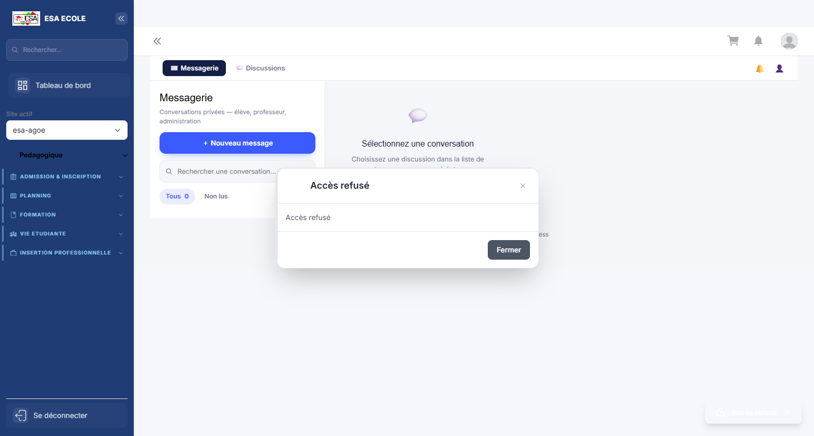

**Objectif :** Messagerie interne permettant d’échanger avec les autres acteurs de l’établissement.

**Actions principales :**

1. Choisir une conversation
2. Rédiger et envoyer un message
3. Joindre un document si nécessaire

---

## 17. Mon profil

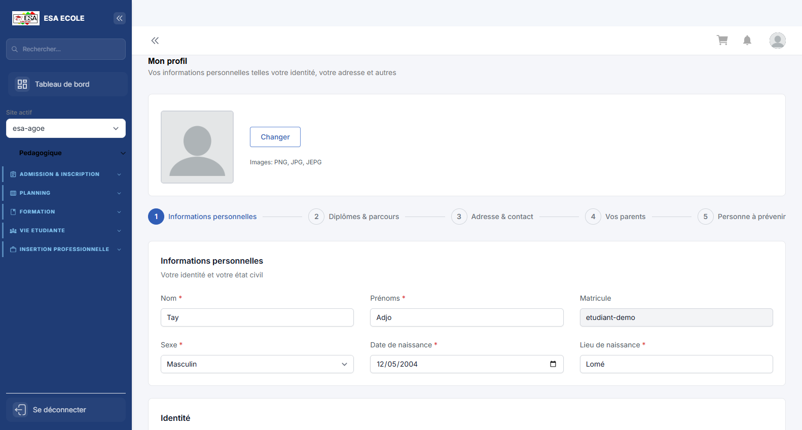

**Objectif :** Informations personnelles et professionnelles du compte connecté : identité, contacts et rattachements.

**Actions principales :**

1. Vérifier ses informations
2. Mettre à jour les champs modifiables
3. Enregistrer

---

## 18. Mon compte

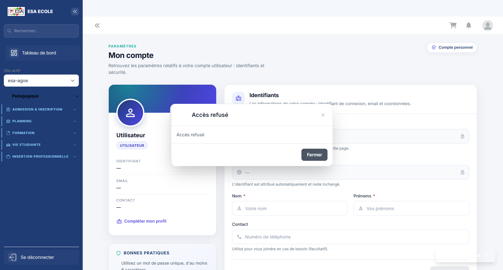

**Objectif :** Paramètres de sécurité du compte : mot de passe, double authentification et sessions.

**Actions principales :**

1. Changer le mot de passe
2. Activer ou vérifier le 2FA
3. Contrôler les sessions ouvertes

---

## 19. Diplômes

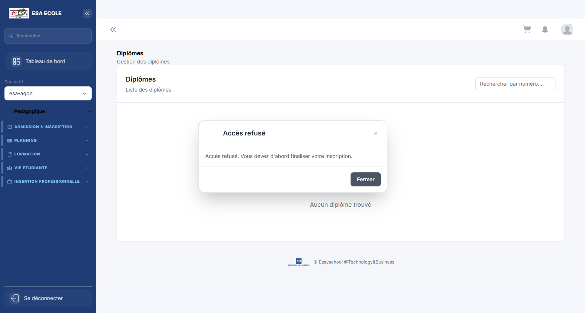

**Objectif :** Diplômes obtenus, impressions et vérification d’authenticité.

**Actions principales :**

1. Rechercher un diplômé
2. Consulter le diplôme
3. Générer ou vérifier

---

## 20. Demandes de documents

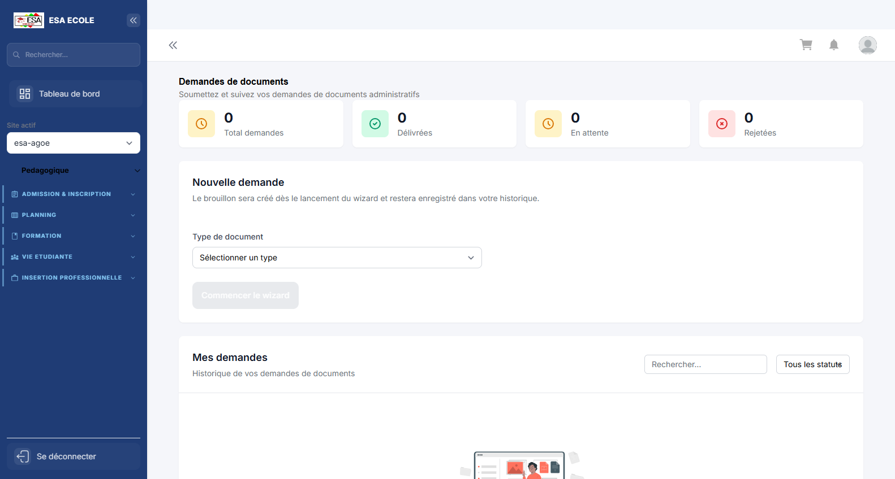

**Objectif :** Demandes de documents administratifs (attestation, relevé, certificat) et leur traitement.

**Actions principales :**

1. Créer ou ouvrir une demande
2. Vérifier les pièces
3. Générer le document

---

## 21. Mes documents

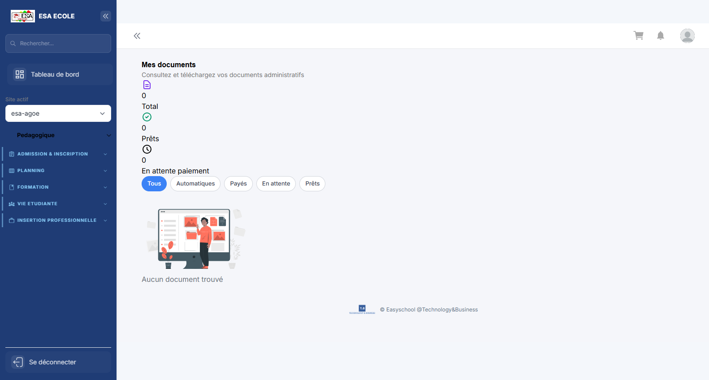

**Objectif :** Documents personnels disponibles : attestations, relevés, certificats et documents déposés.

**Actions principales :**

1. Parcourir la liste
2. Ouvrir un document
3. Télécharger

---

## 22. Demandes VAE

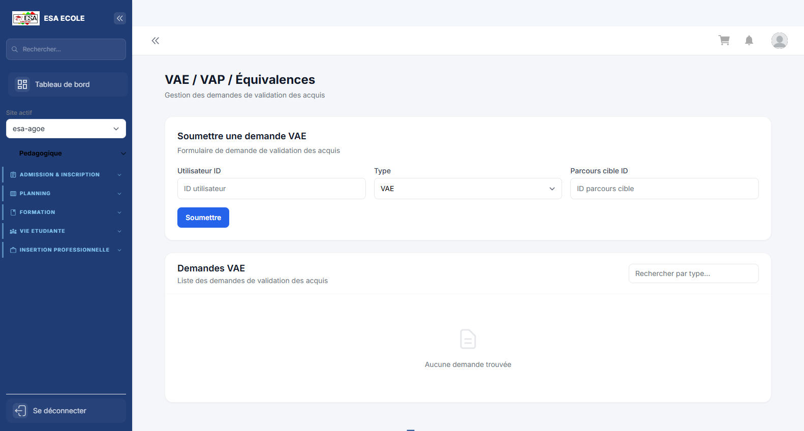

**Objectif :** Demandes de validation des acquis de l’expérience : pièces, expertise et décision.

**Actions principales :**

1. Déposer une demande
2. Fournir le dossier d’expérience
3. Suivre l’instruction

---

*Guide généré par `scripts/guide/generer-guides.cjs`. Les captures valides les plus récentes sont utilisées, avec repli sur les captures historiques.*
