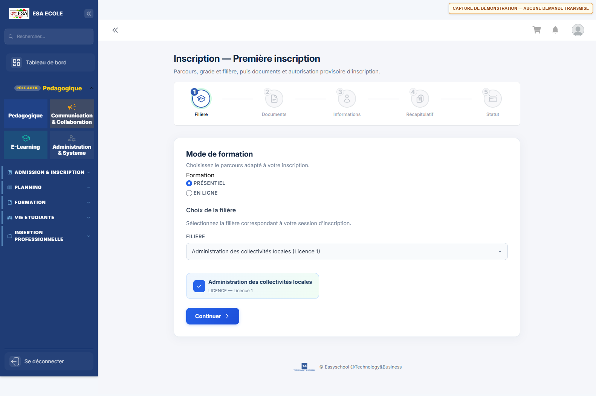
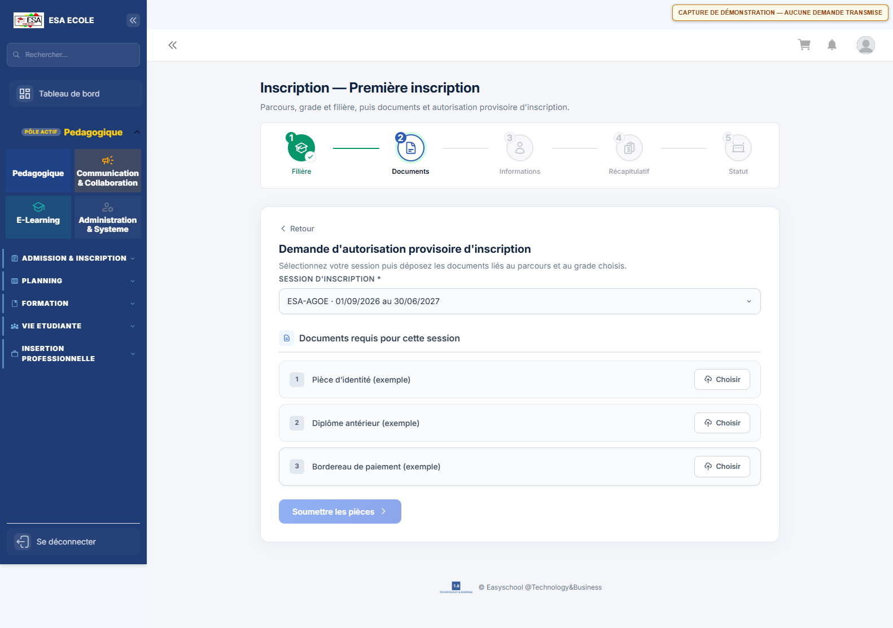
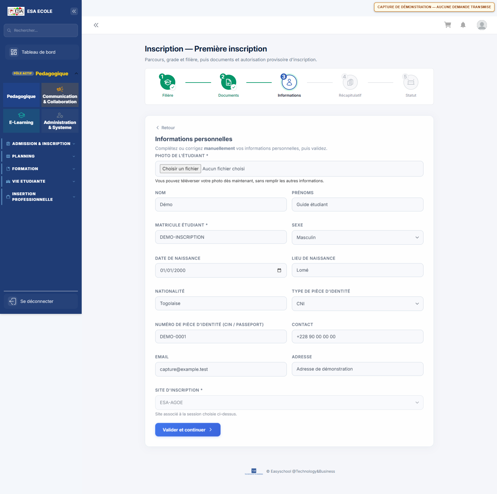
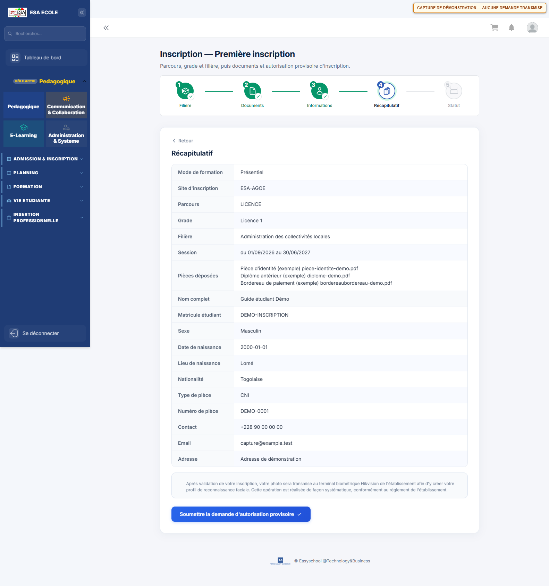
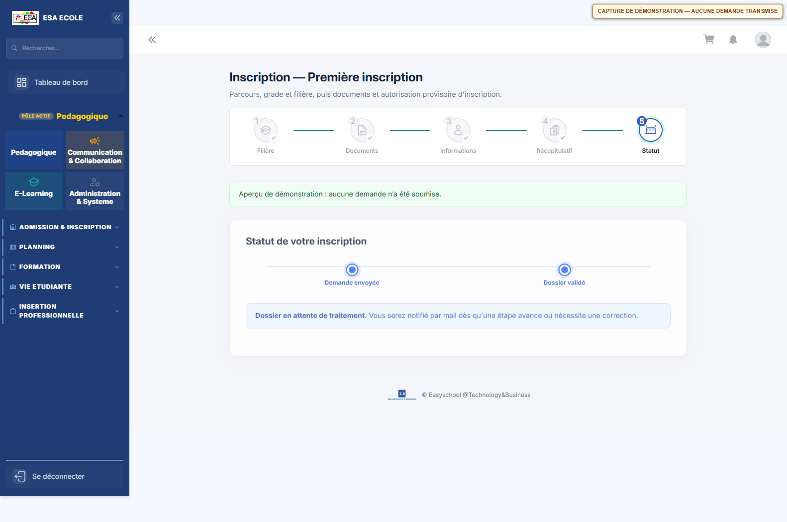
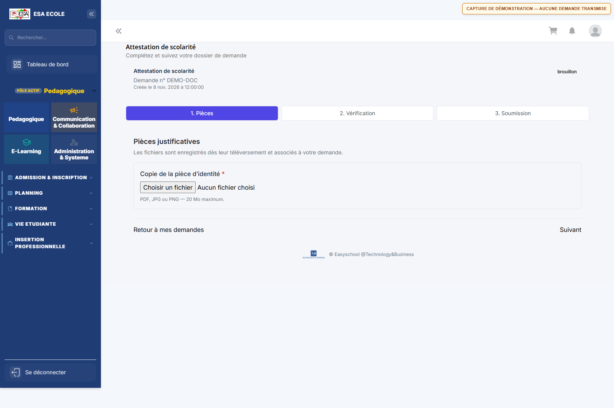
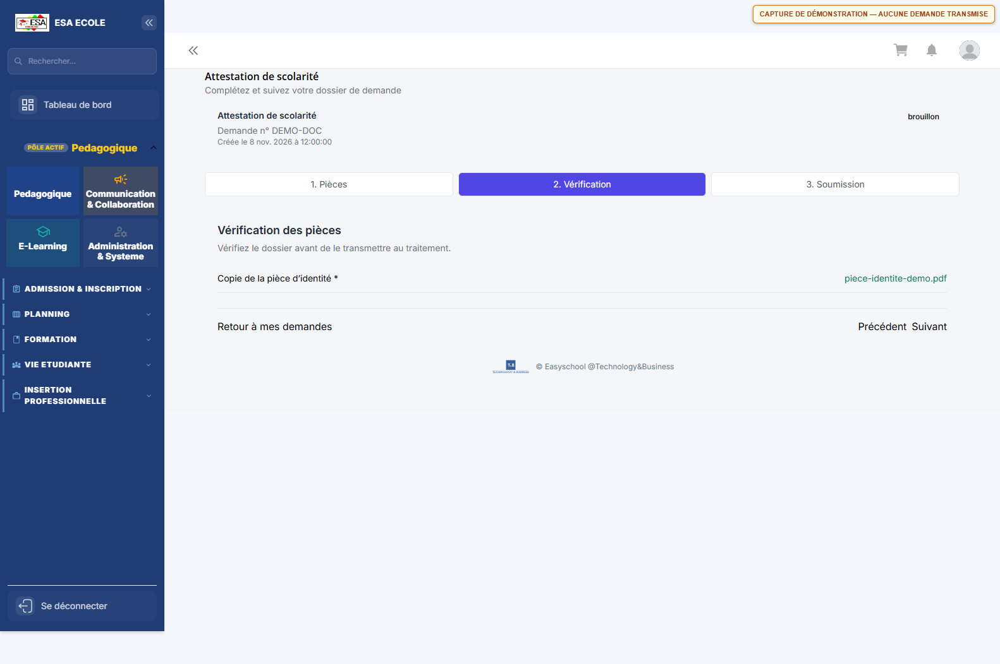
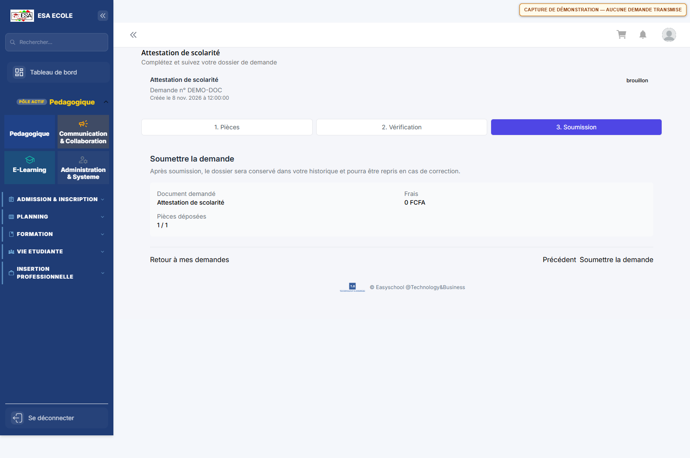

# Guide d'utilisation — Étudiants (Apprenants)

> Ce guide vous accompagne dans vos démarches d'étudiant : inscription, dépôt des pièces et du bordereau, suivi de dossier, paiements, demandes de documents, réclamations, vie étudiante et échanges avec l'établissement.

**Profil :** Étudiants (Apprenants)  
**Nombre d'écrans :** 22  
**Mise à jour :** 8 novembre 2026

> **À lire avant de commencer :** les actions de validation (contrôle du dossier, saisie comptable, décision du comité, préparation des documents) sont réservées à l'administration. Votre espace vous permet de déposer, consulter, suivre et télécharger ; il ne remplace pas la validation par les services compétents.

## Sommaire

1. [Parcours](#1-parcours)
2. [Demandes](#2-demandes)
3. [Demandes d'orientation](#3-demandes-dorientation)
4. [Parcours d'orientation](#4-parcours-dorientation)
5. [Mes bordereaux](#5-mes-bordereaux)
6. [Mon dossier](#6-mon-dossier)
7. [Réorientation](#7-réorientation)
8. [Réclamations](#8-réclamations)
9. [Calendrier](#9-calendrier)
10. [Bibliothèque](#10-bibliothèque)
11. [Annonces](#11-annonces)
12. [Vie estudiantine](#12-vie-estudiantine)
13. [Suggestions](#13-suggestions)
14. [Paiements](#14-paiements)
15. [Échéances](#15-échéances)
16. [Discussions](#16-discussions)
17. [Mon profil](#17-mon-profil)
18. [Mon compte](#18-mon-compte)
19. [Diplômes](#19-diplômes)
20. [Demandes de documents](#20-demandes-de-documents)
21. [Mes documents](#21-mes-documents)
22. [Demandes VAE](#22-demandes-vae)

---

## Bienvenue dans votre espace étudiant

Votre espace rassemble les démarches que vous pouvez réaliser vous-même et les informations que l'établissement met à votre disposition.

### Ce que vous pouvez faire sans passer par l'administration

- Consulter les filières proposées et les conditions d'accès.
- Créer et compléter une demande d'inscription.
- Téléverser les pièces demandées et votre bordereau de paiement.
- Suivre l'avancement de votre dossier et corriger les éléments signalés.
- Consulter votre dossier, vos échéances et votre solde.
- Demander des documents administratifs et télécharger ceux qui sont prêts.
- Soumettre une réclamation, une suggestion, une demande de réorientation ou une demande VAE.
- Consulter vos notes, bulletins, emplois du temps et ressources pédagogiques, selon ce que l'établissement a publié.
- Échanger avec les enseignants et l'administration via la messagerie.

### Ce qui reste géré par l'administration

- Le contrôle de votre dossier et la décision du comité d'orientation.
- La création et la modification des filières, des unités d'enseignement (UE), des cours et des sessions. Vous consultez les éléments publiés ; vous ne créez pas d'UE.
- La saisie comptable de votre bordereau et la validation de vos paiements.
- La préparation, la signature et la remise de vos documents officiels.
- Les décisions de réorientation, de VAE et le traitement des réclamations.

---

## Avant de commencer

### Se connecter

1. Utilisez les identifiants remis par l'administration.
2. À la première connexion, changez le mot de passe temporaire depuis **Mon compte**.
3. Si l'établissement a activé la double authentification, saisissez le code demandé.
4. Ne partagez jamais votre mot de passe. Si vous utilisez un ordinateur partagé, déconnectez-vous à la fin de votre session.

### Préparer ses documents

- Formats acceptés pour les pièces et les bordereaux : **PDF, JPG/JPEG, PNG, HEIC/HEIF**.
- Taille maximale : **20 Mo par fichier**.
- Vérifiez que chaque document est lisible, complet et en cours de validité.
- Nommez clairement vos fichiers, par exemple `CNI_NomPrenom.pdf` ou `Bordereau_NomPrenom.pdf`.

### Repères utiles

| Terme | Signification |
|---|---|
| Filière / parcours | Formation que vous souhaitez suivre (ex. Licence, Master, BTS). |
| UE | Unité d'enseignement : matière ou bloc de matières d'un parcours. |
| Bordereau | Justificatif de paiement que vous téléversez pour permettre la saisie comptable. |
| Échéance | Date et montant à payer selon votre échéancier. |
| Quitus | Attestation de paiement délivrée après régularisation. |
| VAE / VAP | Validation des acquis de l'expérience ou professionnels. |
| Relevé de notes | Document récapitulatif de vos résultats sur une période. |

---

## Votre parcours conseillé

| Étape | Écran | Ce que vous faites | Résultat attendu |
|---|---|---|---|
| 1 | Parcours | Vous consultez les filières et leurs conditions d'accès. | Vous choisissez la filière adaptée à votre projet. |
| 2 | Demandes | Vous créez votre demande d'inscription. | Un dossier est ouvert pour la session en cours. |
| 3 | Demandes (assistant) | Vous déposez les pièces demandées et votre bordereau. | Le dossier est soumis pour contrôle. |
| 4 | Mon dossier | Vous suivez l'état de votre dossier. | Vous savez si le dossier est en contrôle, en comité ou validé. |
| 5 | Paiements puis Mes bordereaux | Vous consultez vos échéances et déposez un justificatif de paiement. | Le service comptable peut imputer votre paiement. |
| 6 | Demandes de documents puis Mes documents | Vous demandez et téléchargez vos documents administratifs. | Vous obtenez vos attestations et relevés. |
| 7 | Réclamations / Réorientation / Demandes VAE | Vous effectuez une démarche particulière. | Votre demande est instruite par le service concerné. |

> **Conseil :** commencez toujours par vérifier que votre dossier est à jour avant de déposer un bordereau. Un dossier incomplet ralentit la validation.

---

## Comprendre les statuts

### Demande d'inscription

| Statut | Signification |
|---|---|
| Soumis | Votre dossier a été transmis et attend son contrôle. |
| Authentifié (Audit) | Les pièces et le bordereau ont été contrôlés par le service compétent. |
| Transmis au comité | Le dossier est en attente de la décision du comité d'orientation. |
| Validé | Votre inscription est validée. |
| Correction demandée | Le comité ou le service comptable attend une correction de votre part. |
| Rejeté | Votre dossier a été refusé ; le motif est indiqué dans le détail. |

Selon les contrôles, le dossier peut aussi passer par une étape de saisie comptable avant d'être transmis au comité.

### Bordereau de paiement

| Statut | Signification |
|---|---|
| En attente | Le bordereau a été déposé et attend son contrôle. |
| Validé | Le bordereau a été authentifié par le service compétent. |
| Rejeté | Le bordereau est refusé ; vous devez en déposer un nouveau. |
| En saisie comptable | Le service comptable prépare l'imputation du paiement. |
| Traité | Le paiement est imputé et vos échéances sont mises à jour. |

> Sur l'écran **Mes bordereaux**, un bordereau qui n'est ni « Validé » ni « Rejeté » est affiché comme « En attente ». Le détail reste consultable.

### Demande de document administratif

| Statut | Signification |
|---|---|
| Brouillon | La demande est commencée mais pas encore soumise. |
| Soumise | La demande a été transmise. |
| En attente de paiement | Un règlement est nécessaire avant préparation. |
| Payé | Le paiement est enregistré. |
| En préparation | Le service prépare le document. |
| En validation du comité | Le document attend une validation. |
| Validée | La demande est validée. |
| Document prêt | Le document est disponible au téléchargement. |
| Remis | Le document a été remis. |
| Délivrée | Le document a été délivré. |
| Rejetée | La demande est refusée ; le motif est indiqué. |
| Annulée | La demande a été annulée. |

### Autres statuts

| Démarche | Statuts |
|---|---|
| Réclamation | Ouverte, Traitée, Fermée. |
| Réorientation | Soumise, En étude, Approuvée, Rejetée. |
| Demande VAE / VAP / équivalence | Soumise, En instruction, Acceptée, Rejetée. |
| Suggestion | Ouverte, Traitée, Fermée. |
| Échéance | Payée, En retard, Impayée. |
| Dossier étudiant | Actif, Suspendu, Archivé. |

---

## 1. Parcours

**Où le trouver :** menu **Pédagogique > Admission & Inscription > Parcours**.

**À quoi sert cet écran :** découvrir les filières proposées avant de déposer une demande d'inscription.

**Ce que vous pouvez faire :**

1. Filtrer les filières par niveau d'étude.
2. Rechercher une filière par son nom.
3. Ouvrir la fiche d'une filière pour consulter son type, son niveau, sa durée et ses conditions d'accès.

**Bon à savoir :**

- Vous êtes en consultation : la création et la modification des filières sont réservées à l'administration.
- Vous ne créez et ne modifiez ni filière, ni UE, ni cours. Ces éléments sont configurés et publiés par l'administration.
- Si la liste est vide, aucune offre n'est publiée pour le moment. Contactez le secrétariat pour connaître les prochaines ouvertures.

---

## 2. Demandes

**Où le trouver :** menu **Pédagogique > Admission & Inscription > Demandes**.

**À quoi sert cet écran :** créer votre demande d'inscription et suivre son avancement.

**Ce que vous pouvez faire :**

1. Cliquer sur **Nouvelle demande** pour démarrer une demande, si une session d'inscription est ouverte.
2. Cliquer sur **Traiter** pour reprendre un dossier en cours, ou sur **Détails** pour consulter un dossier déjà soumis.
3. Ouvrir la correction d'un dossier lorsque le statut indique **Correction demandée** ou **Rejeté**.

**Les cinq étapes de votre demande :**

1. **Filière** — choisissez le mode de formation (présentiel ou en ligne) et la filière.
2. **Documents** — sélectionnez la session d'inscription, téléversez les pièces demandées et votre bordereau de paiement.
3. **Informations** — complétez ou corrigez vos informations personnelles et ajoutez votre photo.
4. **Récapitulatif** — vérifiez l'ensemble des informations avant de soumettre.
5. **Statut** — suivez l'avancement de votre dossier.

### Captures des étapes du wizard

> Captures de démonstration : les données et pièces affichées sont fictives, aucune demande n'a été transmise. La liste réelle des pièces dépend de la session choisie.

#### 1. Filière

#### 2. Documents

#### 3. Informations personnelles

#### 4. Récapitulatif

#### 5. Statut

**Bon à savoir :**

- Une seule demande peut être en cours pour une même session. Un message vous prévient si une demande existe déjà.
- Sans session ouverte, la création est bloquée : attendez l'ouverture de la session ou contactez le secrétariat.
- Les pièces acceptées sont au format PDF, JPG/JPEG, PNG ou HEIC/HEIF, dans la limite de 20 Mo par fichier.
- Si vous rechargez la page, vos choix et vos informations sont conservés, mais les fichiers doivent être re-sélectionnés : un navigateur ne peut pas conserver un fichier téléversé.
- En cas de correction, vos choix de filière, vos autres pièces et vos informations personnelles sont conservés : ne refaites que ce qui est demandé.
- Le bordereau déposé à l'étape 2 est contrôlé par le service comptable ; la saisie de la référence bancaire et du montant ne vous incombe pas.

---

## 3. Demandes d'orientation

**Où le trouver :** menu **Pédagogique > Admission & Inscription > Demandes orientation**.

**À quoi sert cet écran :** suivre vos demandes d'orientation vers une ou plusieurs filières.

**Ce que vous pouvez faire :**

1. Cliquer sur **Nouvelle demande** : une fenêtre vous invite à choisir des parcours.
2. Cliquer sur **Choisir des parcours** pour ouvrir le catalogue d'orientation.
3. Ajouter une ou plusieurs filières au panier, puis ouvrir le panier et cliquer sur **Faire une demande**.
4. Cliquer sur **Détails** pour consulter le contenu d'une demande.

**Bon à savoir :**

- L'état **En cours** signifie que la demande est enregistrée et attend une réponse.
- L'état **Terminé** signifie qu'une réponse d'orientation a été enregistrée par l'administration.
- Une demande d'orientation est distincte d'une demande d'inscription : elle sert à vous aider à choisir votre filière.

---

## 4. Parcours d'orientation

**Où le trouver :** menu **Pédagogique > Admission & Inscription > Parcours orientation**.

**À quoi sert cet écran :** consulter les filières proposées et préparer votre demande d'orientation.

**Ce que vous pouvez faire :**

1. Filtrer les filières par catégorie et par niveau d'étude.
2. Rechercher une filière par son nom.
3. Ouvrir une fiche pour consulter la présentation, les prérequis et les débouchés.
4. Cliquer sur **Ajouter au panier** et renseigner, si demandé, les notes obtenues dans les matières prérequises.
5. Ouvrir le panier (icône avec un compteur en haut de l'écran), vérifier vos choix, puis cliquer sur **Faire une demande**.

**Bon à savoir :**

- Vous pouvez ajouter plusieurs filières et en retirer avant de valider.
- La demande n'est créée qu'au moment où vous cliquez sur **Faire une demande** dans le panier.
- Vous êtes en consultation sur le catalogue : la création d'une filière est réservée à l'administration.

---

## 5. Mes bordereaux

**Où le trouver :** menu **Pédagogique > Admission & Inscription > Mes bordereaux**.

**À quoi sert cet écran :** déposer votre justificatif de paiement et suivre son traitement.

**Ce que vous pouvez faire :**

1. Cliquer sur **Uploader un bordereau** et sélectionner votre fichier.
2. Consulter l'aperçu du fichier déposé.
3. Ouvrir **Détails** pour lire le statut, les dates et le commentaire du service comptable.
4. Filtrer la liste par statut et rechercher un bordereau par référence.

**Formats acceptés :** PDF, JPG/JPEG, PNG, HEIC/HEIF — 20 Mo maximum.

**Bon à savoir :**

- Vous déposez uniquement le fichier. La référence bancaire, le montant et le type d'opération sont renseignés par le service comptable après vérification.
- Un bordereau **Rejeté** doit être remplacé par un nouveau justificatif valide.
- Le dépôt d'un bordereau ne vaut pas validation du paiement : consultez régulièrement le statut.
- Pour régler une échéance, partez de l'écran **Paiements** et cliquez sur **Payer cette échéance** : vous serez dirigé vers cet écran.

---

## 6. Mon dossier

**Où le trouver :** menu **Pédagogique > Admission & Inscription > Mon dossier**.

**À quoi sert cet écran :** consulter la synthèse de votre dossier étudiant et télécharger vos premières attestations.

**Ce que vous pouvez faire :**

1. Vérifier votre identité, votre matricule, votre parcours et vos coordonnées.
2. Consulter vos échéances et leur état.
3. Télécharger l'**Attestation de préinscription** (PRE001).
4. Télécharger l'**Attestation d'admissibilité** (ADM020).
5. Télécharger votre carte étudiante si elle a été générée.
6. Afficher votre QR code de pointage.

**Bon à savoir :**

- Les attestations sont générées au format PDF, avec une référence et un QR code de vérification. Vérifiez que votre nom et votre matricule sont corrects avant de les transmettre.
- Le QR code de pointage peut être remplacé par votre matricule si l'affichage n'est pas disponible.
- Le dossier peut être **Actif**, **Suspendu** ou **Archivé**. En cas de statut Suspendu ou Archivé, contactez l'administration.
- Cet écran est une synthèse : le dépôt des pièces se fait dans l'assistant de demande d'inscription, à l'étape **Documents**.
- Si aucun dossier n'apparaît, contactez l'administration : votre dossier n'est peut-être pas encore créé.

---

## 7. Réorientation

**Où le trouver :** menu **Pédagogique > Traitement de données > Reorientation**.

**À quoi sert cet écran :** demander un changement de parcours ou de filière.

**Ce que vous pouvez faire :**

1. Sélectionner votre cursus.
2. Vérifier le parcours actuel affiché en lecture seule.
3. Choisir le parcours cible.
4. Saisir le motif de votre demande.
5. Cliquer sur **Soumettre la demande**.
6. Suivre l'état de votre demande dans le tableau.

**Bon à savoir :**

- Les statuts sont **Soumise**, **En étude**, **Approuvée** et **Rejetée**.
- La décision est prise par l'administration ; vous ne pouvez pas modifier une demande déjà soumise.
- Préparez un motif clair et factuel : il servira à l'instruction de votre dossier.
- Aucune pièce jointe n'est demandée dans cet écran. Si un justificatif est nécessaire, le service vous le demandera.

---

## 8. Réclamations

**Où le trouver :** menu **Pédagogique > Traitement de données > Reclamations**.

**À quoi sert cet écran :** soumettre une réclamation et suivre son traitement.

**Ce que vous pouvez faire :**

1. Saisir le motif de votre réclamation (2 000 caractères maximum).
2. Cliquer sur **Envoyer la réclamation**.
3. Filtrer vos réclamations par statut.
4. Déplier une réclamation pour lire la description et les réponses de l'administration.

**Bon à savoir :**

- Les statuts sont **Ouverte**, **Traitée** et **Fermée**.
- Le bouton d'envoi reste désactivé tant que le motif est vide.
- Aucune pièce jointe n'est possible dans cet écran. Si des justificatifs sont nécessaires, déposez-les auprès du service concerné.
- Vous ne pouvez pas supprimer une réclamation. En cas d'erreur, contactez l'administration.

---

## 9. Calendrier

**Où le trouver :** menu **Pédagogique > Planning > Calendrier**.

**À quoi sert cet écran :** consulter les dates importantes de l'année académique.

**Ce que vous pouvez faire :**

1. Naviguer dans le calendrier par mois.
2. Cliquer sur un événement pour afficher son type, sa description, sa classe, son parcours et son statut.
3. Repérer les périodes de cours, d'examens, de vacances et les échéances administratives.

**Bon à savoir :**

- Les couleurs distinguent les types d'événements : cours, examen, vacance, événement sportif, culturel, réunion, administratif et jour férié.
- Vous êtes en consultation : la publication du calendrier et la création d'événements sont réservées à l'administration.
- Un événement peut concerner une classe ou un parcours particulier : vérifiez le détail avant de vous organiser.

---

## 10. Bibliothèque

**Où le trouver :** menu **Pédagogique > Formation > Bibliotheque**.

**À quoi sert cet écran :** consulter les ouvrages et documents PDF mis à disposition.

**Ce que vous pouvez faire :**

1. Rechercher un livre par titre ou auteur.
2. Parcourir la grille des ouvrages disponibles.
3. Ouvrir un livre pour le lire dans la visionneuse PDF intégrée.

**Bon à savoir :**

- Chaque consultation est comptabilisée par l'application.
- Vous êtes en consultation : l'ajout et la suppression d'ouvrages sont réservés à l'administration.
- Aucun emprunt ni réservation n'est géré dans cet écran.
- Si aucun livre n'apparaît, la bibliothèque numérique n'a pas encore été alimentée.

---

## 11. Annonces

**Où le trouver :** menu **Pédagogique > Vie Etudiante > Annonces**.

**À quoi sert cet écran :** consulter les annonces institutionnelles qui vous concernent.

**Ce que vous pouvez faire :**

1. Parcourir les annonces publiées.
2. Identifier l'auteur et le public visé grâce au badge affiché sur chaque carte.
3. Lire le contenu de l'annonce.

**Bon à savoir :**

- Les publics possibles sont **Tout le monde**, **Apprenants**, **Enseignants** et **Personnel**.
- Vous êtes en consultation : la création et la suppression d'annonces sont réservées à l'administration.
- Si aucune annonce n'apparaît, aucune publication n'est disponible pour votre profil.

---

## 12. Vie estudiantine

**Où le trouver :** menu **Pédagogique > Vie Etudiante > Vie estudiantine**.

**À quoi sert cet écran :** suivre la vie de l'établissement et les informations qui ne relèvent pas d'un cours.

**Ce que vous pouvez faire :**

1. Consulter les événements à venir.
2. Lire les actualités et les communications de l'établissement.
3. Découvrir les associations étudiantes.
4. Filtrer les actualités par catégorie.

**Bon à savoir :**

- Les actualités et les communications proviennent de l'administration.
- Les événements et les associations sont des blocs d'information : ils ne permettent pas une inscription en ligne.
- Cet écran est en consultation.

---

## 13. Suggestions

**Où le trouver :** menu **Pédagogique > Vie Etudiante > Suggestions**.

**À quoi sert cet écran :** adresser une idée ou une proposition d'amélioration à l'administration.

**Ce que vous pouvez faire :**

1. Choisir le type de suggestion (**Étudiant**).
2. Saisir votre message.
3. Cliquer sur **Envoyer**.
4. Relire vos suggestions dans la liste et cliquer sur **Lire la suite** pour les messages longs.

**Bon à savoir :**

- Le bouton d'envoi reste désactivé tant que le message est vide.
- Les statuts sont **Ouverte**, **Traitée** et **Fermée**. Selon l'écran, ils peuvent apparaître sous leur forme technique (`ouverte`, `traitee`, `fermee`).
- Aucune pièce jointe n'est possible.
- Vous ne voyez que vos propres suggestions.

---

## 14. Paiements

**Où le trouver :** menu **Financier > Finance > Paiements**.

**À quoi sert cet écran :** consulter votre échéancier, le montant restant et la prochaine échéance.

**Ce que vous pouvez faire :**

1. Consulter le total restant et la prochaine échéance.
2. Lire le tableau des échéances : numéro, mois, date limite, montant et statut.
3. Cliquer sur **Payer cette échéance** pour une échéance non payée : vous êtes dirigé vers **Mes bordereaux** pour déposer votre justificatif.

**Bon à savoir :**

- Les statuts sont **Payée**, **En retard** et **Impayée**.
- Le total restant exclut les échéances déjà payées.
- L'échéancier est généré après la validation de votre premier bordereau par l'institution. Tant qu'il n'existe pas, un message vous l'indique.
- Le paiement en ligne n'est pas proposé : le règlement se fait par dépôt d'un bordereau, puis saisie par le service comptable.
- Le bouton **Nouveau paiement** est réservé aux profils de caisse et à l'administration.

---

## 15. Échéances

**Où le trouver :** menu **Financier > Finance > Echeances**.

**À quoi sert cet écran :** consulter votre échéancier sous forme d'arborescence, avec les montants payés et restants.

**Ce que vous pouvez faire :**

1. Parcourir l'arborescence par année, filière, niveau et classe.
2. Consulter, pour chaque échéance, le type, le numéro, le montant, le montant payé, le restant et le statut.
3. Repérer les échéances en retard ou impayées.

**Bon à savoir :**

- Vous êtes en consultation : la génération automatique et la création d'échéances sont réservées à l'administration.
- Les montants sont affichés dans la devise de l'établissement (généralement le FCFA).
- Pour régler une échéance, utilisez l'écran **Paiements** puis **Mes bordereaux**.
- Si l'arborescence est vide, votre échéancier n'est pas encore généré.

---

## 16. Discussions

**Où le trouver :** menu **Communication & Collaboration > Communication > Discussions**.

**À quoi sert cet écran :** échanger avec les enseignants, l'administration et les autres membres de l'établissement.

**Ce que vous pouvez faire :**

1. Ouvrir une conversation existante ou cliquer sur **Nouveau message**.
2. Créer un salon de discussion et inviter des membres.
3. Envoyer un message texte, une image, une vidéo, un fichier ou un sticker.
4. Rejoindre un salon avec un code d'invitation.
5. Démarrer un appel vidéo depuis une conversation.
6. Rechercher une conversation et filtrer les messages non lus.

**Bon à savoir :**

- Les fichiers acceptés sont les images, les vidéos, les PDF et les documents DOC/DOCX.
- Un message vide n'est pas envoyé.
- Sélectionnez d'abord une conversation ou un salon : la fenêtre de discussion affiche un message d'attente tant qu'aucun échange n'est ouvert.
- Les échanges restent internes à l'établissement.

---

## 17. Mon profil

**Où le trouver :** menu **Administration & Systeme > Parametres > Mon profil**.

**À quoi sert cet écran :** compléter et mettre à jour vos informations personnelles.

**Ce que vous pouvez faire :**

1. Parcourir les cinq étapes : **Informations personnelles**, **Diplômes & parcours**, **Adresse & contact**, **Vos parents** et **Personne à prévenir**.
2. Corriger les champs modifiables et ajouter votre photo.
3. Passer d'une étape à l'autre avec **Précédent** et **Suivant**.
4. Enregistrer à la dernière étape.

**Bon à savoir :**

- Votre identifiant, votre matricule et votre parcours sont affichés en lecture seule.
- La photo accepte les formats JPEG, PNG, GIF, WEBP, HEIC et HEIF, dans la limite de 20 Mo.
- Chaque étape est vérifiée avant de passer à la suivante : une liste des champs manquants s'affiche si nécessaire.
- Si vous arrivez depuis l'assistant d'inscription, la photo peut être obligatoire avant de quitter la première étape.
- Après l'enregistrement, vous revenez à l'écran d'où vous veniez.

---

## 18. Mon compte

**Où le trouver :** menu **Administration & Systeme > Parametres > Mon compte**.

**À quoi sert cet écran :** consulter votre solde et l'historique de vos transactions.

**Ce que vous pouvez faire :**

1. Consulter votre solde actuel.
2. Lire le nombre de transactions payées et le montant des impayés.
3. Parcourir le tableau des transactions : date, libellé, montant, statut.
4. Télécharger un document disponible depuis la ligne correspondante.

**Bon à savoir :**

- Les statuts sont **Payé**, **Impayé** et **En attente**.
- Les libellés de frais sont explicites : frais d'inscription, de scolarité, de bibliothèque, d'assurance, de logement, de document ou pénalité de retard.
- La devise affichée est celle de l'établissement, généralement le FCFA.
- Pour régler une échéance, utilisez **Paiements > Payer cette échéance**, puis déposez un bordereau dans **Mes bordereaux**.
- Si un bouton d'action n'aboutit pas, utilisez le parcours de paiement par bordereau et signalez le problème à l'administration.

---

## 19. Diplômes

**Où le trouver :** menu **Gestion documentaire > Documents > Diplomes**.

**À quoi sert cet écran :** consulter les diplômes enregistrés et retrouver un diplôme par son numéro.

**Ce que vous pouvez faire :**

1. Rechercher un diplôme par son numéro.
2. Consulter le cursus, l'année d'obtention, la mention et la date de délivrance.
3. Vérifier les informations affichées.

**Bon à savoir :**

- Les mentions sont **Passable**, **Assez bien**, **Bien** et **Très bien** ; selon l'écran, elles peuvent apparaître sous leur forme technique (`passable`, `assez_bien`, `bien`, `tres_bien`).
- Vous êtes en consultation : l'ajout, la modification et la suppression d'un diplôme sont réservés à l'administration.
- Si vous constatez qu'un diplôme ne vous appartient pas, signalez-le immédiatement à l'administration : la consultation doit être limitée à vos propres documents.

---

## 20. Demandes de documents

**Où le trouver :** menu **Gestion documentaire > Demandes > Demandes docs**.

**À quoi sert cet écran :** demander un document administratif (attestation, relevé de notes, certificat) et suivre sa préparation.

**Ce que vous pouvez faire :**

1. Choisir le type de document.
2. Pour un document payant, sélectionner un reçu de paiement valide.
3. Pour un relevé de notes, choisir l'année académique et le semestre.
4. Cliquer sur **Continuer vers le wizard** pour compléter les pièces et soumettre la demande.
5. Reprendre un **Brouillon** ou corriger une demande **Rejetée**.
6. Annuler une demande éligible.
7. Suivre les compteurs : Total, Délivrées, En attente, Rejetées.

### Wizard — pièces, vérification et soumission

> Captures de démonstration avec une demande et une pièce fictives. Elles ne correspondent pas à une demande réelle.

#### 1. Pièces justificatives

#### 2. Vérification des pièces

#### 3. Soumission

**Bon à savoir :**

- Pour un document payant, le reçu est obligatoire. Sans reçu valide, un message vous invite à vous présenter au service de recouvrement.
- Le montant du reçu reste celui indiqué au moment du paiement, même si le tarif change ensuite.
- L'annulation n'est possible que si les frais ne sont pas payés, sans reçu, et si la demande est au statut **Brouillon**, **Soumise**, **En attente de paiement** ou **Rejetée**.
- Les statuts détaillés sont présentés dans la section « Comprendre les statuts ».
- Les documents prêts se téléchargent depuis **Mes documents**.

---

## 21. Mes documents

**Où le trouver :** menu **Gestion documentaire > Demandes > Mes documents**.

**À quoi sert cet écran :** suivre vos demandes de documents et télécharger les pièces disponibles.

**Ce que vous pouvez faire :**

1. Consulter les compteurs **Prêts** et **En attente**.
2. Filtrer les documents : Tous, Automatiques, Payés, En attente, Prêts.
3. Télécharger un document lorsque le bouton est disponible.
4. Télécharger le reçu de caisse associé, s'il existe.

**Bon à savoir :**

- Les statuts affichés sont **Soumise**, **En attente de paiement**, **Payé**, **En préparation**, **Document prêt**, **Remis**, **Rejetée**, **Annulée**, **Validée** et **Délivrée**.
- Si le statut indique **En attente de paiement**, rendez-vous au service de recouvrement avec le montant indiqué.
- Si le document n'est pas encore disponible, attendez sa préparation : le téléchargement s'activera une fois le document prêt.
- Cet écran ne permet pas de créer une demande : utilisez **Demandes de documents**.

---

## 22. Demandes VAE

**Où le trouver :** menu **Gestion documentaire > Demandes > Demandes VAE**.

**À quoi sert cet écran :** soumettre une demande de validation des acquis de l'expérience (VAE), des acquis professionnels (VAP) ou d'équivalence.

**Ce que vous pouvez faire :**

1. Renseigner votre identifiant étudiant.
2. Choisir le type de demande : **VAE**, **VAP** ou **Équivalence**.
3. Renseigner l'identifiant du parcours cible.
4. Cliquer sur **Soumettre**.
5. Suivre l'état de votre demande dans le tableau.

**Bon à savoir :**

- Les statuts sont **Soumise**, **En instruction**, **Acceptée** et **Rejetée** ; selon l'écran, ils peuvent apparaître sous leur forme technique (`soumise`, `instruction`, `acceptee`, `rejetee`).
- Préparez votre identifiant étudiant et l'identifiant du parcours cible avant de commencer. En cas de doute, demandez-les au secrétariat.
- Aucune pièce jointe n'est demandée dans cet écran. Le service peut vous demander des justificatifs complémentaires pendant l'instruction.
- La décision est prise par l'administration.

---

## Aller plus loin : les autres écrans de votre espace

Selon la configuration de votre établissement et la publication des contenus, vous pouvez également utiliser :

| Écran | Menu | Usage |
|---|---|---|
| Notes | Pédagogique > Formation > Notes | Consulter les notes publiées. |
| Bulletins | Pédagogique > Evaluation & Suivi > Bulletins | Consulter et télécharger vos bulletins. |
| Emplois du temps | Pédagogique > Planning > Emplois du temps | Consulter votre planning de cours. |
| Cahiers de texte | Pédagogique > Formation > Cahiers de texte | Lire les contenus et travaux demandés. |
| Cahier de présence | Pédagogique > Formation > Cahier de présence | Consulter vos présences et absences. |
| Unités d'enseignement | Pédagogique > Formation > Unités d'enseignements | Consulter les UE publiées. La création et la modification sont réservées à l'administration. |
| Mes rattrapages | Pédagogique > Planning > Mes rattrapages | Suivre vos demandes de rattrapage. |
| Ma réinscription | Pédagogique > Admission & Inscription > Ma réinscription | Préparer votre réinscription. |
| Offres de stage | Pédagogique > Insertion Professionnelle > Offres stage | Consulter les offres disponibles. |
| Demandes stage | Pédagogique > Insertion Professionnelle > Demandes stage | Suivre vos demandes de stage. |

> Les écrans et les contenus disponibles dépendent des modules activés par votre établissement. Si un menu n'apparaît pas, contactez le secrétariat.

---

## En cas de problème

| Situation | Que faire |
|---|---|
| Votre demande indique **Correction demandée** | Ouvrez la demande, lisez le motif, remplacez uniquement les pièces signalées, puis validez la correction. |
| Votre bordereau est **Rejeté** | Ouvrez le détail pour lire le motif, puis déposez un nouveau justificatif valide. Si le bordereau est lié à une demande d'inscription, utilisez le parcours de correction. |
| Votre demande de document est **Rejetée** | Cliquez sur **Corriger le dossier**, remplacez la pièce concernée, puis soumettez à nouveau. |
| Votre document est **En attente de paiement** | Présentez-vous au service de recouvrement avec le montant indiqué, puis revenez dans **Mes documents**. |
| Aucun échéancier n'apparaît | Attendez la validation de votre premier bordereau. Si le problème persiste, contactez le service de recouvrement. |
| Vous n'arrivez pas à vous connecter | Vérifiez votre identifiant et votre mot de passe. Contactez l'administration ; ne partagez jamais vos identifiants. |
| Une page affiche une erreur | Notez le message, rechargez la page et essayez un autre navigateur. Si l'erreur persiste, signalez-la avec une capture d'écran. |
| Vous constatez une information erronée | Ne modifiez pas vous-même les données sensibles : contactez le secrétariat ou la scolarité avec la référence de votre dossier. |

---

## Vos documents officiels et votre sécurité

- Les attestations et documents générés par l'application comportent une référence et un QR code de vérification. Vérifiez toujours votre nom, votre matricule et l'année avant de les transmettre.
- Téléchargez vos documents depuis **Mes documents** ou **Mon dossier**. Évitez de les transférer par des canaux non sécurisés.
- Changez votre mot de passe temporaire dès la première connexion et ne le communiquez à personne.
- Déconnectez-vous après chaque session, surtout sur un ordinateur partagé.
- Signalez toute anomalie d'accès : document qui ne vous appartient pas, information personnelle incorrecte, connexion suspecte.

---

## Glossaire

| Terme | Définition |
|---|---|
| Attestation de préinscription | Document provisoire prouvant le dépôt de votre demande d'inscription. |
| Attestation d'admissibilité | Document attestant que votre dossier est admissible à la suite du parcours. |
| Bordereau | Justificatif de paiement déposé dans l'application. |
| Échéancier | Calendrier des sommes à payer, avec dates limites et statuts. |
| Filière | Formation proposée par l'établissement. |
| Matricule | Identifiant unique de votre dossier étudiant. |
| Quitus | Attestation de paiement après régularisation. |
| Relevé de notes | Document récapitulatif de vos résultats. |
| UE | Unité d'enseignement. |
| VAE / VAP | Validation des acquis de l'expérience ou professionnels. |

---

## Index des écrans

| N° | Écran | Menu | Lecture seule ? |
|---|---|---|---|
| 1 | Parcours | Pédagogique > Admission & Inscription > Parcours | Oui |
| 2 | Demandes | Pédagogique > Admission & Inscription > Demandes | Non |
| 3 | Demandes d'orientation | Pédagogique > Admission & Inscription > Demandes orientation | Non |
| 4 | Parcours d'orientation | Pédagogique > Admission & Inscription > Parcours orientation | Non |
| 5 | Mes bordereaux | Pédagogique > Admission & Inscription > Mes bordereaux | Non |
| 6 | Mon dossier | Pédagogique > Admission & Inscription > Mon dossier | Téléchargements |
| 7 | Réorientation | Pédagogique > Traitement de données > Reorientation | Non |
| 8 | Réclamations | Pédagogique > Traitement de données > Reclamations | Non |
| 9 | Calendrier | Pédagogique > Planning > Calendrier | Oui |
| 10 | Bibliothèque | Pédagogique > Formation > Bibliotheque | Oui |
| 11 | Annonces | Pédagogique > Vie Etudiante > Annonces | Oui |
| 12 | Vie estudiantine | Pédagogique > Vie Etudiante > Vie estudiantine | Oui |
| 13 | Suggestions | Pédagogique > Vie Etudiante > Suggestions | Non |
| 14 | Paiements | Financier > Finance > Paiements | Consultation |
| 15 | Échéances | Financier > Finance > Echeances | Oui |
| 16 | Discussions | Communication & Collaboration > Communication > Discussions | Non |
| 17 | Mon profil | Administration & Systeme > Parametres > Mon profil | Non |
| 18 | Mon compte | Administration & Systeme > Parametres > Mon compte | Consultation |
| 19 | Diplômes | Gestion documentaire > Documents > Diplomes | Oui |
| 20 | Demandes de documents | Gestion documentaire > Demandes > Demandes docs | Non |
| 21 | Mes documents | Gestion documentaire > Demandes > Mes documents | Téléchargements |
| 22 | Demandes VAE | Gestion documentaire > Demandes > Demandes VAE | Non |

---

*Guide rédigé pour les étudiants de l'établissement. Il décrit l'état de l'application au 8 novembre 2026. Les libellés, les menus et les règles peuvent évoluer ; en cas de différence avec l'écran affiché, contactez l'administration.*
