# Guide d'utilisation — Direction (Institution)

> Vue complète de l'établissement : pilotage, inscriptions, scolarité, finances, ressources humaines, qualité, documents officiels et administration.

**Profil :** Direction (Institution)  
**Nombre d'écrans :** 116  
**Généré le :** 02/11/2026

Ce guide présente les écrans du profil dans l'ordre d'utilisation conseillé. Chaque section contient une capture, l'objectif de l'écran et les actions principales.

## Sommaire

1. [Sessions d’inscription](#1-sessions-d-inscription)
2. [Parcours](#2-parcours)
3. [Salles de classe](#3-salles-de-classe)
4. [Frais par parcours](#4-frais-par-parcours)
5. [Demandes](#5-demandes)
6. [Effectifs inscrits](#6-effectifs-inscrits)
7. [Demandes d'orientation](#7-demandes-d-orientation)
8. [Parcours d'orientation](#8-parcours-d-orientation)
9. [Désignation du directeur de mémoire](#9-designation-du-directeur-de-memoire)
10. [Configurations](#10-configurations)
11. [Attributions](#11-attributions)
12. [Campagne de bourses](#12-campagne-de-bourses)
13. [Dossiers étudiants](#13-dossiers-etudiants)
14. [Cartes étudiantes](#14-cartes-etudiantes)
15. [Arborescence des dossiers](#15-arborescence-des-dossiers)
16. [Registres](#16-registres)
17. [Équivalences](#17-equivalences)
18. [Dispenses](#18-dispenses)
19. [Réorientation](#19-reorientation)
20. [Traiter les réclamations](#20-traiter-les-reclamations)
21. [Emplois du temps](#21-emplois-du-temps)
22. [Calendrier](#22-calendrier)
23. [Sessions d'examens](#23-sessions-d-examens)
24. [Rattrapages](#24-rattrapages)
25. [Décisions de passage](#25-decisions-de-passage)
26. [Enseignants](#26-enseignants)
27. [Cahiers de texte](#27-cahiers-de-texte)
28. [Cahier de présence](#28-cahier-de-presence)
29. [Notes](#29-notes)
30. [Bibliothèque](#30-bibliotheque)
31. [Gestion de la bibliothèque](#31-gestion-de-la-bibliotheque)
32. [Bulletins](#32-bulletins)
33. [Moyennes](#33-moyennes)
34. [Paramètres de notation](#34-parametres-de-notation)
35. [Délibérations & jury](#35-deliberations-jury)
36. [Absences](#36-absences)
37. [Sanctions & discipline](#37-sanctions-discipline)
38. [Conseils de classe](#38-conseils-de-classe)
39. [Annonces](#39-annonces)
40. [Vie estudiantine](#40-vie-estudiantine)
41. [Offres de stage](#41-offres-de-stage)
42. [Entreprises](#42-entreprises)
43. [Paiements](#43-paiements)
44. [Échéances](#44-echeances)
45. [Situation irrégulière](#45-situation-irreguliere)
46. [Situation financière](#46-situation-financiere)
47. [Catégories](#47-categories)
48. [Transferts](#48-transferts)
49. [Corrections](#49-corrections)
50. [Rebuts](#50-rebuts)
51. [Inventaires](#51-inventaires)
52. [Fournisseurs](#52-fournisseurs)
53. [Reportings](#53-reportings)
54. [Cycle de vie](#54-cycle-de-vie)
55. [Sites](#55-sites)
56. [Catégories — vue 2](#56-categories-vue-2)
57. [Affectations](#57-affectations)
58. [Assurances](#58-assurances)
59. [Sorties provisoires](#59-sorties-provisoires)
60. [Cessions](#60-cessions)
61. [Rebuts — vue 2](#61-rebuts-vue-2)
62. [Maintenance](#62-maintenance)
63. [Inventaires — vue 2](#63-inventaires-vue-2)
64. [Reportings — vue 2](#64-reportings-vue-2)
65. [Planning du personnel](#65-planning-du-personnel)
66. [Catalogue e-learning](#66-catalogue-e-learning)
67. [Utilisateurs](#67-utilisateurs)
68. [QR codes](#68-qr-codes)
69. [Journal d'audit](#69-journal-d-audit)
70. [Configuration](#70-configuration)
71. [Profils d'accès](#71-profils-d-acces)
72. [Mon profil](#72-mon-profil)
73. [Mon compte](#73-mon-compte)
74. [École](#74-ecole)
75. [Année scolaire](#75-annee-scolaire)
76. [Frais](#76-frais)
77. [Notifications](#77-notifications)
78. [Système](#78-systeme)
79. [Sauvegardes](#79-sauvegardes)
80. [Types de documents](#80-types-de-documents)
81. [Modèles de documents](#81-modeles-de-documents)
82. [Cachet électronique](#82-cachet-electronique)
83. [Workflows documentaires](#83-workflows-documentaires)
84. [Tous les documents](#84-tous-les-documents)
85. [Générer un document](#85-generer-un-document)
86. [Diplômes](#86-diplomes)
87. [Demandes de documents](#87-demandes-de-documents)
88. [Traiter les demandes](#88-traiter-les-demandes)
89. [Demandes VAE](#89-demandes-vae)
90. [Signatures](#90-signatures)
91. [Signature direction](#91-signature-direction)
92. [Tableau de bord](#92-tableau-de-bord)
93. [Encaissement](#93-encaissement)
94. [Caisse](#94-caisse)
95. [Clôture de caisse](#95-cloture-de-caisse)
96. [Demandes — vue 2](#96-demandes-vue-2)
97. [Autorisations provisoires](#97-autorisations-provisoires)
98. [Types de documents — vue 2](#98-types-de-documents-vue-2)
99. [Journal de caisse](#99-journal-de-caisse)
100. [Mes bordereaux](#100-mes-bordereaux)
101. [Réclamations](#101-reclamations)
102. [Mon tableau de bord](#102-mon-tableau-de-bord)
103. [Unités d'enseignement](#103-unites-d-enseignement)
104. [Validation des bordereaux](#104-validation-des-bordereaux)
105. [Comptabilité](#105-comptabilite)
106. [Articles](#106-articles)
107. [Mouvements](#107-mouvements)
108. [Immobilisations](#108-immobilisations)
109. [Employés](#109-employes)
110. [Paie](#110-paie)
111. [Historique](#111-historique)
112. [Rapports](#112-rapports)
113. [Tableau de bord de pilotage](#113-tableau-de-bord-de-pilotage)
114. [Effectifs](#114-effectifs)
115. [Notes — vue 2](#115-notes-vue-2)
116. [Paiements — vue 2](#116-paiements-vue-2)

## 1. Sessions d’inscription

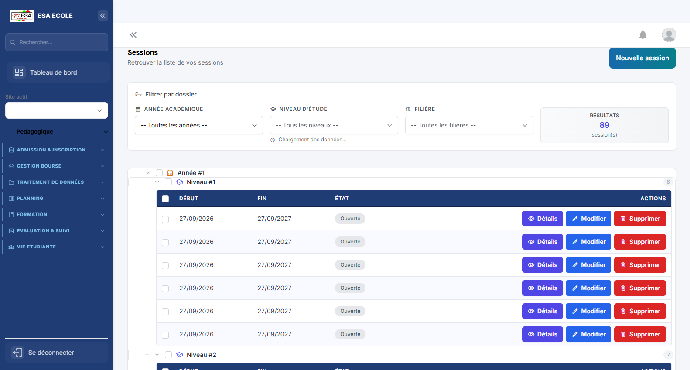

**Objectif :** Sessions d’inscription par année académique et niveau : période d’ouverture, pièces et frais associés.

**Actions principales :**

1. Créer une session
2. Définir la période et les pièces
3. Ouvrir ou clôturer la session

---

## 2. Parcours

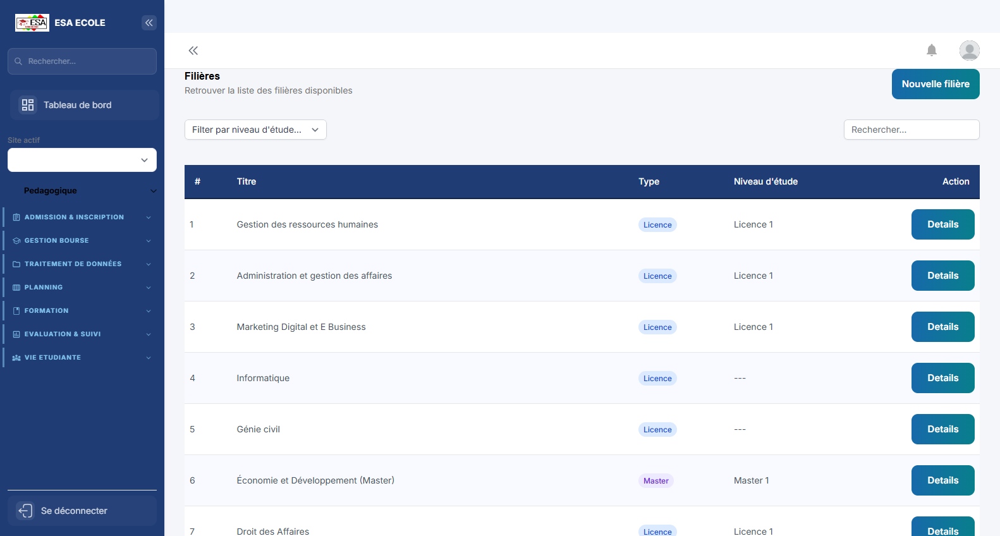

**Objectif :** Catalogue des parcours de formation : niveaux, UE, crédits et conditions d’accès.

**Actions principales :**

1. Créer ou modifier un parcours
2. Rattacher les UE
3. Vérifier les prérequis

---

## 3. Salles de classe

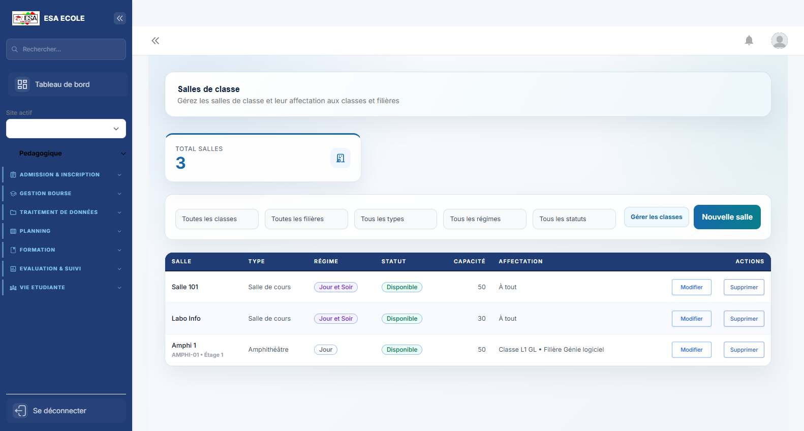

**Objectif :** Référentiel des salles et de leurs capacités, utilisé pour les emplois du temps et les examens.

**Actions principales :**

1. Créer une salle
2. Renseigner la capacité
3. Affecter aux cours ou examens

---

## 4. Frais par parcours

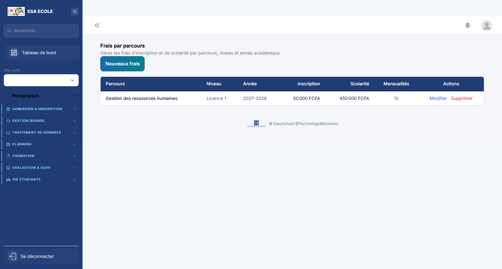

**Objectif :** Grille des frais de scolarité par parcours, niveau et année académique.

**Actions principales :**

1. Choisir le parcours
2. Définir les tranches et échéances
3. Enregistrer la grille

---

## 5. Demandes

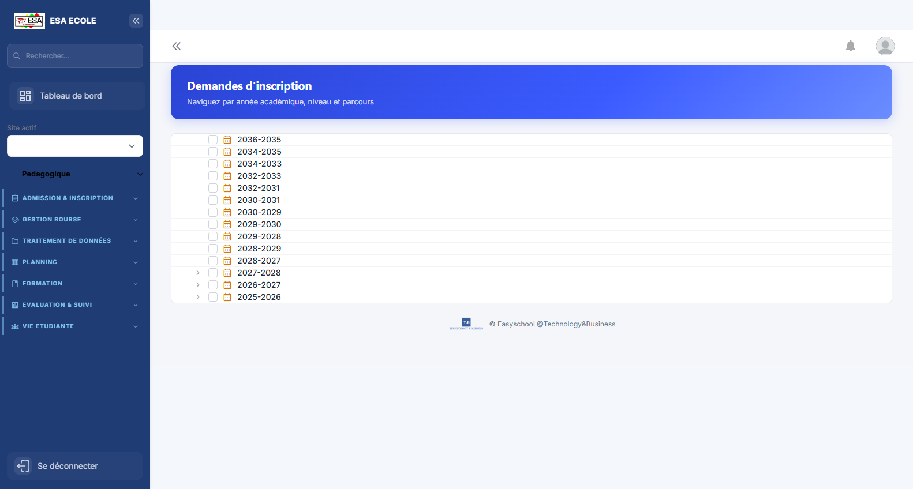

**Objectif :** File des demandes d’inscription ou de réinscription avec leur statut dans le pipeline.

**Actions principales :**

1. Filtrer par statut
2. Ouvrir un dossier
3. Faire avancer l’étape

---

## 6. Effectifs inscrits

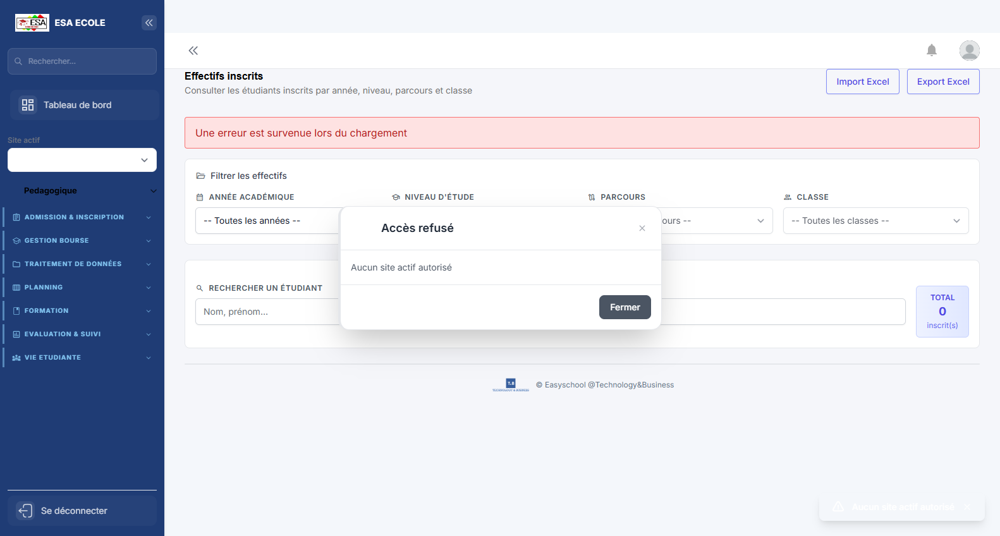

**Objectif :** Liste et statistiques des étudiants effectivement inscrits pour l’année ou la session sélectionnée.

**Actions principales :**

1. Choisir l’année et le parcours
2. Vérifier les inscrits
3. Exporter ou ouvrir un dossier

---

## 7. Demandes d'orientation

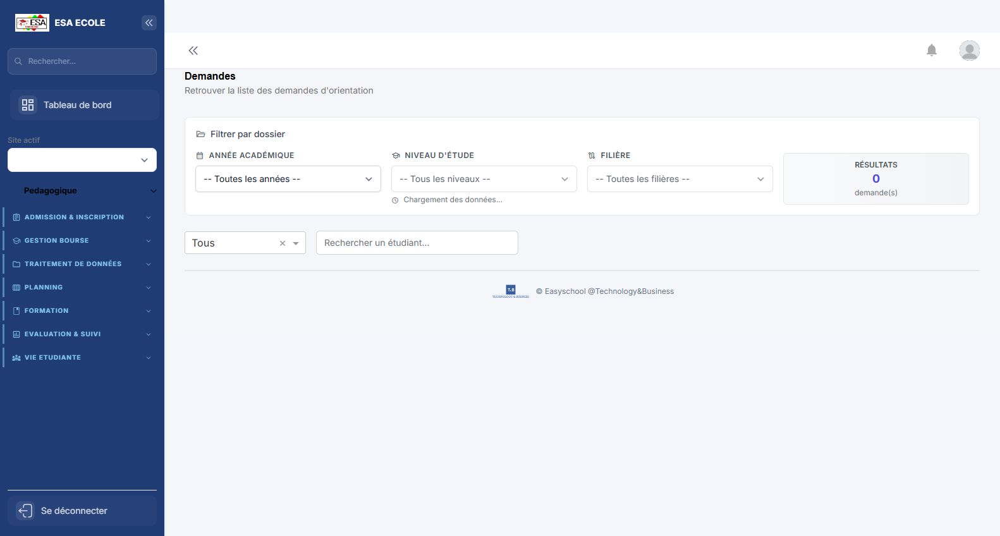

**Objectif :** Demandes d’orientation des candidats : choix de parcours, pièces et décision du comité.

**Actions principales :**

1. Consulter les demandes
2. Vérifier les pièces
3. Instruire ou orienter

---

## 8. Parcours d'orientation

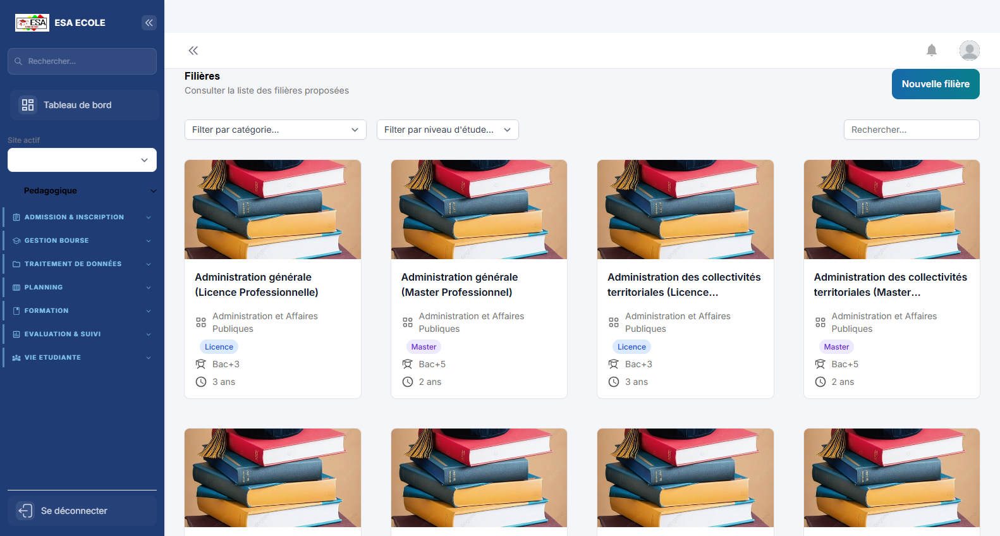

**Objectif :** Parcours proposés à l’orientation, avec leurs débouchés et conditions d’admission.

**Actions principales :**

1. Consulter l’offre
2. Associer les niveaux
3. Publier les parcours

---

## 9. Désignation du directeur de mémoire

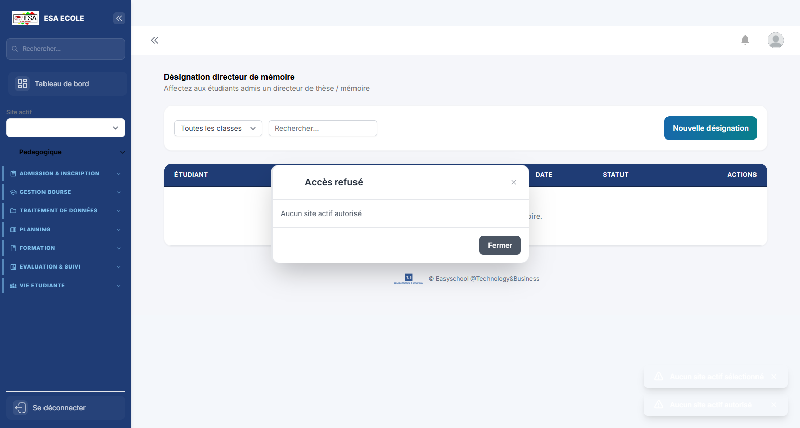

**Objectif :** Affectation des directeurs de mémoire aux étudiants et suivi des encadrements.

**Actions principales :**

1. Choisir les étudiants
2. Proposer un directeur
3. Valider l’affectation

---

## 10. Configurations

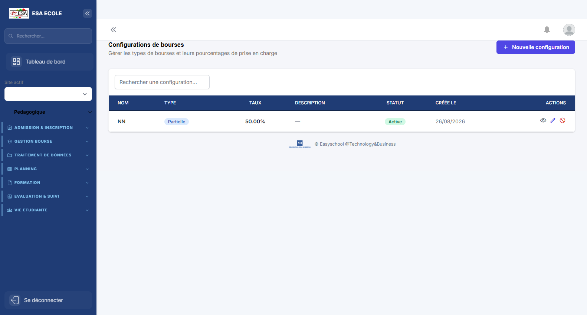

**Objectif :** Paramétrage du module : règles, barèmes et options appliquées aux dossiers.

**Actions principales :**

1. Choisir la configuration
2. Modifier les paramètres
3. Enregistrer et tester

---

## 11. Attributions

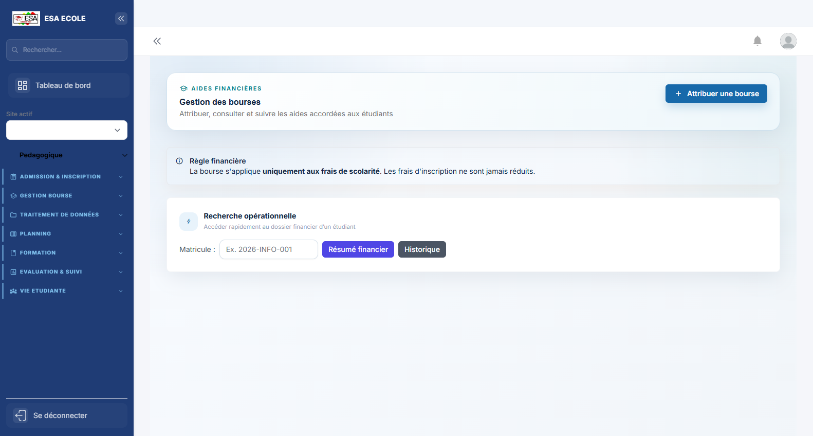

**Objectif :** Attribution des droits, responsabilités ou avantages aux personnes concernées.

**Actions principales :**

1. Rechercher la personne
2. Choisir l’attribution
3. Valider la période

---

## 12. Campagne de bourses

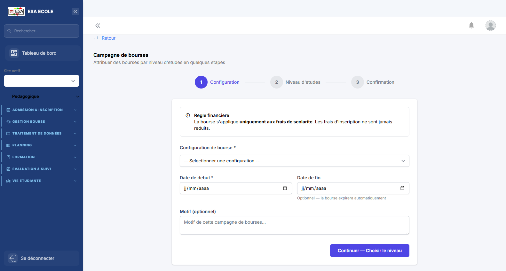

**Objectif :** Campagne d’attribution des bourses : critères, candidats et décisions.

**Actions principales :**

1. Ouvrir la campagne
2. Examiner les candidatures
3. Attribuer ou refuser

---

## 13. Dossiers étudiants

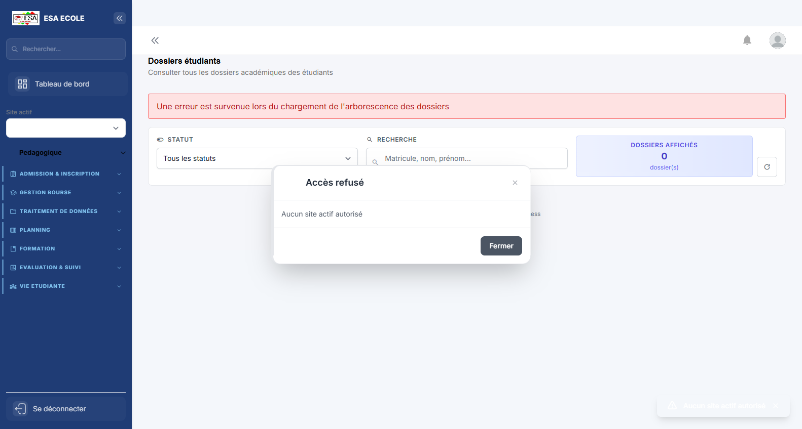

**Objectif :** Base des dossiers étudiants : recherche, complétude et historique administratif.

**Actions principales :**

1. Rechercher un étudiant
2. Contrôler les pièces
3. Ouvrir le dossier complet

---

## 14. Cartes étudiantes

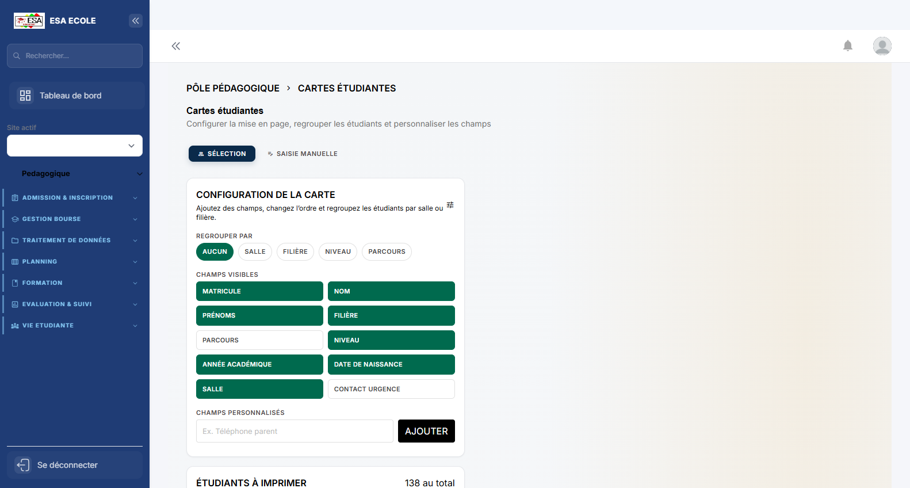

**Objectif :** Génération et suivi des cartes étudiantes avec photo, matricule et QR code.

**Actions principales :**

1. Sélectionner les étudiants
2. Vérifier la photo
3. Générer ou imprimer les cartes

---

## 15. Arborescence des dossiers

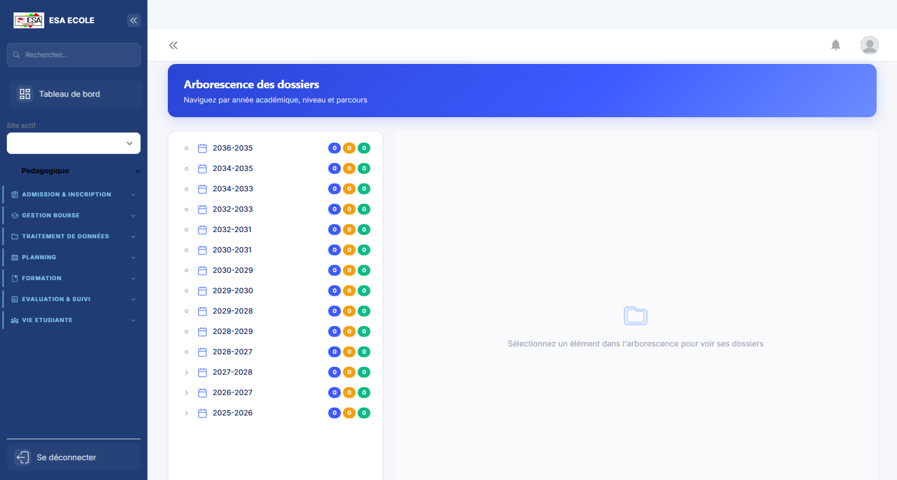

**Objectif :** Classement hiérarchique des dossiers et documents (étudiant, promotion, année).

**Actions principales :**

1. Parcourir l’arborescence
2. Ouvrir un dossier
3. Déplacer ou archiver

---

## 16. Registres

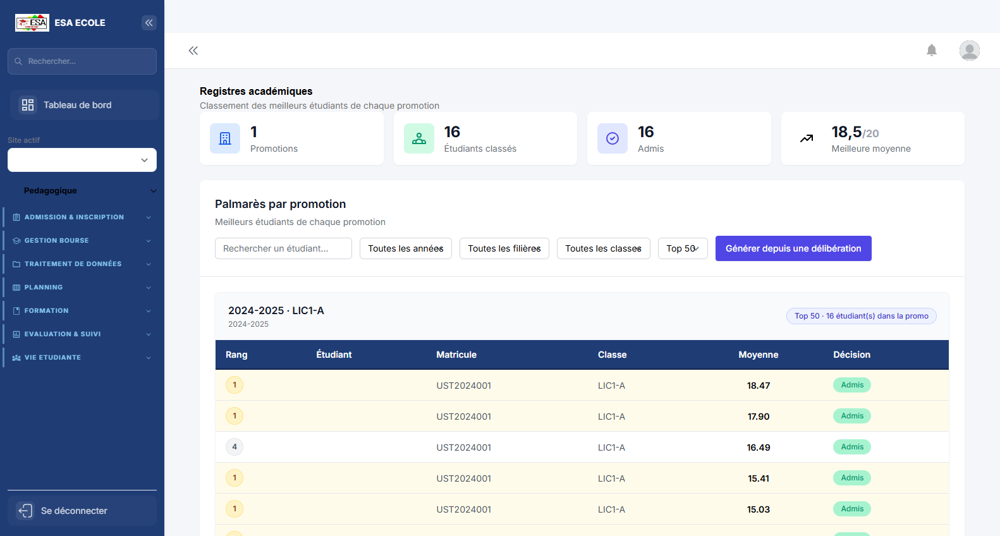

**Objectif :** Registres officiels : inscriptions, présences, délibérations et registres réglementaires.

**Actions principales :**

1. Choisir le registre
2. Filtrer par année
3. Consulter ou exporter

---

## 17. Équivalences

**Objectif :** Reconnaissance d’UE ou de crédits obtenus ailleurs.

**Actions principales :**

1. Créer une demande
2. Joindre les justificatifs
3. Valider l’équivalence

---

## 18. Dispenses

**Objectif :** Dispenses d’assiduité ou d’épreuve accordées à un étudiant.

**Actions principales :**

1. Choisir l’étudiant
2. Renseigner le motif
3. Valider la dispense

---

## 19. Réorientation

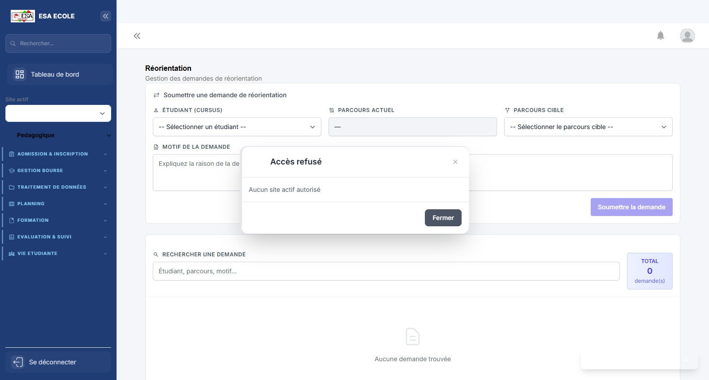

**Objectif :** Demandes de réorientation vers un autre parcours ou niveau.

**Actions principales :**

1. Créer une demande
2. Joindre les motifs
3. Suivre la décision

---

## 20. Traiter les réclamations

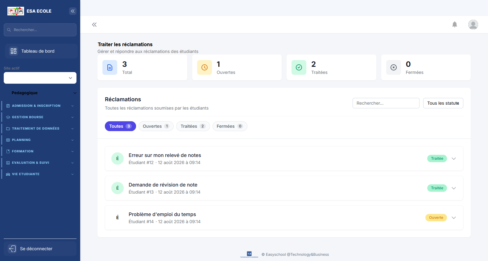

**Objectif :** File de traitement des réclamations : instruction, réponse et clôture.

**Actions principales :**

1. Ouvrir une réclamation
2. Instruire le dossier
3. Répondre et clôturer

---

## 21. Emplois du temps

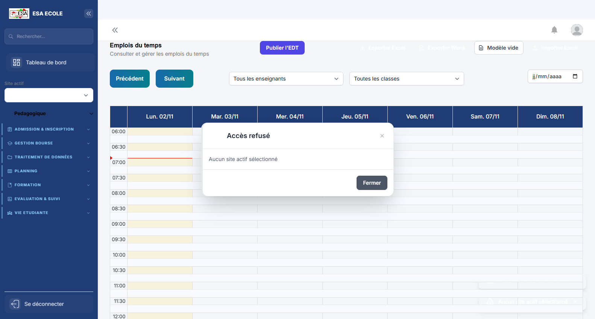

**Objectif :** Planning des cours par classe, enseignant et salle.

**Actions principales :**

1. Choisir la classe ou l’enseignant
2. Consulter le planning
3. Détecter les conflits

---

## 22. Calendrier

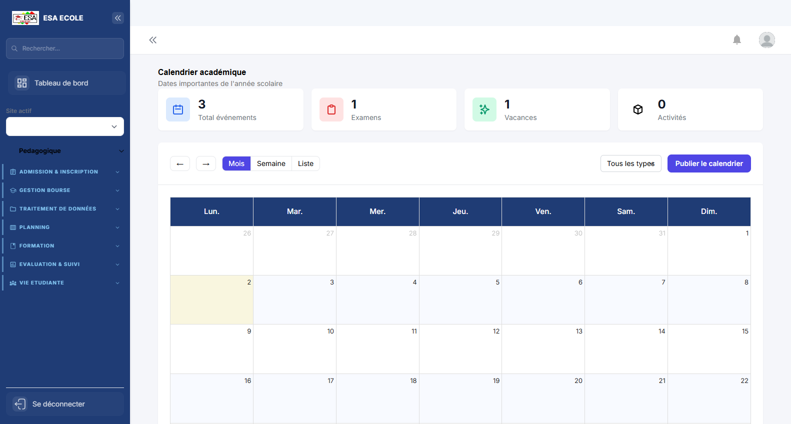

**Objectif :** Calendrier académique : sessions, examens, périodes de saisie et événements de l’établissement.

**Actions principales :**

1. Choisir la période
2. Consulter un événement
3. S’abonner ou exporter le calendrier

---

## 23. Sessions d'examens

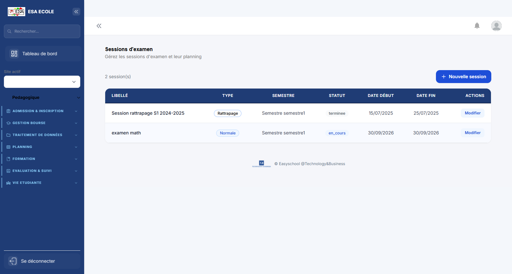

**Objectif :** Programmation des examens : dates, salles, surveillants et épreuves.

**Actions principales :**

1. Créer une session
2. Affecter salles et surveillants
3. Publier le planning

---

## 24. Rattrapages

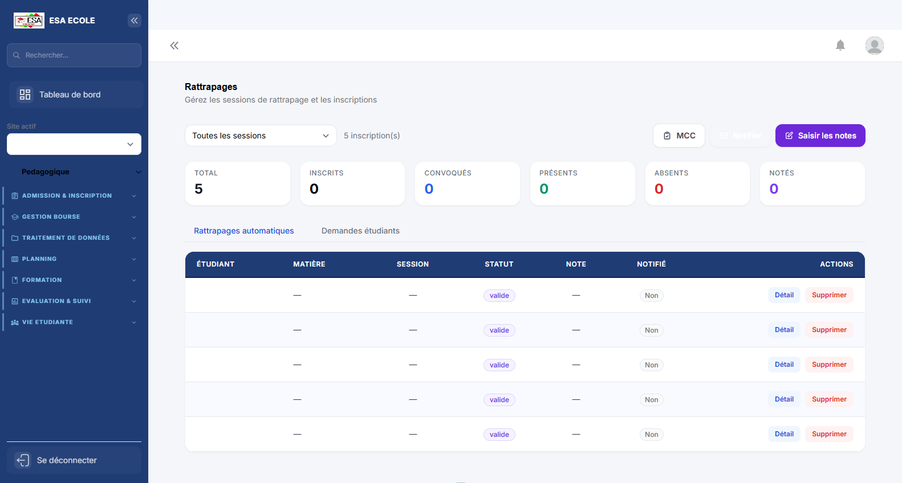

**Objectif :** Sessions de rattrapage : inscription, épreuves et résultats.

**Actions principales :**

1. Créer une session
2. Inscrire les étudiants
3. Saisir les résultats

---

## 25. Décisions de passage

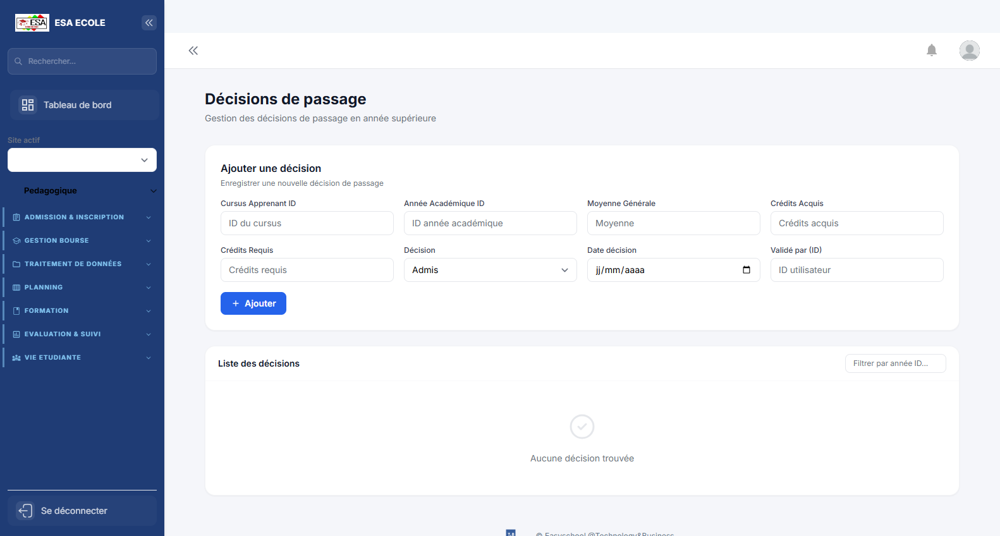

**Objectif :** Décisions de passage en année supérieure ou de redoublement.

**Actions principales :**

1. Préparer les propositions
2. Valider en jury
3. Notifier les étudiants

---

## 26. Enseignants

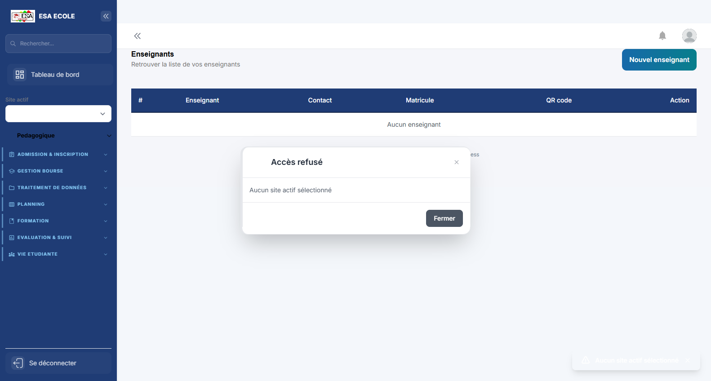

**Objectif :** Référentiel des enseignants : profil, spécialités, affectations et badge de pointage.

**Actions principales :**

1. Créer ou modifier un enseignant
2. Affecter aux cours
3. Générer le badge

---

## 27. Cahiers de texte

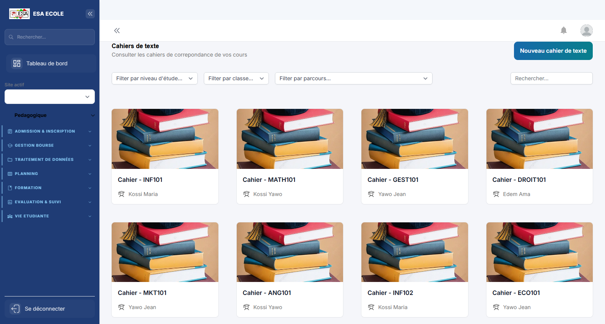

**Objectif :** Contenu des séances : objectifs, activités, devoirs et ressources.

**Actions principales :**

1. Choisir la classe et la séance
2. Renseigner le contenu
3. Publier pour les étudiants

---

## 28. Cahier de présence

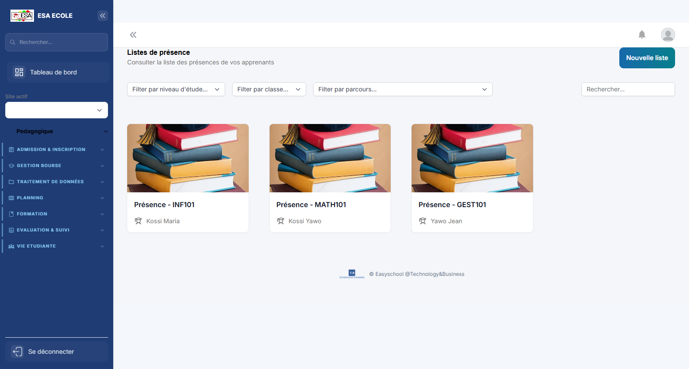

**Objectif :** Appel et suivi des présences par séance, avec motif d’absence.

**Actions principales :**

1. Ouvrir la séance
2. Marquer les présents et absents
3. Enregistrer

---

## 29. Notes

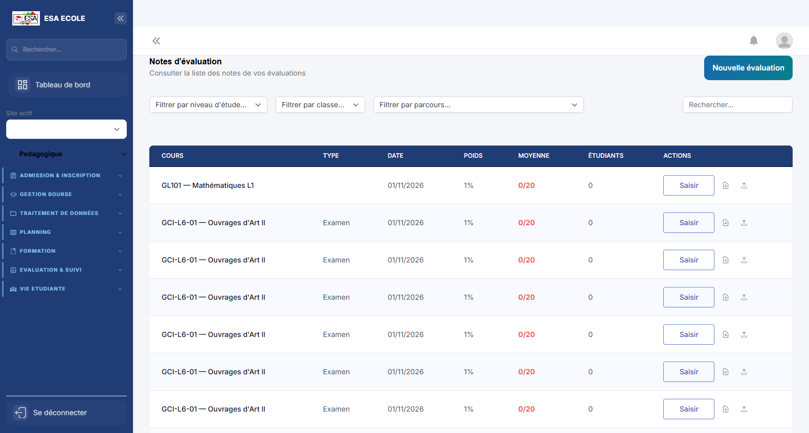

**Objectif :** Saisie et consultation des notes par classe, UE et type d’évaluation.

**Actions principales :**

1. Choisir la classe et l’UE
2. Saisir les notes
3. Vérifier puis publier

---

## 30. Bibliothèque

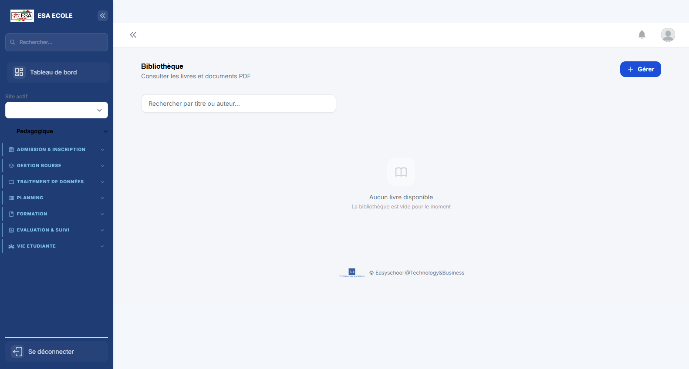

**Objectif :** Catalogue des ouvrages disponibles, avec recherche et consultation des fiches.

**Actions principales :**

1. Rechercher un ouvrage
2. Consulter la fiche et la disponibilité
3. Réserver ou emprunter

---

## 31. Gestion de la bibliothèque

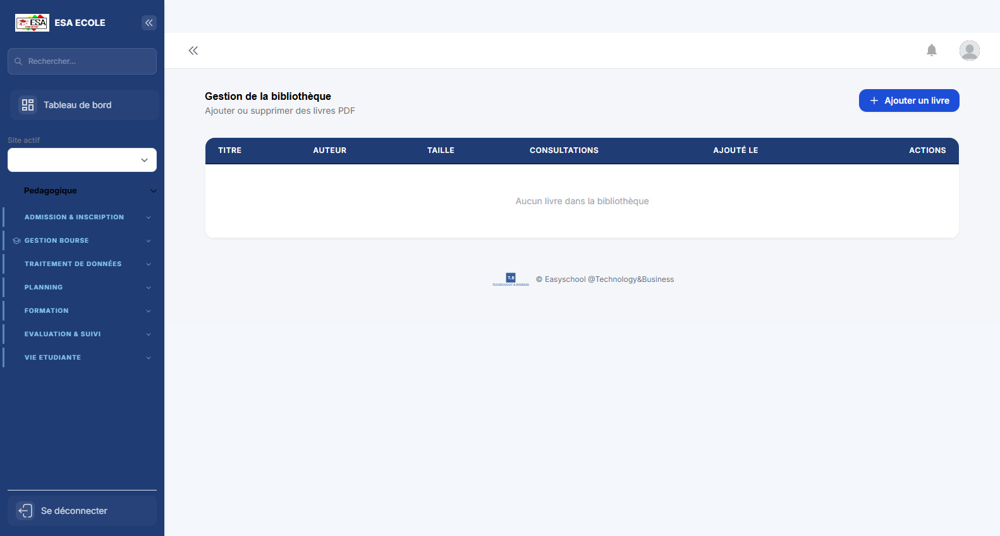

**Objectif :** Administration du fonds documentaire : ouvrages, exemplaires, prêts et retours.

**Actions principales :**

1. Ajouter un ouvrage
2. Gérer les exemplaires
3. Suivre les prêts et retards

---

## 32. Bulletins

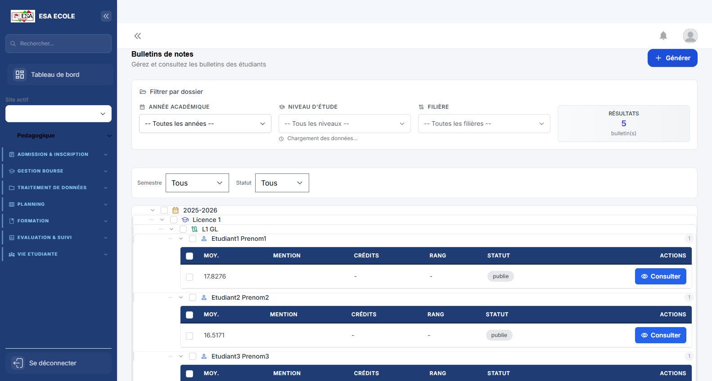

**Objectif :** Bulletins générés à partir des notes : moyennes, crédits, mentions et décisions.

**Actions principales :**

1. Choisir l’année et la classe
2. Générer les bulletins
3. Contrôler et publier

---

## 33. Moyennes

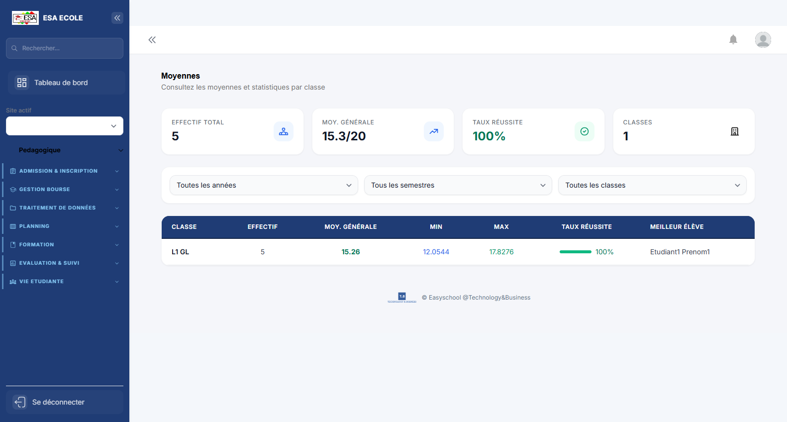

**Objectif :** Calcul et contrôle des moyennes par étudiant, UE et semestre.

**Actions principales :**

1. Sélectionner le périmètre
2. Lancer le calcul
3. Contrôler les anomalies

---

## 34. Paramètres de notation

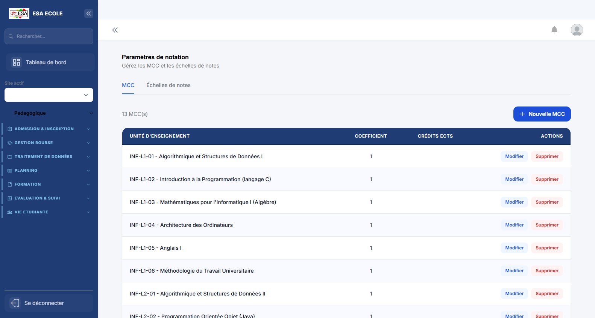

**Objectif :** Règles de calcul : coefficients, compensation, crédits et seuils de validation.

**Actions principales :**

1. Choisir le niveau
2. Définir les règles
3. Enregistrer

---

## 35. Délibérations & jury

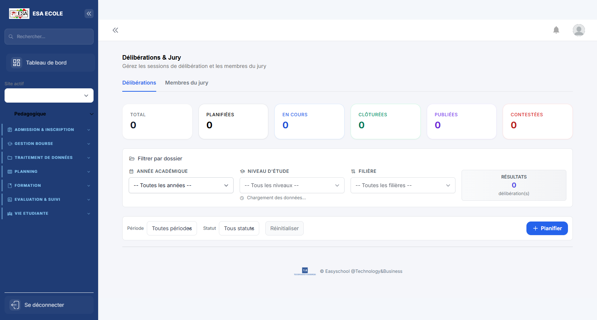

**Objectif :** Séances de jury : décisions d’admission, de passage ou de redoublement.

**Actions principales :**

1. Préparer la séance
2. Examiner les cas
3. Consigner les décisions

---

## 36. Absences

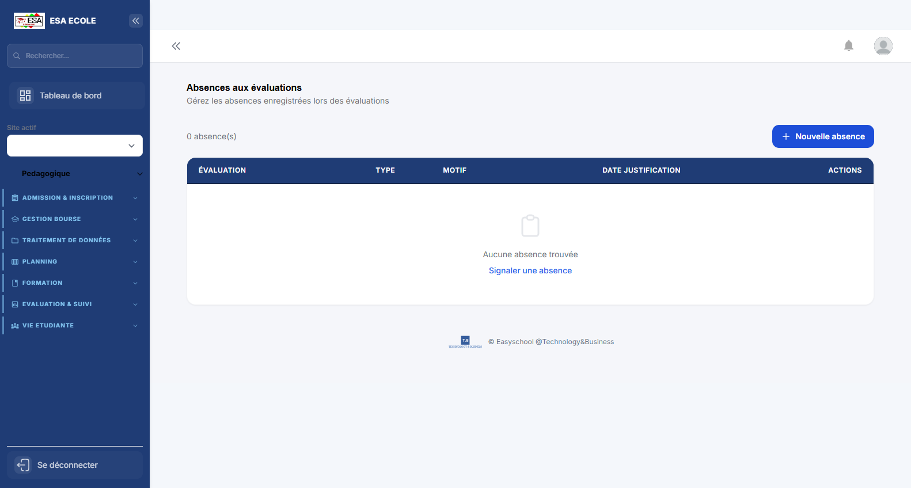

**Objectif :** Suivi des absences et justificatifs, avec alertes et statistiques.

**Actions principales :**

1. Filtrer les absences
2. Vérifier un justificatif
3. Valider ou sanctionner

---

## 37. Sanctions & discipline

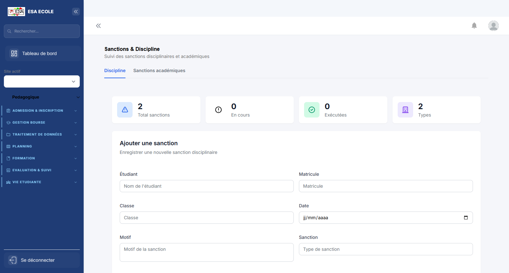

**Objectif :** Procédures disciplinaires : faits, convocation, décision et suivi.

**Actions principales :**

1. Ouvrir un dossier
2. Consigner les faits
3. Notifier la décision

---

## 38. Conseils de classe

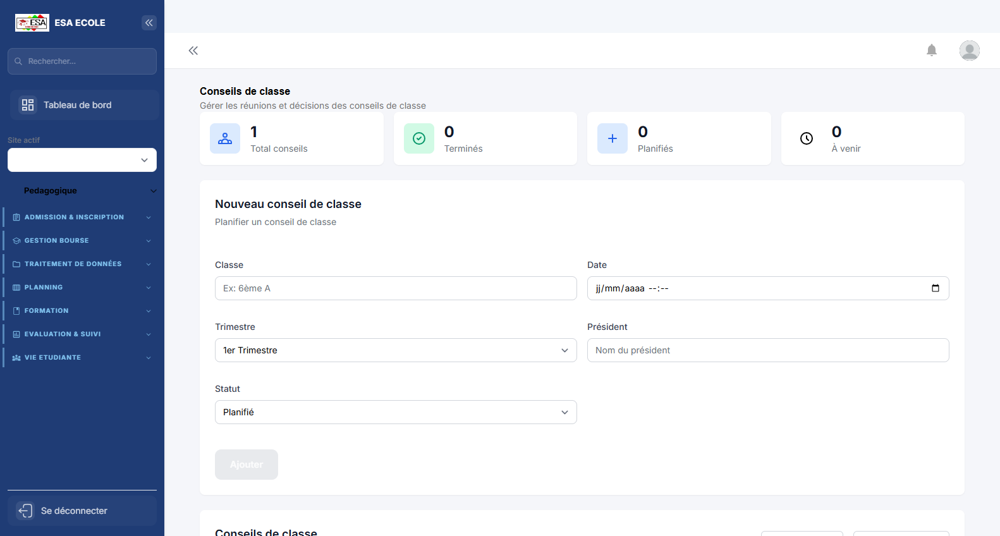

**Objectif :** Préparation et tenue des conseils de classe : synthèse par étudiant et avis.

**Actions principales :**

1. Choisir la classe
2. Consulter les synthèses
3. Saisir les avis

---

## 39. Annonces

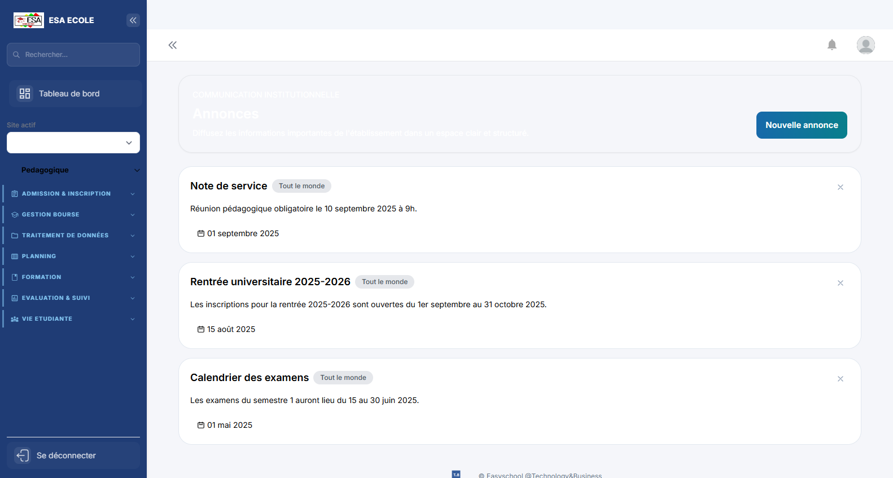

**Objectif :** Publication et consultation des annonces destinées aux étudiants, enseignants ou personnels.

**Actions principales :**

1. Créer ou ouvrir une annonce
2. Choisir le public cible
3. Publier ou archiver

---

## 40. Vie estudiantine

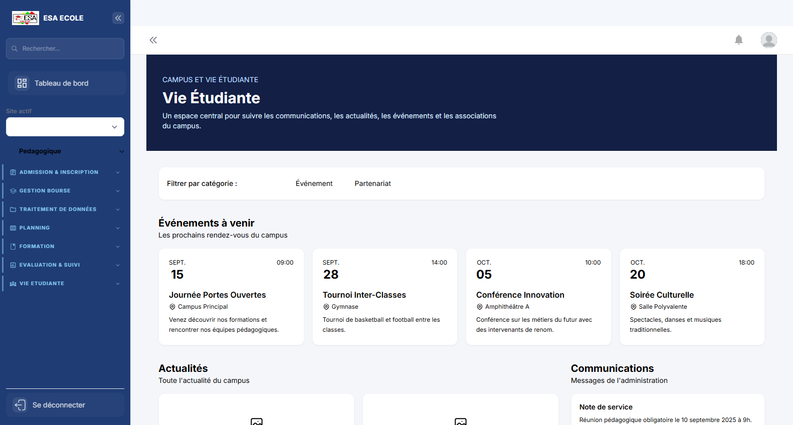

**Objectif :** Actualités, activités et informations de la vie étudiante.

**Actions principales :**

1. Parcourir les publications
2. Ouvrir une actualité
3. Participer ou réagir

---

## 41. Offres de stage

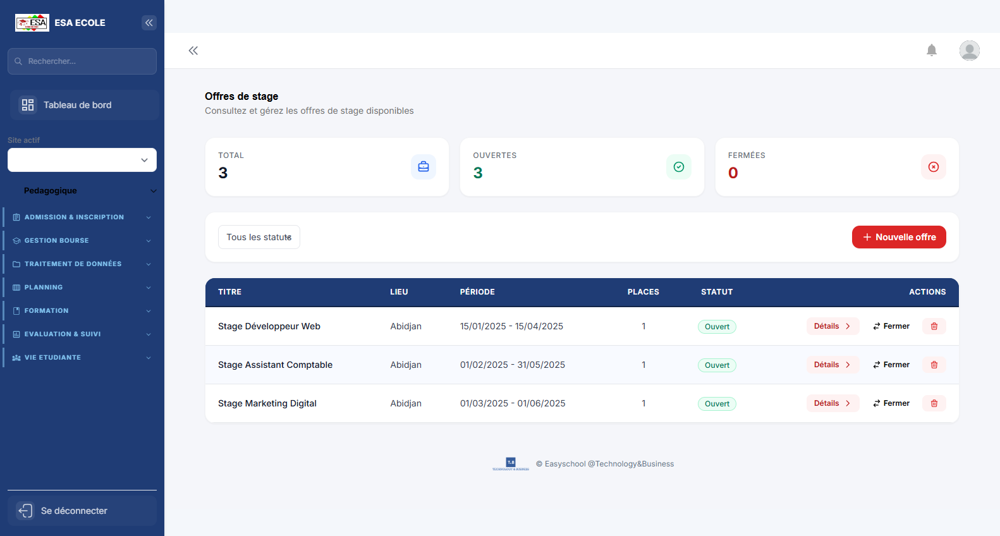

**Objectif :** Offres de stage publiées par les entreprises partenaires.

**Actions principales :**

1. Parcourir les offres
2. Consulter le détail
3. Postuler

---

## 42. Entreprises

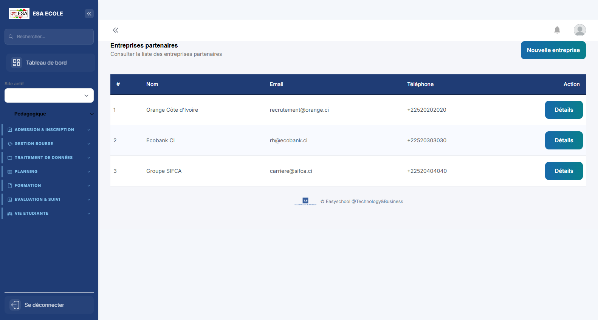

**Objectif :** Référentiel des entreprises partenaires et des contacts.

**Actions principales :**

1. Créer une entreprise
2. Renseigner les contacts
3. Associer les offres

---

## 43. Paiements

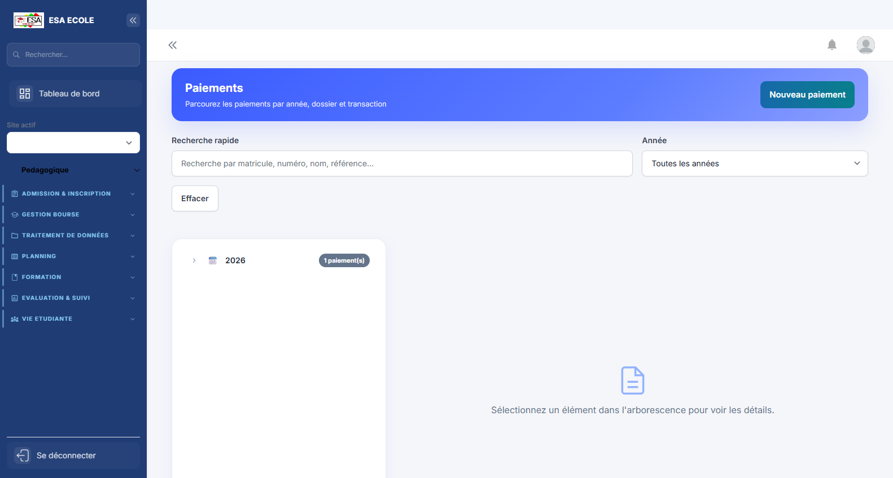

**Objectif :** Paiements des étudiants : saisie, recherche, historique et rattachement aux échéances.

**Actions principales :**

1. Rechercher un étudiant ou un paiement
2. Vérifier le montant et la référence
3. Enregistrer ou consulter le reçu

---

## 44. Échéances

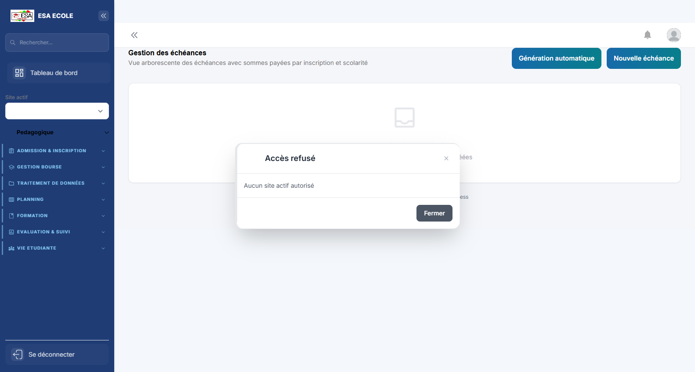

**Objectif :** Échéancier des frais par étudiant : montants dus, dates limites et statuts.

**Actions principales :**

1. Choisir un étudiant ou une période
2. Contrôler les échéances
3. Marquer un paiement ou une relance

---

## 45. Situation irrégulière

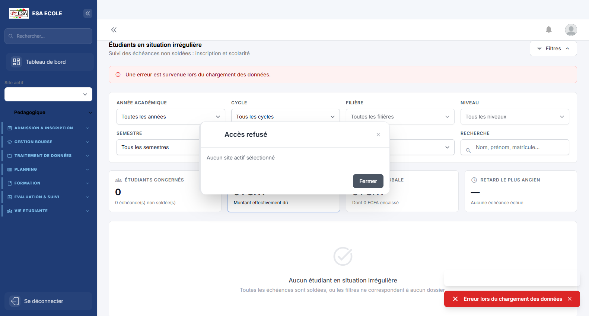

**Objectif :** Étudiants en retard ou en défaut de paiement, avec motif et ancienneté de la dette.

**Actions principales :**

1. Filtrer les impayés
2. Analyser l’historique
3. Lancer une relance ou une régularisation

---

## 46. Situation financière

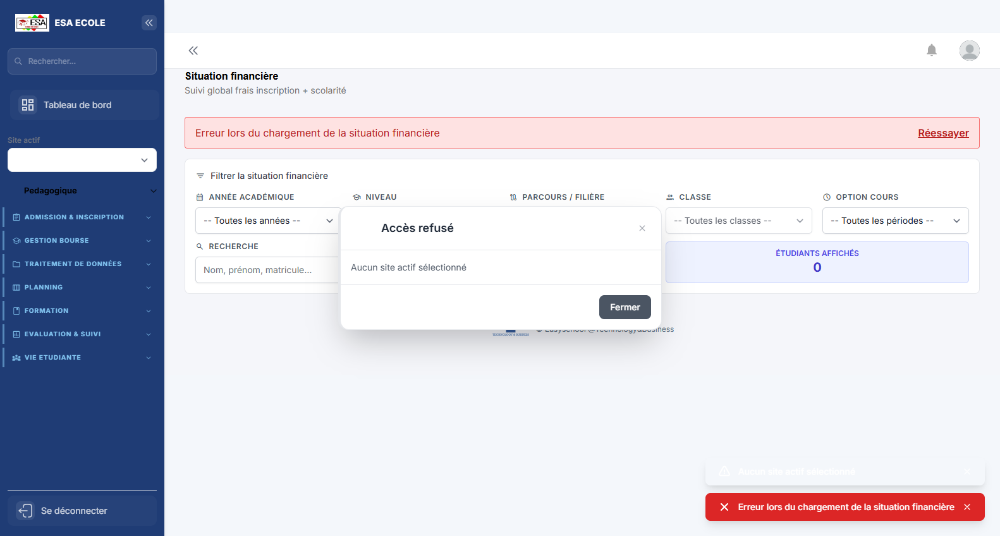

**Objectif :** Situation détaillée d’un étudiant : total dû, total payé, reste à payer et échéances.

**Actions principales :**

1. Rechercher l’étudiant
2. Lire le solde et l’historique
3. Exporter la situation

---

## 47. Catégories

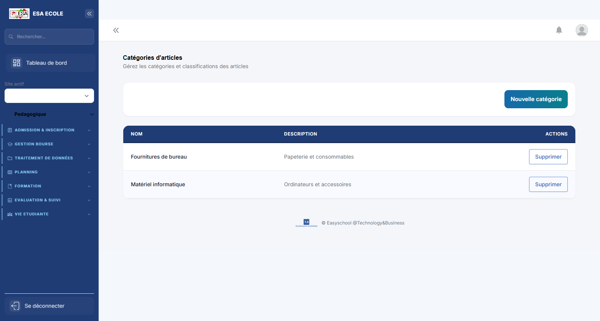

**Objectif :** Catégories d’articles, de documents ou d’immobilisations utilisées dans les référentiels.

**Actions principales :**

1. Créer une catégorie
2. Définir les règles associées
3. Enregistrer

---

## 48. Transferts

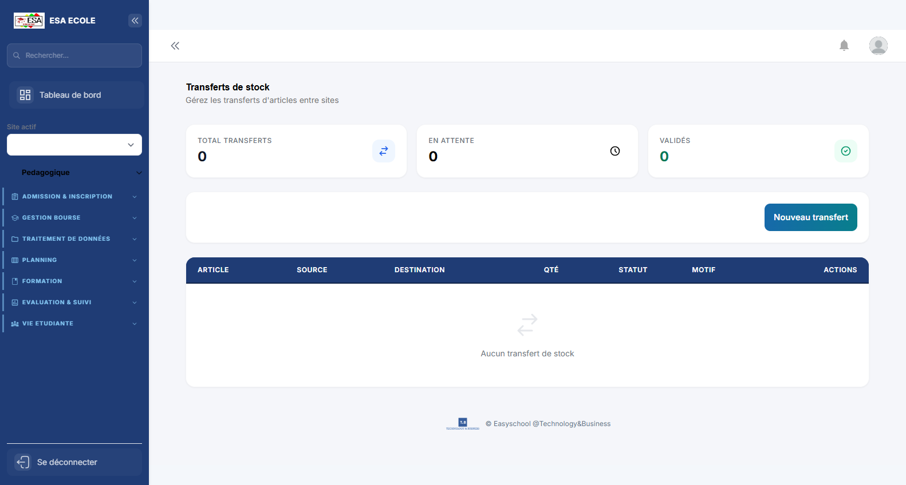

**Objectif :** Transferts de dossiers entre services, sites ou archives.

**Actions principales :**

1. Sélectionner les dossiers
2. Choisir la destination
3. Valider le transfert

---

## 49. Corrections

**Objectif :** Corrections et régularisations autorisées sur les données ou les opérations.

**Actions principales :**

1. Rechercher l’élément
2. Saisir le motif
3. Appliquer la correction

---

## 50. Rebuts

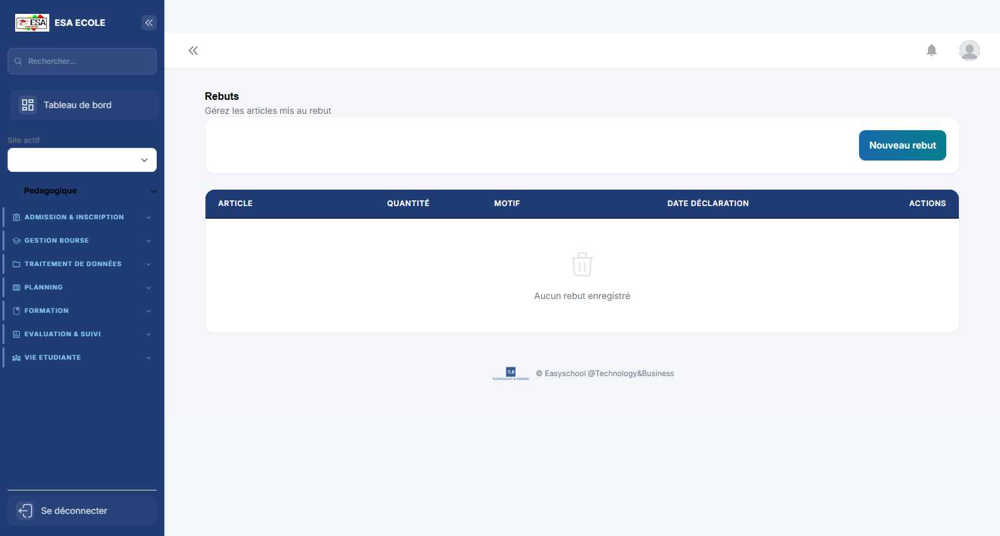

**Objectif :** Biens mis au rebut avec motif, procès-verbal et sortie d’inventaire.

**Actions principales :**

1. Sélectionner les biens
2. Renseigner le motif
3. Valider la mise au rebut

---

## 51. Inventaires

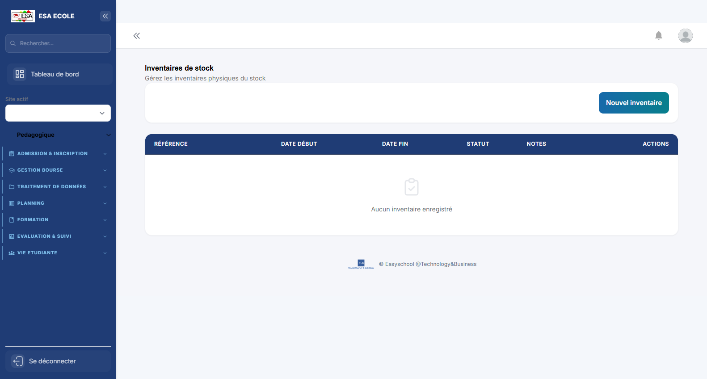

**Objectif :** Campagnes d’inventaire physique et rapprochement avec le registre comptable.

**Actions principales :**

1. Lancer une campagne
2. Saisir les constats
3. Générer les écarts

---

## 52. Fournisseurs

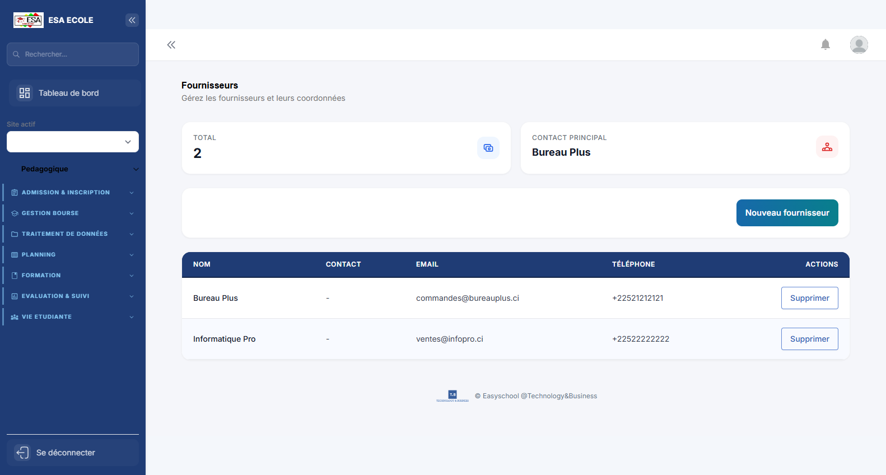

**Objectif :** Référentiel des fournisseurs et de leurs coordonnées.

**Actions principales :**

1. Créer un fournisseur
2. Renseigner les coordonnées
3. Activer

---

## 53. Reportings

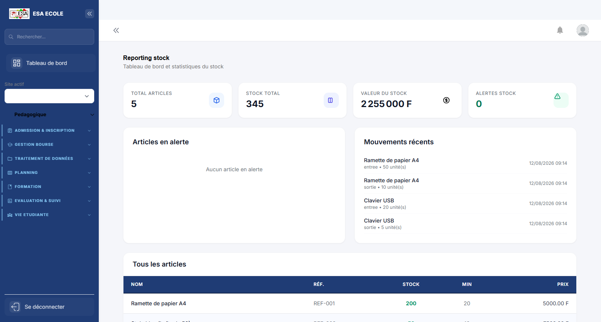

**Objectif :** Tableaux de bord et rapports financiers consolidés.

**Actions principales :**

1. Choisir le rapport
2. Filtrer la période
3. Exporter

---

## 54. Cycle de vie

**Objectif :** Étapes de vie d’un document ou dossier : actif, intermédiaire, archivage, élimination.

**Actions principales :**

1. Vérifier l’étape
2. Programmer la transition
3. Valider l’opération

---

## 55. Sites

**Objectif :** Sites et établissements rattachés, avec leur adresse et leur responsable.

**Actions principales :**

1. Créer un site
2. Renseigner l’adresse
3. Activer

---

## 56. Catégories — vue 2

**Objectif :** Catégories d’articles, de documents ou d’immobilisations utilisées dans les référentiels.

**Actions principales :**

1. Créer une catégorie
2. Définir les règles associées
3. Enregistrer

---

## 57. Affectations

**Objectif :** Affectation des biens, salles ou moyens aux personnes et services.

**Actions principales :**

1. Choisir le bien
2. Sélectionner le bénéficiaire
3. Valider l’affectation

---

## 58. Assurances

**Objectif :** Contrats d’assurance des biens : police, échéances et sinistres.

**Actions principales :**

1. Créer un contrat
2. Renseigner les échéances
3. Suivre les sinistres

---

## 59. Sorties provisoires

**Objectif :** Biens sortis temporairement avec date de retour et responsable.

**Actions principales :**

1. Enregistrer une sortie
2. Fixer la date de retour
3. Contrôler le retour

---

## 60. Cessions

**Objectif :** Cessions de biens : motif, valorisation et validation.

**Actions principales :**

1. Sélectionner le bien
2. Renseigner la cession
3. Valider

---

## 61. Rebuts — vue 2

**Objectif :** Biens mis au rebut avec motif, procès-verbal et sortie d’inventaire.

**Actions principales :**

1. Sélectionner les biens
2. Renseigner le motif
3. Valider la mise au rebut

---

## 62. Maintenance

**Objectif :** Interventions de maintenance préventive et curative sur les biens.

**Actions principales :**

1. Créer une demande
2. Planifier l’intervention
3. Clôturer avec le rapport

---

## 63. Inventaires — vue 2

**Objectif :** Campagnes d’inventaire physique et rapprochement avec le registre comptable.

**Actions principales :**

1. Lancer une campagne
2. Saisir les constats
3. Générer les écarts

---

## 64. Reportings — vue 2

**Objectif :** Tableaux de bord et rapports financiers consolidés.

**Actions principales :**

1. Choisir le rapport
2. Filtrer la période
3. Exporter

---

## 65. Planning du personnel

**Objectif :** Affectation hebdomadaire des personnels : poste, tâche et horaires.

**Actions principales :**

1. Choisir la semaine
2. Affecter les personnels
3. Publier le planning

---

## 66. Catalogue e-learning

**Objectif :** Cours en ligne publiés pour l’année et le niveau de l’apprenant, avec crédits et tarif.

**Actions principales :**

1. Parcourir le catalogue
2. Vérifier les prérequis
3. Choisir une UE

---

## 67. Utilisateurs

**Objectif :** Comptes utilisateurs : création, rôle, activation, blocage et réinitialisation.

**Actions principales :**

1. Créer ou rechercher un compte
2. Attribuer le rôle
3. Activer ou bloquer

---

## 68. QR codes

**Objectif :** Génération et vérification des QR codes (cartes, badges, documents).

**Actions principales :**

1. Sélectionner les éléments
2. Générer les QR codes
3. Imprimer ou télécharger

---

## 69. Journal d'audit

**Objectif :** Journal horodaté des actions sensibles : acteur, action, entité, ancienne et nouvelle valeur.

**Actions principales :**

1. Filtrer par acteur ou période
2. Ouvrir une trace
3. Exporter le journal

---

## 70. Configuration

**Objectif :** Paramètres généraux de l’application : établissement, année, notifications et options.

**Actions principales :**

1. Choisir une section
2. Modifier les valeurs
3. Enregistrer

---

## 71. Profils d'accès

**Objectif :** Profils et matrice des habilitations : menus et actions autorisés par rôle.

**Actions principales :**

1. Choisir un profil
2. Cocher les permissions
3. Appliquer immédiatement

---

## 72. Mon profil

**Objectif :** Informations personnelles et professionnelles du compte connecté : identité, contacts et rattachements.

**Actions principales :**

1. Vérifier ses informations
2. Mettre à jour les champs modifiables
3. Enregistrer

---

## 73. Mon compte

**Objectif :** Paramètres de sécurité du compte : mot de passe, double authentification et sessions.

**Actions principales :**

1. Changer le mot de passe
2. Activer ou vérifier le 2FA
3. Contrôler les sessions ouvertes

---

## 74. École

**Objectif :** Fiche de l’établissement : identité, coordonnées, logo et informations officielles.

**Actions principales :**

1. Renseigner l’identité
2. Mettre à jour les coordonnées
3. Enregistrer les paramètres

---

## 75. Année scolaire

**Objectif :** Année académique de référence : dates de début et de fin, statut actif et rattachement des données.

**Actions principales :**

1. Créer ou sélectionner l’année
2. Définir les dates et le statut
3. Rattacher les sessions et référentiels

---

## 76. Frais

**Objectif :** Référentiel des frais et de leurs règles de calcul (scolarité, services, examens).

**Actions principales :**

1. Créer un type de frais
2. Associer les parcours concernés
3. Activer la facturation

---

## 77. Notifications

**Objectif :** Centre de notifications de l’application : alertes métier, échéances et messages système.

**Actions principales :**

1. Lire les notifications récentes
2. Marquer comme lues
3. Ouvrir l’élément concerné

---

## 78. Système

**Objectif :** État technique du système : services, files d’attente, tâches planifiées et versions.

**Actions principales :**

1. Contrôler les services
2. Consulter les journaux
3. Relancer une tâche si nécessaire

---

## 79. Sauvegardes

**Objectif :** Sauvegardes de la base et des documents : planification, exécution et restauration.

**Actions principales :**

1. Lancer une sauvegarde
2. Vérifier l’intégrité
3. Télécharger ou restaurer

---

## 80. Types de documents

**Objectif :** Référentiel des modèles de documents et de leurs règles de génération.

**Actions principales :**

1. Créer un type
2. Associer le modèle
3. Définir les champs obligatoires

---

## 81. Modèles de documents

**Objectif :** Gestion des modèles (contenu, variables, mise en page) utilisés pour les documents officiels.

**Actions principales :**

1. Créer ou importer un modèle
2. Insérer les variables
3. Publier la version

---

## 82. Cachet électronique

**Objectif :** Configuration et apposition du cachet électronique de l’établissement.

**Actions principales :**

1. Choisir le cachet
2. Vérifier le document
3. Apposer le cachet

---

## 83. Workflows documentaires

**Objectif :** Circuits de validation des documents : étapes, acteurs et conditions de passage.

**Actions principales :**

1. Choisir un workflow
2. Définir les étapes
3. Activer le circuit

---

## 84. Tous les documents

**Objectif :** Vue transversale des documents produits ou déposés, avec filtres et recherche.

**Actions principales :**

1. Filtrer par type ou étudiant
2. Ouvrir un document
3. Contrôler ou télécharger

---

## 85. Générer un document

**Objectif :** Assistant de génération d’un document officiel à partir d’un modèle et des données du dossier.

**Actions principales :**

1. Choisir le modèle
2. Vérifier les champs préremplis
3. Générer et archiver

---

## 86. Diplômes

**Objectif :** Diplômes obtenus, impressions et vérification d’authenticité.

**Actions principales :**

1. Rechercher un diplômé
2. Consulter le diplôme
3. Générer ou vérifier

---

## 87. Demandes de documents

**Objectif :** Demandes de documents administratifs (attestation, relevé, certificat) et leur traitement.

**Actions principales :**

1. Créer ou ouvrir une demande
2. Vérifier les pièces
3. Générer le document

---

## 88. Traiter les demandes

**Objectif :** File de traitement des demandes de documents : vérification, validation et génération.

**Actions principales :**

1. Ouvrir une demande
2. Contrôler les conditions
3. Valider et générer

---

## 89. Demandes VAE

**Objectif :** Demandes de validation des acquis de l’expérience : pièces, expertise et décision.

**Actions principales :**

1. Déposer une demande
2. Fournir le dossier d’expérience
3. Suivre l’instruction

---

## 90. Signatures

**Objectif :** Signatures électroniques apposées sur les documents et suivi de leur validité.

**Actions principales :**

1. Ouvrir un document à signer
2. Contrôler le contenu
3. Signer électroniquement

---

## 91. Signature direction

**Objectif :** File des documents en attente de signature de la direction.

**Actions principales :**

1. Examiner le document
2. Vérifier les pièces
3. Signer ou renvoyer

---

## 92. Tableau de bord

**Objectif :** Vue de pilotage opérationnel : volumes, échéances et activités récentes du périmètre du profil.

**Actions principales :**

1. Choisir la période
2. Analyser les indicateurs
3. Accéder au détail d’un bloc

---

## 93. Encaissement

**Objectif :** Encaissement au guichet : identification de l’étudiant, montant, mode de paiement et reçu.

**Actions principales :**

1. Rechercher l’étudiant
2. Saisir le paiement
3. Imprimer le reçu

---

## 94. Caisse

**Objectif :** État de la caisse du jour : fonds, encaissements, décaissements et solde.

**Actions principales :**

1. Ouvrir la caisse
2. Enregistrer les opérations
3. Contrôler le solde

---

## 95. Clôture de caisse

**Objectif :** Clôture journalière : comptage, écart éventuel et validation de la caisse.

**Actions principales :**

1. Compter les espèces
2. Saisir le montant
3. Valider la clôture

---

## 96. Demandes — vue 2

**Objectif :** File des demandes d’inscription ou de réinscription avec leur statut dans le pipeline.

**Actions principales :**

1. Filtrer par statut
2. Ouvrir un dossier
3. Faire avancer l’étape

---

## 97. Autorisations provisoires

**Objectif :** Autorisations accordées en attente de régularisation (accès aux cours, examens ou documents).

**Actions principales :**

1. Créer une autorisation
2. Fixer l’échéance
3. Suivre la régularisation

---

## 98. Types de documents — vue 2

**Objectif :** Référentiel des modèles de documents et de leurs règles de génération.

**Actions principales :**

1. Créer un type
2. Associer le modèle
3. Définir les champs obligatoires

---

## 99. Journal de caisse

**Objectif :** Détail chronologique des mouvements de caisse avec justificatifs et soldes.

**Actions principales :**

1. Choisir la date
2. Contrôler les mouvements
3. Exporter le journal

---

## 100. Mes bordereaux

**Objectif :** Bordereaux déposés par l’étudiant (ou suivis par le profil) avec leur état d’authentification et d’imputation.

**Actions principales :**

1. Déposer ou consulter un bordereau
2. Suivre son statut
3. Télécharger le reçu

---

## 101. Réclamations

**Objectif :** Dépôt et suivi des réclamations (notes, scolarité, discipline, paiement).

**Actions principales :**

1. Créer une réclamation
2. Joindre les pièces
3. Suivre le statut

---

## 102. Mon tableau de bord

**Objectif :** Page d'accueil du profil : indicateurs personnels, alertes et raccourcis vers les tâches les plus fréquentes.

**Actions principales :**

1. Lire les indicateurs et alertes
2. Ouvrir un raccourci
3. Traiter les éléments en attente

---

## 103. Unités d'enseignement

**Objectif :** UE et ECUE : crédits, volumes horaires, semestres et prérequis.

**Actions principales :**

1. Créer une UE
2. Ajouter les ECUE
3. Définir crédits et prérequis

---

## 104. Validation des bordereaux

**Objectif :** Authentification des bordereaux déposés : contrôle du justificatif et saisie des références bancaires.

**Actions principales :**

1. Ouvrir le bordereau
2. Vérifier le PDF et les références
3. Valider ou rejeter avec motif

---

## 105. Comptabilité

**Objectif :** Comptabilité générale : journaux, écritures, balance et grand livre.

**Actions principales :**

1. Choisir le journal
2. Consulter ou saisir une écriture
3. Contrôler la balance

---

## 106. Articles

**Objectif :** Référentiel des articles et prestations utilisés dans les achats et la comptabilité.

**Actions principales :**

1. Créer un article
2. Renseigner l’unité et le prix
3. Activer

---

## 107. Mouvements

**Objectif :** Mouvements de stocks ou de trésorerie : entrées, sorties et soldes.

**Actions principales :**

1. Filtrer les mouvements
2. Ouvrir un mouvement
3. Contrôler le justificatif

---

## 108. Immobilisations

**Objectif :** Registre des immobilisations : acquisition, amortissement et valeur nette.

**Actions principales :**

1. Créer une immobilisation
2. Paramétrer l’amortissement
3. Suivre la valeur nette

---

## 109. Employés

**Objectif :** Référentiel du personnel : identité, poste, contrat et affectation.

**Actions principales :**

1. Créer ou modifier un employé
2. Renseigner le poste
3. Activer le compte

---

## 110. Paie

**Objectif :** Préparation et exécution de la paie : éléments variables, bulletins et virements.

**Actions principales :**

1. Choisir la période
2. Contrôler les éléments variables
3. Calculer et valider la paie

---

## 111. Historique

**Objectif :** Journal chronologique des opérations réalisées sur le périmètre : date, acteur, action et résultat.

**Actions principales :**

1. Filtrer par période ou acteur
2. Consulter le détail d’une opération
3. Exporter si besoin

---

## 112. Rapports

**Objectif :** Rapports et exports disponibles pour le profil, avec filtres de période et de périmètre.

**Actions principales :**

1. Choisir un rapport
2. Renseigner les filtres
3. Générer puis télécharger

---

## 113. Tableau de bord de pilotage

**Objectif :** Synthèse consolidée destinée au pilotage : effectifs, résultats, finances et alertes majeures.

**Actions principales :**

1. Sélectionner l’année ou la période
2. Comparer les indicateurs
3. Exporter ou ouvrir le détail

---

## 114. Effectifs

**Objectif :** Effectifs par niveau, parcours ou classe, avec répartition et évolution.

**Actions principales :**

1. Filtrer par année et niveau
2. Comparer les effectifs
3. Exporter la liste

---

## 115. Notes — vue 2

**Objectif :** Saisie et consultation des notes par classe, UE et type d’évaluation.

**Actions principales :**

1. Choisir la classe et l’UE
2. Saisir les notes
3. Vérifier puis publier

---

## 116. Paiements — vue 2

**Objectif :** Paiements des étudiants : saisie, recherche, historique et rattachement aux échéances.

**Actions principales :**

1. Rechercher un étudiant ou un paiement
2. Vérifier le montant et la référence
3. Enregistrer ou consulter le reçu

---

*Guide généré par `scripts/guide/generer-guides.cjs`. Les captures valides les plus récentes sont utilisées, avec repli sur les captures historiques.*
