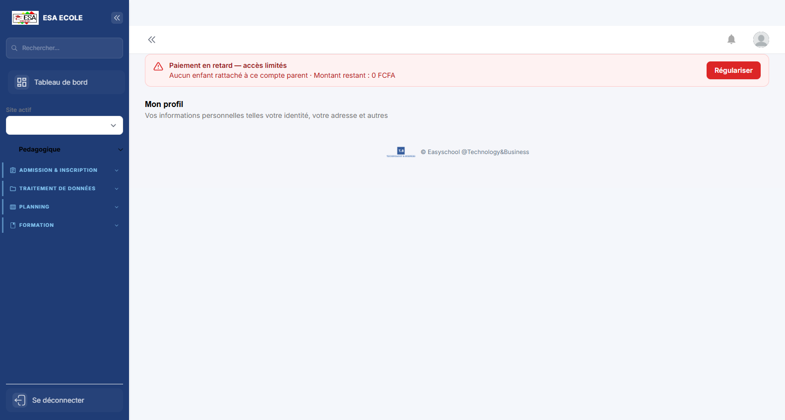
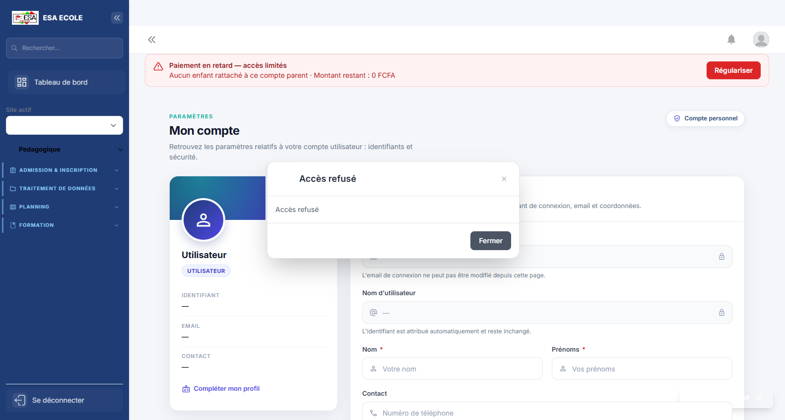
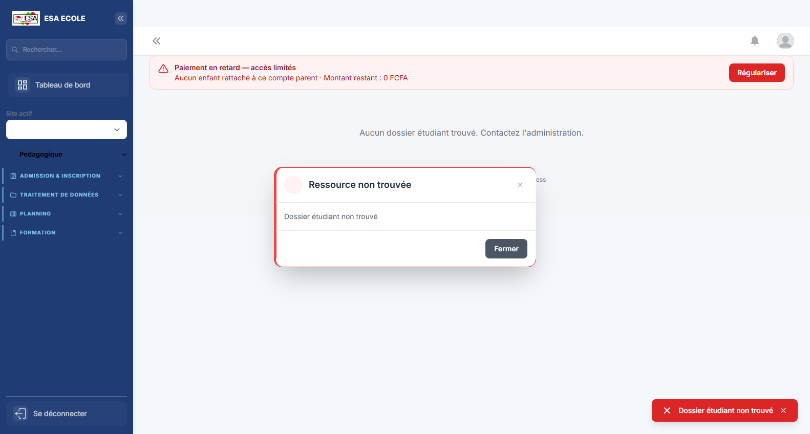
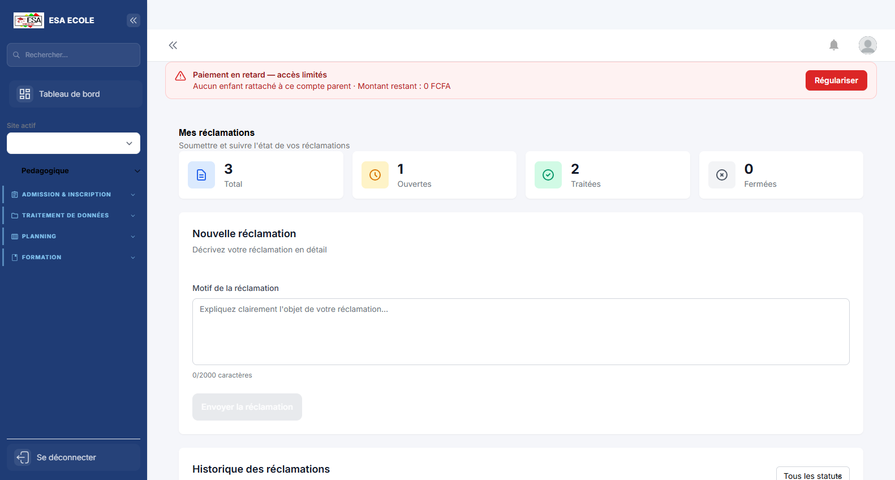
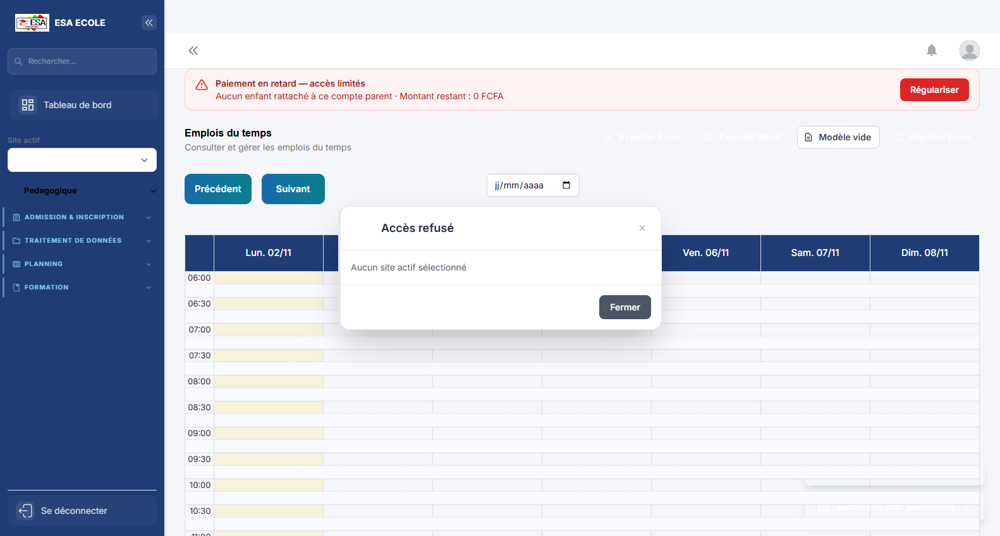
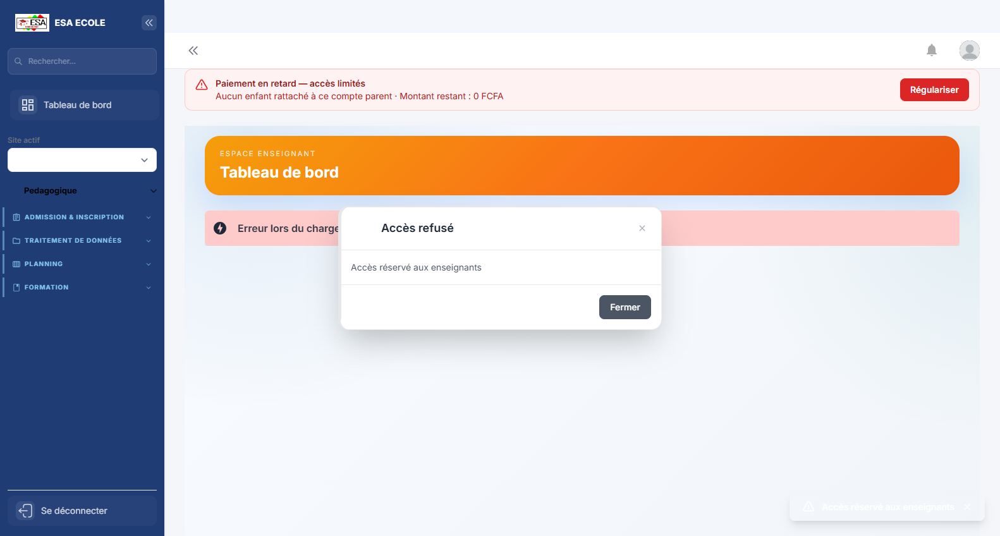
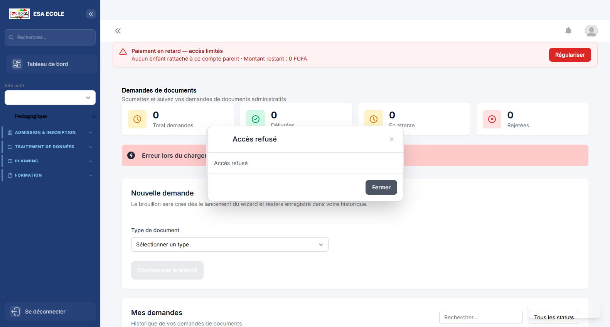

# Guide d'utilisation — Espace parents

> Suivi de l'enfant : dossier, notes et bulletins, absences, emploi du temps, paiements et demandes de documents.

**Profil :** Espace parents  
**Nombre d'écrans :** 7  
**Généré le :** 02/11/2026

Ce guide présente les écrans du profil dans l'ordre d'utilisation conseillé. Chaque section contient une capture, l'objectif de l'écran et les actions principales.

## Sommaire

1. [Mon profil](#1-mon-profil)
2. [Mon compte](#2-mon-compte)
3. [Mon dossier](#3-mon-dossier)
4. [Réclamations](#4-reclamations)
5. [Emplois du temps](#5-emplois-du-temps)
6. [Mon tableau de bord](#6-mon-tableau-de-bord)
7. [Demandes de documents](#7-demandes-de-documents)

## 1. Mon profil

**Objectif :** Informations personnelles et professionnelles du compte connecté : identité, contacts et rattachements.

**Actions principales :**

1. Vérifier ses informations
2. Mettre à jour les champs modifiables
3. Enregistrer

---

## 2. Mon compte

**Objectif :** Paramètres de sécurité du compte : mot de passe, double authentification et sessions.

**Actions principales :**

1. Changer le mot de passe
2. Activer ou vérifier le 2FA
3. Contrôler les sessions ouvertes

---

## 3. Mon dossier

**Objectif :** Dossier administratif de l’étudiant : identité, pièces, inscriptions et suivi.

**Actions principales :**

1. Vérifier les informations
2. Compléter une pièce manquante
3. Suivre la validation

---

## 4. Réclamations

**Objectif :** Dépôt et suivi des réclamations (notes, scolarité, discipline, paiement).

**Actions principales :**

1. Créer une réclamation
2. Joindre les pièces
3. Suivre le statut

---

## 5. Emplois du temps

**Objectif :** Planning des cours par classe, enseignant et salle.

**Actions principales :**

1. Choisir la classe ou l’enseignant
2. Consulter le planning
3. Détecter les conflits

---

## 6. Mon tableau de bord

**Objectif :** Page d'accueil du profil : indicateurs personnels, alertes et raccourcis vers les tâches les plus fréquentes.

**Actions principales :**

1. Lire les indicateurs et alertes
2. Ouvrir un raccourci
3. Traiter les éléments en attente

---

## 7. Demandes de documents

**Objectif :** Demandes de documents administratifs (attestation, relevé, certificat) et leur traitement.

**Actions principales :**

1. Créer ou ouvrir une demande
2. Vérifier les pièces
3. Générer le document

---

*Guide généré par `scripts/guide/generer-guides.cjs`. Les captures valides les plus récentes sont utilisées, avec repli sur les captures historiques.*
