# Guide d'utilisation — Personnel administratif

> Appui administratif : inscriptions, scolarité, caisse, documents, notes et finances selon les habilitations attribuées.

**Profil :** Personnel administratif  
**Nombre d'écrans :** 64  
**Généré le :** 02/11/2026

Ce guide présente les écrans du profil dans l'ordre d'utilisation conseillé. Chaque section contient une capture, l'objectif de l'écran et les actions principales.

## Sommaire

1. [Situation financière](#1-situation-financiere)
2. [Tableau de bord](#2-tableau-de-bord)
3. [Encaissement](#3-encaissement)
4. [Caisse](#4-caisse)
5. [Clôture de caisse](#5-cloture-de-caisse)
6. [Demandes](#6-demandes)
7. [Autorisations provisoires](#7-autorisations-provisoires)
8. [Types de documents](#8-types-de-documents)
9. [Journal de caisse](#9-journal-de-caisse)
10. [Parcours](#10-parcours)
11. [Demandes — vue 2](#11-demandes-vue-2)
12. [Effectifs inscrits](#12-effectifs-inscrits)
13. [Demandes d'orientation](#13-demandes-d-orientation)
14. [Parcours d'orientation](#14-parcours-d-orientation)
15. [Mes bordereaux](#15-mes-bordereaux)
16. [Configurations](#16-configurations)
17. [Attributions](#17-attributions)
18. [Campagne de bourses](#18-campagne-de-bourses)
19. [Dossiers étudiants](#19-dossiers-etudiants)
20. [Cartes étudiantes](#20-cartes-etudiantes)
21. [Registres](#21-registres)
22. [Réclamations](#22-reclamations)
23. [Traiter les réclamations](#23-traiter-les-reclamations)
24. [Emplois du temps](#24-emplois-du-temps)
25. [Calendrier](#25-calendrier)
26. [Rattrapages](#26-rattrapages)
27. [Mon tableau de bord](#27-mon-tableau-de-bord)
28. [Unités d'enseignement](#28-unites-d-enseignement)
29. [Cahier de présence](#29-cahier-de-presence)
30. [Notes](#30-notes)
31. [Bulletins](#31-bulletins)
32. [Moyennes](#32-moyennes)
33. [Conseils de classe](#33-conseils-de-classe)
34. [Annonces](#34-annonces)
35. [Vie estudiantine](#35-vie-estudiantine)
36. [Paiements](#36-paiements)
37. [Situation irrégulière](#37-situation-irreguliere)
38. [Validation des bordereaux](#38-validation-des-bordereaux)
39. [Comptabilité](#39-comptabilite)
40. [Articles](#40-articles)
41. [Mouvements](#41-mouvements)
42. [Immobilisations](#42-immobilisations)
43. [Sites](#43-sites)
44. [Catégories](#44-categories)
45. [Affectations](#45-affectations)
46. [Assurances](#46-assurances)
47. [Sorties provisoires](#47-sorties-provisoires)
48. [Cessions](#48-cessions)
49. [Rebuts](#49-rebuts)
50. [Maintenance](#50-maintenance)
51. [Inventaires](#51-inventaires)
52. [Reportings](#52-reportings)
53. [Employés](#53-employes)
54. [Paie](#54-paie)
55. [Historique](#55-historique)
56. [Rapports](#56-rapports)
57. [Tableau de bord de pilotage](#57-tableau-de-bord-de-pilotage)
58. [Effectifs](#58-effectifs)
59. [Notes — vue 2](#59-notes-vue-2)
60. [Paiements — vue 2](#60-paiements-vue-2)
61. [Mon profil](#61-mon-profil)
62. [Mon compte](#62-mon-compte)
63. [Demandes de documents](#63-demandes-de-documents)
64. [Traiter les demandes](#64-traiter-les-demandes)

## 1. Situation financière

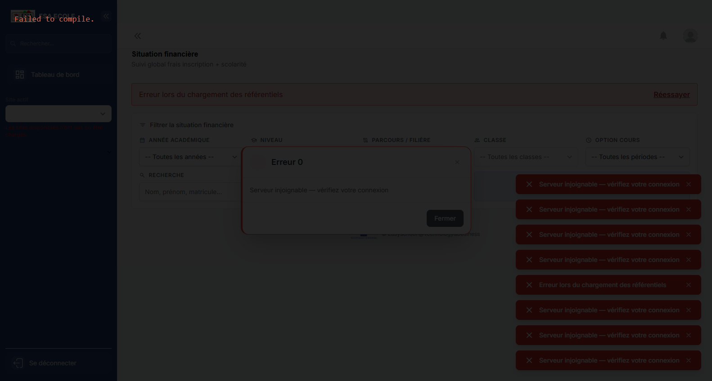

**Objectif :** Situation détaillée d’un étudiant : total dû, total payé, reste à payer et échéances.

**Actions principales :**

1. Rechercher l’étudiant
2. Lire le solde et l’historique
3. Exporter la situation

---

## 2. Tableau de bord

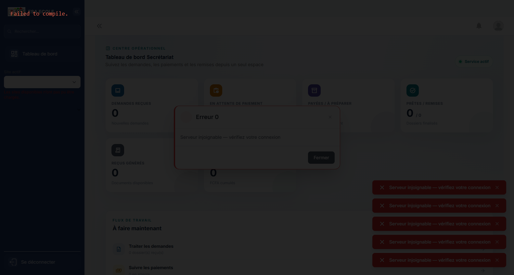

**Objectif :** Vue de pilotage opérationnel : volumes, échéances et activités récentes du périmètre du profil.

**Actions principales :**

1. Choisir la période
2. Analyser les indicateurs
3. Accéder au détail d’un bloc

---

## 3. Encaissement

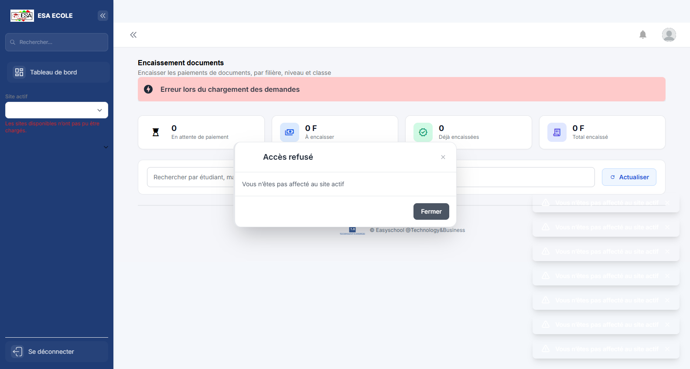

**Objectif :** Encaissement au guichet : identification de l’étudiant, montant, mode de paiement et reçu.

**Actions principales :**

1. Rechercher l’étudiant
2. Saisir le paiement
3. Imprimer le reçu

---

## 4. Caisse

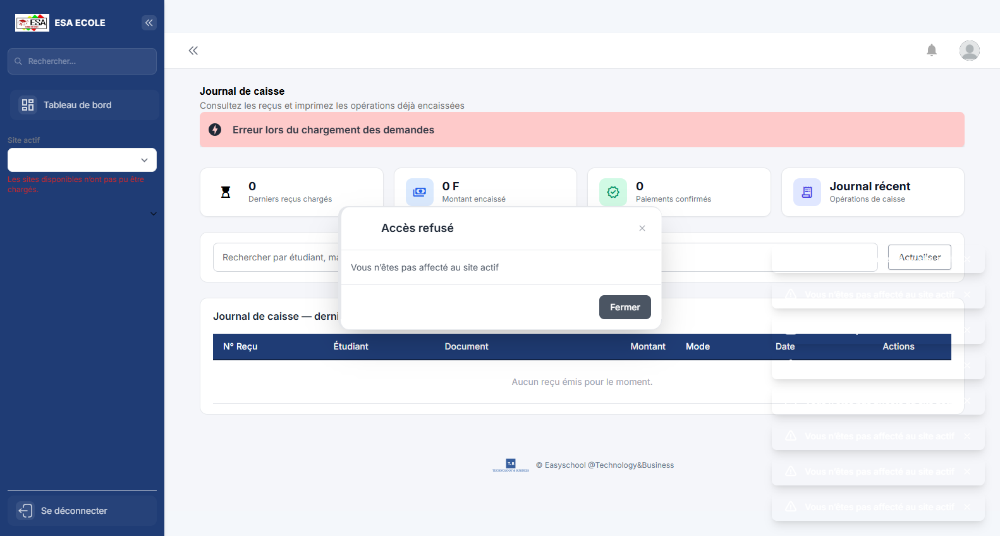

**Objectif :** État de la caisse du jour : fonds, encaissements, décaissements et solde.

**Actions principales :**

1. Ouvrir la caisse
2. Enregistrer les opérations
3. Contrôler le solde

---

## 5. Clôture de caisse

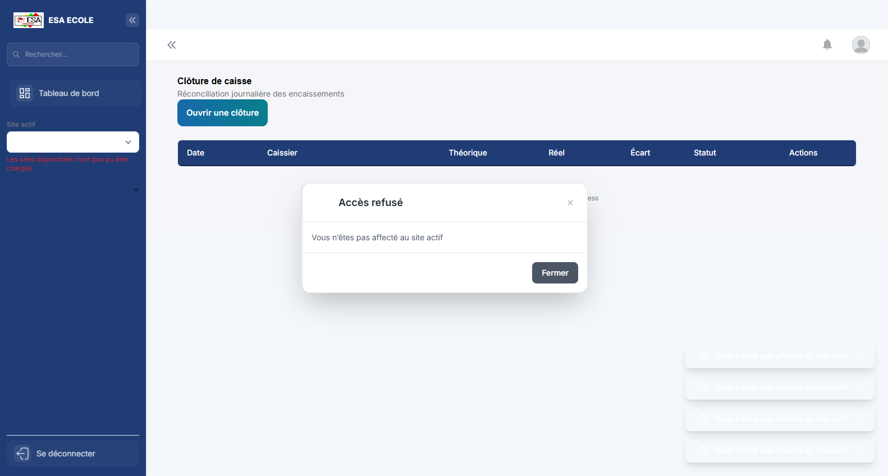

**Objectif :** Clôture journalière : comptage, écart éventuel et validation de la caisse.

**Actions principales :**

1. Compter les espèces
2. Saisir le montant
3. Valider la clôture

---

## 6. Demandes

**Objectif :** File des demandes d’inscription ou de réinscription avec leur statut dans le pipeline.

**Actions principales :**

1. Filtrer par statut
2. Ouvrir un dossier
3. Faire avancer l’étape

---

## 7. Autorisations provisoires

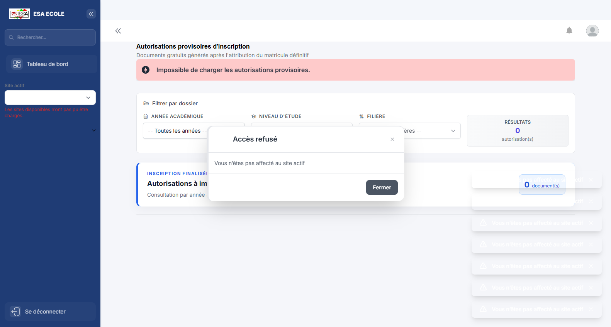

**Objectif :** Autorisations accordées en attente de régularisation (accès aux cours, examens ou documents).

**Actions principales :**

1. Créer une autorisation
2. Fixer l’échéance
3. Suivre la régularisation

---

## 8. Types de documents

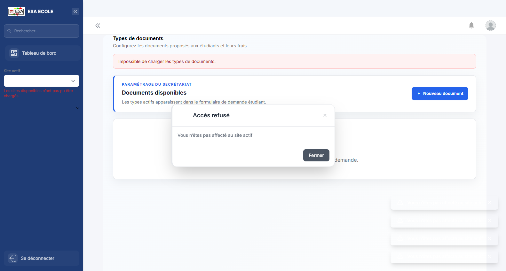

**Objectif :** Référentiel des modèles de documents et de leurs règles de génération.

**Actions principales :**

1. Créer un type
2. Associer le modèle
3. Définir les champs obligatoires

---

## 9. Journal de caisse

**Objectif :** Détail chronologique des mouvements de caisse avec justificatifs et soldes.

**Actions principales :**

1. Choisir la date
2. Contrôler les mouvements
3. Exporter le journal

---

## 10. Parcours

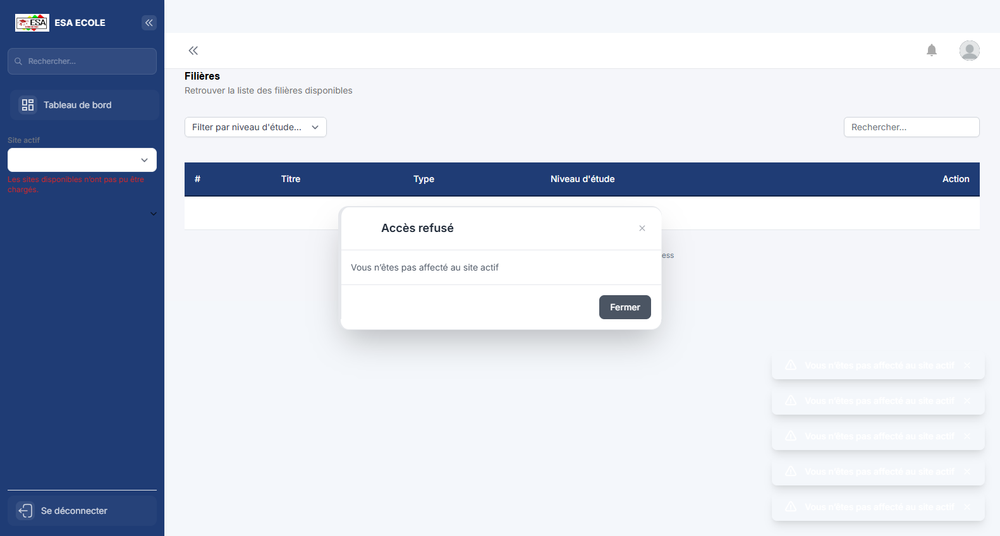

**Objectif :** Catalogue des parcours de formation : niveaux, UE, crédits et conditions d’accès.

**Actions principales :**

1. Créer ou modifier un parcours
2. Rattacher les UE
3. Vérifier les prérequis

---

## 11. Demandes — vue 2

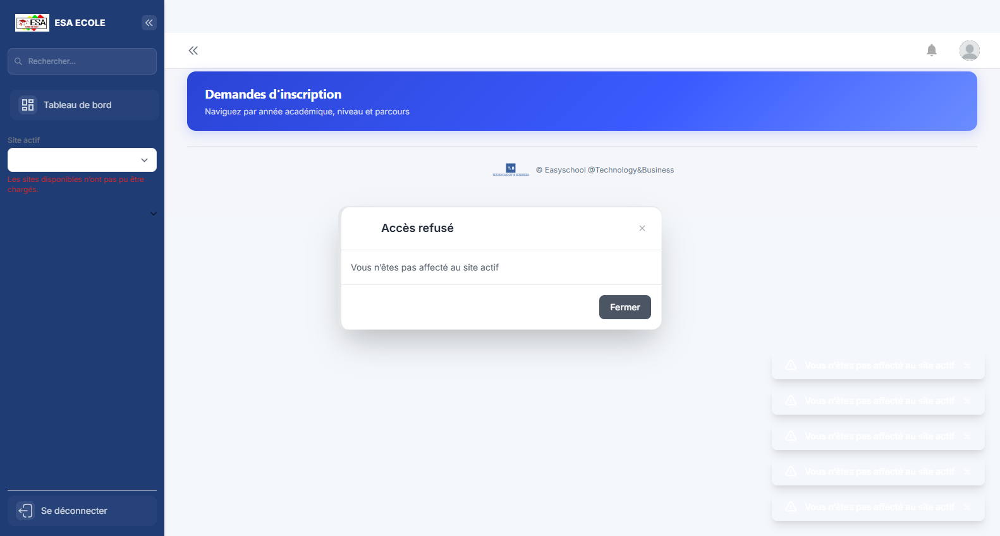

**Objectif :** File des demandes d’inscription ou de réinscription avec leur statut dans le pipeline.

**Actions principales :**

1. Filtrer par statut
2. Ouvrir un dossier
3. Faire avancer l’étape

---

## 12. Effectifs inscrits

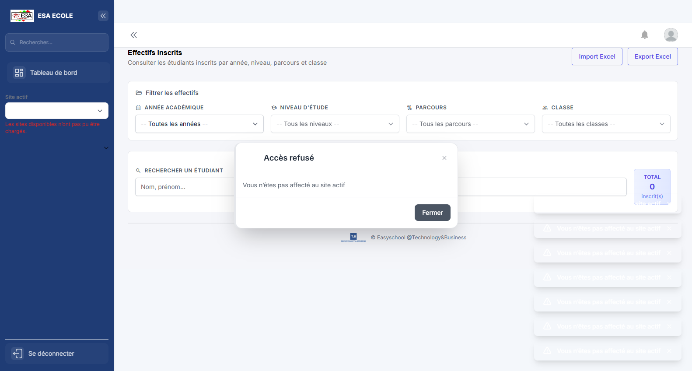

**Objectif :** Liste et statistiques des étudiants effectivement inscrits pour l’année ou la session sélectionnée.

**Actions principales :**

1. Choisir l’année et le parcours
2. Vérifier les inscrits
3. Exporter ou ouvrir un dossier

---

## 13. Demandes d'orientation

**Objectif :** Demandes d’orientation des candidats : choix de parcours, pièces et décision du comité.

**Actions principales :**

1. Consulter les demandes
2. Vérifier les pièces
3. Instruire ou orienter

---

## 14. Parcours d'orientation

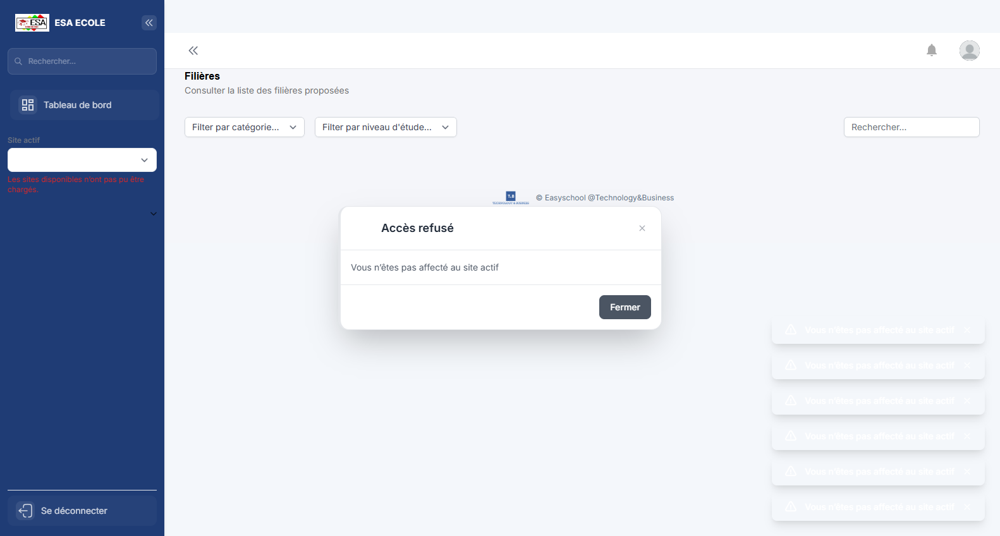

**Objectif :** Parcours proposés à l’orientation, avec leurs débouchés et conditions d’admission.

**Actions principales :**

1. Consulter l’offre
2. Associer les niveaux
3. Publier les parcours

---

## 15. Mes bordereaux

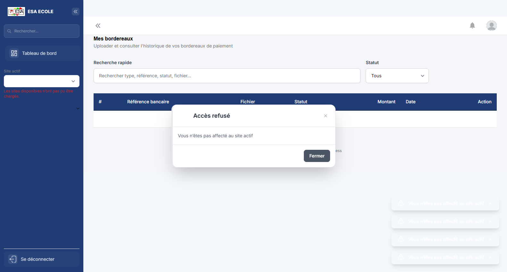

**Objectif :** Bordereaux déposés par l’étudiant (ou suivis par le profil) avec leur état d’authentification et d’imputation.

**Actions principales :**

1. Déposer ou consulter un bordereau
2. Suivre son statut
3. Télécharger le reçu

---

## 16. Configurations

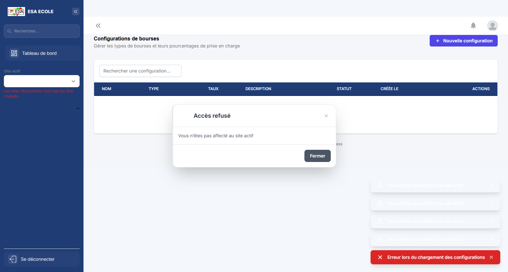

**Objectif :** Paramétrage du module : règles, barèmes et options appliquées aux dossiers.

**Actions principales :**

1. Choisir la configuration
2. Modifier les paramètres
3. Enregistrer et tester

---

## 17. Attributions

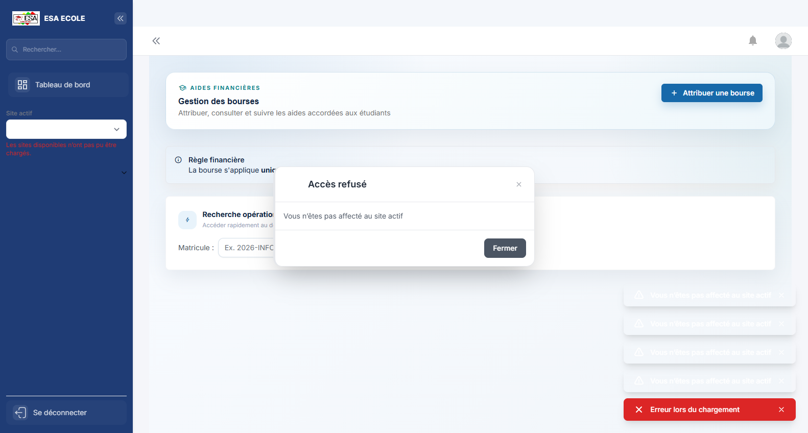

**Objectif :** Attribution des droits, responsabilités ou avantages aux personnes concernées.

**Actions principales :**

1. Rechercher la personne
2. Choisir l’attribution
3. Valider la période

---

## 18. Campagne de bourses

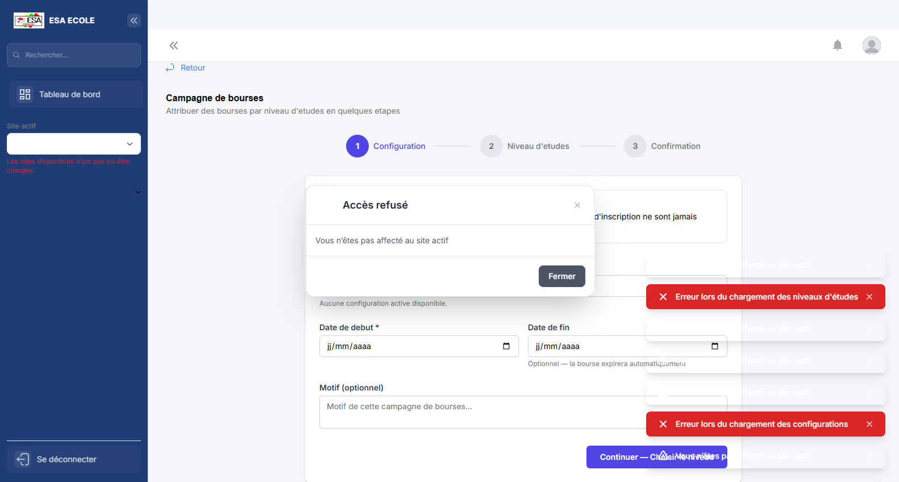

**Objectif :** Campagne d’attribution des bourses : critères, candidats et décisions.

**Actions principales :**

1. Ouvrir la campagne
2. Examiner les candidatures
3. Attribuer ou refuser

---

## 19. Dossiers étudiants

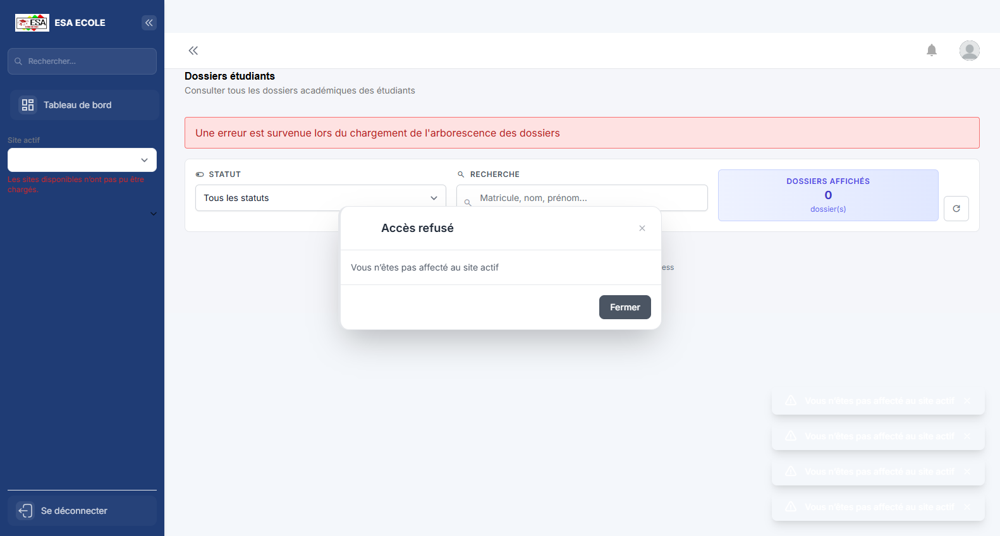

**Objectif :** Base des dossiers étudiants : recherche, complétude et historique administratif.

**Actions principales :**

1. Rechercher un étudiant
2. Contrôler les pièces
3. Ouvrir le dossier complet

---

## 20. Cartes étudiantes

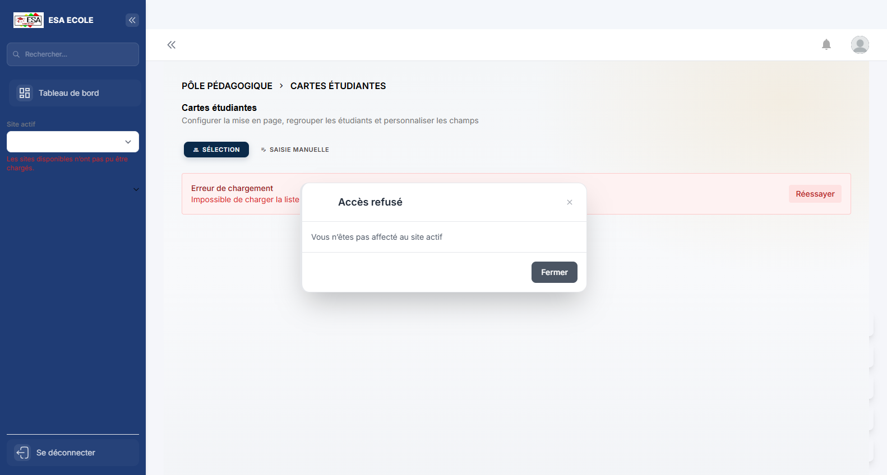

**Objectif :** Génération et suivi des cartes étudiantes avec photo, matricule et QR code.

**Actions principales :**

1. Sélectionner les étudiants
2. Vérifier la photo
3. Générer ou imprimer les cartes

---

## 21. Registres

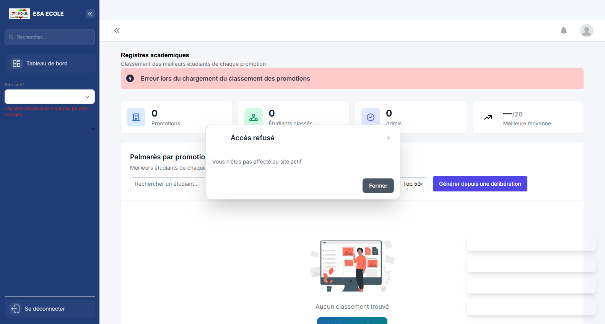

**Objectif :** Registres officiels : inscriptions, présences, délibérations et registres réglementaires.

**Actions principales :**

1. Choisir le registre
2. Filtrer par année
3. Consulter ou exporter

---

## 22. Réclamations

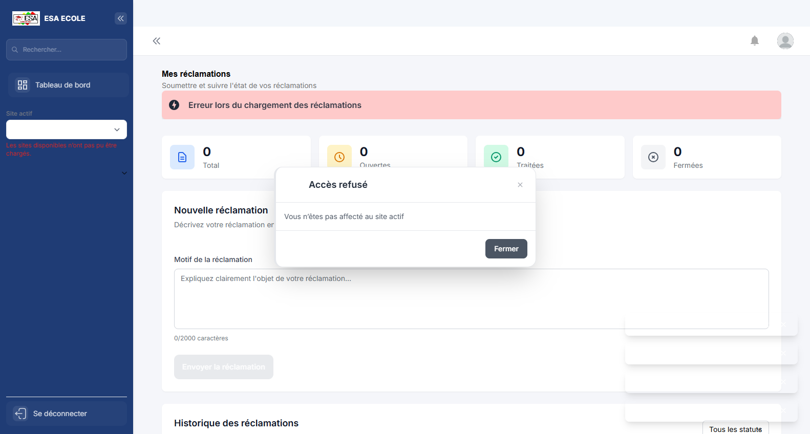

**Objectif :** Dépôt et suivi des réclamations (notes, scolarité, discipline, paiement).

**Actions principales :**

1. Créer une réclamation
2. Joindre les pièces
3. Suivre le statut

---

## 23. Traiter les réclamations

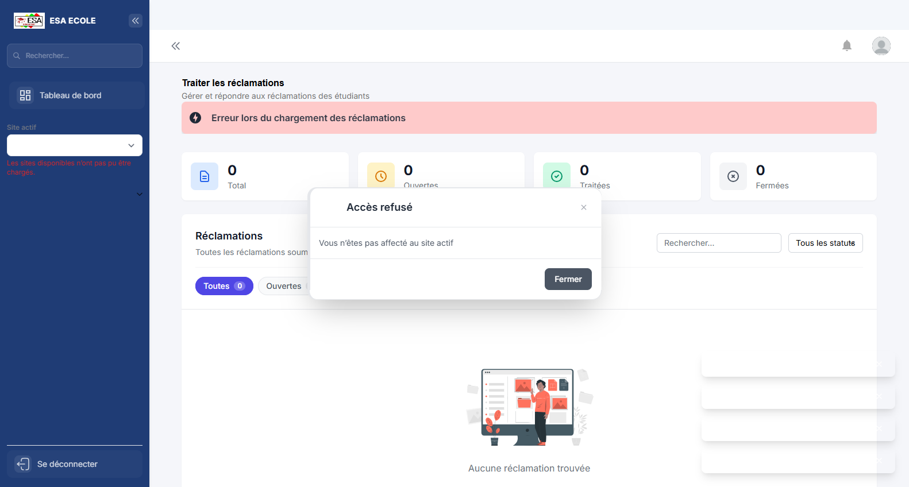

**Objectif :** File de traitement des réclamations : instruction, réponse et clôture.

**Actions principales :**

1. Ouvrir une réclamation
2. Instruire le dossier
3. Répondre et clôturer

---

## 24. Emplois du temps

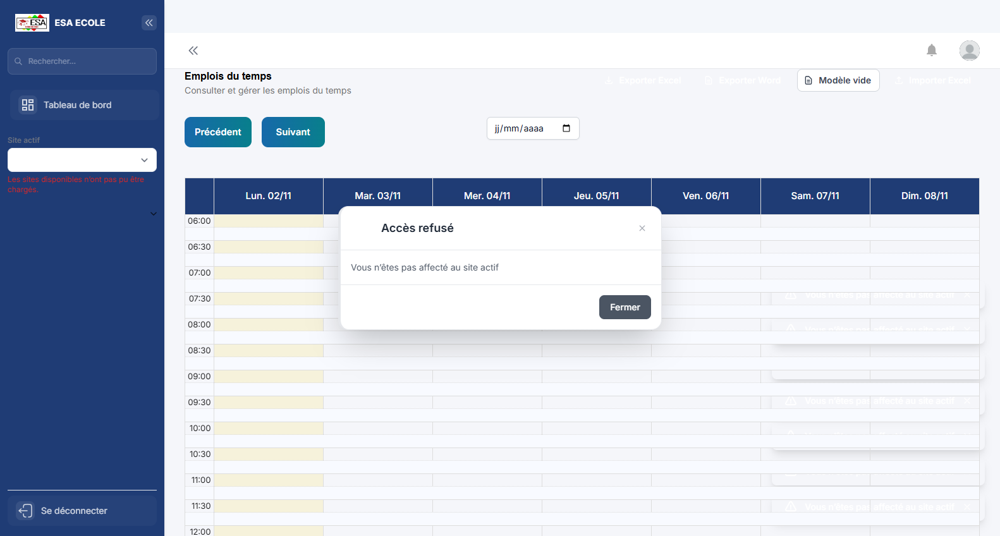

**Objectif :** Planning des cours par classe, enseignant et salle.

**Actions principales :**

1. Choisir la classe ou l’enseignant
2. Consulter le planning
3. Détecter les conflits

---

## 25. Calendrier

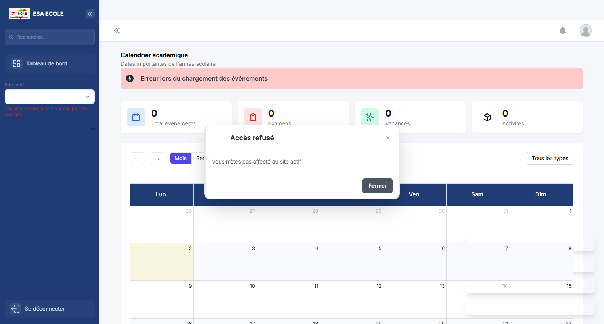

**Objectif :** Calendrier académique : sessions, examens, périodes de saisie et événements de l’établissement.

**Actions principales :**

1. Choisir la période
2. Consulter un événement
3. S’abonner ou exporter le calendrier

---

## 26. Rattrapages

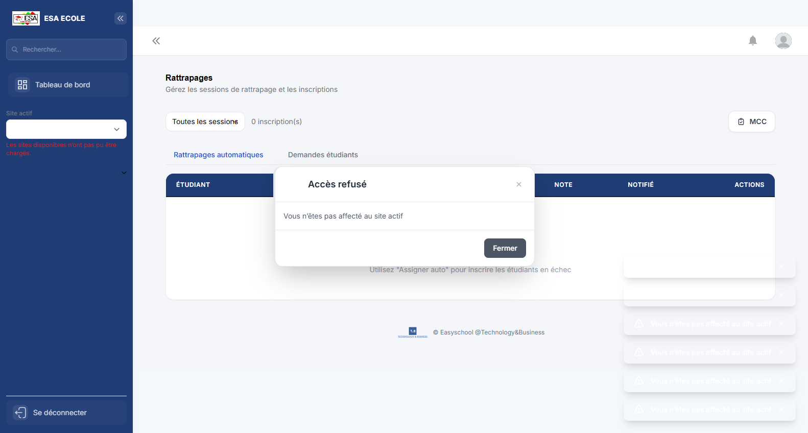

**Objectif :** Sessions de rattrapage : inscription, épreuves et résultats.

**Actions principales :**

1. Créer une session
2. Inscrire les étudiants
3. Saisir les résultats

---

## 27. Mon tableau de bord

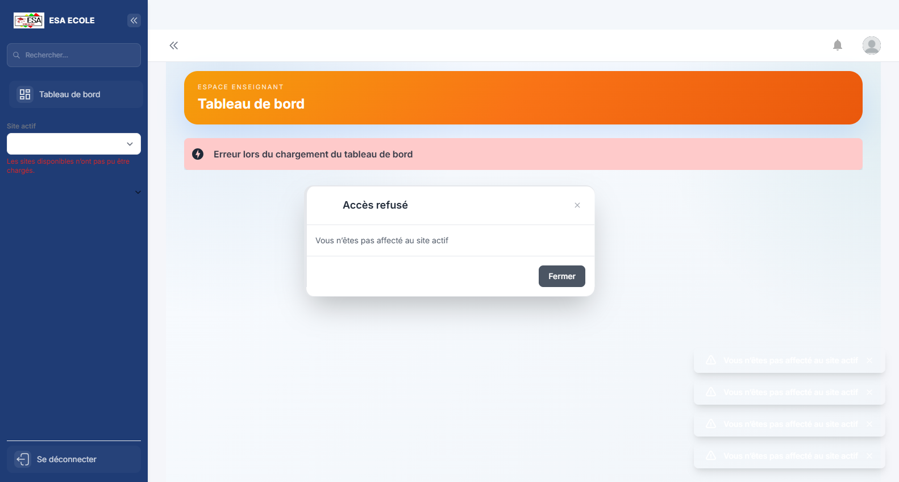

**Objectif :** Page d'accueil du profil : indicateurs personnels, alertes et raccourcis vers les tâches les plus fréquentes.

**Actions principales :**

1. Lire les indicateurs et alertes
2. Ouvrir un raccourci
3. Traiter les éléments en attente

---

## 28. Unités d'enseignement

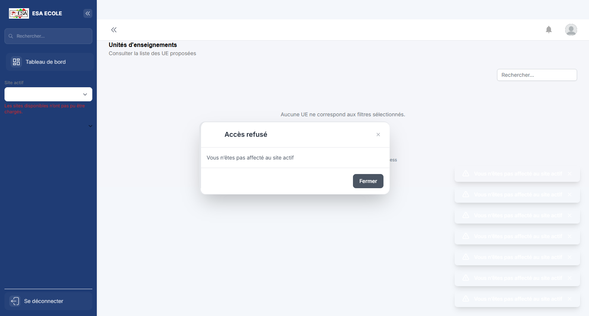

**Objectif :** UE et ECUE : crédits, volumes horaires, semestres et prérequis.

**Actions principales :**

1. Créer une UE
2. Ajouter les ECUE
3. Définir crédits et prérequis

---

## 29. Cahier de présence

**Objectif :** Appel et suivi des présences par séance, avec motif d’absence.

**Actions principales :**

1. Ouvrir la séance
2. Marquer les présents et absents
3. Enregistrer

---

## 30. Notes

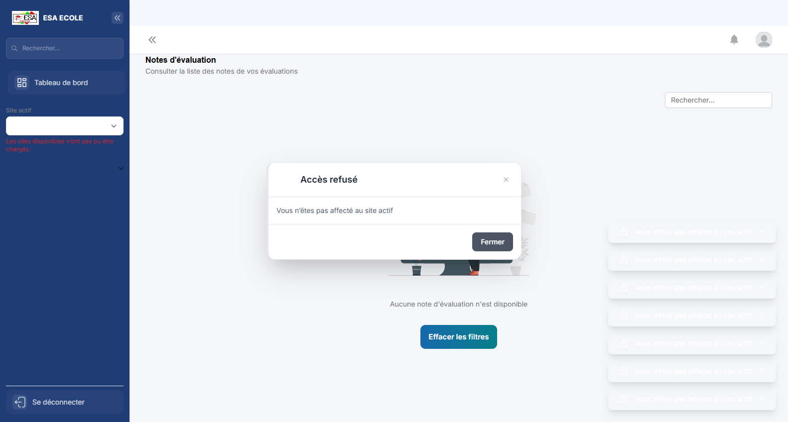

**Objectif :** Saisie et consultation des notes par classe, UE et type d’évaluation.

**Actions principales :**

1. Choisir la classe et l’UE
2. Saisir les notes
3. Vérifier puis publier

---

## 31. Bulletins

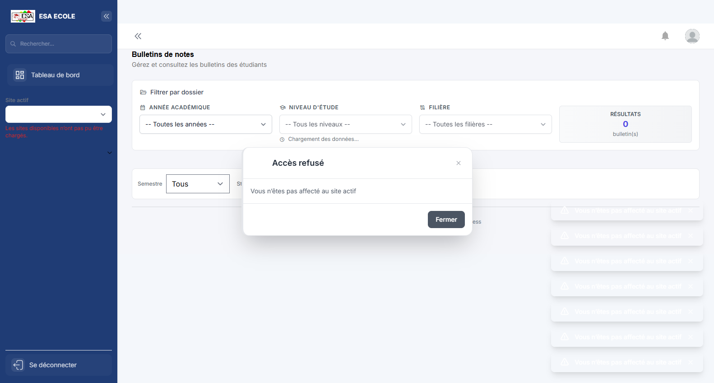

**Objectif :** Bulletins générés à partir des notes : moyennes, crédits, mentions et décisions.

**Actions principales :**

1. Choisir l’année et la classe
2. Générer les bulletins
3. Contrôler et publier

---

## 32. Moyennes

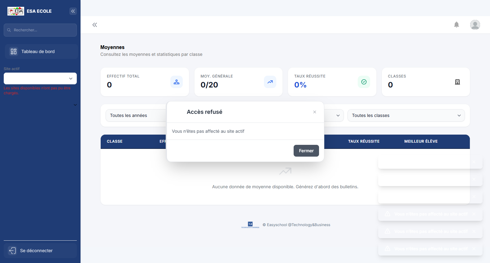

**Objectif :** Calcul et contrôle des moyennes par étudiant, UE et semestre.

**Actions principales :**

1. Sélectionner le périmètre
2. Lancer le calcul
3. Contrôler les anomalies

---

## 33. Conseils de classe

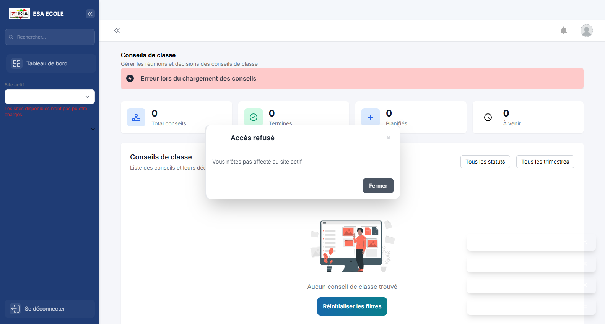

**Objectif :** Préparation et tenue des conseils de classe : synthèse par étudiant et avis.

**Actions principales :**

1. Choisir la classe
2. Consulter les synthèses
3. Saisir les avis

---

## 34. Annonces

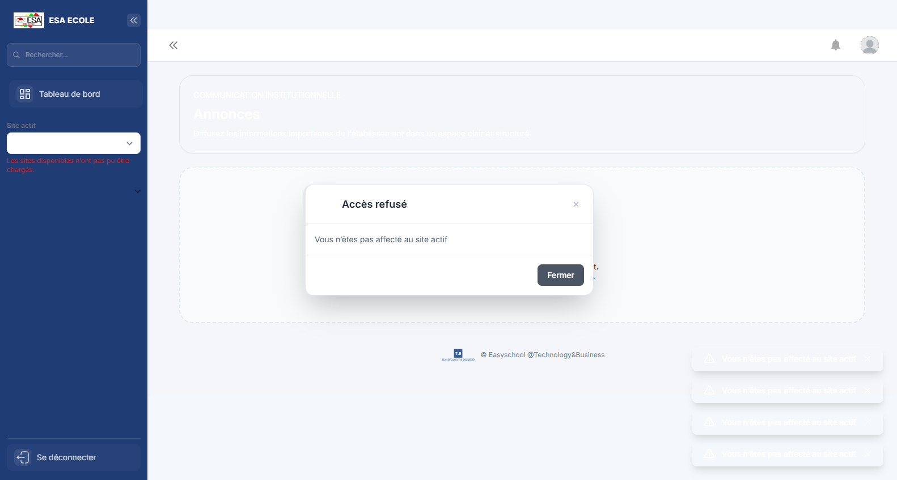

**Objectif :** Publication et consultation des annonces destinées aux étudiants, enseignants ou personnels.

**Actions principales :**

1. Créer ou ouvrir une annonce
2. Choisir le public cible
3. Publier ou archiver

---

## 35. Vie estudiantine

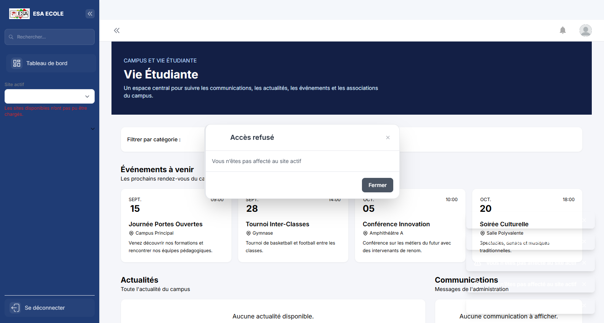

**Objectif :** Actualités, activités et informations de la vie étudiante.

**Actions principales :**

1. Parcourir les publications
2. Ouvrir une actualité
3. Participer ou réagir

---

## 36. Paiements

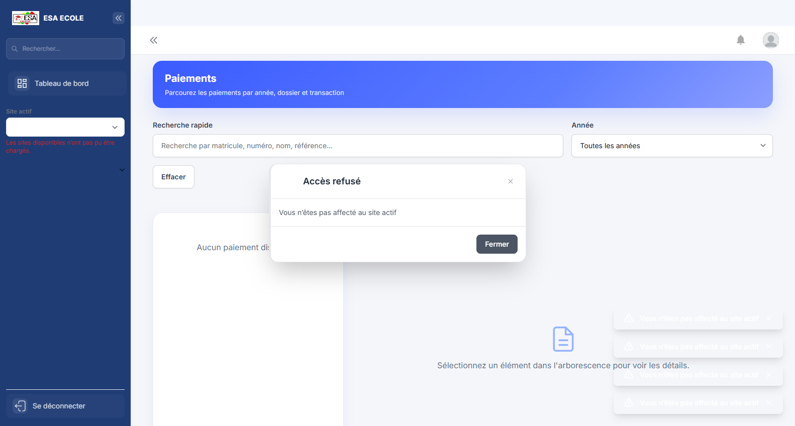

**Objectif :** Paiements des étudiants : saisie, recherche, historique et rattachement aux échéances.

**Actions principales :**

1. Rechercher un étudiant ou un paiement
2. Vérifier le montant et la référence
3. Enregistrer ou consulter le reçu

---

## 37. Situation irrégulière

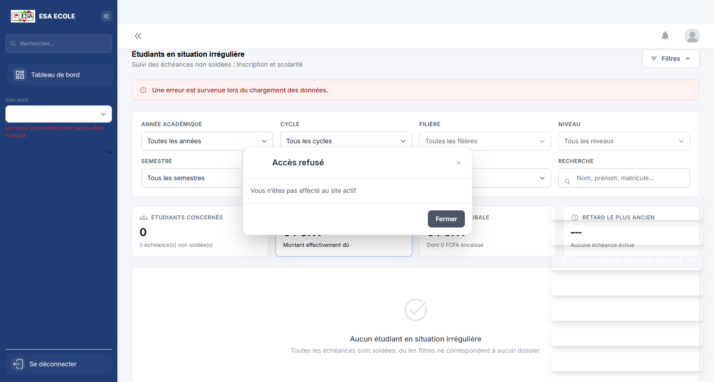

**Objectif :** Étudiants en retard ou en défaut de paiement, avec motif et ancienneté de la dette.

**Actions principales :**

1. Filtrer les impayés
2. Analyser l’historique
3. Lancer une relance ou une régularisation

---

## 38. Validation des bordereaux

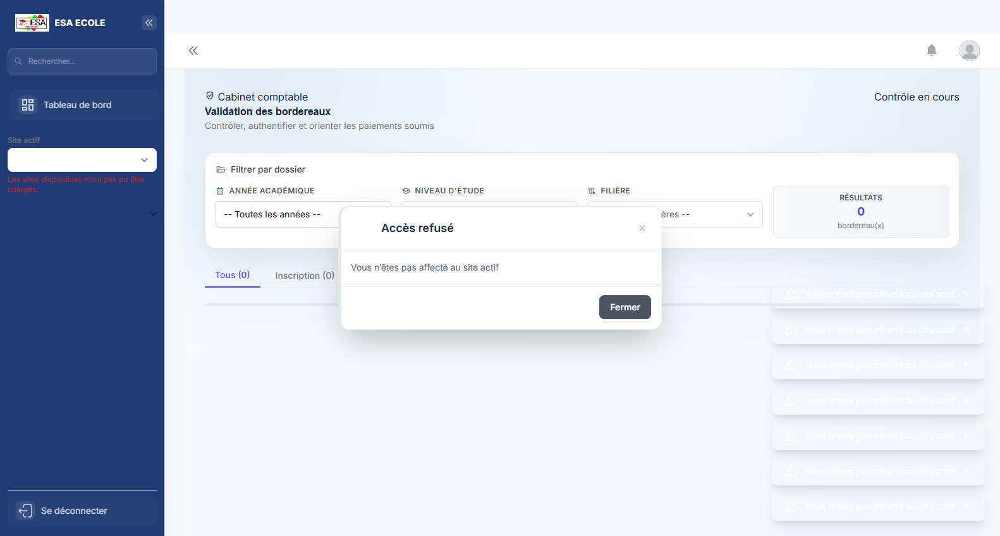

**Objectif :** Authentification des bordereaux déposés : contrôle du justificatif et saisie des références bancaires.

**Actions principales :**

1. Ouvrir le bordereau
2. Vérifier le PDF et les références
3. Valider ou rejeter avec motif

---

## 39. Comptabilité

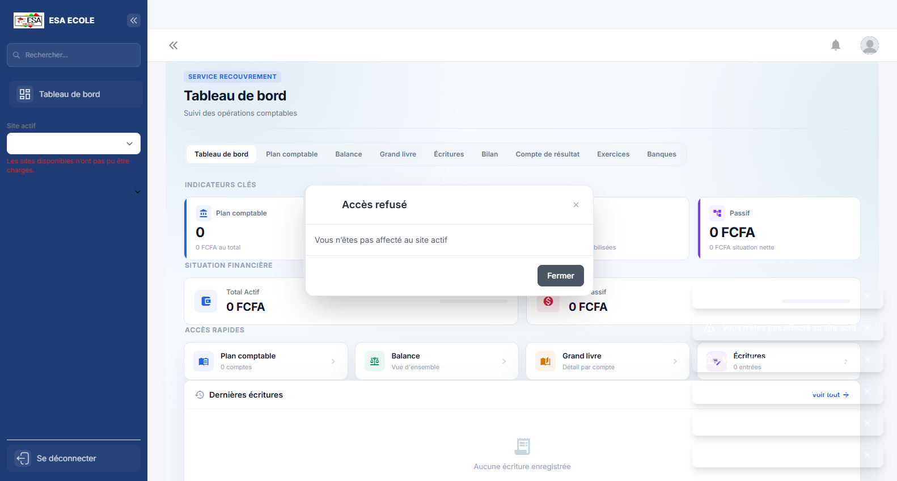

**Objectif :** Comptabilité générale : journaux, écritures, balance et grand livre.

**Actions principales :**

1. Choisir le journal
2. Consulter ou saisir une écriture
3. Contrôler la balance

---

## 40. Articles

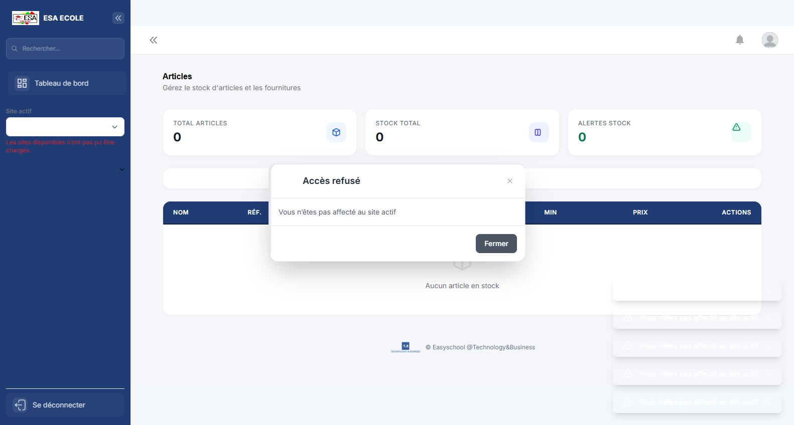

**Objectif :** Référentiel des articles et prestations utilisés dans les achats et la comptabilité.

**Actions principales :**

1. Créer un article
2. Renseigner l’unité et le prix
3. Activer

---

## 41. Mouvements

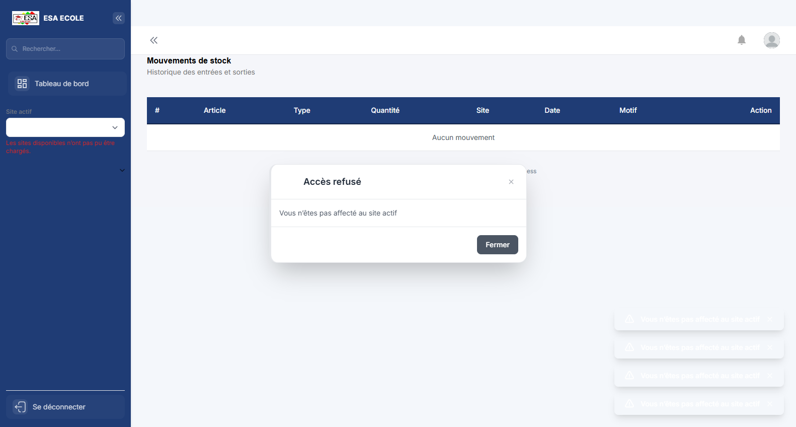

**Objectif :** Mouvements de stocks ou de trésorerie : entrées, sorties et soldes.

**Actions principales :**

1. Filtrer les mouvements
2. Ouvrir un mouvement
3. Contrôler le justificatif

---

## 42. Immobilisations

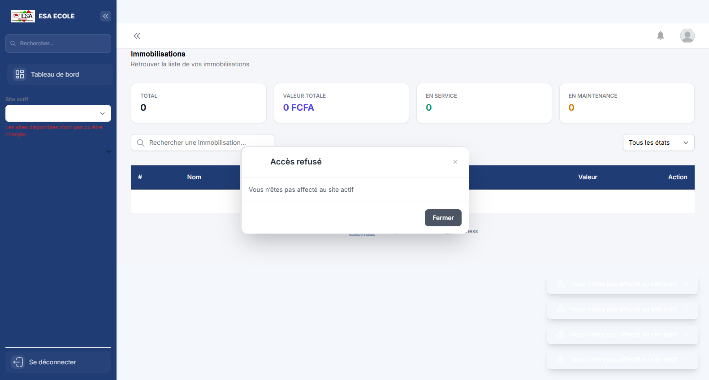

**Objectif :** Registre des immobilisations : acquisition, amortissement et valeur nette.

**Actions principales :**

1. Créer une immobilisation
2. Paramétrer l’amortissement
3. Suivre la valeur nette

---

## 43. Sites

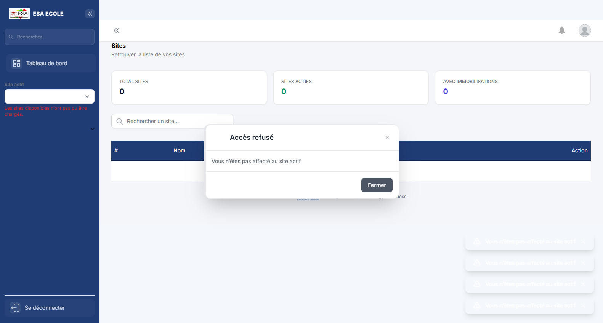

**Objectif :** Sites et établissements rattachés, avec leur adresse et leur responsable.

**Actions principales :**

1. Créer un site
2. Renseigner l’adresse
3. Activer

---

## 44. Catégories

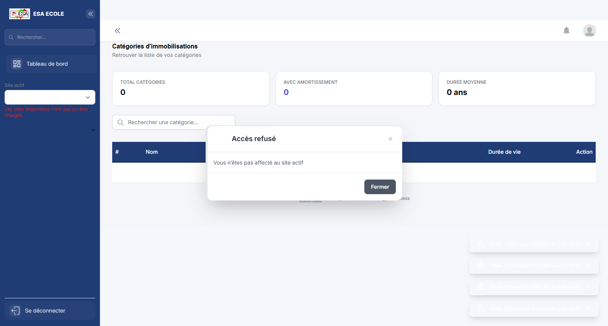

**Objectif :** Catégories d’articles, de documents ou d’immobilisations utilisées dans les référentiels.

**Actions principales :**

1. Créer une catégorie
2. Définir les règles associées
3. Enregistrer

---

## 45. Affectations

**Objectif :** Affectation des biens, salles ou moyens aux personnes et services.

**Actions principales :**

1. Choisir le bien
2. Sélectionner le bénéficiaire
3. Valider l’affectation

---

## 46. Assurances

**Objectif :** Contrats d’assurance des biens : police, échéances et sinistres.

**Actions principales :**

1. Créer un contrat
2. Renseigner les échéances
3. Suivre les sinistres

---

## 47. Sorties provisoires

**Objectif :** Biens sortis temporairement avec date de retour et responsable.

**Actions principales :**

1. Enregistrer une sortie
2. Fixer la date de retour
3. Contrôler le retour

---

## 48. Cessions

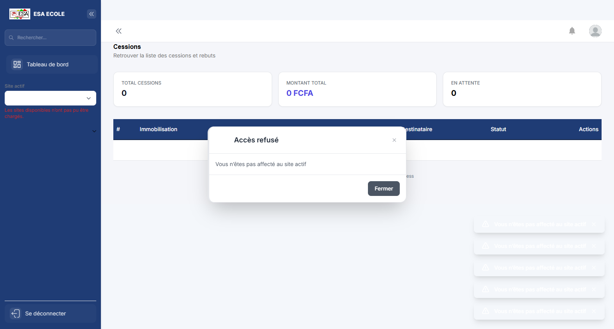

**Objectif :** Cessions de biens : motif, valorisation et validation.

**Actions principales :**

1. Sélectionner le bien
2. Renseigner la cession
3. Valider

---

## 49. Rebuts

**Objectif :** Biens mis au rebut avec motif, procès-verbal et sortie d’inventaire.

**Actions principales :**

1. Sélectionner les biens
2. Renseigner le motif
3. Valider la mise au rebut

---

## 50. Maintenance

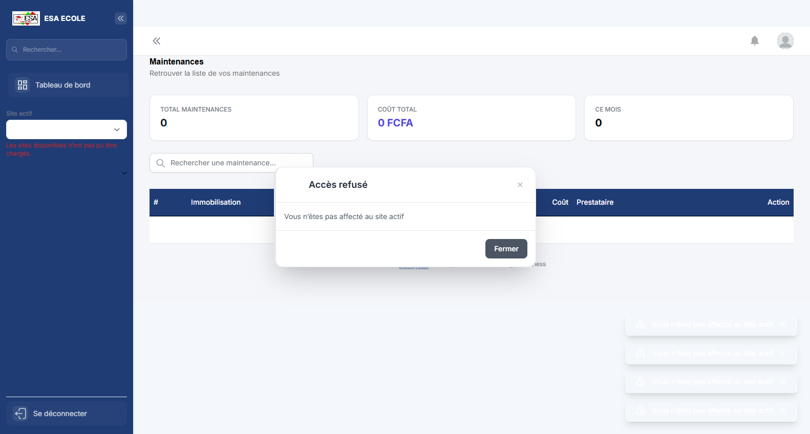

**Objectif :** Interventions de maintenance préventive et curative sur les biens.

**Actions principales :**

1. Créer une demande
2. Planifier l’intervention
3. Clôturer avec le rapport

---

## 51. Inventaires

**Objectif :** Campagnes d’inventaire physique et rapprochement avec le registre comptable.

**Actions principales :**

1. Lancer une campagne
2. Saisir les constats
3. Générer les écarts

---

## 52. Reportings

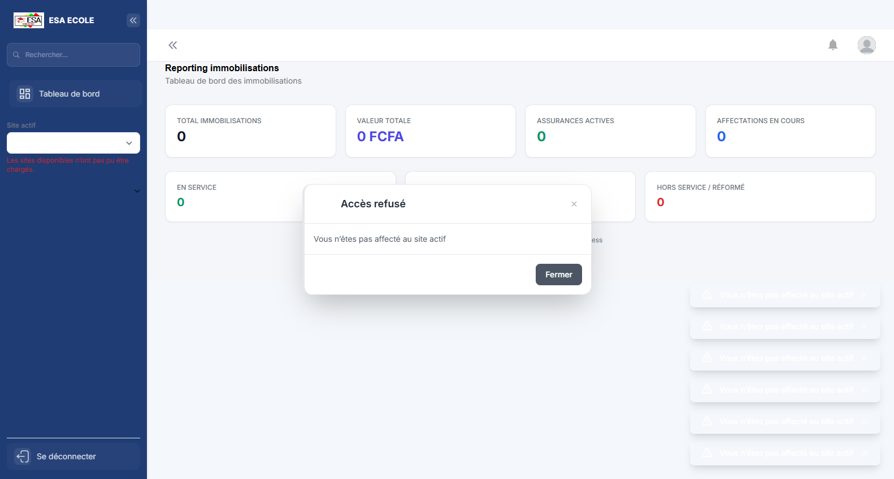

**Objectif :** Tableaux de bord et rapports financiers consolidés.

**Actions principales :**

1. Choisir le rapport
2. Filtrer la période
3. Exporter

---

## 53. Employés

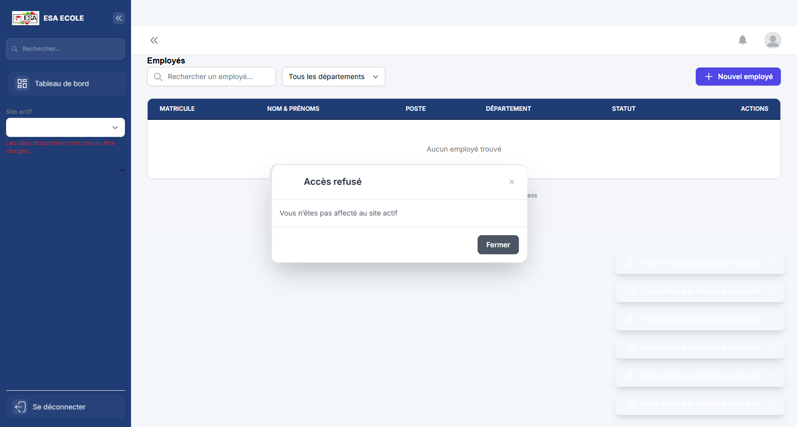

**Objectif :** Référentiel du personnel : identité, poste, contrat et affectation.

**Actions principales :**

1. Créer ou modifier un employé
2. Renseigner le poste
3. Activer le compte

---

## 54. Paie

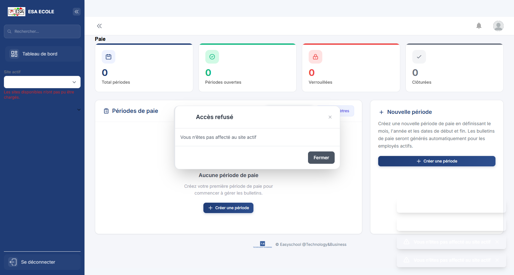

**Objectif :** Préparation et exécution de la paie : éléments variables, bulletins et virements.

**Actions principales :**

1. Choisir la période
2. Contrôler les éléments variables
3. Calculer et valider la paie

---

## 55. Historique

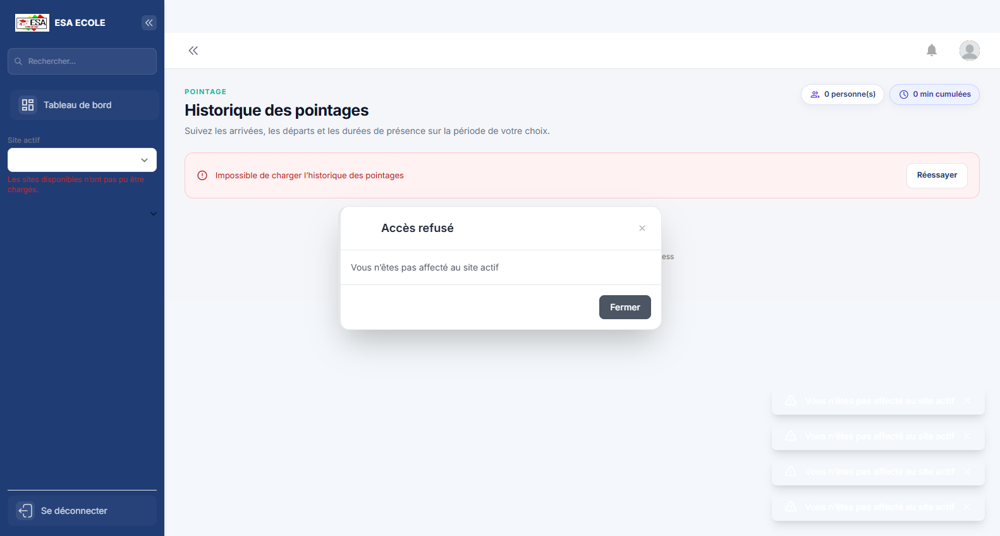

**Objectif :** Journal chronologique des opérations réalisées sur le périmètre : date, acteur, action et résultat.

**Actions principales :**

1. Filtrer par période ou acteur
2. Consulter le détail d’une opération
3. Exporter si besoin

---

## 56. Rapports

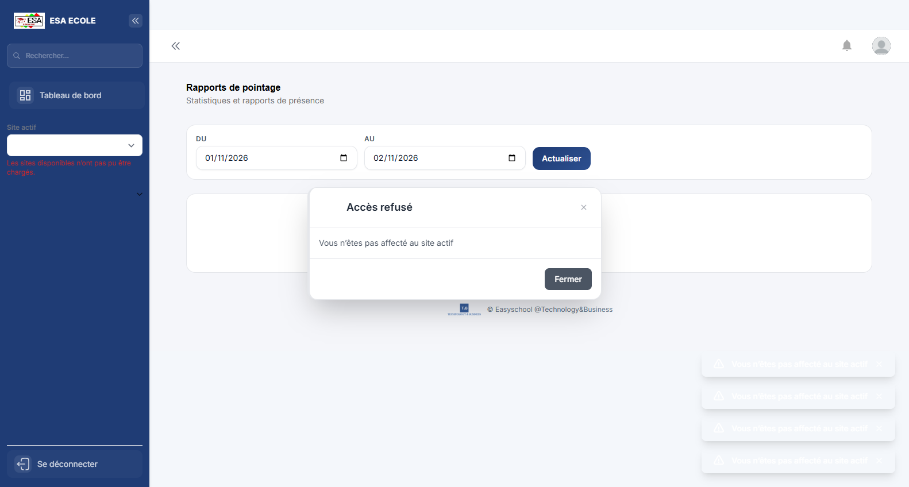

**Objectif :** Rapports et exports disponibles pour le profil, avec filtres de période et de périmètre.

**Actions principales :**

1. Choisir un rapport
2. Renseigner les filtres
3. Générer puis télécharger

---

## 57. Tableau de bord de pilotage

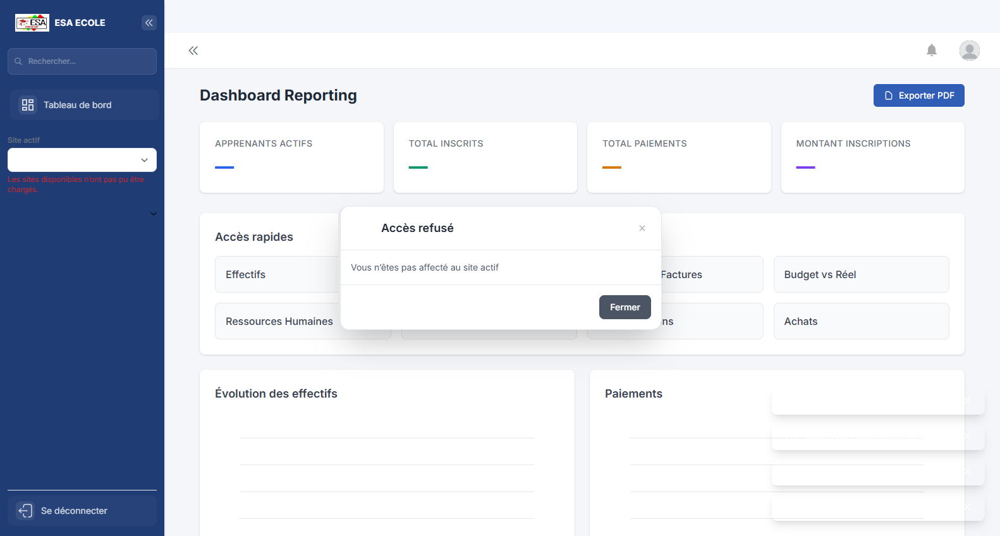

**Objectif :** Synthèse consolidée destinée au pilotage : effectifs, résultats, finances et alertes majeures.

**Actions principales :**

1. Sélectionner l’année ou la période
2. Comparer les indicateurs
3. Exporter ou ouvrir le détail

---

## 58. Effectifs

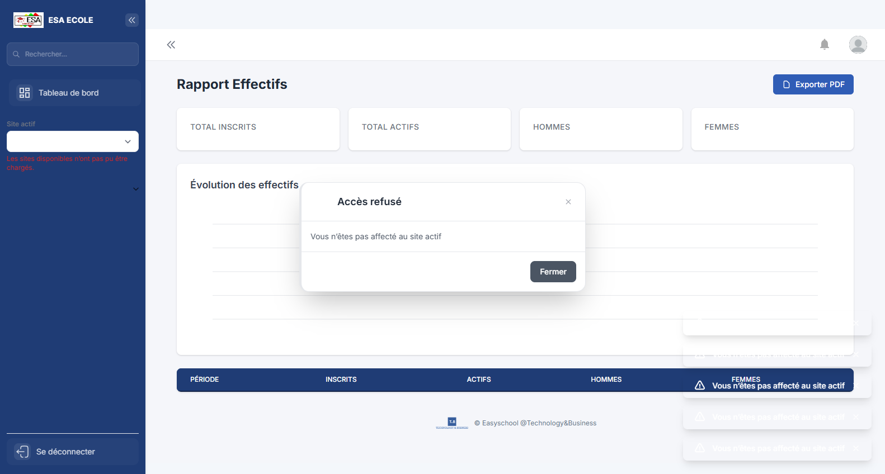

**Objectif :** Effectifs par niveau, parcours ou classe, avec répartition et évolution.

**Actions principales :**

1. Filtrer par année et niveau
2. Comparer les effectifs
3. Exporter la liste

---

## 59. Notes — vue 2

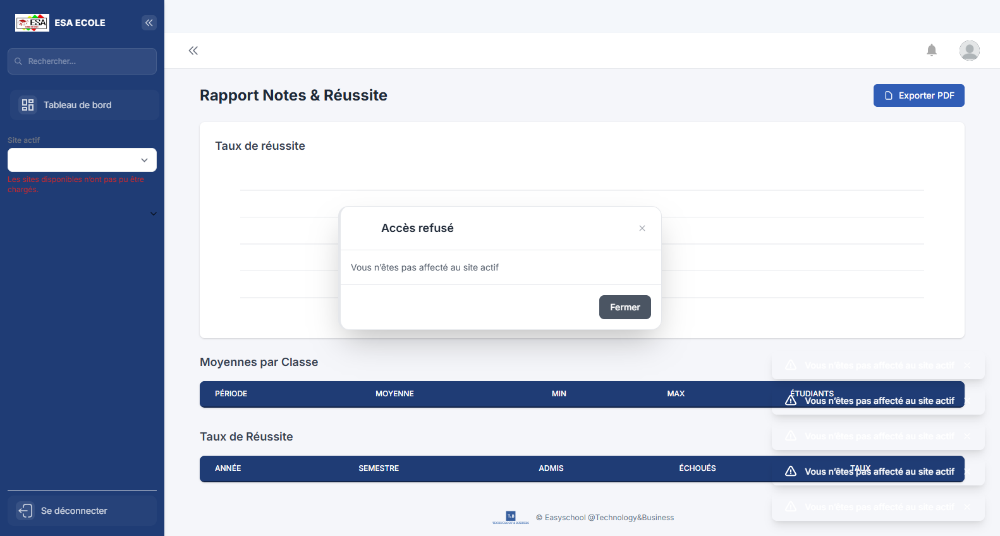

**Objectif :** Saisie et consultation des notes par classe, UE et type d’évaluation.

**Actions principales :**

1. Choisir la classe et l’UE
2. Saisir les notes
3. Vérifier puis publier

---

## 60. Paiements — vue 2

**Objectif :** Paiements des étudiants : saisie, recherche, historique et rattachement aux échéances.

**Actions principales :**

1. Rechercher un étudiant ou un paiement
2. Vérifier le montant et la référence
3. Enregistrer ou consulter le reçu

---

## 61. Mon profil

**Objectif :** Informations personnelles et professionnelles du compte connecté : identité, contacts et rattachements.

**Actions principales :**

1. Vérifier ses informations
2. Mettre à jour les champs modifiables
3. Enregistrer

---

## 62. Mon compte

**Objectif :** Paramètres de sécurité du compte : mot de passe, double authentification et sessions.

**Actions principales :**

1. Changer le mot de passe
2. Activer ou vérifier le 2FA
3. Contrôler les sessions ouvertes

---

## 63. Demandes de documents

**Objectif :** Demandes de documents administratifs (attestation, relevé, certificat) et leur traitement.

**Actions principales :**

1. Créer ou ouvrir une demande
2. Vérifier les pièces
3. Générer le document

---

## 64. Traiter les demandes

**Objectif :** File de traitement des demandes de documents : vérification, validation et génération.

**Actions principales :**

1. Ouvrir une demande
2. Contrôler les conditions
3. Valider et générer

---

*Guide généré par `scripts/guide/generer-guides.cjs`. Les captures valides les plus récentes sont utilisées, avec repli sur les captures historiques.*
