# Guide d'utilisation — Recouvrement (ESA Compta)

> Encaissements, reçus, suivi de caisse et des impayés, et imputation des bordereaux après leur authentification par le Cabinet comptable.

**Profil :** Recouvrement (ESA Compta)  
**Nombre d'écrans :** 28 + 1 illustration fictive  
**Mise à jour :** 08/11/2026

> **Périmètre du profil.** ESA Compta enregistre les paiements, édite les reçus, suit la caisse et impute les bordereaux déjà authentifiés. Le contrôle du justificatif et la décision de validation ou de rejet appartiennent au Cabinet comptable. Le secrétariat oriente l'étudiant et ne réalise pas d'encaissement.

Les captures sont des illustrations de l'application ; elles ne correspondent pas à des opérations réelles. L'image du bordereau est un spécimen visuel fictif, sans valeur de paiement. Utilisez les procédures ci-dessous pour les tâches quotidiennes, puis les fiches d'écran pour retrouver une fonction.

## Sommaire

### Procédures pas à pas

- [Encaisser un règlement et remettre le reçu](#encaisser-un-reglement-et-remettre-le-recu)
- [Saisir et imputer un bordereau authentifié](#saisir-et-imputer-un-bordereau-authentifie)
- [Suivre les impayés et vérifier une situation financière](#suivre-les-impayes-et-verifier-une-situation-financiere)
- [Clôturer et contrôler la caisse](#cloturer-et-controler-la-caisse)

### Écrans du profil

1. [Situation irrégulière](#1-situation-irreguliere)
2. [Situation financière](#2-situation-financiere)
3. [Bordereaux à imputer](#3-bordereaux-a-imputer)
4. [Bordereaux en attente](#4-bordereaux-en-attente)
5. [Bordereaux traités](#5-bordereaux-traites)
6. [Bordereaux rejetés](#6-bordereaux-rejetes)
7. [Types de bordereau](#7-types-de-bordereau)
8. [Mes bordereaux](#8-mes-bordereaux)
9. [Configurations](#9-configurations)
10. [Attributions](#10-attributions)
11. [Mon tableau de bord](#11-mon-tableau-de-bord)
12. [Paiements](#12-paiements)
13. [Validation des bordereaux](#13-validation-des-bordereaux)
14. [Comptabilité](#14-comptabilite)
15. [Immobilisations](#15-immobilisations)
16. [Sites](#16-sites)
17. [Catégories](#17-categories)
18. [Affectations](#18-affectations)
19. [Assurances](#19-assurances)
20. [Sorties provisoires](#20-sorties-provisoires)
21. [Cessions](#21-cessions)
22. [Rebuts](#22-rebuts)
23. [Maintenance](#23-maintenance)
24. [Inventaires](#24-inventaires)
25. [Reportings](#25-reportings)
26. [Paiements — vue 2](#26-paiements-vue-2)
27. [Mon profil](#27-mon-profil)
28. [Mon compte](#28-mon-compte)

## Encaisser un règlement et remettre le reçu

**Où le trouver :** **Recouvrement > Caisse > Encaissement documents** pour une demande de document payante, ou **Financier > Finance > Paiements** pour les autres encaissements. Saisissez uniquement un règlement effectivement reçu.

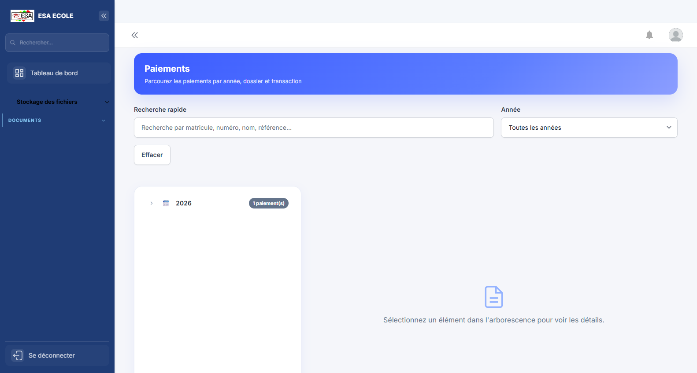

### Avant d'enregistrer le paiement

1. **Rechercher l'étudiant avec son matricule ou ses informations d'identification, puis vérifier le dossier ou la demande concernée.**
   - Pourquoi : cela évite de rattacher le règlement à la mauvaise personne ou à la mauvaise opération.
   - Responsable : ESA Compta / Recouvrement
2. **Vérifier le montant attendu, la nature du paiement et l'échéance ou le document concerné.**
   - Pourquoi : le montant reçu doit correspondre à une somme due et être affecté à la bonne opération.
   - Responsable : ESA Compta / Recouvrement

### Enregistrer et remettre le reçu

1. **Choisir le moyen de paiement proposé et enregistrer le montant réellement reçu, avec les références demandées.**
   - Pourquoi : la saisie doit refléter l'encaissement effectif ; ne marquez pas comme payé un montant seulement annoncé ou justifié par un bordereau non contrôlé.
   - Responsable : ESA Compta / Recouvrement
2. **Après confirmation de l'enregistrement, vérifier le numéro, la date, le montant et le mode sur le reçu.**
   - Pourquoi : le reçu est la preuve remise à l'étudiant et permet de retrouver l'opération.
   - Responsable : ESA Compta / Recouvrement
3. **Imprimer ou remettre le reçu, puis vérifier l'opération dans le journal de caisse ou l'historique des paiements.**
   - Pourquoi : le contrôle final confirme que le paiement est visible et correctement rattaché.
   - Responsable : ESA Compta / Recouvrement

## Saisir et imputer un bordereau authentifié

**Où le trouver :** **Financier > Finance > Bordereaux à imputer**. Le Cabinet comptable contrôle le justificatif et authentifie le bordereau ; ESA Compta effectue ensuite la saisie et l'imputation. N'utilisez pas le circuit d'imputation pour remplacer ou contourner le contrôle du Cabinet.

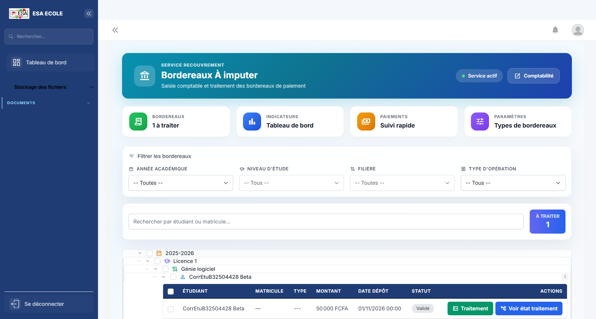

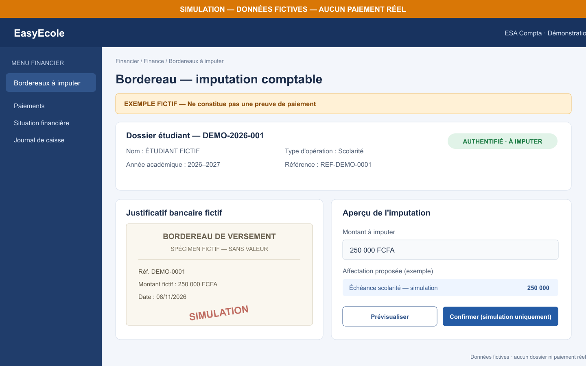

### Contrôler le dossier avant saisie

1. **Ouvrir « Bordereaux à imputer », puis filtrer par année, niveau, parcours ou type d'opération si nécessaire.**
   - Pourquoi : les filtres aident à retrouver le bordereau dans la file des dossiers authentifiés.
   - Responsable : ESA Compta / Recouvrement
2. **Vérifier le statut, l'étudiant, le type d'opération, le montant et les références du bordereau.**
   - Pourquoi : l'imputation doit correspondre au justificatif contrôlé par le Cabinet et au dossier financier de l'étudiant.
   - Responsable : ESA Compta / Recouvrement
3. **En cas de bordereau absent, rejeté ou incohérent, suspendre le traitement et contacter le Cabinet comptable ou le service concerné.**
   - Pourquoi : le Recouvrement ne modifie pas la décision d'authentification et ne doit pas imputer un dossier non contrôlé.
   - Responsable : ESA Compta / Recouvrement

### Saisir, prévisualiser et confirmer

1. **Ouvrir le traitement et vérifier ou compléter le montant, la référence bancaire, le numéro de bordereau, le moyen de paiement, la banque, le type d'opération et la date.**
   - Pourquoi : ces champs servent à enregistrer le paiement et à le rattacher aux échéances correctes.
   - Responsable : ESA Compta / Recouvrement
2. **Si le type d'opération est MIXTE, relire la composition calculée automatiquement par l'application avant de continuer.**
   - Pourquoi : la ventilation entre inscription et scolarité est calculée par le système ; elle ne doit pas être remplacée par une estimation manuelle.
   - Responsable : ESA Compta / Recouvrement
3. **Lancer l'aperçu du traitement, contrôler la répartition proposée et les avertissements, puis confirmer la saisie uniquement si les données sont exactes.**
   - Pourquoi : l'aperçu permet de repérer une incohérence avant l'imputation comptable.
   - Responsable : ESA Compta / Recouvrement
4. **Retrouver le bordereau dans « Bordereaux traités » et consulter son état d'imputation.**
   - Pourquoi : cette vérification confirme le résultat enregistré et facilite le suivi ultérieur.
   - Responsable : ESA Compta / Recouvrement

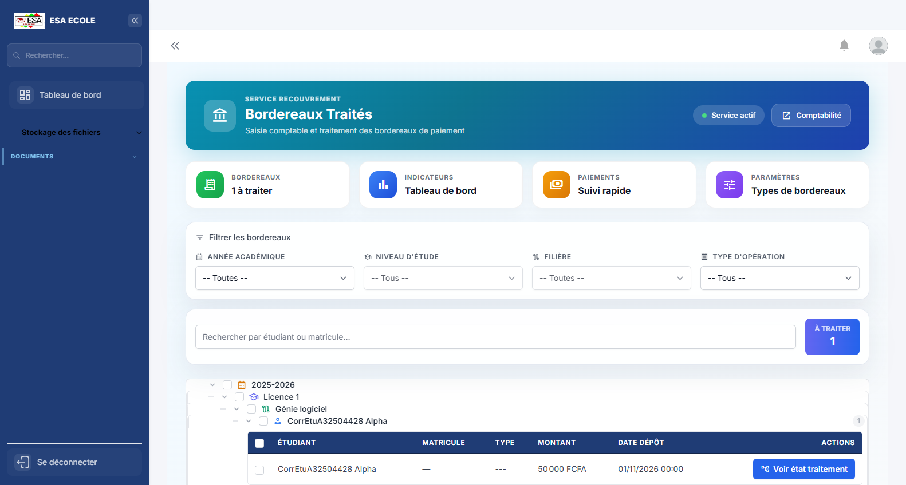

## Suivre les impayés et vérifier une situation financière

**Où le trouver :** **Financier > Finance > Situation irrégulière** et **Situation financière**. Utilisez ces écrans pour répondre à une question sur un solde ou repérer une échéance en retard. Une échéance affichée impayée ne prouve pas à elle seule qu'aucun règlement n'a été remis : vérifiez les paiements et les justificatifs avant de répondre.

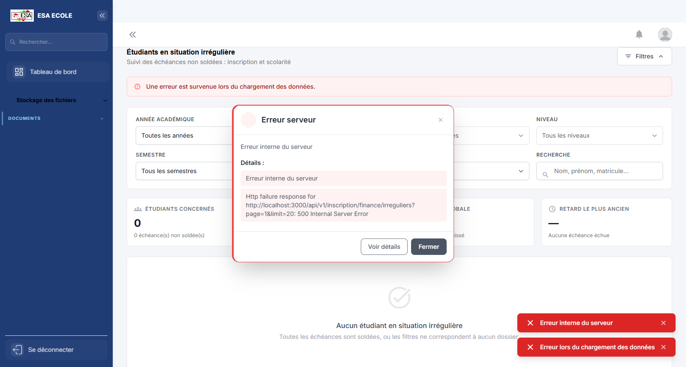
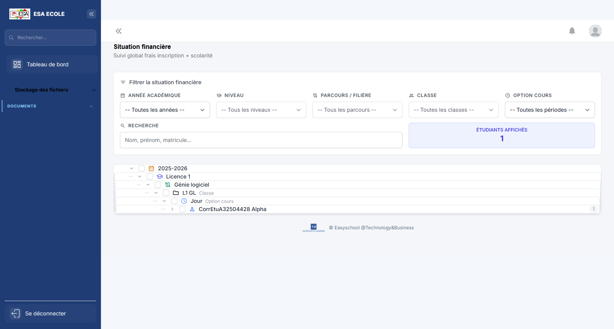

### Vérifier le dossier

1. **Rechercher l'étudiant par matricule et sélectionner la bonne année académique.**
   - Pourquoi : un même étudiant peut avoir plusieurs dossiers ou périodes de paiement.
   - Responsable : ESA Compta / Recouvrement
2. **Comparer les sommes dues, les paiements enregistrés, les échéances et leurs dates limites.**
   - Pourquoi : cette comparaison distingue un retard réel d'un paiement déjà reçu mais pas encore rapproché.
   - Responsable : ESA Compta / Recouvrement
3. **Si un reçu existe mais que la situation ne reflète pas le paiement, vérifier l'historique et les références avant toute nouvelle saisie.**
   - Pourquoi : éviter une double saisie ou une relance injustifiée.
   - Responsable : ESA Compta / Recouvrement
4. **Communiquer uniquement le solde confirmé et orienter l'étudiant vers le service compétent lorsqu'une pièce ou une décision manque.**
   - Pourquoi : les informations communiquées doivent correspondre à l'état vérifié du dossier.
   - Responsable : ESA Compta / Recouvrement

## Clôturer et contrôler la caisse

**Où le trouver :** **Recouvrement > Caisse > Clôture caisse**. La clôture compare le montant théorique calculé par l'application au montant réellement compté. Une différence doit être signalée et expliquée ; ne modifiez pas le montant réel pour faire disparaître un écart.

### Clôture de fin de journée

1. **Dans « Clôture caisse », vérifier la date, le caissier, le montant théorique et le statut de la clôture.**
   - Pourquoi : vous devez travailler sur la bonne session et confirmer les opérations qui lui sont rattachées.
   - Responsable : ESA Compta / Recouvrement
2. **Au début de la session, si aucune clôture n'est ouverte, cliquer sur « Ouvrir une clôture » et vérifier que la ligne apparaît au bon nom de caissier.**
   - Pourquoi : l'application rattache la clôture au caissier et aux encaissements de la session.
   - Responsable : ESA Compta / Recouvrement
3. **En fin de session, compter les fonds réellement présents et rapprocher ce total des reçus et opérations de caisse.**
   - Pourquoi : le montant réel doit provenir du comptage, et non être recopié automatiquement depuis le montant théorique.
   - Responsable : ESA Compta / Recouvrement
4. **Saisir le montant réellement compté, vérifier l'écart affiché et cliquer sur « Valider la clôture » seulement après le rapprochement.**
   - Pourquoi : la clôture conserve les montants théorique et réel ainsi que l'écart constaté.
   - Responsable : ESA Compta / Recouvrement
5. **En cas d'écart ou d'opération manquante, conserver les références des reçus et prévenir le responsable avant de finaliser.**
   - Pourquoi : une clôture ne remplace pas l'analyse ni la déclaration d'une anomalie de caisse.
   - Responsable : ESA Compta / Recouvrement

---

## 1. Situation irrégulière

**Objectif :** Étudiants en retard ou en défaut de paiement, avec motif et ancienneté de la dette.

**Actions principales :**

1. Filtrer les impayés par année et retrouver le dossier de l'étudiant
2. Vérifier les échéances et rapprocher avec les paiements ou reçus enregistrés
3. Communiquer le solde confirmé ou transmettre l'anomalie au service compétent

---

## 2. Situation financière

**Objectif :** Situation détaillée d’un étudiant : total dû, total payé, reste à payer et échéances.

**Actions principales :**

1. Rechercher l’étudiant
2. Lire le solde et l’historique
3. Exporter la situation

---

## 3. Bordereaux à imputer

**Objectif :** Bordereaux authentifiés en attente d’imputation comptable sur les échéances.

**Actions principales :**

1. Ouvrir un bordereau déjà authentifié par le Cabinet comptable
2. Vérifier l'étudiant, le type d'opération, le montant et les références
3. Prévisualiser l'imputation, compléter les champs requis, puis confirmer si tout concorde

---

## 4. Bordereaux en attente

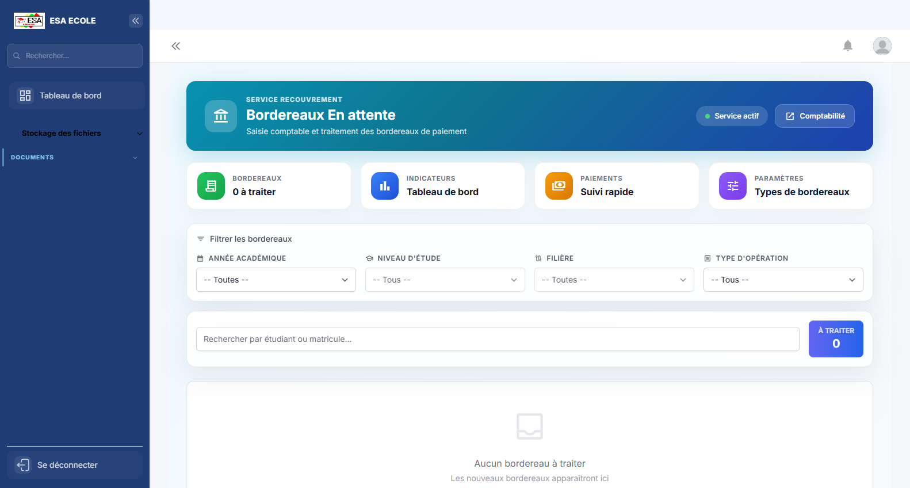

**Objectif :** Bordereaux en cours d’instruction, en attente d’une pièce ou d’une validation.

**Actions principales :**

1. Vérifier le motif et les éléments manquants
2. Contacter le Cabinet comptable ou le service concerné pour le complément requis
3. Ne pas imputer tant que le bordereau n'est pas authentifié

---

## 5. Bordereaux traités

**Objectif :** Bordereaux totalement traités et imputés, consultables pour contrôle.

**Actions principales :**

1. Filtrer les bordereaux par période ou par étudiant
2. Ouvrir l'état d'imputation et rapprocher les montants avec la situation financière
3. Conserver les références du bordereau et du paiement pour le suivi

---

## 6. Bordereaux rejetés

**Objectif :** Bordereaux rejetés avec motif, à corriger par l’étudiant ou le service concerné.

**Actions principales :**

1. Consulter le motif
2. Notifier l’étudiant
3. Suivre la nouvelle soumission

---

## 7. Types de bordereau

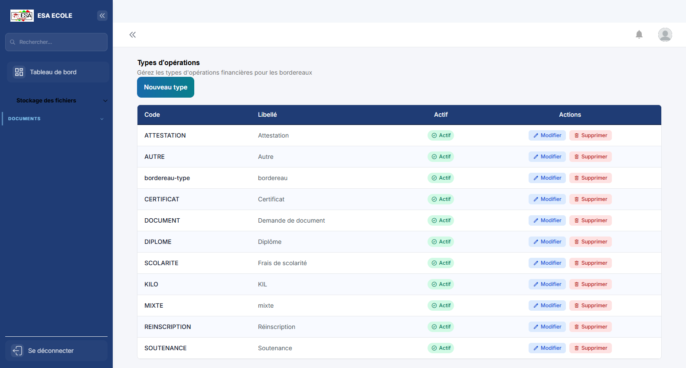

**Objectif :** Référentiel des types de bordereaux et des imputations associées.

**Actions principales :**

1. Créer un type
2. Associer les frais
3. Activer

---

## 8. Mes bordereaux

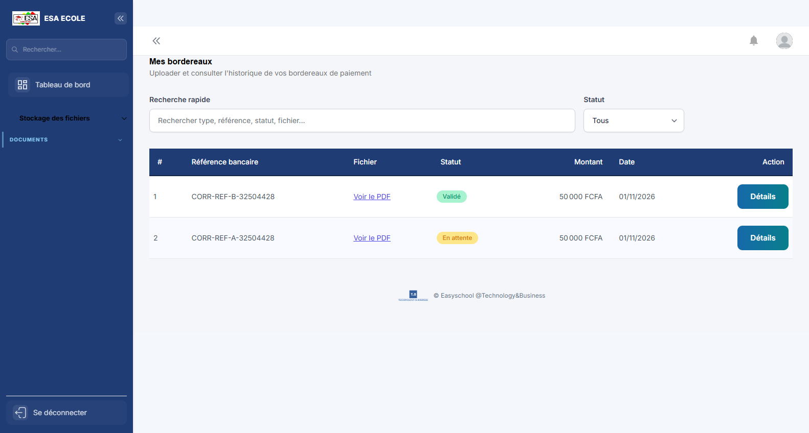

**Objectif :** Bordereaux déposés par l’étudiant (ou suivis par le profil) avec leur état d’authentification et d’imputation.

**Actions principales :**

1. Déposer ou consulter un bordereau
2. Suivre son statut
3. Télécharger le reçu

---

## 9. Configurations

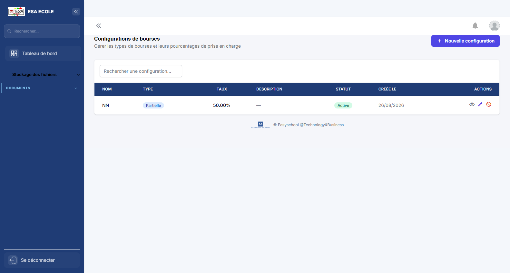

**Objectif :** Paramétrage du module : règles, barèmes et options appliquées aux dossiers.

**Actions principales :**

1. Choisir la configuration
2. Modifier les paramètres
3. Enregistrer et tester

---

## 10. Attributions

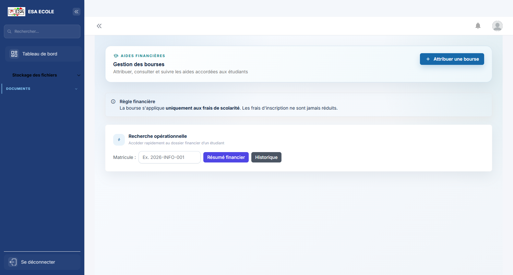

**Objectif :** Attribution des droits, responsabilités ou avantages aux personnes concernées.

**Actions principales :**

1. Rechercher la personne
2. Choisir l’attribution
3. Valider la période

---

## 11. Mon tableau de bord

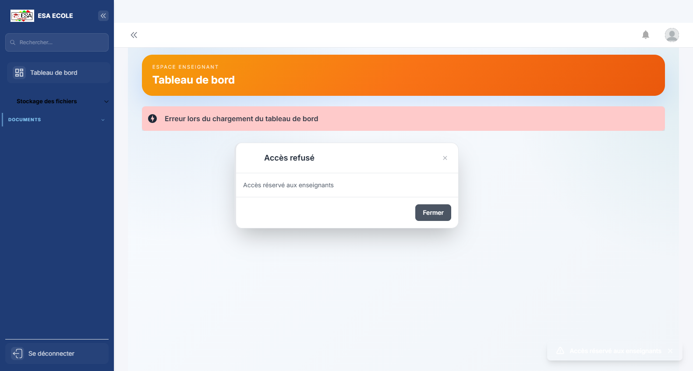

**Objectif :** Page d'accueil du profil : indicateurs personnels, alertes et raccourcis vers les tâches les plus fréquentes.

**Actions principales :**

1. Lire les indicateurs et alertes
2. Ouvrir un raccourci
3. Traiter les éléments en attente

---

## 12. Paiements

**Objectif :** Paiements des étudiants : saisie, recherche, historique et rattachement aux échéances.

**Actions principales :**

1. Rechercher un étudiant ou un paiement
2. Vérifier le montant et la référence
3. Enregistrer ou consulter le reçu

---

## 13. Validation des bordereaux

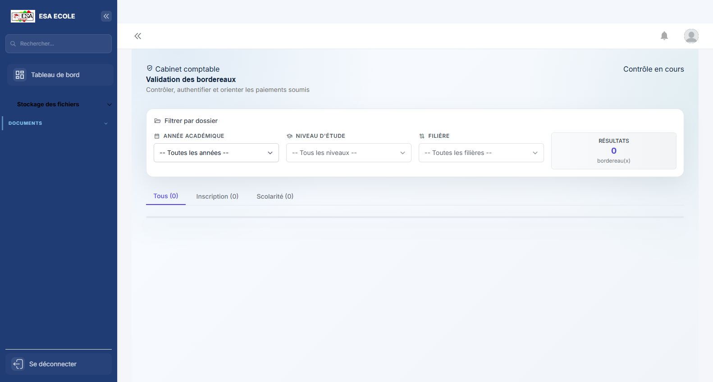

**Objectif :** Authentification des bordereaux déposés : contrôle du justificatif et saisie des références bancaires.

**Actions principales :**

1. Ouvrir le bordereau
2. Vérifier le statut et le motif de rejet ou d'attente
3. Orienter vers le Cabinet comptable pour le contrôle du justificatif

> **Périmètre :** l'authentification et le rejet d'un justificatif relèvent du Cabinet comptable. Si cet écran apparaît dans votre menu, ne l'utilisez pas pour valider un bordereau ; le Recouvrement traite les dossiers authentifiés depuis **Bordereaux à imputer**.

---

## 14. Comptabilité

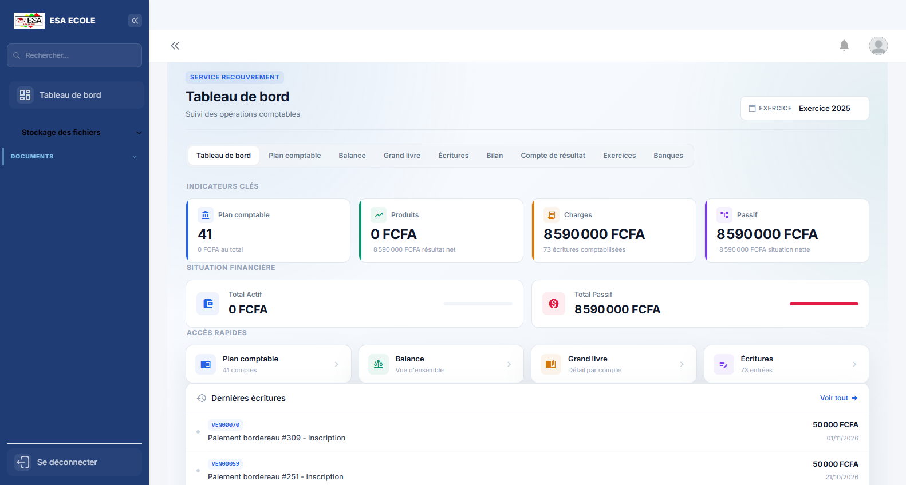

**Objectif :** Comptabilité générale : journaux, écritures, balance et grand livre.

**Actions principales :**

1. Choisir le journal
2. Consulter ou saisir une écriture
3. Contrôler la balance

---

## 15. Immobilisations

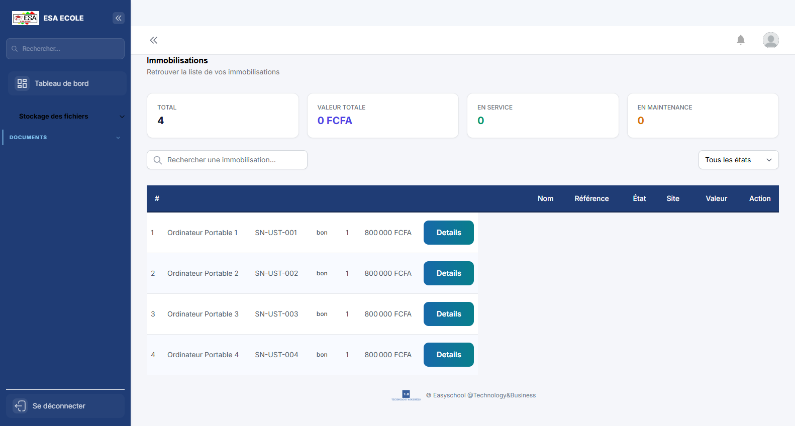

**Objectif :** Registre des immobilisations : acquisition, amortissement et valeur nette.

**Actions principales :**

1. Créer une immobilisation
2. Paramétrer l’amortissement
3. Suivre la valeur nette

---

## 16. Sites

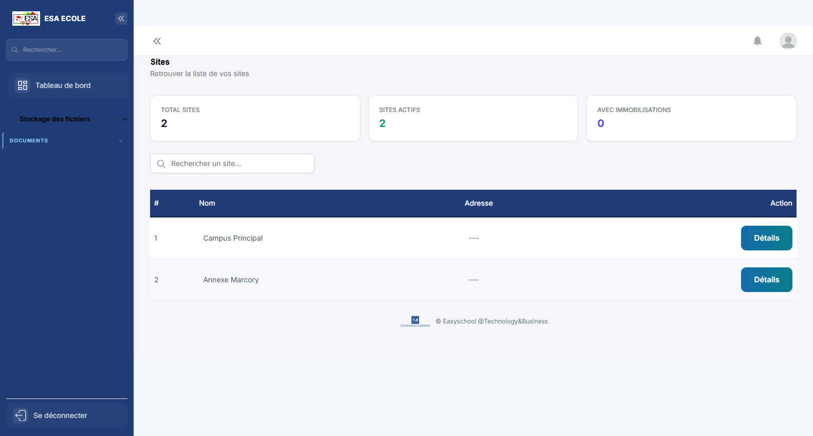

**Objectif :** Sites et établissements rattachés, avec leur adresse et leur responsable.

**Actions principales :**

1. Créer un site
2. Renseigner l’adresse
3. Activer

---

## 17. Catégories

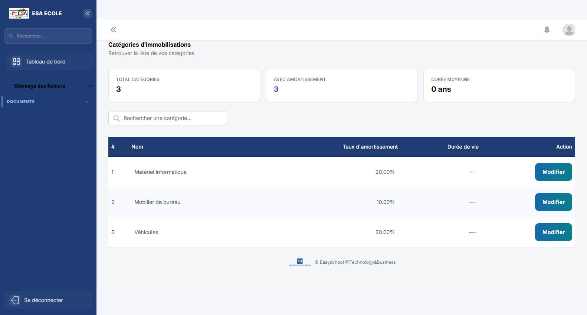

**Objectif :** Catégories d’articles, de documents ou d’immobilisations utilisées dans les référentiels.

**Actions principales :**

1. Créer une catégorie
2. Définir les règles associées
3. Enregistrer

---

## 18. Affectations

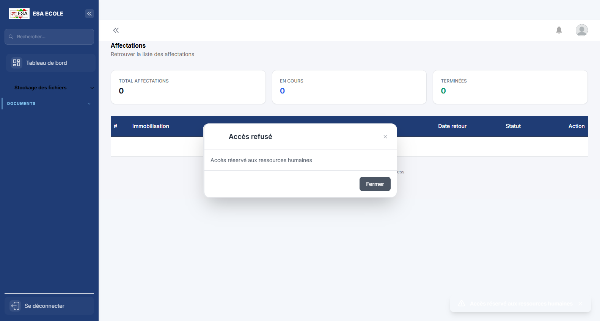

**Objectif :** Affectation des biens, salles ou moyens aux personnes et services.

**Actions principales :**

1. Choisir le bien
2. Sélectionner le bénéficiaire
3. Valider l’affectation

---

## 19. Assurances

**Objectif :** Contrats d’assurance des biens : police, échéances et sinistres.

**Actions principales :**

1. Créer un contrat
2. Renseigner les échéances
3. Suivre les sinistres

---

## 20. Sorties provisoires

**Objectif :** Biens sortis temporairement avec date de retour et responsable.

**Actions principales :**

1. Enregistrer une sortie
2. Fixer la date de retour
3. Contrôler le retour

---

## 21. Cessions

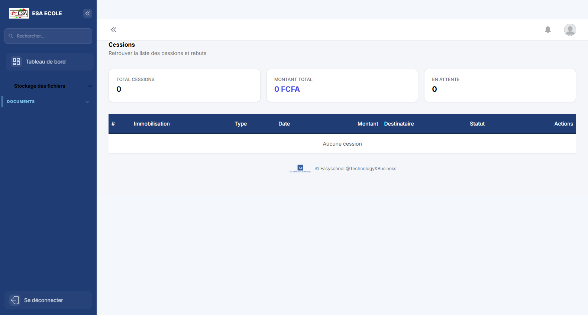

**Objectif :** Cessions de biens : motif, valorisation et validation.

**Actions principales :**

1. Sélectionner le bien
2. Renseigner la cession
3. Valider

---

## 22. Rebuts

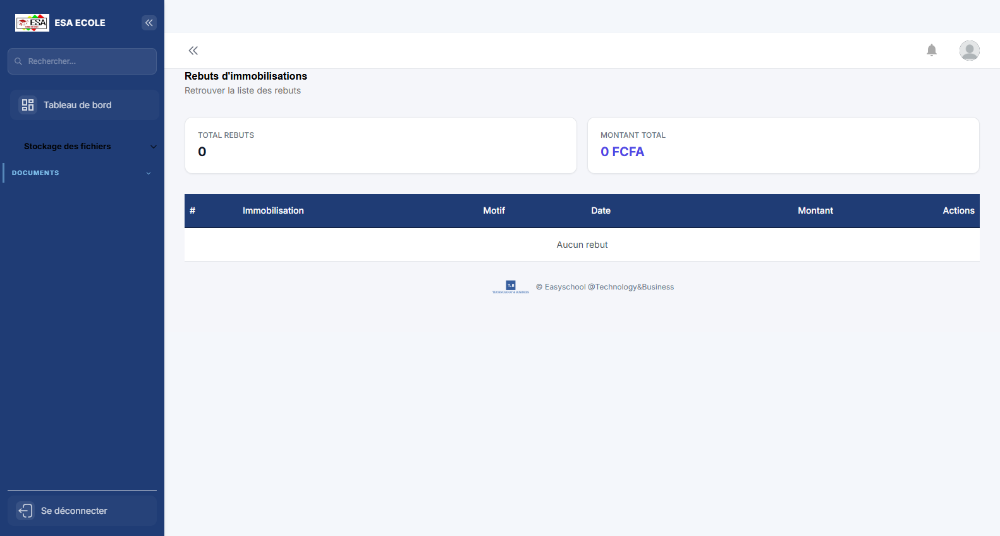

**Objectif :** Biens mis au rebut avec motif, procès-verbal et sortie d’inventaire.

**Actions principales :**

1. Sélectionner les biens
2. Renseigner le motif
3. Valider la mise au rebut

---

## 23. Maintenance

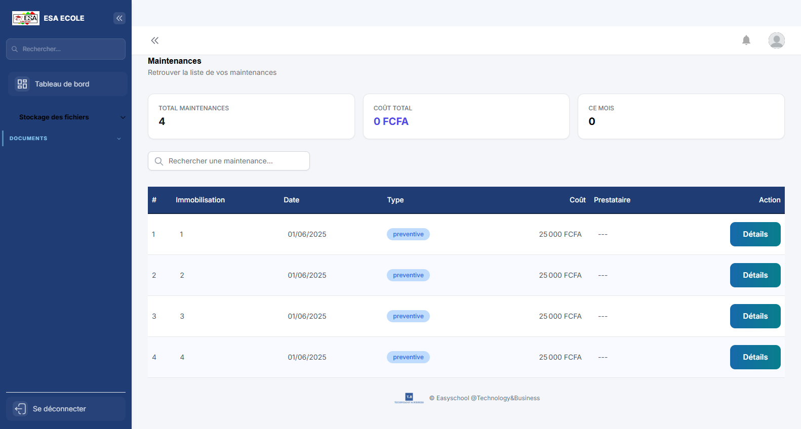

**Objectif :** Interventions de maintenance préventive et curative sur les biens.

**Actions principales :**

1. Créer une demande
2. Planifier l’intervention
3. Clôturer avec le rapport

---

## 24. Inventaires

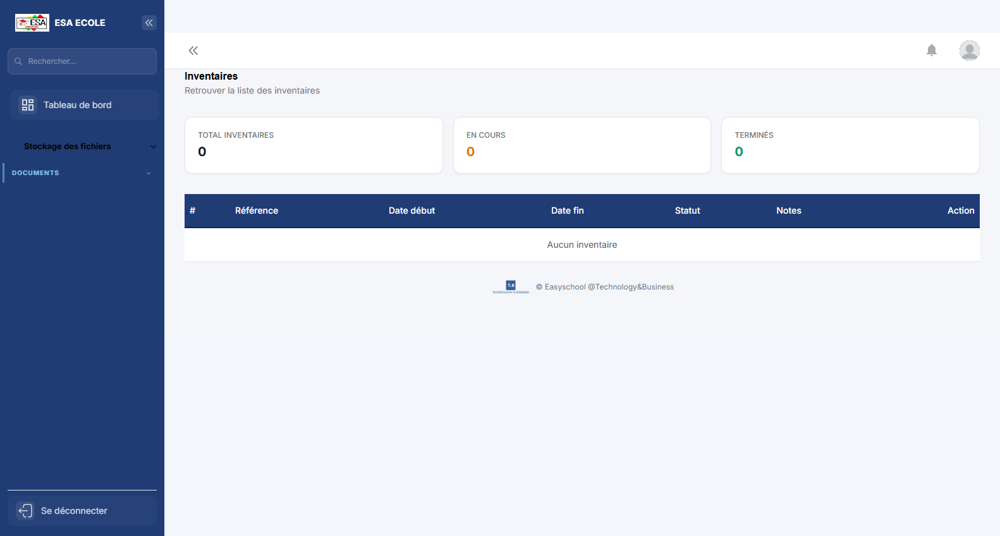

**Objectif :** Campagnes d’inventaire physique et rapprochement avec le registre comptable.

**Actions principales :**

1. Lancer une campagne
2. Saisir les constats
3. Générer les écarts

---

## 25. Reportings

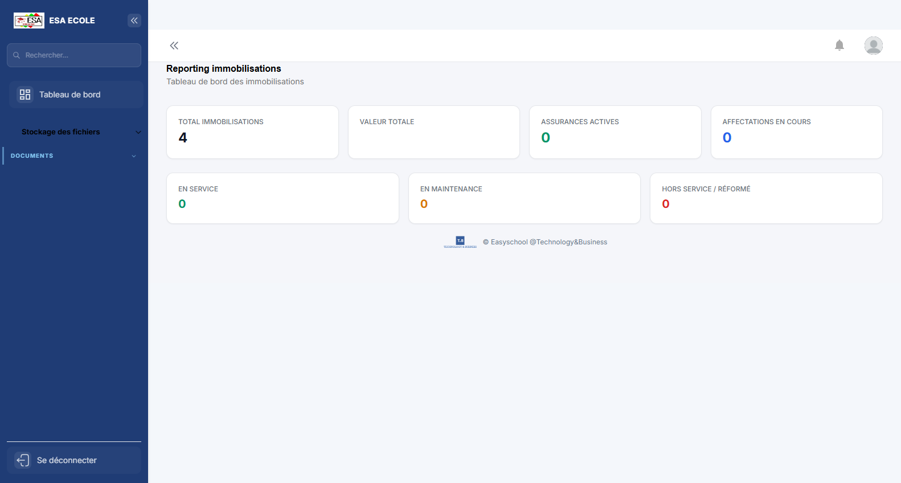

**Objectif :** Tableaux de bord et rapports financiers consolidés.

**Actions principales :**

1. Choisir le rapport
2. Filtrer la période
3. Exporter

---

## 26. Paiements — vue 2

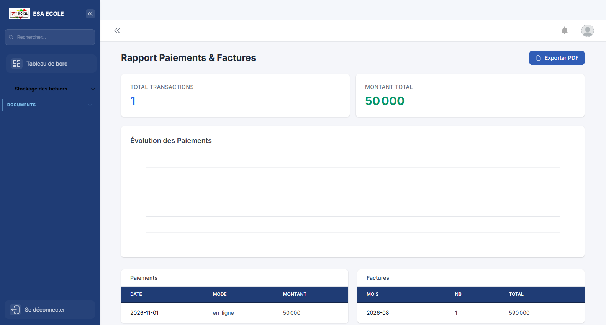

**Objectif :** Paiements des étudiants : saisie, recherche, historique et rattachement aux échéances.

**Actions principales :**

1. Rechercher un étudiant ou un paiement
2. Vérifier le montant et la référence
3. Enregistrer ou consulter le reçu

---

## 27. Mon profil

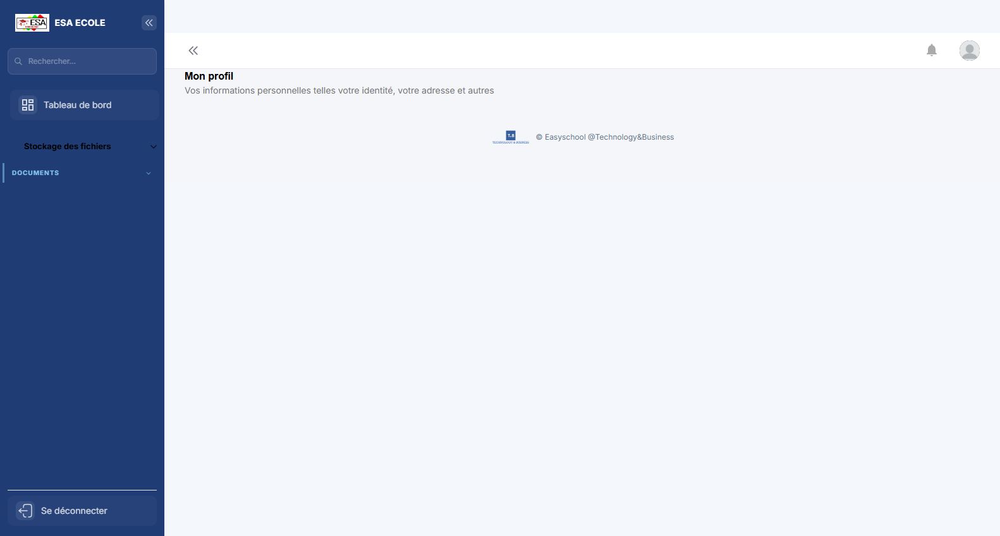

**Objectif :** Informations personnelles et professionnelles du compte connecté : identité, contacts et rattachements.

**Actions principales :**

1. Vérifier ses informations
2. Mettre à jour les champs modifiables
3. Enregistrer

---

## 28. Mon compte

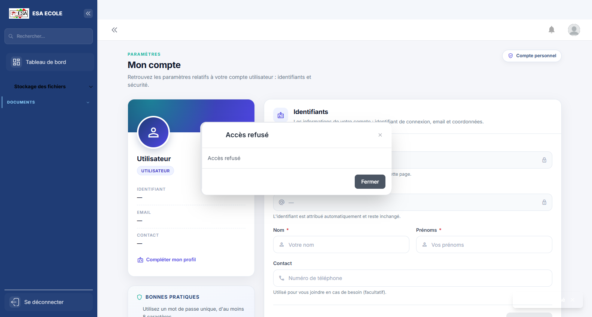

**Objectif :** Paramètres de sécurité du compte : mot de passe, double authentification et sessions.

**Actions principales :**

1. Changer le mot de passe
2. Activer ou vérifier le 2FA
3. Contrôler les sessions ouvertes

---

*Guide EasyEcole — Recouvrement (ESA Compta), mis à jour le 08/11/2026. Les captures sont illustratives ; les habilitations de votre compte déterminent les écrans réellement accessibles.*
