# Guide d'utilisation — Ressources humaines

> Gestion du personnel : employés, contrats, paie, congés, heures supplémentaires, prestataires et reportings RH.

**Profil :** Ressources humaines  
**Nombre d'écrans :** 17  
**Généré le :** 02/11/2026

Ce guide présente les écrans du profil dans l'ordre d'utilisation conseillé. Chaque section contient une capture, l'objectif de l'écran et les actions principales.

## Sommaire

1. [Catégories professionnelles](#1-categories-professionnelles)
2. [Grilles salariales](#2-grilles-salariales)
3. [Paramètres de paie](#3-parametres-de-paie)
4. [Heures supplémentaires](#4-heures-supplementaires)
5. [Prêts et avances](#5-prets-et-avances)
6. [Prestataires](#6-prestataires)
7. [Indemnités prestataires](#7-indemnites-prestataires)
8. [Contrats](#8-contrats)
9. [Planning du personnel](#9-planning-du-personnel)
10. [Reportings RH](#10-reportings-rh)
11. [Mon profil](#11-mon-profil)
12. [Mon compte](#12-mon-compte)
13. [Mon tableau de bord](#13-mon-tableau-de-bord)
14. [Employés](#14-employes)
15. [Paie](#15-paie)
16. [Demandes de congé](#16-demandes-de-conge)
17. [Soldes de congé](#17-soldes-de-conge)

## 1. Catégories professionnelles

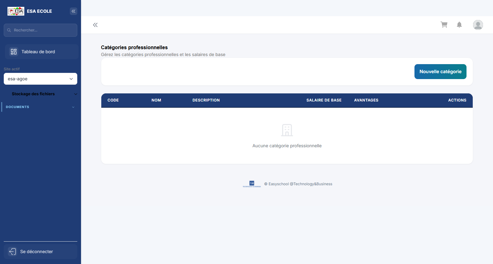

**Objectif :** Catégories et échelons du personnel utilisés pour la paie.

**Actions principales :**

1. Créer une catégorie
2. Définir les échelons
3. Associer les employés

---

## 2. Grilles salariales

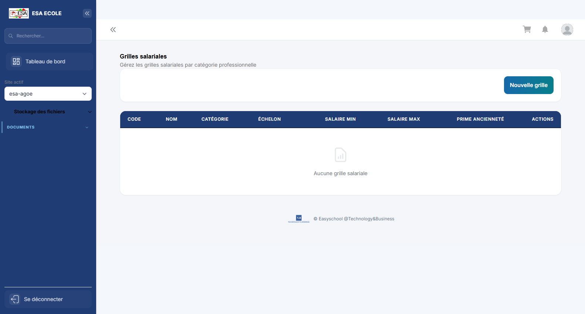

**Objectif :** Grilles de salaires par catégorie, échelon et ancienneté.

**Actions principales :**

1. Choisir la catégorie
2. Renseigner les montants
3. Publier la grille

---

## 3. Paramètres de paie

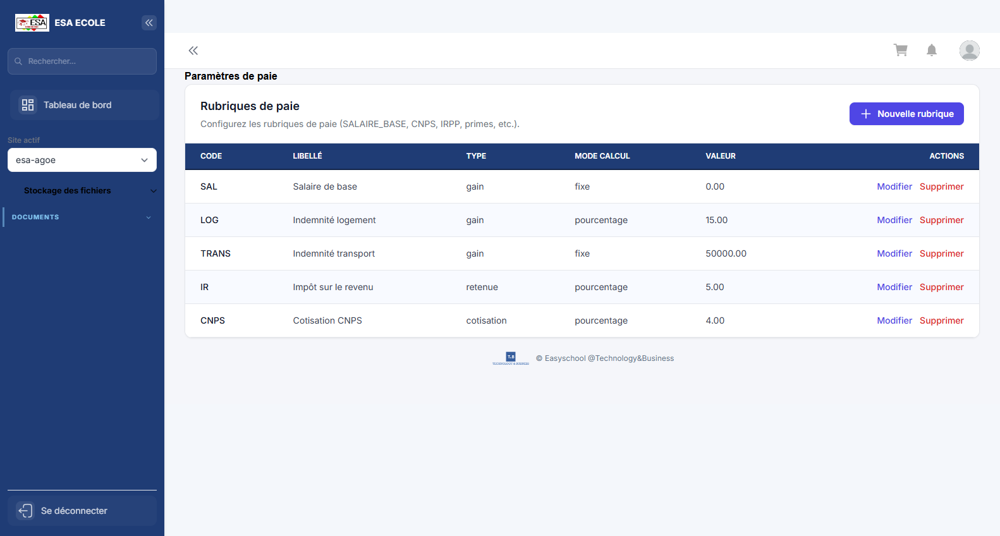

**Objectif :** Règles de calcul de la paie : cotisations, primes et retenues.

**Actions principales :**

1. Choisir le paramètre
2. Modifier la valeur
3. Enregistrer

---

## 4. Heures supplémentaires

**Objectif :** Saisie et validation des heures supplémentaires effectuées.

**Actions principales :**

1. Saisir les heures
2. Faire valider par le responsable
3. Intégrer à la paie

---

## 5. Prêts et avances

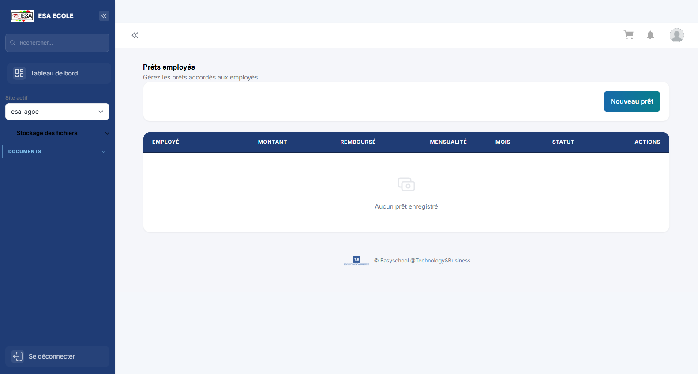

**Objectif :** Prêts et avances accordés au personnel, avec échéancier de remboursement.

**Actions principales :**

1. Créer une demande
2. Valider le montant
3. Suivre les retenues

---

## 6. Prestataires

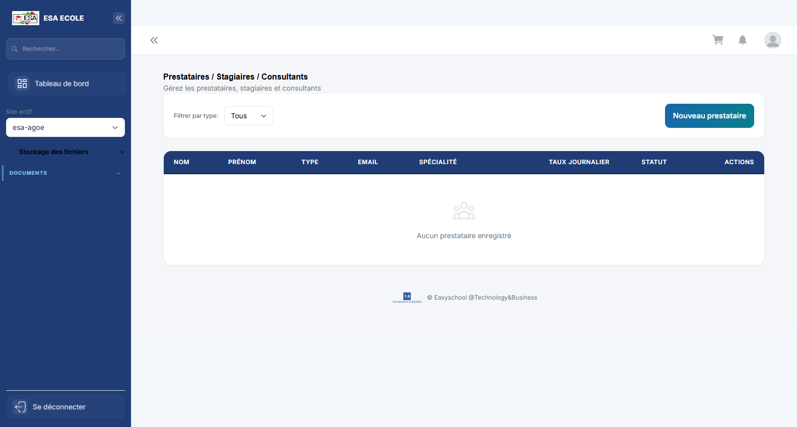

**Objectif :** Prestataires externes et suivi de leurs interventions.

**Actions principales :**

1. Créer un prestataire
2. Renseigner les coordonnées
3. Suivre les prestations

---

## 7. Indemnités prestataires

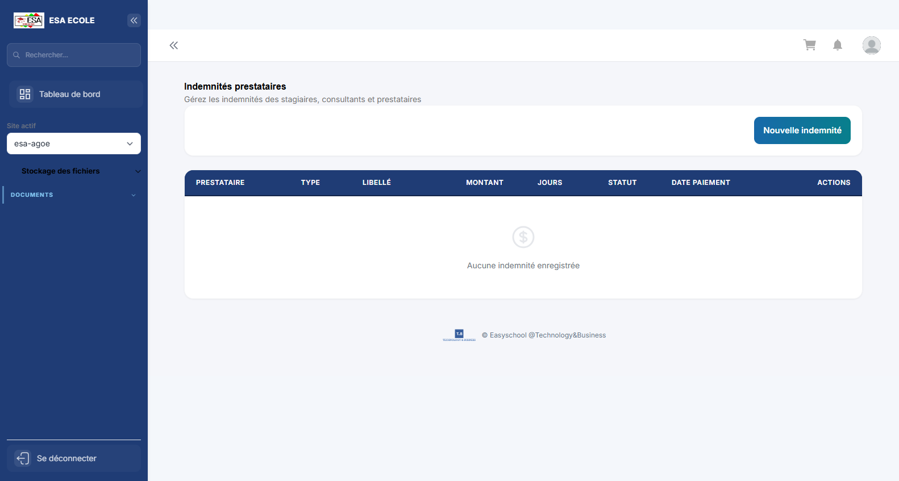

**Objectif :** Calcul et paiement des indemnités dues aux prestataires.

**Actions principales :**

1. Sélectionner les prestations
2. Calculer les indemnités
3. Valider le paiement

---

## 8. Contrats

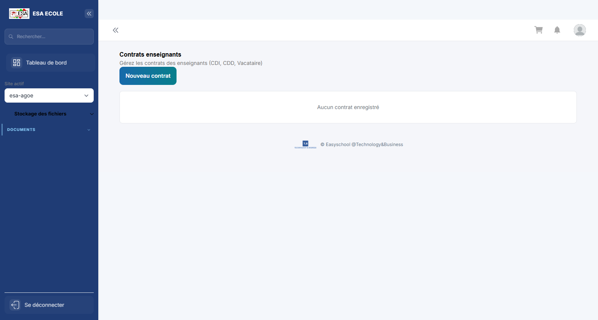

**Objectif :** Contrats de travail : type, durée, rémunération et avenants.

**Actions principales :**

1. Créer un contrat
2. Renseigner les clauses
3. Suivre les échéances

---

## 9. Planning du personnel

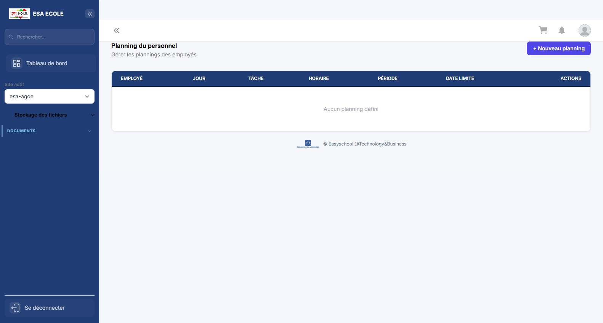

**Objectif :** Affectation hebdomadaire des personnels : poste, tâche et horaires.

**Actions principales :**

1. Choisir la semaine
2. Affecter les personnels
3. Publier le planning

---

## 10. Reportings RH

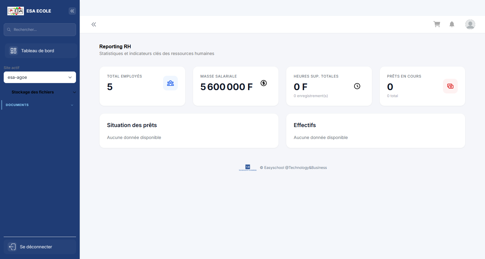

**Objectif :** Indicateurs RH : effectifs, masse salariale, absences et turnover.

**Actions principales :**

1. Choisir la période
2. Analyser les indicateurs
3. Exporter

---

## 11. Mon profil

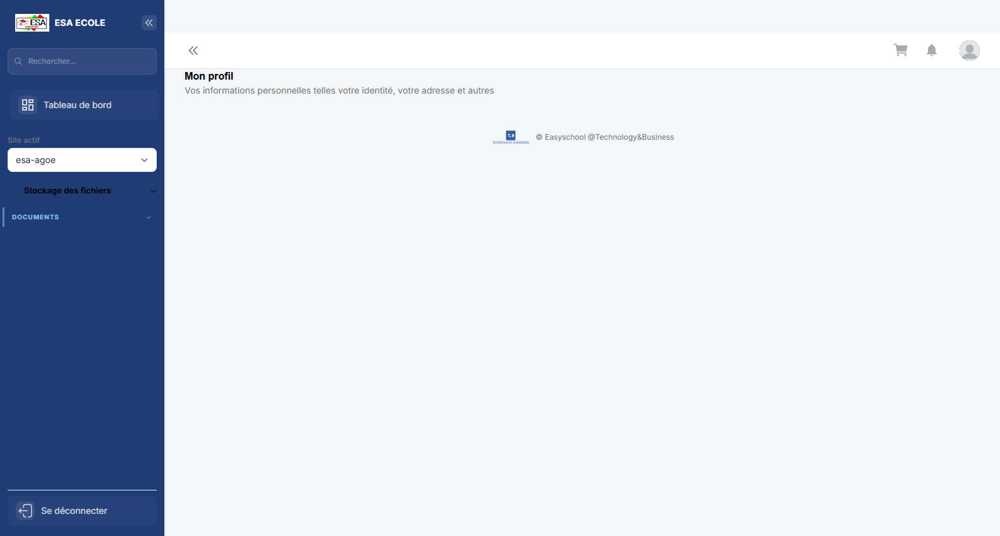

**Objectif :** Informations personnelles et professionnelles du compte connecté : identité, contacts et rattachements.

**Actions principales :**

1. Vérifier ses informations
2. Mettre à jour les champs modifiables
3. Enregistrer

---

## 12. Mon compte

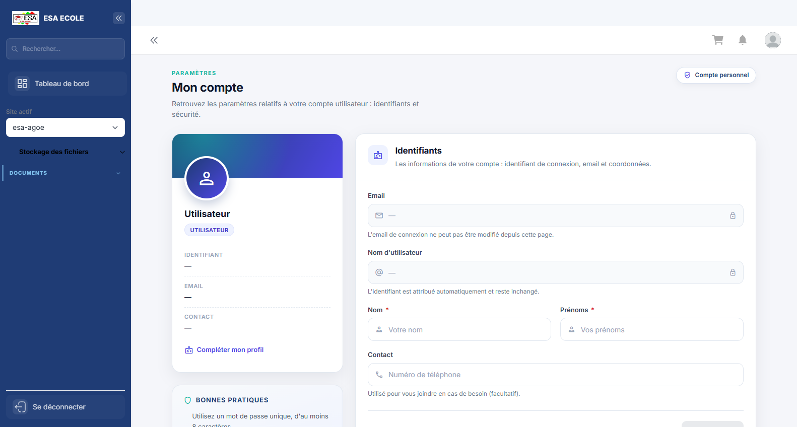

**Objectif :** Paramètres de sécurité du compte : mot de passe, double authentification et sessions.

**Actions principales :**

1. Changer le mot de passe
2. Activer ou vérifier le 2FA
3. Contrôler les sessions ouvertes

---

## 13. Mon tableau de bord

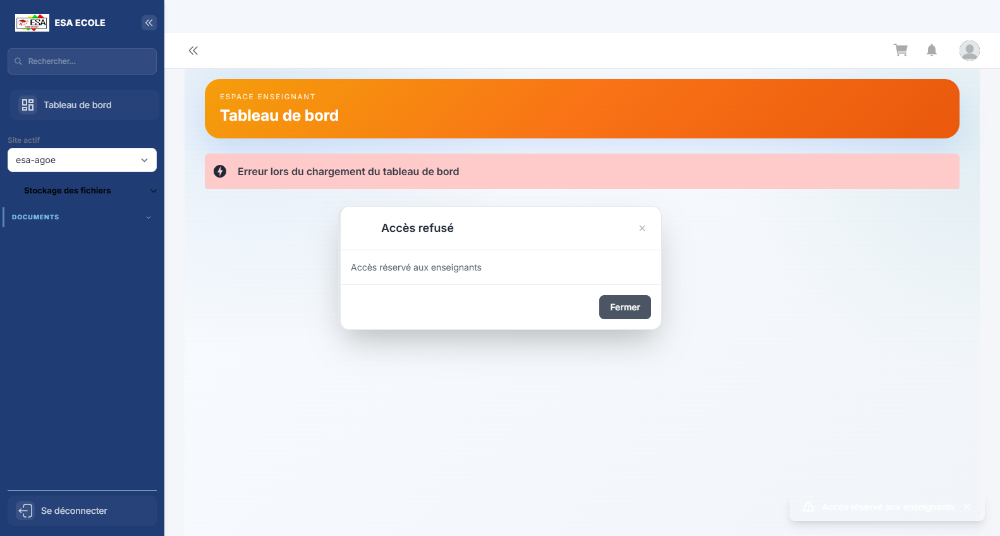

**Objectif :** Page d'accueil du profil : indicateurs personnels, alertes et raccourcis vers les tâches les plus fréquentes.

**Actions principales :**

1. Lire les indicateurs et alertes
2. Ouvrir un raccourci
3. Traiter les éléments en attente

---

## 14. Employés

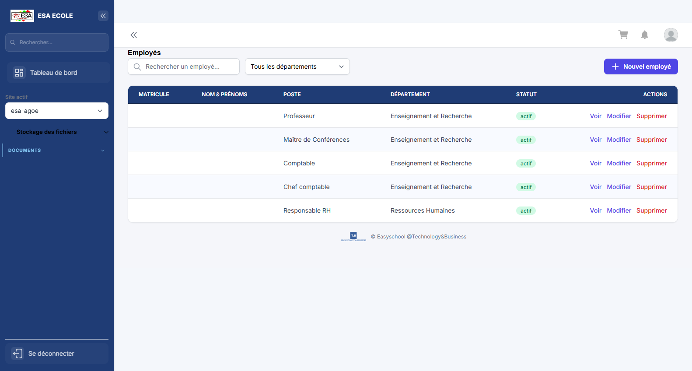

**Objectif :** Référentiel du personnel : identité, poste, contrat et affectation.

**Actions principales :**

1. Créer ou modifier un employé
2. Renseigner le poste
3. Activer le compte

---

## 15. Paie

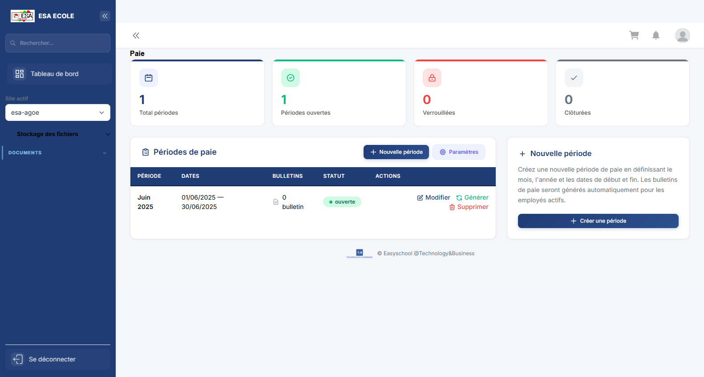

**Objectif :** Préparation et exécution de la paie : éléments variables, bulletins et virements.

**Actions principales :**

1. Choisir la période
2. Contrôler les éléments variables
3. Calculer et valider la paie

---

## 16. Demandes de congé

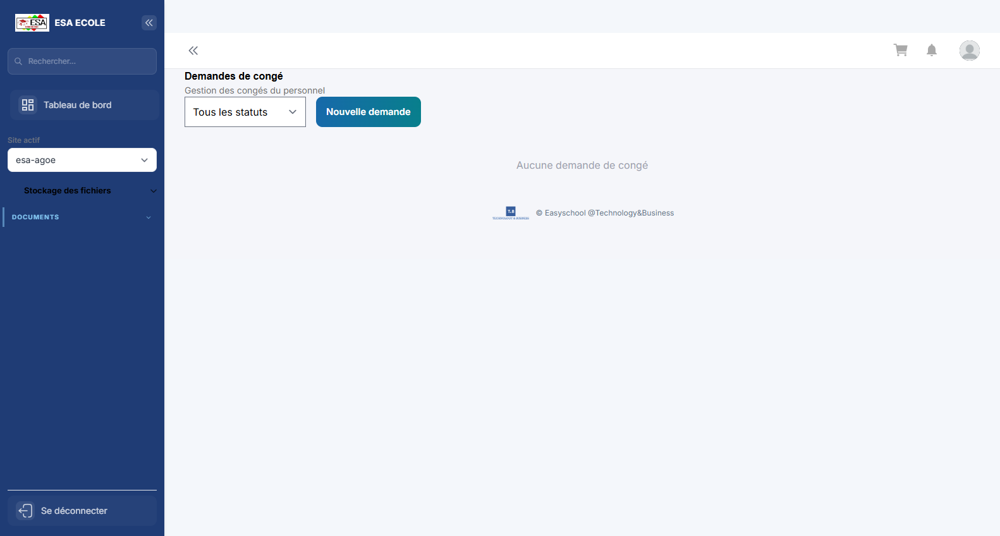

**Objectif :** Demandes de congé du personnel et leur circuit de validation.

**Actions principales :**

1. Créer une demande
2. Faire valider
3. Mettre à jour le solde

---

## 17. Soldes de congé

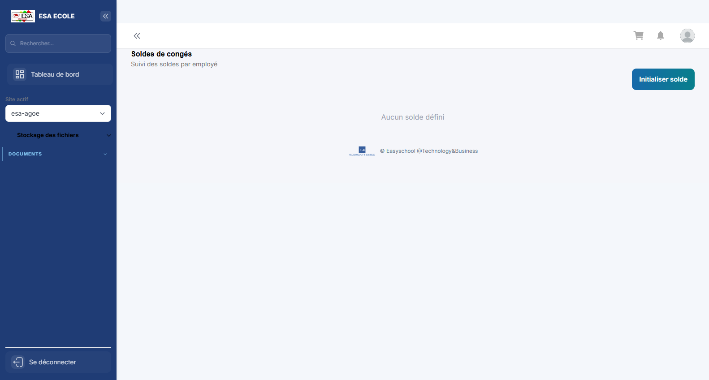

**Objectif :** Soldes de congés par employé et par période.

**Actions principales :**

1. Rechercher un employé
2. Consulter le solde
3. Ajuster si nécessaire

---

*Guide généré par `scripts/guide/generer-guides.cjs`. Les captures valides les plus récentes sont utilisées, avec repli sur les captures historiques.*
