# Guide d'utilisation — Superviseur général

> Pilotage pédagogique transversal : consultation, création, modification et publication des emplois du temps du site actif autorisé, suivi des cours, évaluations et présences.

**Profil :** Superviseur général  
**Nombre d'écrans :** 26
**Généré le :** 08/11/2026

Ce guide présente les écrans du profil dans l'ordre d'utilisation conseillé. Chaque section contient une capture, l'objectif de l'écran et les actions principales.

## Sommaire

### Procédures pas à pas
- [Emploi du temps — planifier, contrôler les conflits et publier](#emploi-du-temps-planifier-controler-les-conflits-et-publier)

1. [Salles de classe](#1-salles-de-classe)
2. [Emplois du temps](#2-emplois-du-temps)
3. [Calendrier](#3-calendrier)
4. [Sessions d'examens](#4-sessions-d-examens)
5. [Rattrapages](#5-rattrapages)
6. [Tableau de bord du superviseur](#6-tableau-de-bord-du-superviseur)
7. [Cahiers de texte](#7-cahiers-de-texte)
8. [Cahier de présence](#8-cahier-de-presence)
9. [Notes](#9-notes)
10. [Bulletins](#10-bulletins)
11. [Moyennes](#11-moyennes)
12. [Délibérations & jury](#12-deliberations-jury)
13. [Conseils de classe](#13-conseils-de-classe)
14. [Unités d'enseignement](#14-unites-d-enseignement)
15. [Historique](#15-historique)
16. [Shifts](#16-shifts)
17. [Absences](#17-absences)
18. [Rapports](#18-rapports)
19. [Tableau de bord de pilotage](#19-tableau-de-bord-de-pilotage)
20. [Effectifs](#20-effectifs)
21. [Notes — vue 2](#21-notes-vue-2)
22. [Mon profil](#22-mon-profil)
23. [Mon compte](#23-mon-compte)
24. [Emploi du temps — exemple fictif](#24-emploi-du-temps-exemple-fictif)
25. [Nouvelle séance — formulaire fictif](#25-nouvelle-seance-formulaire-fictif)
26. [Publication du planning — exemple fictif](#26-publication-du-planning-exemple-fictif)

## Procédures pas à pas

### Emploi du temps — planifier, contrôler les conflits et publier

Le Superviseur général peut créer, modifier, supprimer et publier les séances du site actif autorisé. La capture réelle montre « Aucun site actif sélectionné » ; les suivantes sont des simulations avec des données entièrement fictives. Il faut d’abord sélectionner un site auquel le compte est affecté. La publication envoie les notifications uniquement pour les cours de ce site.

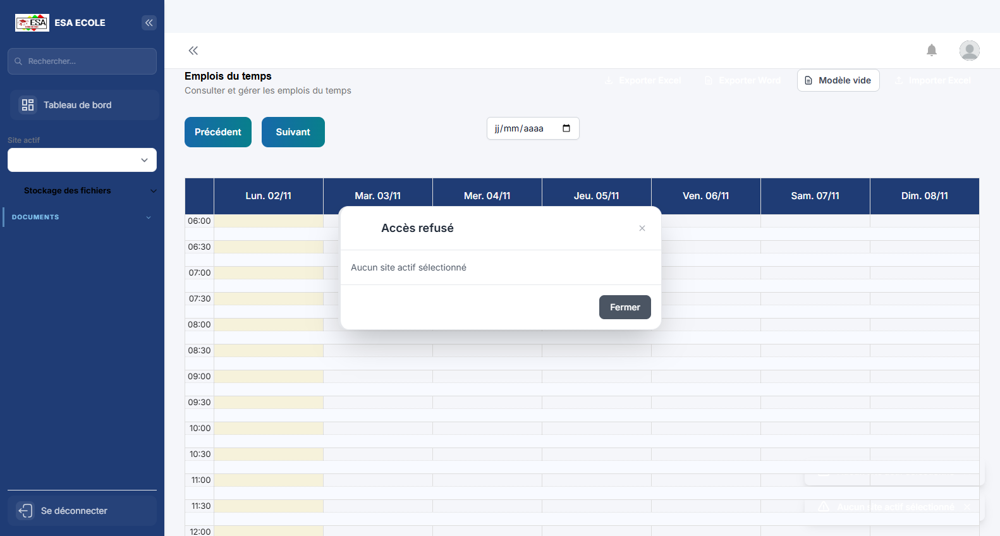

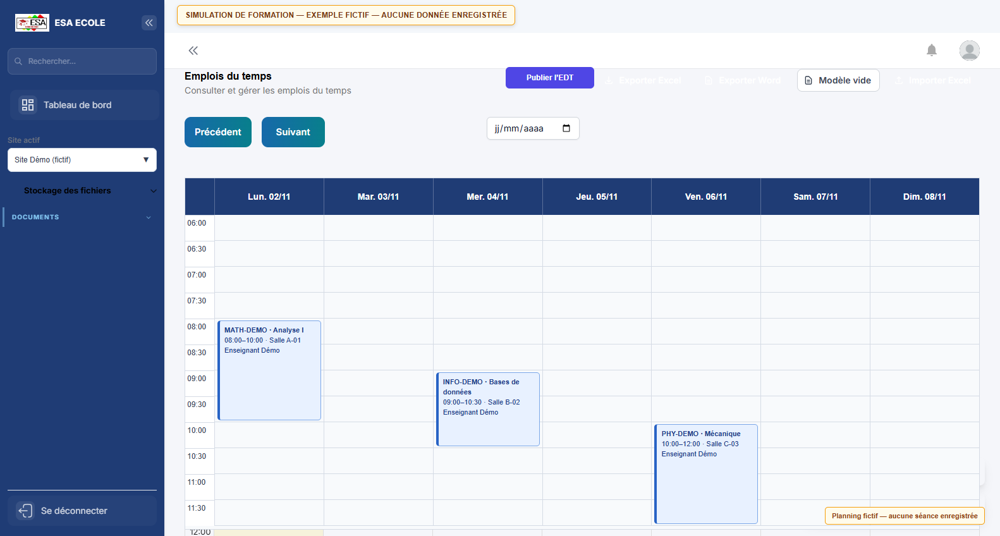

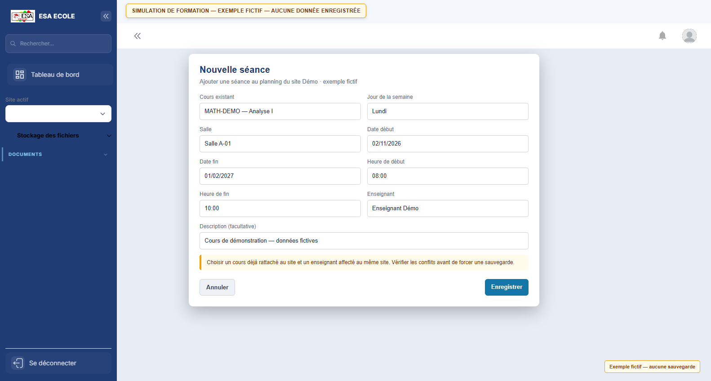

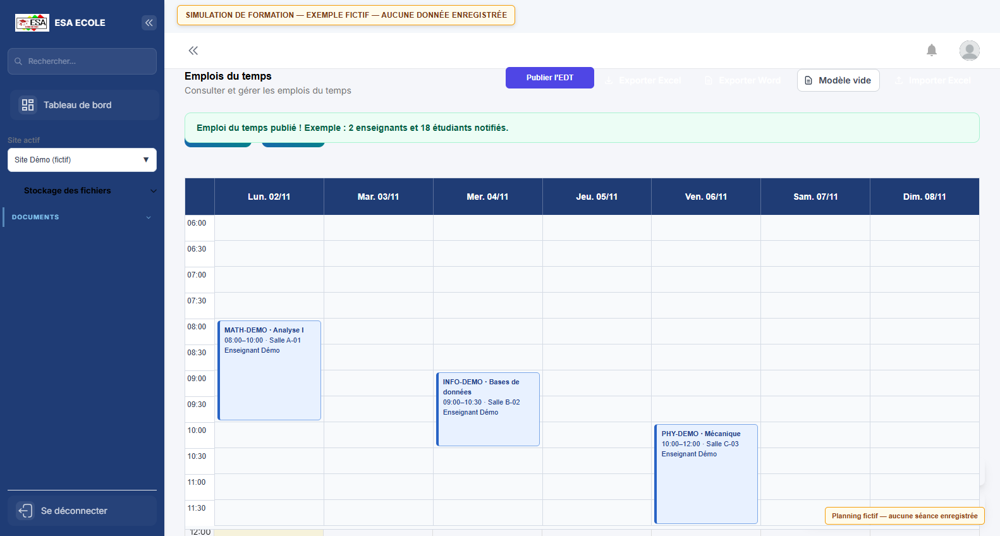

#### Préparer les séances du planning

1. **Sélectionner un site actif auquel le compte est autorisé, puis ouvrir Emplois du temps.**
   - Pourquoi : La création, la modification et la publication sont limitées au site actif du Superviseur général.
   - Responsable : Superviseur général / Administrateur
2. **Choisir la semaine et, si nécessaire, filtrer par enseignant ou classe. Cliquer sur une plage libre du calendrier pour ouvrir Nouvelle séance.**
   - Pourquoi : Le clic sur la grille préremplit la date, l’heure et le jour de la semaine.
   - Responsable : Superviseur général
3. **Cocher Choisir parmi les cours et sélectionner le cours existant ; renseigner la salle, les dates de début et de fin, les horaires, l’enseignant et la description utile.**
   - Pourquoi : La séance doit être rattachée à un cours du site actif et à un enseignant affecté à ce site.
   - Responsable : Superviseur général
4. **Cliquer sur Enregistrer. Lire les conflits retournés et corriger les chevauchements avant de forcer une sauvegarde.**
   - Pourquoi : Le contrôle signale les collisions d’horaires ; ne forcer l’enregistrement qu’après validation explicite.
   - Responsable : Superviseur général
5. **Pour corriger une séance, cliquer sur son bloc puis Enregistrer après vérification ; utiliser Supprimer uniquement après confirmation.**
   - Pourquoi : La modification et la suppression sont des opérations persistantes sur le planning.
   - Responsable : Superviseur général

#### Contrôler et publier

1. **Parcourir les séances de la semaine et vérifier cours, enseignant, salle, dates, horaires et absence de conflit.**
   - Pourquoi : La publication informe les personnes concernées par les séances du site.
   - Responsable : Superviseur général
2. **Cliquer sur Publier l’EDT, puis attendre le message de confirmation et contrôler les nombres d’enseignants et d’étudiants notifiés.**
   - Pourquoi : La publication déclenche les notifications aux enseignants, étudiants et parents concernés par le planning du site actif.
   - Responsable : Superviseur général
3. **Si aucun site actif n’est disponible, arrêter la procédure et demander l’affectation du compte ; ne pas tenter de publier sans périmètre.**
   - Pourquoi : Le serveur refuse la publication sans site actif autorisé.
   - Responsable : Superviseur général / Administrateur

## 1. Salles de classe

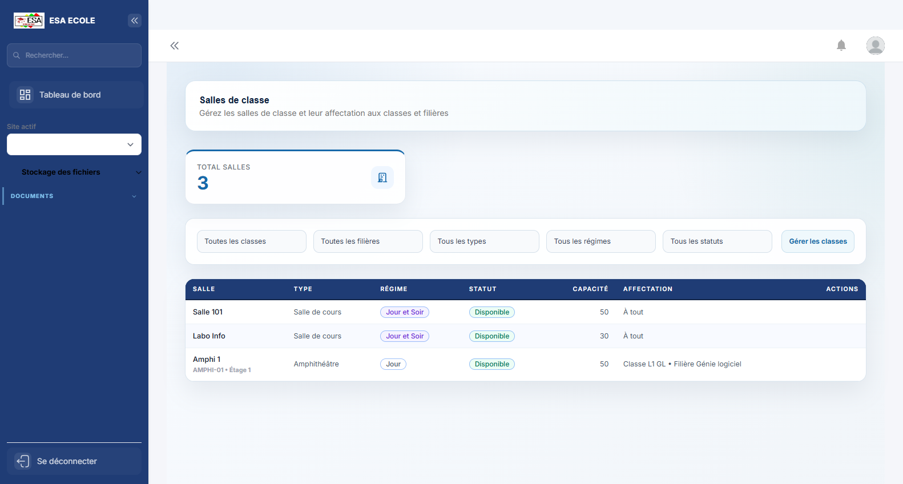

**Objectif :** Référentiel des salles et de leurs capacités, utilisé pour les emplois du temps et les examens.

**Actions principales :**

1. Créer une salle
2. Renseigner la capacité
3. Affecter aux cours ou examens

---

## 2. Emplois du temps

**Objectif :** Planning des cours par classe, enseignant et salle. Les profils Institution, Administrateur et Superviseur général peuvent gérer et publier le planning dans leur périmètre autorisé ; les autres profils le consultent.

**Actions principales :**

1. Vérifier le site actif autorisé
2. Consulter ou gérer les séances selon le rôle
3. Vérifier les conflits puis publier le planning si le rôle le permet

---

## 3. Calendrier

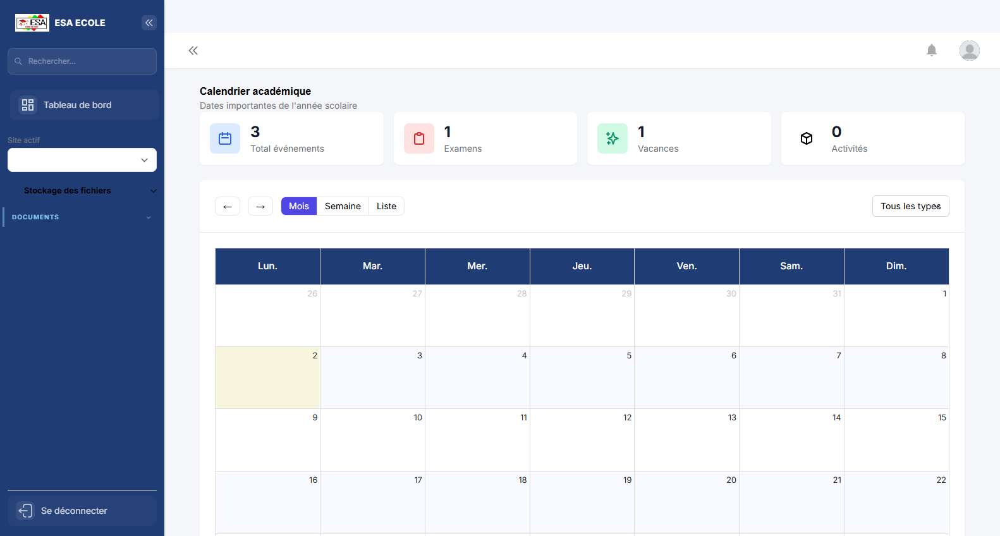

**Objectif :** Calendrier académique : sessions, examens, périodes de saisie et événements de l’établissement.

**Actions principales :**

1. Choisir la période
2. Consulter un événement
3. S’abonner ou exporter le calendrier

---

## 4. Sessions d'examens

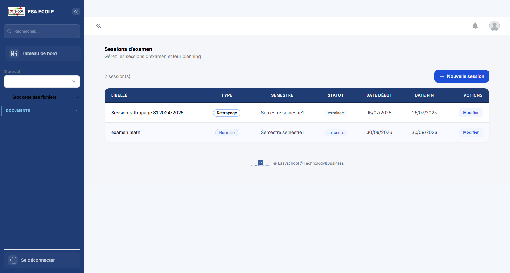

**Objectif :** Programmation des examens : dates, salles, surveillants et épreuves.

**Actions principales :**

1. Créer une session
2. Affecter salles et surveillants
3. Publier le planning

---

## 5. Rattrapages

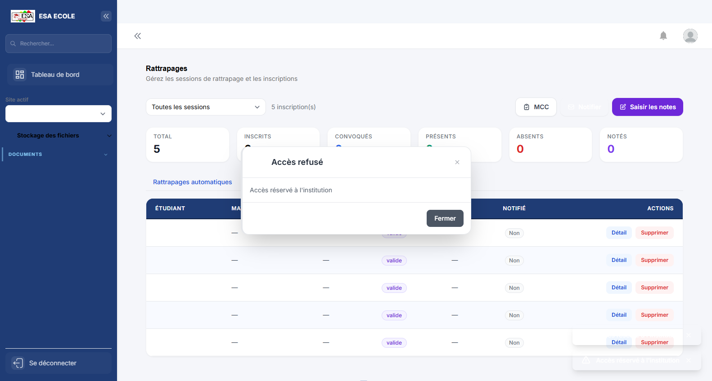

**Objectif :** Sessions de rattrapage : inscription, épreuves et résultats.

**Actions principales :**

1. Créer une session
2. Inscrire les étudiants
3. Saisir les résultats

---

## 6. Tableau de bord du superviseur

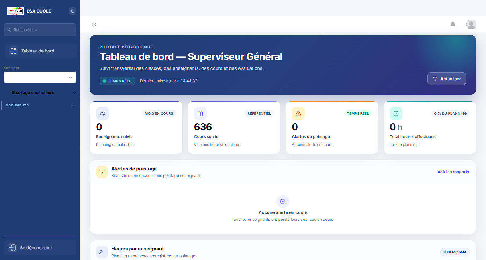

**Objectif :** Vue transversale du superviseur général : avancement des cours, saisie des notes, absences et alertes pédagogiques.

**Actions principales :**

1. Contrôler les indicateurs
2. Repérer les retards de saisie
3. Ouvrir l’écran concerné

---

## 7. Cahiers de texte

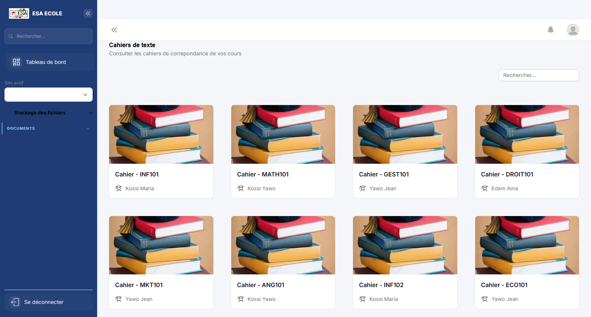

**Objectif :** Contenu des séances : objectifs, activités, devoirs et ressources.

**Actions principales :**

1. Rechercher un cours existant
2. Ouvrir ou créer son cahier
3. Ajouter les blocs des séances réellement dispensées

---

## 8. Cahier de présence

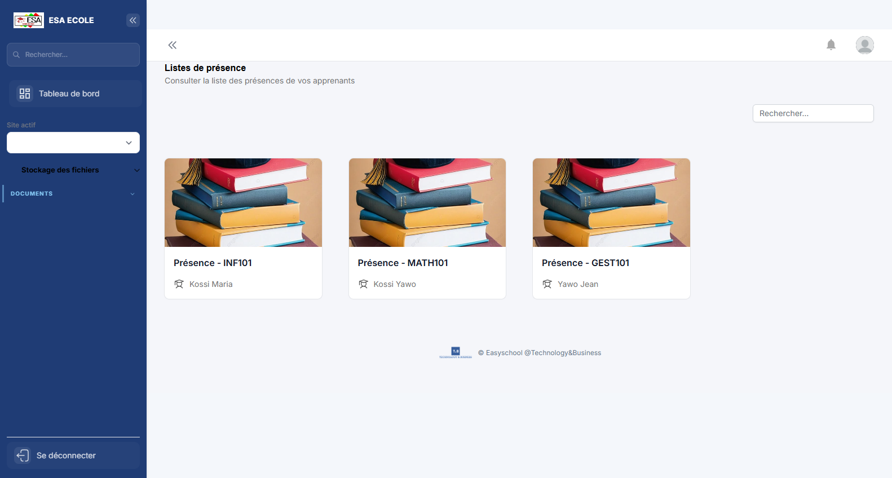

**Objectif :** Listes et feuilles de présence par séance. Les actions disponibles dépendent du rôle : l’enseignant renseigne les états lors de la création d’une séance, tandis que le Surveillant peut modifier l’état d’une feuille existante dans son périmètre autorisé.

**Actions principales :**

1. Ouvrir une liste autorisée
2. Vérifier la séance et les participants
3. Saisir les états selon les droits du rôle et contrôler le résultat

---

## 9. Notes

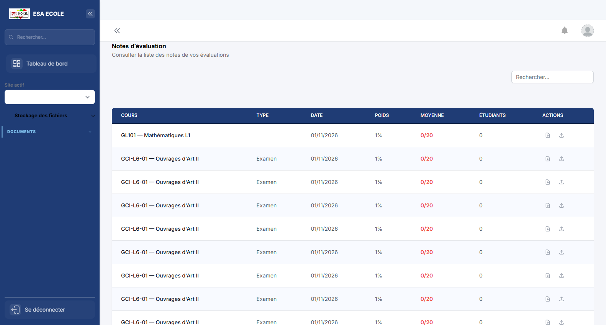

**Objectif :** Saisie et consultation des notes par classe, UE et type d’évaluation.

**Actions principales :**

1. Choisir la classe et l’UE
2. Saisir les notes
3. Vérifier puis publier

---

## 10. Bulletins

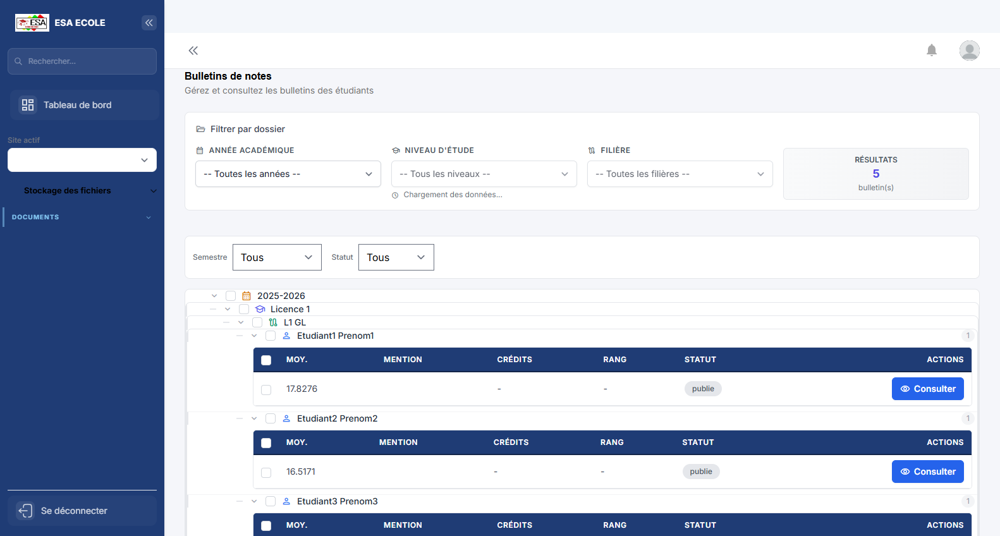

**Objectif :** Bulletins générés à partir des notes : moyennes, crédits, mentions et décisions.

**Actions principales :**

1. Choisir l’année et la classe
2. Générer les bulletins
3. Contrôler et publier

---

## 11. Moyennes

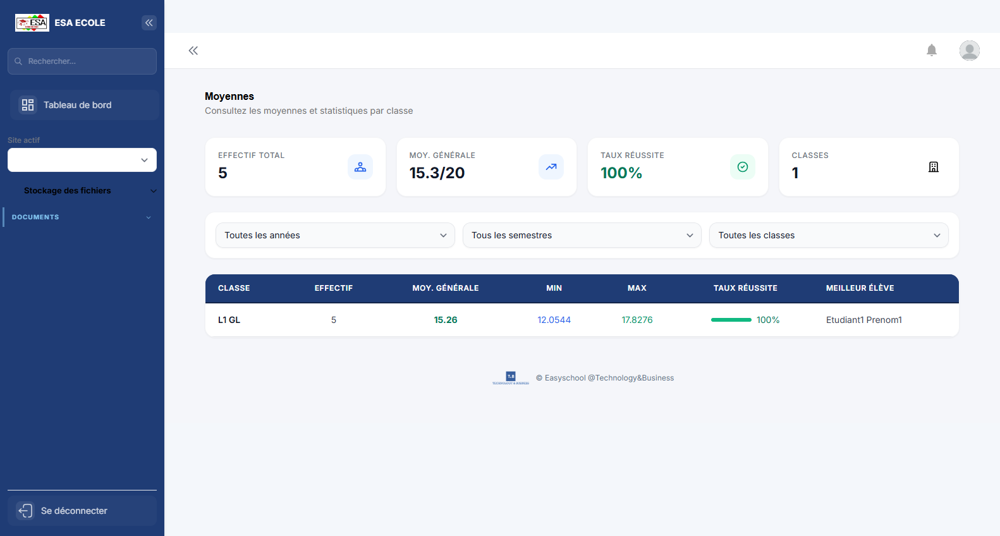

**Objectif :** Calcul et contrôle des moyennes par étudiant, UE et semestre.

**Actions principales :**

1. Sélectionner le périmètre
2. Lancer le calcul
3. Contrôler les anomalies

---

## 12. Délibérations & jury

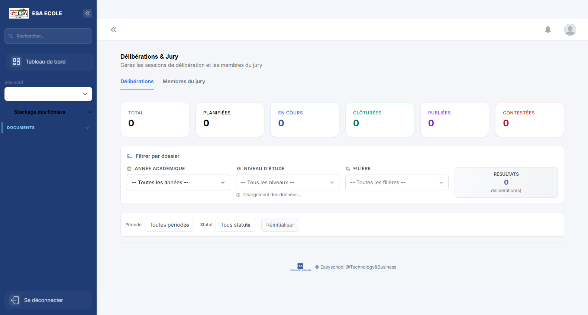

**Objectif :** Séances de jury : décisions d’admission, de passage ou de redoublement.

**Actions principales :**

1. Préparer la séance
2. Examiner les cas
3. Consigner les décisions

---

## 13. Conseils de classe

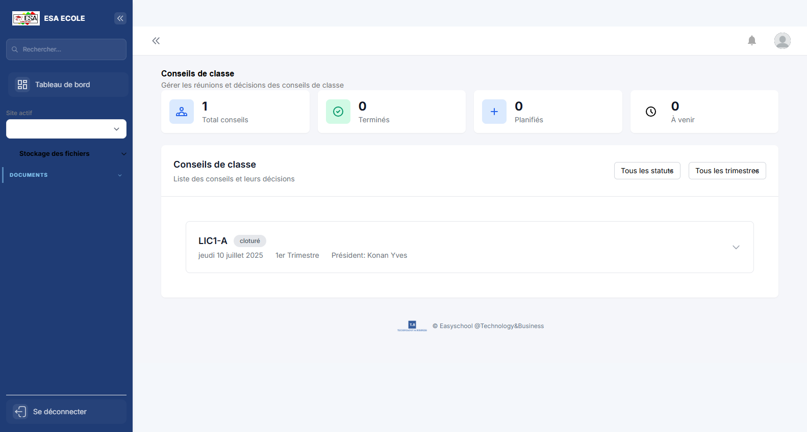

**Objectif :** Préparation et tenue des conseils de classe : synthèse par étudiant et avis.

**Actions principales :**

1. Choisir la classe
2. Consulter les synthèses
3. Saisir les avis

---

## 14. Unités d'enseignement

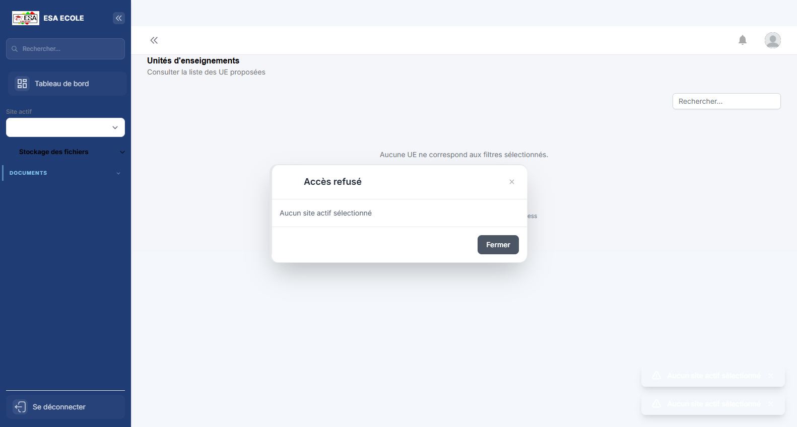

**Objectif :** UE et ECUE : crédits, volumes horaires, semestres et prérequis.

**Actions principales :**

1. Créer une UE
2. Ajouter les ECUE
3. Définir crédits et prérequis

---

## 15. Historique

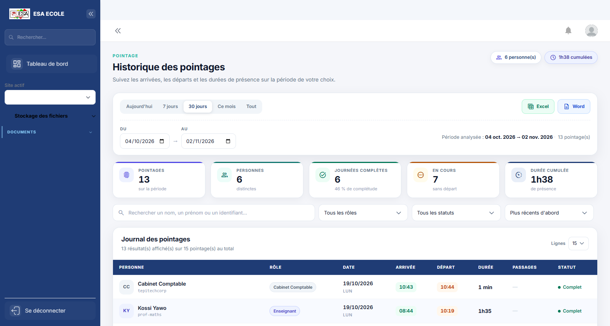

**Objectif :** Journal chronologique des opérations réalisées sur le périmètre : date, acteur, action et résultat.

**Actions principales :**

1. Filtrer par période ou acteur
2. Consulter le détail d’une opération
3. Exporter si besoin

---

## 16. Shifts

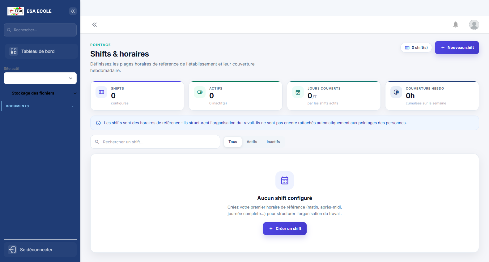

**Objectif :** Plages horaires de travail utilisées pour le pointage et les plannings.

**Actions principales :**

1. Créer un shift
2. Définir les horaires
3. Activer

---

## 17. Absences

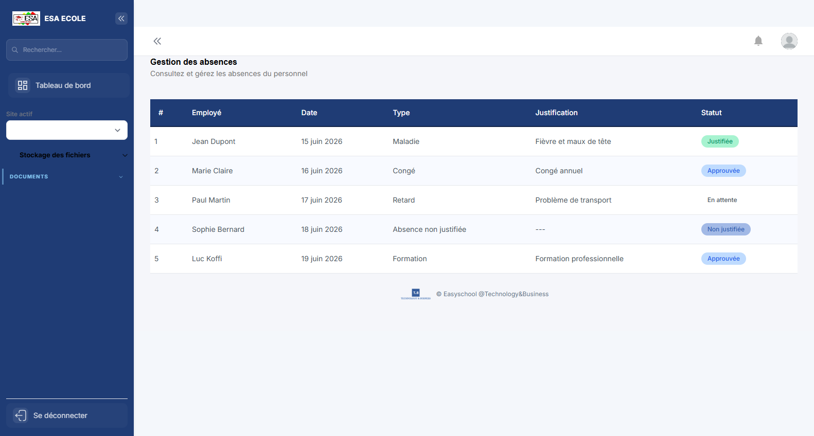

**Objectif :** Suivi des absences et justificatifs, avec alertes et statistiques.

**Actions principales :**

1. Filtrer les absences
2. Vérifier un justificatif
3. Valider ou sanctionner

---

## 18. Rapports

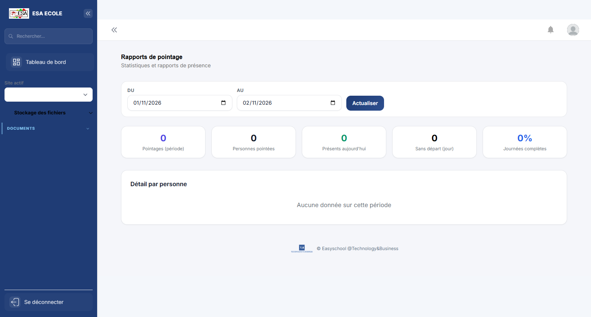

**Objectif :** Rapports et exports disponibles pour le profil, avec filtres de période et de périmètre.

**Actions principales :**

1. Choisir un rapport
2. Renseigner les filtres
3. Générer puis télécharger

---

## 19. Tableau de bord de pilotage

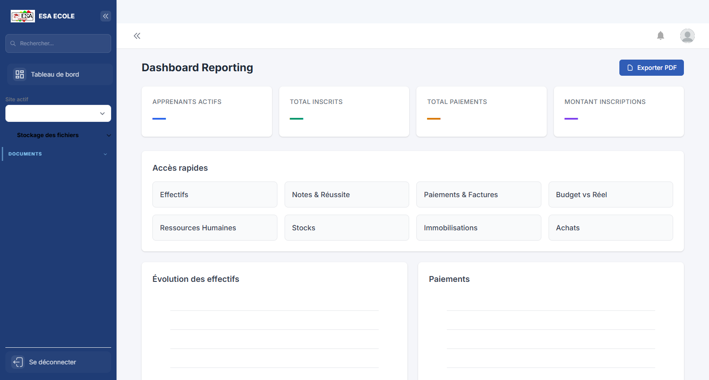

**Objectif :** Synthèse consolidée destinée au pilotage : effectifs, résultats, finances et alertes majeures.

**Actions principales :**

1. Sélectionner l’année ou la période
2. Comparer les indicateurs
3. Exporter ou ouvrir le détail

---

## 20. Effectifs

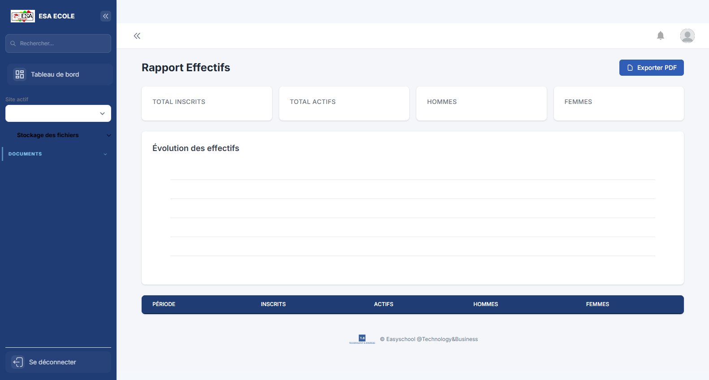

**Objectif :** Effectifs par niveau, parcours ou classe, avec répartition et évolution.

**Actions principales :**

1. Filtrer par année et niveau
2. Comparer les effectifs
3. Exporter la liste

---

## 21. Notes — vue 2

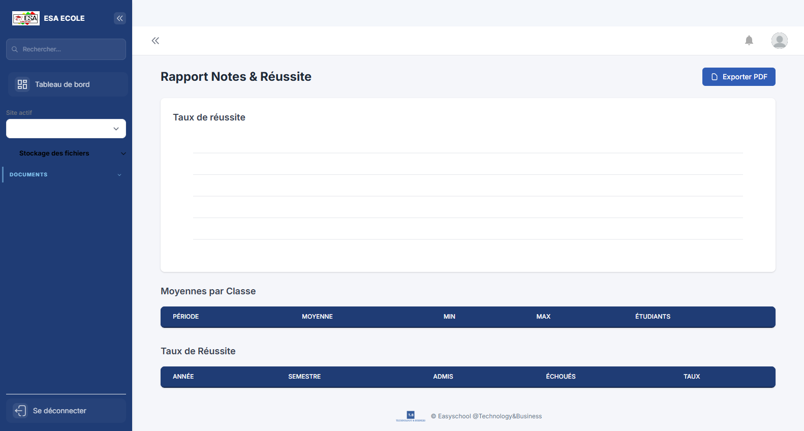

**Objectif :** Saisie et consultation des notes par classe, UE et type d’évaluation.

**Actions principales :**

1. Choisir la classe et l’UE
2. Saisir les notes
3. Vérifier puis publier

---

## 22. Mon profil

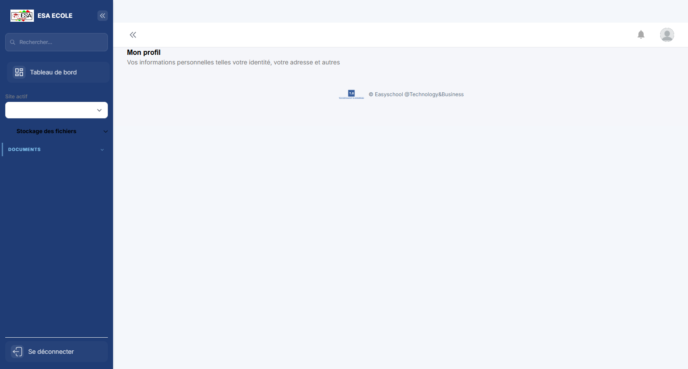

**Objectif :** Informations personnelles et professionnelles du compte connecté : identité, contacts et rattachements.

**Actions principales :**

1. Vérifier ses informations
2. Mettre à jour les champs modifiables
3. Enregistrer

---

## 23. Mon compte

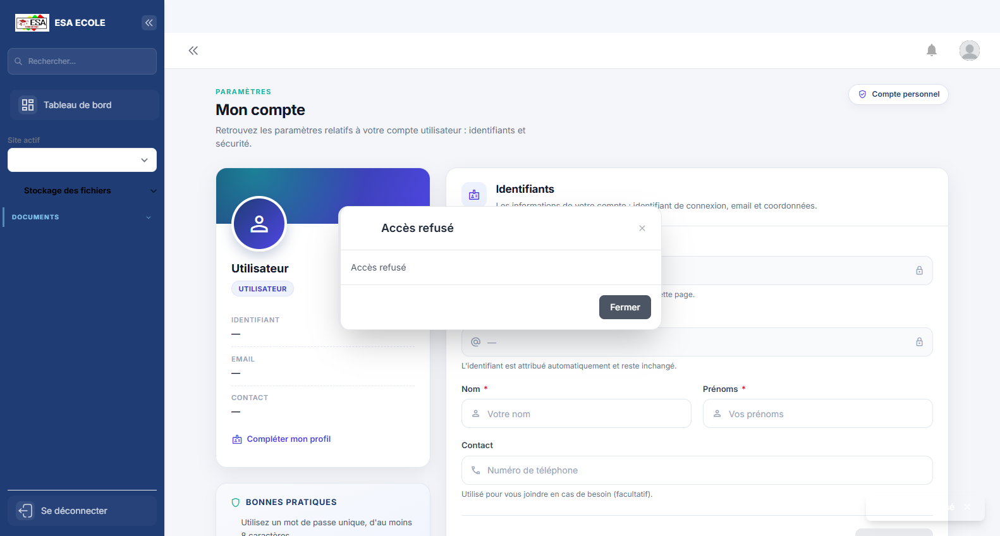

**Objectif :** Paramètres de sécurité du compte : mot de passe, double authentification et sessions.

**Actions principales :**

1. Changer le mot de passe
2. Activer ou vérifier le 2FA
3. Contrôler les sessions ouvertes

---

## 24. Emploi du temps — exemple fictif

**Objectif :** Simulation visuelle d’un planning avec des cours, dates, enseignants et salles fictifs. Elle ne modifie ni n’enregistre aucune séance.

**Actions principales :**

1. Vérifier le site actif autorisé
2. Contrôler les cours, horaires, enseignants et salles
3. Ne publier qu’après vérification du planning réel

---

## 25. Nouvelle séance — formulaire fictif

**Objectif :** Simulation du formulaire de planification avec des cours, une salle, un enseignant et des dates fictifs. Aucun enregistrement n’est effectué.

**Actions principales :**

1. Choisir un cours existant
2. Compléter les dates et horaires
3. Contrôler le site et les conflits avant d’enregistrer

---

## 26. Publication du planning — exemple fictif

**Objectif :** Simulation du message de confirmation et des nombres de destinataires. Aucune notification n’est envoyée.

**Actions principales :**

1. Vérifier le planning réel
2. Publier depuis le site actif autorisé
3. Contrôler la confirmation et les destinataires

---

*Guide généré par `scripts/guide/generer-guides.cjs`. Les captures valides les plus récentes sont utilisées, avec repli sur les captures historiques.*
