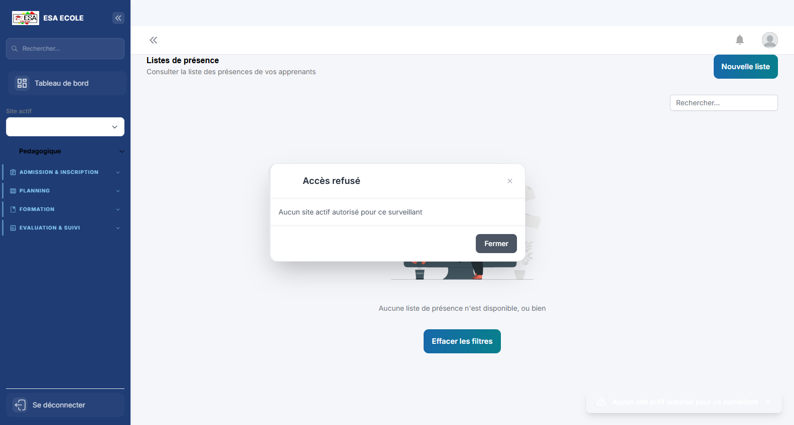
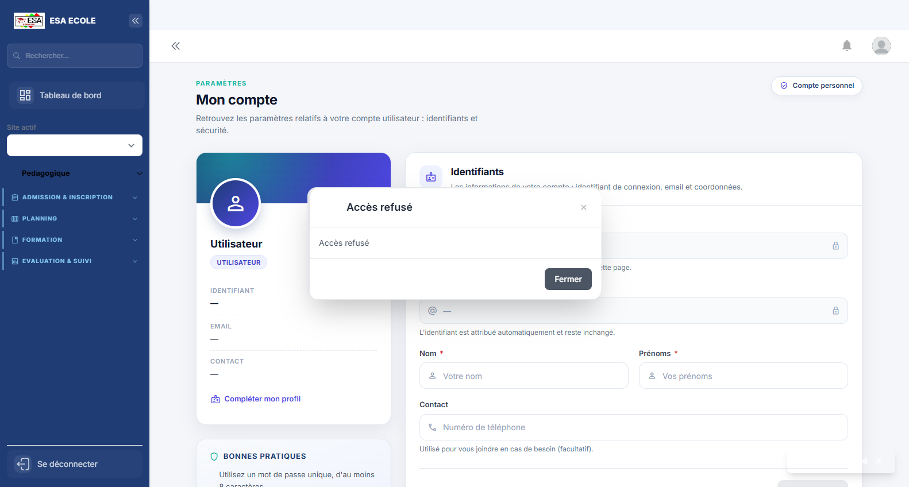

# Guide d'utilisation — Surveillant

> Consultation des emplois du temps et suivi des présences et absences, dans la limite des sites autorisés au compte. Le guide ne contourne pas l'accès refusé lorsqu'aucun site n'est affecté.

**Profil :** Surveillant  
**Nombre d'écrans :** 6
**Généré le :** 08/11/2026

Ce guide présente les écrans du profil dans l'ordre d'utilisation conseillé. Chaque section contient une capture, l'objectif de l'écran et les actions principales.

## Sommaire

### Procédures pas à pas
- [Présences — accès limité au site autorisé](#presences-acces-limite-au-site-autorise)

1. [Emplois du temps](#1-emplois-du-temps)
2. [Mon tableau de bord](#2-mon-tableau-de-bord)
3. [Cahier de présence](#3-cahier-de-presence)
4. [Absences](#4-absences)
5. [Mon profil](#5-mon-profil)
6. [Mon compte](#6-mon-compte)

## Procédures pas à pas

### Présences — accès limité au site autorisé

La capture de démonstration affiche « Aucun site actif autorisé pour ce surveillant ». Elle illustre un refus d’accès réel du compte de démonstration, et non une feuille de présence opérationnelle. Ne pas contourner cette restriction pour obtenir une capture.

#### Avant de traiter une présence

1. **Vérifier que le site actif est affecté au compte. En cas de refus, demander l’affectation ou la correction des habilitations à l’Administrateur.**
   - Pourquoi : Les listes et présences sont limitées au périmètre autorisé.
   - Responsable : Surveillant / Administrateur
2. **Après autorisation, ouvrir la liste de présence de la séance concernée et vérifier le cours, la date et les participants.**
   - Pourquoi : Le contrôle du contexte évite de modifier la feuille d’une autre classe ou séance.
   - Responsable : Surveillant

#### Corriger un état sur une feuille existante

1. **Choisir le statut exact dans le sélecteur de la cellule de présence, puis relire l’état affiché.**
   - Pourquoi : Dans l’interface Surveillant, le changement de sélection enregistre immédiatement l’état ; aucun bouton Enregistrer distinct n’est affiché.
   - Responsable : Surveillant
2. **Pour une séance ou une liste absente, ne pas inventer le cours ni changer de site ; demander l’intervention du service habilité.**
   - Pourquoi : Le rôle et le périmètre de site déterminent les listes disponibles.
   - Responsable : Surveillant / Administration

## 1. Emplois du temps

**Objectif :** Planning des cours par classe, enseignant et salle. Les profils Institution, Administrateur et Superviseur général peuvent gérer et publier le planning dans leur périmètre autorisé ; les autres profils le consultent.

**Actions principales :**

1. Vérifier le site actif autorisé
2. Consulter ou gérer les séances selon le rôle
3. Vérifier les conflits puis publier le planning si le rôle le permet

---

## 2. Mon tableau de bord

**Objectif :** Page d'accueil du profil : indicateurs personnels, alertes et raccourcis vers les tâches les plus fréquentes.

**Actions principales :**

1. Lire les indicateurs et alertes
2. Ouvrir un raccourci
3. Traiter les éléments en attente

---

## 3. Cahier de présence

**Objectif :** Listes et feuilles de présence par séance. Les actions disponibles dépendent du rôle : l’enseignant renseigne les états lors de la création d’une séance, tandis que le Surveillant peut modifier l’état d’une feuille existante dans son périmètre autorisé.

**Actions principales :**

1. Ouvrir une liste autorisée
2. Vérifier la séance et les participants
3. Saisir les états selon les droits du rôle et contrôler le résultat

---

## 4. Absences

**Objectif :** Suivi des absences et justificatifs, avec alertes et statistiques.

**Actions principales :**

1. Filtrer les absences
2. Vérifier un justificatif
3. Valider ou sanctionner

---

## 5. Mon profil

**Objectif :** Informations personnelles et professionnelles du compte connecté : identité, contacts et rattachements.

**Actions principales :**

1. Vérifier ses informations
2. Mettre à jour les champs modifiables
3. Enregistrer

---

## 6. Mon compte

**Objectif :** Paramètres de sécurité du compte : mot de passe, double authentification et sessions.

**Actions principales :**

1. Changer le mot de passe
2. Activer ou vérifier le 2FA
3. Contrôler les sessions ouvertes

---

*Guide généré par `scripts/guide/generer-guides.cjs`. Les captures valides les plus récentes sont utilisées, avec repli sur les captures historiques.*
